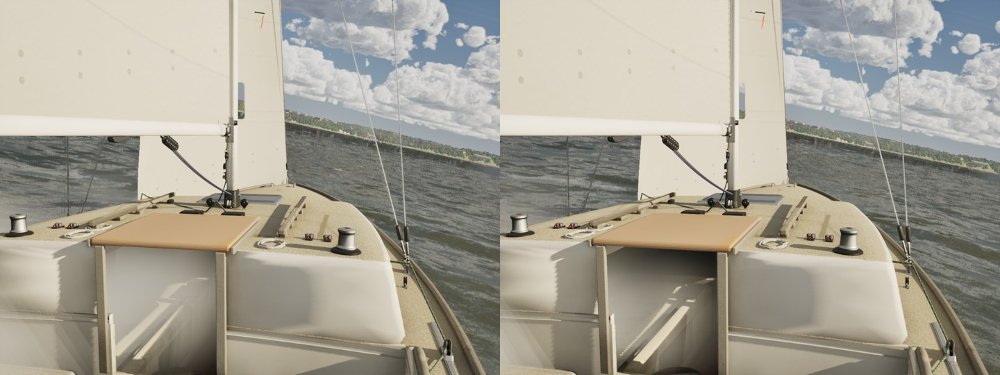

# The lake's wave periods at short fetch (Oct 27 2026)

`docs/mac-next/` candidate 3. In `docs/physics-gaps/`, the lake's periods ran short against SWAN: 28 kn 11% under, and the 14
kn Rush Creek lee shore 28% under (1.34 s against 1.86).

## Where the error is now

The lake-wide medians (`scripts/wave-check.sh`) had come within 5% of SWAN since then:
- at 28 kn, -4.9%;
- at 5 kn, +8%, the light-air end.

SWAN's own periods at its ten points (`--map`, 1050 cases) show what is left. The error depends on fetch: the shorter
the point's effective fetch, the longer SWAN's period is against the law, at 8 kn and up. These are the medians of SWAN /
law by wind and effective fetch, before → after this change:

| Wind | 200–400 m | 400–1000 m | 1000–2500 m | 2500–6000 m |
|---|---|---|---|---|
| 5 kn | 1.00 → 1.00 | 1.03 → 1.03 | 0.98 → 0.98 | 0.96 → 0.96 |
| 8 kn | 1.25 → 1.04 | 1.08 → 0.99 | 1.02 → 0.99 | 1.03 → 1.02 |
| 11 kn | 1.21 → 0.95 | 1.10 → 0.98 | 1.02 → 0.98 | 1.01 → 0.99 |
| 14 kn | 1.32 → 1.00 | 1.09 → 0.97 | 1.05 → 1.01 | 1.04 → 1.02 |
| 18 kn | 1.31 → 1.01 | 1.15 → 1.06 | 1.06 → 1.01 | 1.07 → 1.04 |
| 22 kn | 1.25 → 0.92 | 1.28 → 1.09 | 1.09 → 1.04 | 1.02 → 0.99 |
| 28 kn | 1.29 → 0.96 | 1.31 → 1.17 | 1.11 → 1.06 | 1.03 → 1.00 |

At 5 kn there is no bias, and the fit leaves it alone.

There are two likely causes. A young sea on a short fetch is driven harder than the SPM law, which was fitted to older
seas, allows. And part of the period at a lee point is the open lake's sea reaching round into it, which no local law
can reproduce. The 90th percentiles (1.4–1.9× SWAN / law) are lee directions of the second kind, and they remain.

## The change

`FWaveField::TargetPeakPeriod` is multiplied by `ShortFetchPeriodFactor`:

`1 + (80 m / F) (U / 14 kn)^0.125`, blended in from 5 to 10 kn, with F floored at 200 m (the bake's floor).

- **The fit:** to the binned medians, as #41 fitted the height. The rms binned bias in log period falls from 0.128 to
  0.041.
- **Why this form:** `(50 m / F)^0.75` fitted a little better (0.037), but it also lengthened the open lake's 8 km sea by
  2%. That took `SailingSim.Visual.Whitecaps`' 10 kn cover just under a third of Monahan's (its grid sits at 8 km). With
  the fetch's own power the long fetches keep the law's periods (8 km: 1.01).
- **What follows it:** the sea map's band tables (`BandAmplitudeFactor`), the game's sea and the renderer's components.
- **The calibration sea** keeps `GrowthLawPeriod` directly, so PolarGate and every polar are byte-identical.

The other statistics, before → after:
- SWAN's points, median |log error| of the map's period: 0.12 → 0.11.
- Rush Creek in a 14 kn northerly: 1.34 s from the SPM law alone (physics-gaps) against SWAN's 1.86. The map now gives
  1.40; the point is a lee one, and most of its 1.86 s comes from across the lake.
- The lake-wide medians, which derive SWAN's period from the bake's median ratio times the old law, read longer now:
  0.0% at 28 kn, +6.9% at 11 kn (before: -4.9% and +2.3%). Both statistics are kept here. The points are SWAN's own
  periods, so the fit follows them.

## The caps

Longer periods change how deep the drawn fold runs against its CPU solve, so the caps were re-measured on W8's crest masks
(`docs/water-8/capshape-mac/`). That is the lake, open water, crests only, no AA, four headings, counted by
`count_caps.py`. The target is 0.4 × Monahan.

| Wind | Target | Main | The first fit (p 0.75) | That fit with a refitted scale | This fit, main's `DrawnFoldScaleAt` |
|---|---|---|---|---|---|
| 12 kn | 0.076% | 0.138% | 0.071% | (unchanged) | (scale 0.94, as main) |
| 16 kn | 0.20% | 0.206% | 0.196% | 0.197% | **0.170%** (0.85×) |
| 19 kn (the "20 kn" set) | 0.44% | 0.507% | 0.621%, 0.603% | 0.470% | **0.449%** (1.02×) |

The first fit lengthened the open lake's periods enough that the 20 kn caps needed a higher scale; a larger scale folds
less, and at 0.8725 the cover rose to 0.731%. This fit leaves the open lake's periods within about 1% of main, so main's
scale lands the caps as well as it did on main (W8 pooled 1.07–1.16×), and `DrawnFoldScaleAt` is unchanged.

Gate tests on this fit:
- `SailingSim.Visual.Whitecaps` (the grid against Monahan): 10 kn 0.05% against 0.10%, 20 kn 0.81% against 1.09%.
- `WhitecapOnset`, `WhitecapSize` and `WhitecapsSeen` pass.

## The sea numbers, main → this branch

| | Main | This branch | Band |
|---|---|---|---|
| ORC band: maxi upwind loss in the gale | 6.6% | 8.0% | 1–10% |
| GaleTack: median, 90th percentile, keeping 40% | 10.5 s, 21.8 s, 20 of 24 | 10.9 s, 18.0 s, 20 of 24 | under 15 s, under 30 s, 18 or more |
| SurfingFlow: J/22 steep faces (standalone) | 10.35 kn | 10.15 kn | 1.5–2x hull speed |
| SurfingFlow: maxi at TWA 120 (standalone) | 23.92 kn | 22.88 kn | over 20 kn |
| Surfing: maxi running in the gale | 18.29 kn | 19.63 kn | faster than flat (17.94) |
| Reference checks: Ray Hubbard peak period, 15 kn over 8 mi | 3.02 s | 3.04 s | 1.80–3.10 s |

The gale trials carry a 200 m chop under the Mistral's sea, and in 32 kn the factor makes its period 40% longer. That is
where the maxi's numbers move.

These are byte-identical to main:
- `polar.sh --quick`;
- `--easy` (the Easy mode runs);
- `--sea checks` (adrift creep 0.24 kn, the ORC sea);
- `--scenarios`;
- `traffic.sh 98`.

The Seawall and squall numbers and the lake drills come from the gate's tests.

## Stills

Helm eye at 14 kn on the lake, TWA 50, the same seed and conditions. Main is left, this branch right. In open water the
factor is about 1.03–1.04, so the difference here is small. The change is near the shores.

