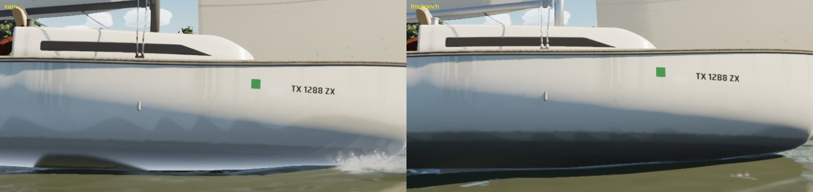
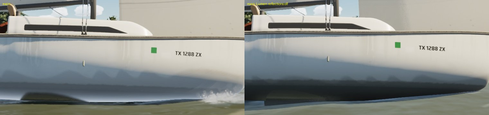
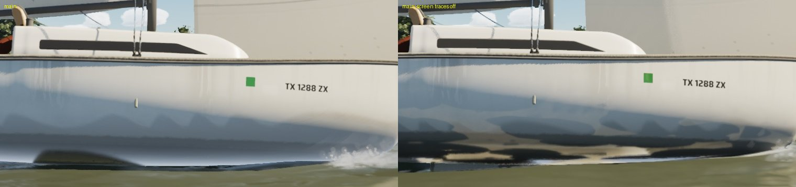
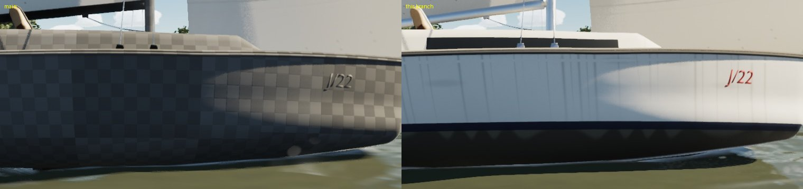

# The dark patch on the lee topsides (Oct 21 2026)

Heeled at 17 kn (42 deg TWA), the hero J/22 showed a dark, water-coloured half-dome about 1 m long on her lee topsides,
near mid-length, just above the waterline. It was on main too. Stills: Mac High, `scripts/run-game.sh`, the lee view
`-SailingBoat=J22 -SailingWind=17 -SailingTWA=42 -SailingHoldTWA=42 -SailingCamTarget=0,0,0.2 -SailingCamDist=5
-SailingCamYaw=-95 -SailingCamPitch=-6`, crop of the waterline.

## Bisect

| Run | Dome |
|---|---|
| `-SailingNoHullClip`, `-SailingClassicHullClip` | still there: not the hull clip |
| A wake-grid change (the pressure patch's static sink spilled a cell past the hull) | still there: not the wake |
| `-SailingNoBoatDF`, `-SailingNoBoatDetail`, software Lumen (`-SailingLumenHW=0`) | still there |
| Calm and upright | gone: it needs heel and speed |
| `-SailingClassicWater` | gone, but that water is a different material entirely |
| `r.Lumen.Reflections.Allow 0` | **gone: a reflection** |
| `r.Lumen.Reflections.ScreenTraces 0` | **the dome gone** (blotchy cache reflections instead) |

The hero's hull is 10 to 17 cm wider than the physics hull at the waterline amidships (measured from its mesh), so there
is no gap between model and clip. The dome was a reflection.

## Cause and fix

Heeled, the lee topsides face down toward the sea, and the glossy gelcoat reflects it. Lumen's reflection screen traces
run before the sea (Single Layer Water) is drawn. A reflected ray going down from the topsides therefore found what is
under the water: the hull's own bottom and the keel, dark and murky. That was the dome, shaped like the keel's root.

Where the reflection points below the horizon, the gelcoat is now rough enough (0.45) that Lumen uses its radiance cache
(the sea's soft sky light) instead of a screen trace, and the clear-coat lobe fades. This is in M_J22HeroSurface
(`import_j22_hero.py` DETAIL_CODE) and in the shared M_BoatSurface (`make_materials.py` BOAT_CODE). The lee topsides
now read as an even, darker grey toward the water, the light under a heeled bilge.

## Found on the way: M_BoatSurface had stopped compiling on High

`-SailingClassicJ22` drew a checkerboard hull. Since #195, M_BoatSurface and M_BoatMast failed to compile for the Mac's
ray-tracing hit shaders ("MetalShaderConverter ... Unhandled FP64 usage"). The engine then used its default material
for everything on those materials on High: the AI boats, the ghost, the marina's berthed boats and every flat part.

The cause is two conditionals between bare literals in the detail branch (`surf == 4 ? 0.5 : ... : 1.0`). DXC types
such a conditional as a double. Typed as `0.5f`, they compile. Bisected by compiling the library at c08a2b72 (clean),
2dd9d05d (#195: broken), d4d75884 and main, then halving the detail branch.

`SailingSim.Visual.BoatShaderLiterals` keeps bare-literal conditionals out of BOAT_CODE (main's fails it).

## Gate

`scripts/gate.sh --scope boats` and `--scope water` (merged with main) both pass: 202 tests and the package
([gate-boats.csv](gate-boats.csv), [gate-water.csv](gate-water.csv)). On High:

- **Boats:** beam8 61.8, beat15 61.3, marina 61.1, helm-eye 60.5, slip 54.0, crew 54.2 fps.
- **Water:** storm 45.4 (66.0 on Medium), the rest 53.8 to 64.7.

The slip view (the marina from the slip, its berthed boats close up) went from 57.5 to 54.0 fps. Those boats now draw
their real M_BoatSurface instead of the engine's cheap default material. That is the material's own cost, which #195's
gate never measured on the Mac's High tier.
