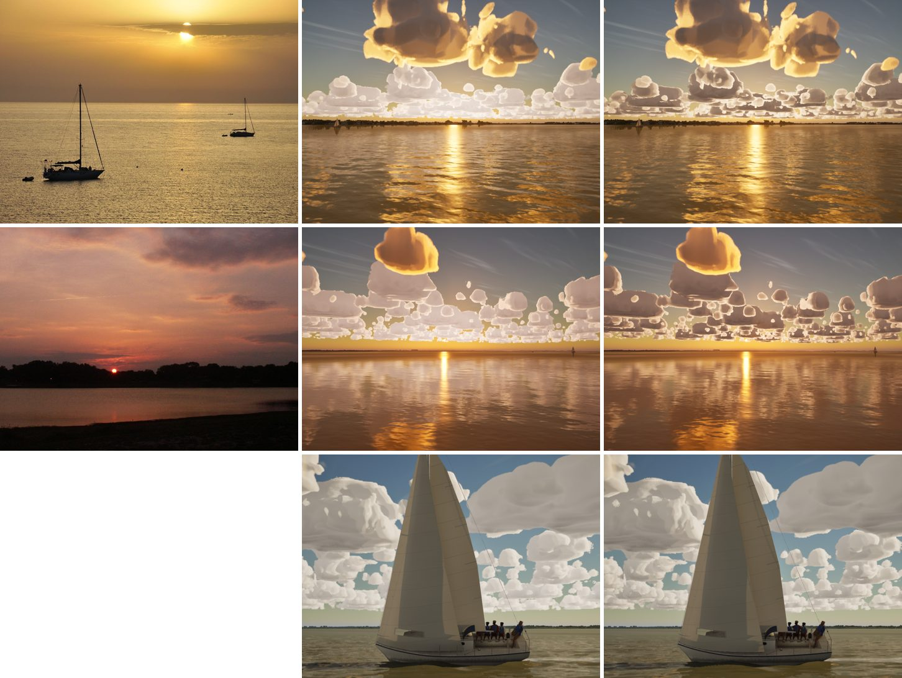

# Low sun: far clouds dark against the glow (realism audit item 2)

The realism audit (`docs/realism-audit-1022/`) found that at dusk the far clouds stayed white-grey, as at noon. In the
photos, clouds toward a setting sun go dark against the glow.

## Cause

The far clouds come from the sky cache (C2). `M_SkyDome` lights them with two terms: the sun's, and the sky's, whose
brightness is the sky's radiance toward the view (`ViewLum`). With the sun low, the sky toward the view is the horizon's
glow, far brighter than the sky a cloud sees overhead, so every far cloud toward a sunset was lit as if by the glow.

## Fix

Below 25° of sun the sky term's brightness is capped at 0.8 of the sky light overhead (`SkyEnv`, already used for its
colour), fully so by 3° (`LOW_SUN_AMB_CAP`, `make_materials.py`). Above 25° nothing changes. At 1.5 the clouds were
still pale against the glow.

The near, live clouds are unchanged: their sunlit sides stay gold. Views facing away from the sun hardly change.

## Stills

The real photo left (G5 pack), main d51ed6e6 middle, this branch right. From the top:
- Galveston at dusk;
- the lake at sunset;
- the Catalina 30's evening (from the phase-8 scenes, no matched photo).

Left: the upper sky stays a cooler grey-blue than in the photos, which also have a warm white balance.

## Gate

- **`--scope clouds`:** pass, 229/229 tests. beam8 60.7, beat15 60.9, storm High 52.7, gulf-sea 63.0, helm-eye 61.4, bridge 64.6, storm
  Medium 71.1.
- **`--scope night`:** pass. coast-night 66.7, helm-eye 60.9, marina-night 60.7. The cap also applies after sunset; the night's far clouds
  still glow over the towns.
