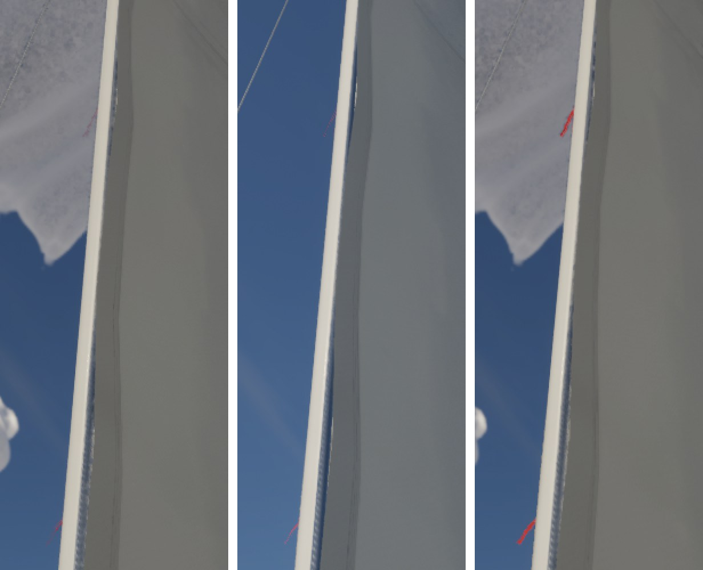

# The dark-red specks at the mast's edge

`docs/ultra-cloud-fullres/` noted a few dark-red specks along the mast's edge against the clouds on Ultra (half-resolution
clouds). It put them down to the cloud upsampler's depth test. They are not the clouds.

## What they are

They are the mainsail's red leech telltales (`UpdateTelltaleRibbons`, `SailVisuals.cpp`): ribbons 22 cm long and 1.2 cm
wide, flat in the plane of the sail's surface. From the cockpit or under the boom you see the leech almost edge-on, 6 to
8 m away. There a 1.2 cm ribbon edge-on is a fraction of a pixel, so it breaks into a dotted line of dark-red specks. They
show on the mast's edge because from below the leech lines up with the mast.

Turning the clouds off (`r.VolumetricCloud 0`) leaves the specks as they were (middle of the sheet), against blue sky as
well as cloud. They went at full-resolution clouds only because that mode draws the clouds over thin geometry (the
"dark blocks" in that report).

On the way: on Ultra (`r.VolumetricRenderTarget.Mode` 1) the engine composites with upsampling mode 2 (one bilinear
sample and a depth test) whatever `UpsamplingMode` says, because 3 maps to 2 in `GetCompositionUpsamplingMode`. Mode 4
(bilateral) composites the mast the same, so nothing changes there.

## What changed

Each telltale is turned to face the camera about its own length and is drawn at least 1.2 px across at its distance, like
the rig lines (`docs/rig-lines`). Up close nothing changes: within about 4 m a 1.2 cm ribbon is wider than that. The
ribbons were already rebuilt every frame, so this costs nothing measurable.

Left to right: main (half-resolution clouds), main with the clouds turned off, this branch. Ultra, 1920x1080, 2x.

I checked the jib's telltales close up (1.4 m) and helm eye against main; they look the same.
