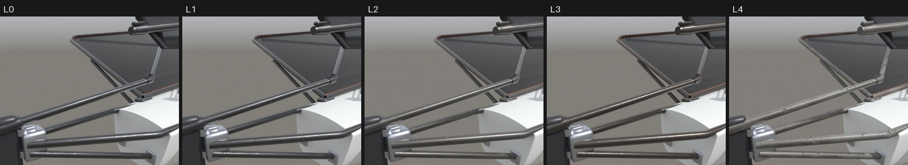
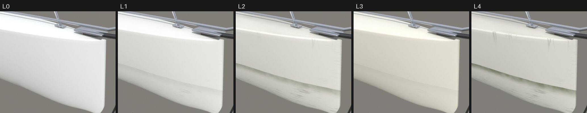
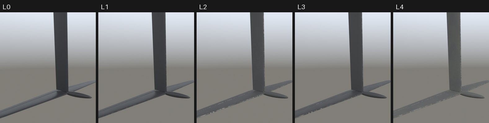
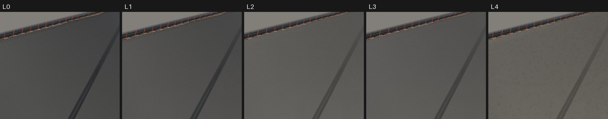
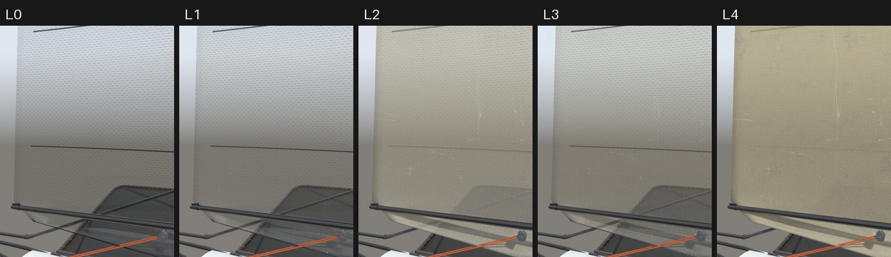
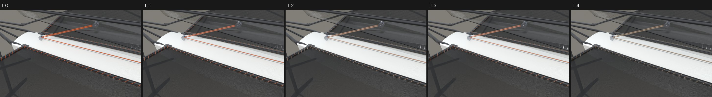
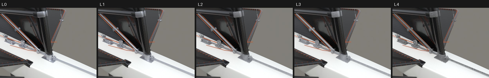
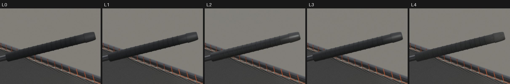

# Hydrofoil moth, slice 6: textures and wear


Until now every one of her materials was a flat viewport colour, and every render was grey clay. This slice gives each
material a real look and the texture loop's five wear levels ([docs/texture-loop](../texture-loop/README.md)), the way
the J-Class's slice 11 did ([docs/jclass-11](../jclass-11/README.md)). It is post-slice art like slices 0 to 5: tools
and docs only, nothing imported into Unreal yet (slice 9, on the PC after Dec 11).

## Her levels

The loop's levels (`Tools/texloop/levels.json`) as they read on her. She lives on the lake (fresh water) and ashore on
her trolley between sails, so there is no weed or barnacles; a kept boat renews her sail, lines, mesh and grip every few
seasons, so at L3 those are on average half their life old.

| Level | Age, care | On the moth |
| --- | --- | --- |
| L0 | new | deep glossy clear coat over the twill, white hull paint, satin grey foils, black wing mesh, a crystal-clear film sail, bright braid, satin silver anodising, a black grip |
| L1 | 0.3 years, 0.9 | hairline scratches where hands, the boom and the wand touch; trolley scuffs on the bottom; dust in the mesh; the first creases in the film; the braid a touch fuzzy |
| L2 | 6 years, 0.5 | the clear coat dull, hazed and amber on the sun side; scuffs, tape residue and black streaks on the hull; white filler on the foils' dings; charcoal, dusty mesh; milky, crinkled film; grey fuzzy lines; scratched anodising; a shiny grip |
| L3 | 30 years, 0.9 | an early foiler kept: polished and refinished, but the clear coat amber and the white paint cream; old filler repairs showing through the foils' paint; a sail and lines a season or two old |
| L4 | 20 years, 0.1 | the clear coat chalked milky grey and flaking; chalky paint with black streaks and a scum line; the foils chipped to filler and primer; brown, mildewed mesh; yellow-brown film with mildew; grey-green lines; white powder and grime on the alloy; a chalky, cracked grip |

## What slice 6 builds

### The cards

`Tools/shipkit/moth/textures_moth.json` holds one card per surface: which of her materials it covers (by kind), the
closest a camera comes, the pattern's real size, the detail maps it draws, and what each level looks like.

| Surface | Her materials (by kind) | Closest camera | Detail maps |
| --- | --- | --- | --- |
| Carbon | tube: Carbon (every tube and spar, the wand); batten: Batten | 0.4 m | CarbonTwill (hers) |
| Hull and foil paint | hull: Hull; deck: Deck; foil: Foil | 0.5 m | Gelcoat, NonSkid (shared) |
| Wing mesh | mesh: Mesh | 0.5 m | WingMesh (hers) |
| Clear film sail | film: Sail (the main and its luff sleeve) | 0.8 m | Scrim (hers) |
| Dyneema lines and shrouds | line: Rope; shroud: Wire | 0.4 m | Braid (shared) |
| Alloy fittings | anodised: Alloy | 0.4 m | Metal (shared) |
| Twist grip | rubber: Grip | 0.3 m | Rubber (shared) |

### Her own maps

`Tools/shipkit/moth/textures.py` makes three tileable maps with numpy (no photos) into `Inputs/moth-detail` (plain git:
the folder's `.gitattributes` keeps them out of Git LFS, which the cloud cannot push). Each is a normal map and a mask.

| Map | Tile | Pixels | Pixels a mm | Mask channels | Pattern measured on the map (card) |
| --- | --- | --- | --- | --- | --- |
| CarbonTwill | 16.24 mm | 1024 | 63 | which way the tow runs, roughness, height | twill repeat 8.12 mm both ways (8.12), tow 2.03 mm (3K at 12.5 to the inch) |
| WingMesh | 15 mm | 512 | 34 | coverage (the opacity), roughness, height | pitch 2.5 mm (2.5), strands 1.0 mm (round 1's 1.6 mm pitch left no gaps a reviewer could see) |
| Scrim | 50 mm | 512 | 10.2 | threads, the film's haze, height | along 12.5 mm (12.5), diagonals crossing every 25 mm (25) |

The carbon is laid round each tube by the tube's own UV (`Tube`: metres along it and round it; `build_moth.add_tube`
writes it as UV1, after the box projection the game's tangent frame needs), so the twill runs along the tube instead
of smearing where a box projection turns. The tows' sheen is anisotropic and turns with the tow. The film is a clear
sheet: light goes through it tinted by the film's colour, and the scrim, haze, creases and specks scatter.

All three tile: each wrapped edge is no rougher than the roughest line inside the tile (the twill's edge falls on a
tow boundary, so it equals it: 1.0). Their memory, block compressed with mips, is 3.0 MB on High and Ultra, under the
4 MB this slice sets; Medium draws no detail maps on her.

### The wear

`Tools/shipkit/moth/weathering_moth.py` builds every material from scratch in Blender's nodes, with each wear term as
a value node (`wear:<term>`) that `apply_level()` sets from the loop's time and dirt numbers, so one build renders any
level. It borrows the J-Class's node helpers. As there, what neglect alone does (the coat flaking, mildew, oxide, chips
left unfilled) starts past a level of dirt a kept boat never reaches, and a first season's marks go as the square root
of dirt and are taken off again by a kept boat's routine.

- **Carbon.** Scratches in fine hairlines; the coat hazing; amber on the faces the sun sees; neglected, the coat
  goes milky (most on top and in patches, the weave faint through it) and lifts in small flakes in a few places, the
  bare fibre grey under them, with grime in the scratches.
- **Hull paint.** Gloss going, chalk (a flat grey-white over the cream), the white yellowing to cream, scuffs where the
  trolley's pads sat, tape residue round the foil case and the gantry's feet, soft black streaks running down from the
  sheer, a green-brown scum line with a crisp top edge. The deck: dust in the non-skid, the grip worn, grime where the
  sailor kneels.
- **Foils.** Spanwise scratches; dings, filler and chips on the leading edges only, in a few stretches; a kept boat's
  filler painted over and faint; chips to grey primer when left; chalk; scum.
- **Mesh.** Fading to charcoal and then brown, dust by the hull, a shine where the knees go, mildew specks in small
  colonies on the strands.
- **Film.** Straight folds near the luff and foot that grow in number with wear, haze, yellowing, mildew specks, a
  light even grime along the foot.
- **Lines.** Fading, fuzz, grime going grey-green, mildew; renewed every few seasons on a kept boat.
- **Alloy.** The anodising fading greyer and flatter, the years as fine scratches over the faces, the first edges
  knocked bright; neglected, a dull dark grey with white oxide and grime in the joints and a thin bloom.
- **Grip.** Worn satin where the hand goes, grime in the ribs, chalky and crazed when old.

In a ladder's view only that ladder's material ages; everything else in the crop stays new, so a sheet is read from
its own material (`render_wear.py`; in round 2 a reviewer had ordered sheets by the orange lines in the crops). The
renders stand her on a pale concrete dock under an overcast sky with a low sun.

## Checks

`Tools/shipkit/moth/wear_check.py` measures the renders (`render_wear.py`: nine views, lit and as each material's
colour alone, at every level, and once as material ids). Its results are in `baseline/wear_check.json`.

| Check | What passes | Result |
| --- | --- | --- |
| The ladder, 10 kinds | each level's colour (CIELAB, per material, averaged by pixels) at least 8 from new at L4 and 4 at L2, L1 no further than L2 and L2 no further than L4, the kept L3 at least 6 from the neglected L4 | all pass (the battens hide behind the film in every view: they share the tubes' dresser, measured there) |
| Colour target | the new carbon within 6 in a and b of ambientCG's CC0 carbon fibre scan (Fabric004, measured only, never shipped) | 0.6: pass (lightness reported, not held: 11.8 darker than the scan, whose lighting is its own) |
| Her maps | tiling, at least 4 pixels a mm, the pattern the card's size within 10%, the PNGs what textures.py makes now | all pass |
| Budget | High 4 MB, Medium 0 | 3.0 MB and 0: pass |
| Blind ladder | three fresh reviewers each put every sheet's five shuffled levels right (or swap two neighbours), and none calls the material something else | 7 of 8 sheets; **the alloy fails** (below) |

Each level's colour distance from new, and the kept L3's from the neglected L4:

| Kind | L1 | L2 | L3 | L4 | L3 to L4 |
| --- | --- | --- | --- | --- | --- |
| carbon.tube | 0.7 | 17.4 | 2.9 | 34.8 | 32.4 |
| paint.hull | 1.3 | 6.8 | 7.6 | 10.7 | 6.4 |
| paint.deck | 2.9 | 9.7 | 5.9 | 12.0 | 8.5 |
| paint.foil | 1.7 | 10.4 | 5.8 | 17.4 | 11.6 |
| mesh.mesh | 12.4 | 28.0 | 23.6 | 33.6 | 10.2 |
| sail.film | 0.6 | 7.7 | 3.3 | 18.0 | 14.9 |
| rope.line | 23.9 | 51.2 | 38.3 | 58.1 | 21.2 |
| rope.shroud | 2.7 | 4.3 | 4.2 | 9.0 | 10.6 |
| alloy.anodised | 2.8 | 9.7 | 7.3 | 16.6 | 9.3 |
| grip.rubber | 2.0 | 10.5 | 6.0 | 14.7 | 8.7 |

(The hull's cream L3 sits a little further from new than its chalked, scuffed L2: the rule holds L2 to L4 and L3 to
L4, not L2 to L3.)

The ladders, L0 to L4 left to right (the blind sheets are the same crops shuffled under A to E, `blind/`, key in
`blind/key.json`):










### Rounds before the reviewers

The first renders showed the wear as camouflage: hard-edged blotches on the mesh, the deck, the tubes and the foils.
The J-Class's reviewers had named the same thing, so it was fixed before any reviewer saw it: the clear coat's
breakdown is now an even milky grey with only small flakes, the mesh's dust a soft gradient by the hull, the foils'
filler and chips only on the edges, the hull's scuffs thin smears on the bottom. Two checks then failed and were fixed:
the film had no fair colour to measure (its albedo is now what it looks like over white: its tint, and what it
scatters, by its opacity), and the kept alloy's faded anodising and the neglected alloy's white bloom cancelled in
their mean colour (neglected alloy now carries brown grime too, and kept anodising fades less).

### The blind rounds

Seven rounds, each with three reviewers who had seen none of the earlier ones and a fresh shuffle from round 3 on
(`wear_check.py --round N`). They saw the sheets before the descriptions, said what each material looked like, then
matched descriptions to letters and named the least real thing on each sheet. All answers are in
`Tools/shipkit/moth/reviews_moth.json` (round 7 scored, the rest kept under `earlier`).

| Round | Sheets ordered by all three | What failed | What changed after it |
| --- | --- | --- | --- |
| 1 | 7 of 8 | the foils (L2/L3 order); granite alloy, lichen hull, rust-coloured foils, marble sail, tarp-like mesh | the mesh's pitch 1.6 to 2.5 mm; softer patterns; the foils' filler order |
| 2 | 8 of 8 | none on order, but one reviewer ordered by the orange lines in the crops; mesh read as a solid tarp; camouflage hull | each ladder ages only its own material; the hull's "camouflage" was a bug (the tape mask covered the whole topsides); the wing mesh's 4 mm sheet put its two faces' weaves half a pitch apart and closed the gaps (now 0.8 mm) |
| 3 | 7 of 8 | the alloy (new, scratched and kept too alike); glitter alloy, snakeskin carbon, birch-bark scuffs | scuffs clustered, chips off the faces, filler faint on a kept boat |
| 4 | 7 of 8 | the alloy (the faded one came out paler and read as new) | faded alloy greyer; foil knocks on the leading edges only; sail creases grow with wear |
| 5 | 8 of 8 | one reviewer read the wing mesh as canvas or screen cloth | a pale dock under her so the mesh's gaps show; the pitting speckle gone |
| 6 | 7 of 8 | the alloy (L1/L3 swapped by two) | the years on alloy as hairlines over the faces, the new one only edge nicks; deep crevices only |
| 7 | 7 of 8 | the alloy: two reviewers swapped L2/L3 (allowed), the third got one right | (this page) |

Round 7, the final answers against the key:

| Sheet | Reviewer 1 | Reviewer 2 | Reviewer 3 |
| --- | --- | --- | --- |
| Carbon | all five | L0/L1 swapped | all five |
| Hull paint | all five | all five | all five |
| Foil paint | L0/L1 swapped | all five | L0/L1 swapped |
| Wing mesh | all five | all five | all five |
| Film sail | all five | all five | all five |
| Lines | all five | all five | all five |
| Alloy | L2/L3 swapped | **one right** | L2/L3 swapped |
| Grip | all five | all five | all five |

Every reviewer named every sheet's material, though all three said the mesh reads as a fine woven screen or cloth
more than an open trampoline mesh. What they still called least real, most named by all three:

- **Alloy, L4:** an even mottle over the step and track instead of white oxide gathered round the screws.
- **Carbon, L4:** the chalked coat as an even pale wash or wrap rather than a coat flaking in patches.
- **Foils:** the knocks along the leading edge read as a dashed line.
- **Hull, L4:** the streaks short smudges that stop below the sheer; the scum line a soft band.
- **Lines:** too thin at this distance to show braid or fuzz, so old rope reads only as a colour (beige rather than
  grey-green).
- **Sail, L4:** an even tan sheet with crease marks like scratches; the scrim too regular at every level.
- **Grip, L4:** the chalk and crazing show on the end cap, not the ribbed part the hand holds.

## Known gaps

- **The game's twin.** The wear is in Blender's nodes here; the boat material's HLSL twin (by E1's Age and Care) and
  the PC import are slice 9's, after Dec 11.
- **The alloy's blind ladder fails.** It passed only in round 5. Its new, first-scratched and kept-but-faded levels
  differ by a few CIELAB units on fittings a few centimetres across, seen from a metre away, and the reviewers swap them
  from round to round. A closer alloy view (the step at 0.4 m, its closest camera on the card) is the next thing to
  try, before any more look changes.
- **The reviewers' least-real list** above is open: the alloy's L4 mottle, chalked carbon as a wrap, the foils' dashed
  knocks, short hull streaks, rope too thin to show its wear, the old sail's even tan.
- **The mesh reads as fine screen, not open trampoline mesh,** even over a pale dock. Its gaps are 1.5 mm, about 4
  pixels in the wing view.
- **No A/B.** The loop's A/B holds a round against the last; this is her first textured round, so there is nothing to
  hold it against.
- **One colour target.** Only the carbon has a CC0 scan that is really that surface. The paint, mesh, film, braid,
  anodising and rubber are judged by the ladder and the blind reviewers.
- **Gloss is judged by eye.** The colour checks read the albedo, which has no shine.
- **Medium draws none of this detail**, as the boats' Medium material.

## How to run

As `docs/moth-2` (the same venv with pip `bpy`), from the repo root:

```
python3 -I Tools/shipkit/moth/textures.py --check                   # her three maps into Inputs/moth-detail
blender -b -P Tools/shipkit/moth/build_moth.py -- <work>            # dresses every material at L0
blender -b -P Tools/shipkit/moth/render_wear.py -- <work>/moth.blend <work>/wear --res 640 --samples 48
python3 -I Tools/shipkit/moth/wear_check.py <work>/wear --fetch --sheets docs/moth-10 --round 7 \
    --out docs/moth-10/baseline/wear_check.json                     # a new round: a new --round, a new shuffle
```

About 25 minutes of rendering on the cloud's CPU (99 frames; `--albedo-only` checks the ladder in under a minute). `--fetch` downloads the CC0 carbon scan once to the
git-ignored `Data/Reference/raw/textures/Moth`.

## Files

| File | What it is |
| --- | --- |
| `Tools/shipkit/moth/textures_moth.json` | new: the seven cards, her own maps' cards, the budget, the wear views and which view each ladder is cut from |
| `Tools/shipkit/moth/textures.py` | new: her three maps, with their tiling, size and budget measures |
| `Tools/shipkit/moth/weathering_moth.py` | new: the wear terms by level, the looks and dressers, `dress()`, `apply_level()`, the albedo and id modes |
| `Tools/shipkit/moth/render_wear.py` | new: the wear renders |
| `Tools/shipkit/moth/wear_check.py` | new: the ladder, colour, maps, budget and blind checks, and the sheets |
| `Tools/shipkit/moth/reviews_moth.json` | new: the blind reviewers' answers, all seven rounds |
| `Tools/shipkit/moth/build_moth.py` | tubes get their own UV; the wing mesh's sheet is 0.8 mm thick (was 4); the build stops if a material has no card, dresses every material and reports the textures |
| `Inputs/moth-detail/` | new: the three maps and `check.json` |
| `docs/licences/assets.csv` | a row for `Inputs/moth-detail` (generated, our own) |
| `docs/moth-10/` | this page, the ladders, the blind sheets and key, `baseline/` (contact sheet, wear_check.json) |
