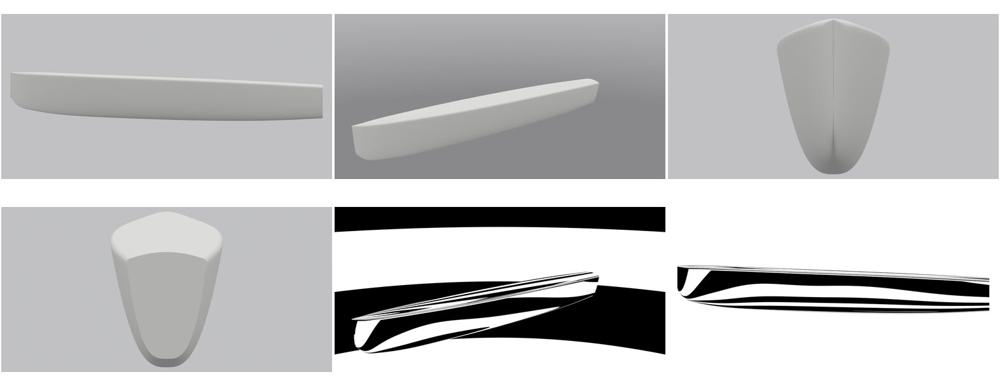
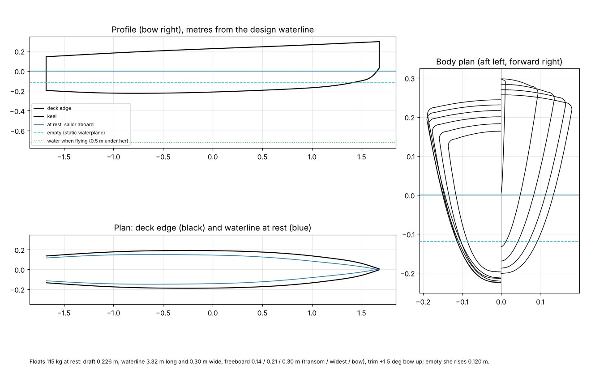

# Hydrofoil moth, slice 1: the hull





Slice 1 builds the moth's hull from a few lines: `Tools/shipkit/moth/lines_moth.json` (keel, deck edge and plan
curves, plus the section's shape), `hull_moth.py` (pure geometry and hydrostatics, no Blender) and `build_moth.py`
(the mesh, `MOTH_Hull`, 38,770 triangles of a 90,000 budget). Her shape was read by eye from the CC BY and public
domain photos in `refs.json`. Nothing was traced, and she is no builder's design.

## What she is

- **Hull length 3.355 m, the class limit**, with a plumb bow and a flat transom. The deck is 0.38 m wide at its
  widest, a little aft of the middle, and narrows to a fine bow.
- **Deep and narrow.** She is 0.44 to 0.46 m deep, with topsides that stand nearly upright and round into a V
  bottom, sharper forward. The section is `plan(x) * t^power`: power 0.32 aft (full) to 0.62 at the bow (sharp).
  The deck has a 2 cm crown and a rounded edge.
- **An almost straight keel.** It has a short, tight forefoot into the stem and a 6 cm rise to the transom. A
  moth's hull only matters at rest and at take-off, so it is drawn for those.

## How she floats (at rest, before take-off)

`hull_moth.py` solves the waterline so the hull floats the game's 115 kg (35 kg boat, 80 kg sailor) with her centre
of buoyancy under the centre of gravity. The sailor sits by the wing bars' front edge at rest (x -0.55), the boat's
own weight is just ahead of the middle (x 0.05).

| | |
| --- | ---: |
| Draft | 0.227 m |
| Waterline length / beam | 3.32 / 0.30 m |
| Freeboard: transom / widest point / bow | 0.14 / 0.21 / 0.29 m |
| Trim | 1.5 degrees bow up |
| Sink per 10 kg | 1.3 cm |
| Empty, she rises (her static waterplane, class rule 6.3) | 0.119 m |

Flying, none of this matters: the hull is 0.4-0.5 m clear of the water.

## Change to the card

The hull depth target went from 0.36 to **0.45 m**. The photo of her afloat before take-off (`Moth-dinghy (1).jpg`,
CC BY 2.0) shows tall, nearly straight topsides standing 0.3-0.4 m out of the water with the sailor up at the mast.
A 0.36 m hull carrying 115 kg would float with only about 0.12 m showing. The card also gains
`rest_displacement_kg` (115): the mesh's own volume under the waterline, weighed like the Hobie's.

## The check

```
python3 -I Tools/shipkit/moth/moth_check.py <work>/m/stats.json --slice 1
length_hull_m      3.355   3.355   +0.0%  ok
hull_beam_m        0.380   0.381   +0.2%  ok
hull_depth_m       0.450   0.458   +1.9%  ok
rest_displacement_kg 115.000 114.730 -0.2%  ok
  hull  38,770 of 90,000  ok
pass
```

## Open

- **Freeboard at rest.** The afloat photo is taken at an angle, so its 0.3-0.4 m is a range, not a measure.
  Slice 3's camera solve on the flying broadside fixes the scale. The sailor's place at rest moves it too: up at the
  mast, the bow sinks about 4 cm.
- **The deck.** It is plain for now. Slice 2 adds the wing bars' feet, slice 3 the main foil's case through the hull
  and the gantry's mounts on the transom, slice 4 the mast step.
- **The zebra profile** shows one band with a slow dip near the middle, from the plan curve's widest point. It is
  gentle and can be refined with the wings, which hide that part of the deck edge anyway.
- **Blind review** waits for Milestone A. There is no "before" model to compare one hull against, so the reviewers
  judge the whole boat against the photos then.

## How to rebuild

```
pip install bpy numpy matplotlib            # Blender's Python, or run the scripts under blender -b -P
blender -b -P Tools/shipkit/moth/build_moth.py -- <work>/s1
blender -b -P Tools/shapeloop/measure.py -- <work>/s1/moth.blend Tools/shapeloop/sections_moth.json <work>/s1/m
python3 -I Tools/shipkit/moth/moth_check.py <work>/s1/m/stats.json --slice 1
blender -b -P Tools/shapeloop/render_set.py -- <work>/s1/moth.blend Tools/shapeloop/sections_moth.json <work>/s1/r --res 1200
python3 -I Tools/shipkit/moth/lines_plot_moth.py docs/moth-2/lines.jpg
python3 -I Tools/shipkit/moth/hull_moth.py  # the hydrostatics alone
```
