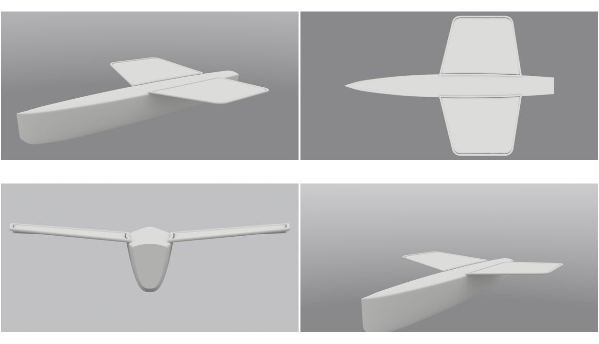

# Hydrofoil moth, slice 2: the hiking wings



Slice 2 adds the moth's two hiking wings (racks): `Tools/shipkit/moth/wings_moth.json` and `wings_moth.py`
(pure geometry), built by `build_moth.py` as `MOTH_WingFrame` (the carbon tubes) and `MOTH_WingDeck` (the mesh the
sailor sits on). Their shape was read by eye from the flying photos in `refs.json`, where the frame is a swept,
roughly trapezoid shape with a dark mesh deck. Nothing was traced.

## What they are

- **Out to the class beam, exactly 2.25 m** (rule 6.2 counts the racks). The outer rail's outside edge is on the
  limit, and the check fails anything wider.
- **Each wing is a frame of carbon tube.** It has a front bar (32 mm), an outer rail (28 mm) with rounded corners (12 cm
  radius, so the sailor's legs slide over them in a tack), a rear bar, an inner rail along the hull's deck edge
  (26 mm) and a diagonal brace under the mesh.
- **At the hull the wing runs from x 0.15 to -1.15.** That is just aft of where the mast will stand (slice 4) and
  0.5 m short of the transom, so the sailor can step aft past it. At the tip it runs from -0.08 to -1.0, so the
  front bar sweeps back.
- **5 degrees of dihedral:** the tips stand about 8 cm higher than the roots.
- **The mesh deck** is laced 22 mm inside the frame and sags 12 mm in the middle. It is drawn as a 4 mm sheet so it
  renders from both sides; slice 6 gives it the open-weave look. Plan area is 1.05 m² a side.
- **Shroud base 1.5 m** (from the tuning guide): the shrouds' chainplates will sit on the front bars 0.75 m out
  (sockets in slice 4).

## The check

```
python3 -I Tools/shipkit/moth/moth_check.py <work>/m/stats.json --slice 2
length_hull_m        3.355   3.355   +0.0%  ok
beam_m               2.250   2.250   +0.0%  ok
hull_beam_m          0.380   0.381   +0.2%  ok
hull_depth_m         0.450   0.458   +1.9%  ok
rest_displacement_kg 115.000 114.730 -0.2%  ok
  hull   38,770 of 90,000  ok
  wings  21,120 of 70,000  ok
pass
```

## Open

- **The wings' fore-and-aft place and sweep** are a reading of the photos, not a measurement. They are rechecked
  with the camera solve on the flying broadside in slice 3, once the strut and mast fix more points.
- **Wing bar fittings** (the sockets where the bars plug into the hull) come with the hardware in slice 5.
- **The deck's weave** comes in slice 6.

## How to rebuild

As `docs/moth-2`. `Tools/shapeloop/sections_moth.json` now holds the `wings` and `wingdeck` sections.
