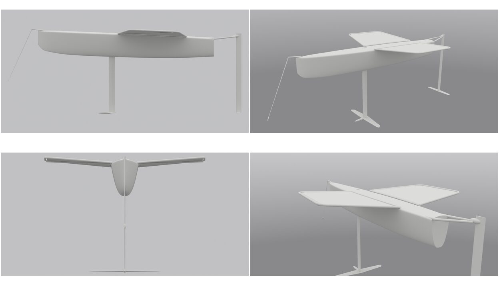

# Hydrofoil moth, slice 3: foils, gantry and wand



Slice 3 adds what makes her a moth: `Tools/shipkit/moth/foils_moth.json` and `foils_moth.py` (plain geometry),
built by `build_moth.py` as one object per part, so the game can move the flap, the elevator and the wand on their
own. Every foil is plain NACA four-digit sections, not copied from any builder's foil.

## The parts

| Part | Object(s) | Size |
| --- | --- | --- |
| Main strut (the daggerboard) | `MOTH_Strut` | chord 0.115 m, 13% thick, quarter chord at x 0.30 (just aft of where the mast will step), through the hull, foot 1.04 m below the hull |
| Main foil | `MOTH_MainFoil`, `MOTH_Pod` | span 1.00 m, chord 0.155 to 0.085, **0.119 m²**; a slim pod at the junction for the flap's bellcrank |
| Flap | `MOTH_Flap` | the aft 30% of the middle 82% of the span, **0.031 m²**; hinge socket `FlapHinge` |
| Gantry | `MOTH_GantryL/R`, `MOTH_RudderHead` | two carbon tubes from the transom's corners to the rudder stock **0.45 m behind the transom**, inside the class's 0.5 m allowance (rule 6.1.5) |
| Rudder | `MOTH_Rudder` | chord 0.10 m, straight and vertical, foot level with the main foil's |
| Elevator | `MOTH_Elevator` | span 0.72 m, chord 0.11 to 0.07, **0.064 m²**; pivot socket `ElevatorPivot` |
| Wand | `MOTH_Wand`, `MOTH_WandPaddle`, `MOTH_BowFitting` | **1.1 m**, tapering 12 to 6 mm, on a short bow fitting 0.12 m ahead of the stem |

The wand is drawn in its **flying pose**: the paddle touches the water 0.45 m under the hull's lowest point, the wand
24 degrees forward of vertical. In the game it swings about `WandPivot` from the wave height under its tip
(`docs/moth-1/physics.md`). Flying at that height, both foils are 0.60 m under the surface, about four chords
deep. That is deep enough to keep nearly all their lift in flat water and leaves room for chop.

## Sockets

`build_moth.py` now writes `Moth_sockets.json` in the game's frame (x forward, y starboard, z up, cm, z 0 the design
waterline at rest): `StrutTop`, `MainFoilCentre`, `FlapHinge`, `RudderPivot`, `ElevatorPivot`, `WandPivot`, `WandTip`.
Slice 7 adds the rest (mast, shrouds, sheets, crew).

## Change to the card

The wand went from 0.95 to **1.1 m**. From a pivot 0.33 m over the design waterline, the paddle must reach water
0.45 m under the hull, a 1.0 m drop. A wand trailing about 25 degrees from vertical then needs 1.1 m. The flying
height is now 0.45 m (it was 0.5).

## The check

```
python3 -I Tools/shipkit/moth/moth_check.py <work>/m/stats.json <work>/s1/Moth_sockets.json --slice 3
length_hull_m            3.355   3.355   +0.0%  ok
beam_m                   2.250   2.250   +0.0%  ok
hull_beam_m              0.380   0.381   +0.2%  ok
hull_depth_m             0.450   0.458   +1.9%  ok
rest_displacement_kg   115.000 114.730   -0.2%  ok
main_foil_span_m         1.000   1.000   +0.0%  ok
main_foil_area_m2        0.120   0.119   -0.6%  ok
elevator_span_m          0.720   0.720   +0.0%  ok
elevator_area_m2         0.065   0.064   -0.9%  ok
main_strut_below_hull_m  1.050   1.040   -1.0%  ok
rudder_below_hull_m      1.050   1.042   -0.8%  ok
wand_length_m            1.100   1.100   +0.0%  ok
gantry_aft_of_transom_m  0.450   0.450   -0.0%  ok
triangles 72,330 in all  (hull 38,770 of 90,000; wings 21,120 of 70,000; foils 12,430 of 80,000)
pass
```

## Open

- **Camera solve.** The flying quarter photo (`Sunday Flying!.jpg`) has to be checked against these lengths.
  It needs the mast's head and the boom from slice 4 to have points spread in depth (the C22's rule: flat point sets
  leave the camera's height free).
- **The flap is drawn over the whole foil** (a separate, slightly proud piece) rather than cut out of it. That's
  enough for the look and lets the game turn it. The light copy in slice 7 merges them.
- **The flap and wand linkage** (pushrod down the strut, bellcrank in the pod, the gearing adjuster at the bow) and the
  twist grip on the tiller come with the hardware in slice 5.
- **The struts' and foils' look** comes in slice 6: carbon, painted tips, a worn leading edge.

## How to rebuild

As `docs/moth-2`. `Tools/shapeloop/sections_moth.json` now holds the `strut`, `foil`, `gantry`, `rudder`, `elevator`
and `wand` sections.
