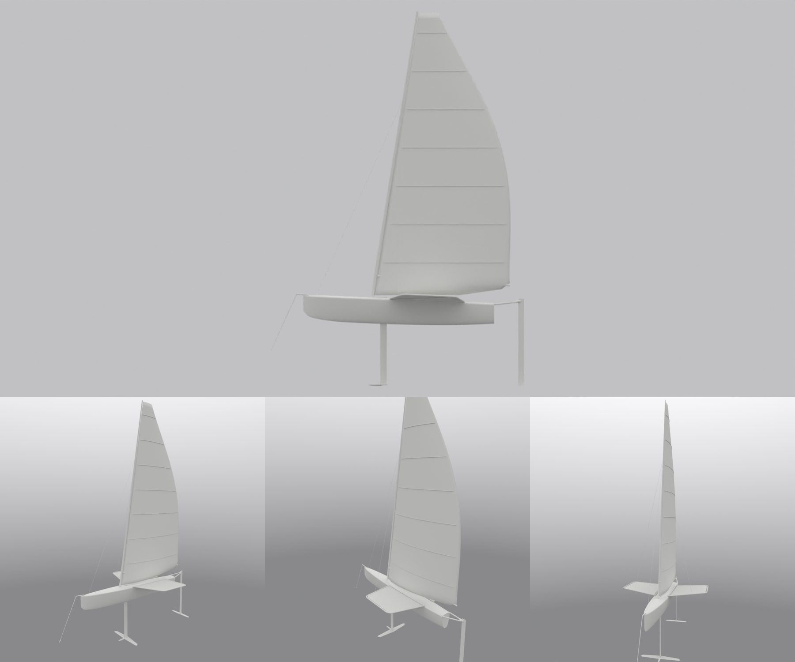

# Hydrofoil moth, slice 4: mast, boom, sail and rigging



Slice 4 adds the rig: `Tools/shipkit/moth/rig_moth.json` and `rig_moth.py` (plain geometry), built by `build_moth.py`
as `MOTH_Mast`, `MOTH_Boom`, `MOTH_Rigging` (two shrouds and a forestay), `MOTH_Sail` and `MOTH_Battens`. The sail is
an invented shape with no builder's outline, logo or graphics.

## The parts

| Part | Size | Where it comes from |
| --- | --- | --- |
| Mast | **5.1 m**, a slim teardrop 62 to 34 mm, raked 9 degrees aft, stepped on the deck at x 0.47 (just ahead of the main strut) | the card (a sailmaker's tuning guide: today's standard mast); the class allows 6.25 m |
| Boom | 2.34 m from the back of the mast to the clew, gooseneck 0.38 m over the deck, drooping 4 degrees | the tuning guide's 2,340 mm |
| Sail | **8.25 m²**, luff **5.04 m**, seven full-length battens, a full roach, the foot sweeping down to the deck | the class limit; the roach is solved to hit the area (0.387 of the leech's chord) |
| Shrouds | from the hounds, 1.55 m under the masthead, to the wings' front bars 0.75 m out each side | the tuning guide's 1,500 mm shroud base |
| Forestay | from the hounds to the deck at x 1.45, near the bow | the photos |

The sail is a **deck-sweeper**: its foot drops below the boom to the deck, so no air leaks under it. It is drawn
sheeted in on the centreline with 7% camber to port. In the game the sail you see is the physics' cloth
(`FSailCloth`), built from the sail's strips, so this mesh is for the showroom, the gallery and the light copy.

## Change to the card

The luff went from 5.1 to **5.04 m**. The sail's luff sleeve starts 4 cm over the deck (the deck-sweeper's tack) and
must stop under the masthead's cap, so a 5.1 m mast stepped on the deck carries 5.04 m of luff. Drawn at 5.1 m, the
head stuck 3.6 cm past the top of the mast. The area stays 8.25 m²: the roach grew slightly to make up for it.

## Sockets

`Moth_sockets.json` gains the rig's attach points (game frame: x forward, y starboard, z up, cm):
`MastBase`, `Masthead`, `Hounds`, `ShroudBase_L`, `ShroudBase_R`, `ForestayTack`, `Gooseneck`, `BoomEnd`, `Tack`,
`Head`, `Clew`.

## The check

```
python3 -I Tools/shipkit/moth/moth_check.py <work>/m/stats.json <work>/s1/Moth_sockets.json --slice 4
length_hull_m                  3.355     3.355   +0.0%  ok
beam_m                         2.250     2.250   +0.0%  ok
hull_beam_m                    0.380     0.381   +0.2%  ok
hull_depth_m                   0.450     0.458   +1.9%  ok
rest_displacement_kg         115.000   114.730   -0.2%  ok
rigged_weight_kg              35.000                    not yet: slice 7
mast_length_m                  5.100     5.100   -0.0%  ok
luff_length_m                  5.040     5.040   +0.0%  ok
sail_area_m2                   8.250     8.250   +0.0%  ok
main_foil_span_m               1.000     1.000   +0.0%  ok
main_foil_area_m2              0.120     0.119   -0.6%  ok
elevator_span_m                0.720     0.720   +0.0%  ok
elevator_area_m2               0.065     0.064   -0.9%  ok
main_strut_below_hull_m        1.050     1.040   -1.0%  ok
rudder_below_hull_m            1.050     1.042   -0.8%  ok
wand_length_m                  1.100     1.100   +0.0%  ok
gantry_aft_of_transom_m        0.450     0.450   -0.0%  ok
triangles 95,418 in all  (hull 38,770 of 90,000; wings 21,120 of 70,000; foil 12,440 of 80,000; rig 23,088 of 90,000)
pass
```

## Open

- **The vang, cunningham, mainsheet and their blocks** come with the hardware in slice 5, with the hiking straps, the
  tiller and its twist grip, and the flap's pushrod and wand gearing.
- **The sail's look** (clear film, the seams, the battens' pockets, an invented emblem) comes in slice 6.
- **The rig's sockets** are drawn on the centreline. The game turns the mast, boom and sail together about `MastBase`
  when the sail is eased.
- **The whole-boat views** on the sheet are framed on everything drawn. The shape loop's own perspective views
  (`render_set.py`) frame the hull, so with the rig drawn they show mostly sail; the hull's fairness views in
  `docs/moth-2` stay the reference for the hull.

## How to rebuild

As `docs/moth-2`. `Tools/shapeloop/sections_moth.json` now holds the `rig` (mast, boom, rigging) and `sail` (sail,
battens) sections.
