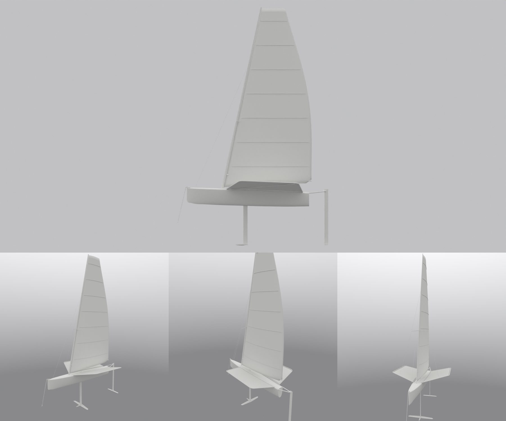

# Hydrofoil moth, Milestone A: the whole boat against the photos



Milestone A checks slices 1 to 4 together against the reference photos (`Tools/shipkit/moth/refs.json`) in two ways:
a camera solved on one photo, and blind reviewers on four. The photos show people, so they and the compare images stay
out of the repo; only the picked pixel numbers are here (`Tools/shipkit/moth/matches/sunday_flying.json`).

## The camera match

The flying photo ('Sunday Flying!.jpg', CC BY 2.0) was matched with `Tools/boatkit/photomatch/solve_camera.py` on seven
points spread in height and depth: the wand pivot, the mast's foot and head, where the main strut leaves the hull, the
rudder's head, the transom's foot and the far wing's front corner. With the focal length free the solve wandered, so it
is fixed at a long telephoto (200 mm equivalent; 100 to 500 mm give the same residuals).

| | Before | After |
| --- | --- | --- |
| Error over the seven points (rms, on a 1,280 px photo) | 14.1 px | **7.7 px** |
| Flying height: hull bottom over the water, read where the struts enter it | 0.44-0.48 m | 0.46-0.53 m (card 0.45) |

The flying height drawn on the card holds. About 130 px is one metre up and down in this view.

## Blind review

Three fresh reviewers per round looked at four rows, each a photo beside a clay render from about the same viewpoint
(the camera-matched view, a bow quarter while flying, afloat at rest, ashore broadside). Left and right were shuffled
per reviewer. They described each picture first and then listed the differences, without being told what to look for.

| Round | Scores (out of 10) | What all three saw |
| --- | --- | --- |
| 1 (slices 1 to 4) | 4, 5, 5 | small flat wings at deck level; a rounded bow; a pointed sail head; no spreaders; the wand raked forward |
| 2 (after the fixes) | 6, 6, 6 | spreaders too high; the wand still raked forward |

## What changed

| Part | Before | After | Why |
| --- | --- | --- | --- |
| Wings | root x 0.15 to -1.15, dihedral 5° | **0.58 to -1.5, dihedral 14°** (1.77 m² a side) | round 1, 3 of 3: the photos' wings run from the mast nearly to the transom and rise outboard; the solve's wing point then fell from 18 to 5 px |
| Bow | forefoot 0.20 m up the stem, transom rise 0.06 | **0.11 m, 0.035**; the sheer 13 mm lower forward | round 1, 3 of 3: a crisp plumb stem; the depth stays 0.45 m because the matched outline fits it |
| Mast step | x 0.47 | **x 0.70** | round 1, 2 of 3; the solve's mast-foot error fell from 11 to 5 px |
| Mast rake | 9° | **12°** | 4 of 6 reviewers; the solve fits 12° best |
| Main strut | x 0.30 | **x 0.10** | 4 of 6 reviewers; the solve's strut error fell from 20 to 10 px |
| Sail head | 0.34 m | **0.65 m**, a square top (the roach re-solved to keep 8.25 m²) | round 1, 3 of 3 |
| Spreaders | none | **a pair at 1.9 m, 0.34 m long, swept 18° aft**, the shrouds over their tips (sockets `SpreaderTip_L/R`) | round 1, 3 of 3; round 2 lowered them from 2.45 m |
| Wand | 1.1 m from a pivot 0.12 m ahead of the stem, 24° forward | **1.02 m from a pivot 0.03 m ahead, 13° forward** | see below |

The size check (`moth_check.py --slice 4`) passes on every measure.

## The wand, and a new check

All six reviewers and the solve saw the photos' wands hanging nearly upright, or even trailing slightly aft. The model's
wand stays a little forward of upright. It is a sensor held forward by shock cord, so on the forward side its angle
changes one way with height. Past upright it would reverse and the ride-height loop would fail. The class rules also
show it reaching forward: a fitting more than 0.5 m past the hull counts toward its length (rule 6.1.5). The old wand
reached 0.575 m past the stem. That was over the rule, and the check had not measured it. `moth_check.py` now
measures `fittings_past_hull_m`: the wand's pivot and tip ahead of the stem and the rudder's gantry behind the transom.
It fails anything over 0.5 m. Now the gantry, at 0.45 m, reaches furthest.

## Left as they are

- **Hull depth.** Four of six reviewers called the hull too deep. The camera-matched outline sits on the photo's hull
  top and bottom, and the photo's wing deck hides the top of its topsides, so the depth stays.
- **Freeboard afloat.** Two reviewers saw the model sit lower in the water than the boat in the afloat photo. Her
  waterline is solved for 115 kg (35 kg boat, 80 kg sailor); the photo's sailor is lighter, and the boat is an older
  design.
- **Gantry length.** The afloat photo's older boat has a longer gantry. The model's 0.45 m stays inside rule 6.1.5.
- **A raised foredeck and a boom above the deck** (one reviewer each). Today's boats are deck-sweepers (the tuning
  guide).

## For the physics (slice 8)

The main strut moved aft, so the main foil carries about 79% of the weight in steady flight (it was 73%). The card's
lift table assumes 85%. The mast moved forward, which moves the sail's centre of effort forward too.

## How to rebuild

As `docs/moth-2`, then:

```
python3 Tools/boatkit/photomatch/solve_camera.py Tools/shipkit/moth/matches/sunday_flying.json <work>/s1/Moth_sockets.json
blender -b -P Tools/boatkit/photomatch/match_blend.py -- <work>/s1/moth.blend Tools/shipkit/moth/matches/sunday_flying.camera.json <photo> <out>
```

The photo is the Commons thumbnail, 1,280 px wide (`refs.json`). Download it locally and never commit it.
