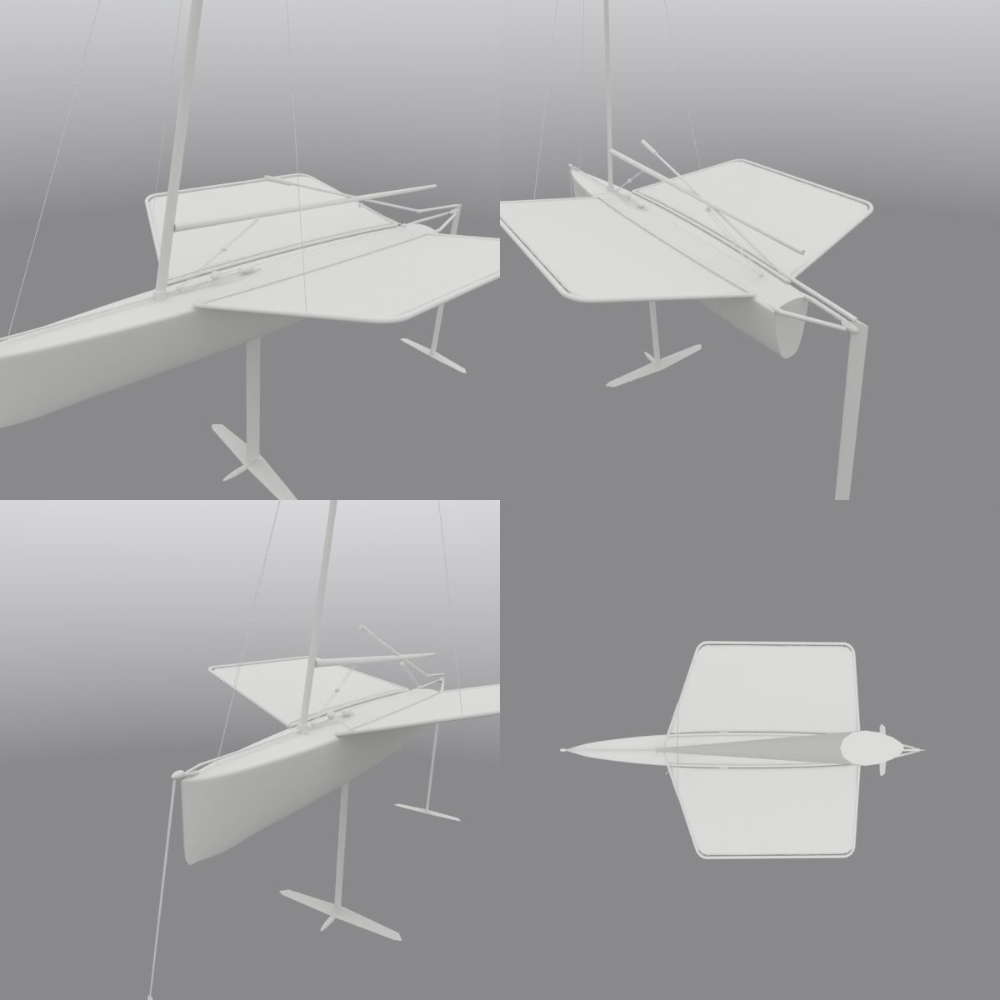

# Hydrofoil moth, slice 5: hardware and lines



Slice 5 adds what the sailor steers and trims with, and the linkage that makes the wand work the flap:
`Tools/shipkit/moth/hardware_moth.json` and `hardware_moth.py` (plain geometry), built by `build_moth.py`. Every fitting
is a generic shape, with no maker's parts or names.

## The parts

| Object | What it is |
| --- | --- |
| `MOTH_Tiller` | a 0.55 m carbon tiller from the rudder's head forward over the transom, with the universal joint at its end |
| `MOTH_TillerExtension` | the 1.65 m extension, drawn straight forward and rising 18° as if held |
| `MOTH_TwistGrip` | the last 0.2 m of the extension. Turning it sets the elevator's angle (fore-and-aft trim) on top of the steering; its own object, so the game can turn it |
| `MOTH_Fittings` | the mainsheet's blocks (under the boom, on the aft deck, the ratchet by the wings' front bar), the vang's blocks, the mast's step collar, the wand's pushrod along the deck to the main strut's head, the bellcrank housing there (with the gearing adjuster) and the ride-height knob on the bow fitting |
| `MOTH_Lines` | the mainsheet (two-part from the boom to the aft deck, then forward to the ratchet and a tail), the vang's cascade, the cunningham from the tack to the mast's foot, and both control tails led aft along the deck |

The rod down the strut to the flap is inside the strut and isn't drawn. Moths carry no hiking straps worth drawing: the
sailor hikes from the wings' rails.

## Sockets

New in `Moth_sockets.json` (game frame: x forward, y starboard, z up, cm): `TillerJoint`, `TwistGrip`,
`MainsheetBoom`, `MainsheetDeck`, `MainsheetRatchet`, `VangBoom`, `VangDeck`, `Cunningham`, `PushrodStrut`. The crew
code's hands go to `TwistGrip` (the helm's hand) and `MainsheetRatchet` (the sheet's tail).

## The check

```
python3 -I Tools/shipkit/moth/moth_check.py <work>/m/stats.json <work>/s1/Moth_sockets.json --slice 5
...every measure as in docs/moth-6...
fittings_past_hull_m           0.500     0.450          ok (limit)
triangles 112,602 in all
  hull          38,770 of 90,000  ok
  wings         26,880 of 70,000  ok
  foil          12,240 of 80,000  ok
  rig           23,272 of 90,000  ok
  hardware      11,440 of 120,000  ok
pass
```

## Open

- **The lines are drawn still.** In the game the mainsheet, vang and cunningham will be live rope through the rope
  code (`RopeLay.h`), like the J/22's, with the boom swinging. These meshes are the showroom's and the light copy's.
- **The extension is drawn held**, rising forward. When the sailor lets it go it lies on the deck or the wing.

## How to rebuild

As `docs/moth-2`. `Tools/shapeloop/sections_moth.json` now holds the `hardware` and `lines` sections.
