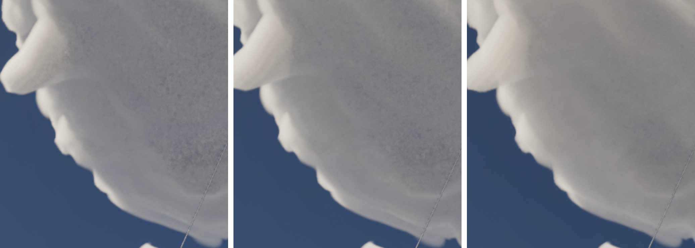
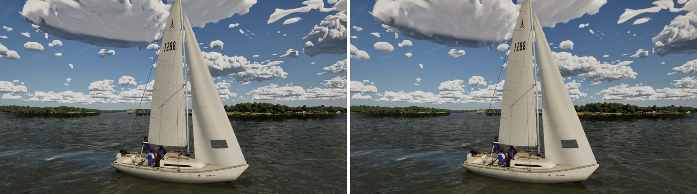

# Near-cloud grain on Ultra (the near-step cap)

The last lever `docs/ultra-cloud-fullres/` named for the speckle on the near clouds overhead: the march's step-depth cap on
near rays.

## Why it still grained

Ultra keeps all 160 view samples on near rays (`r.VolumetricCloud.DistanceToSampleMaxCount` 3 km, W5a), so under a
cumulus the march steps about 19 m. `CLOUD_CODE` caps a cumulus's optical depth per step at `1.5 * MaxStepDepth` of the
step's own length. At 19 m steps that cap is so loose it never binds. A cumulus base then closes within a step or two, and
each pixel is lit at whatever depth its jittered sample landed. Traced at half resolution, that shows as a dark-and-light
grain over the base of the cloud overhead.

## What changed

The cumulus cap is now taken as if each step were at least `CloudCapStepFloor` long. On Ultra that is 76 m, four of its
near steps (`kUltraCloudCapStepM` in `SailingEnvironment.cpp`). The material's default is 0, so Medium, High and the sky
cache's far march (steps of hundreds of metres) compute exactly what they did. Only near rays on Ultra change: the base
closes over three or four steps and the march averages its light. The storm, the stratus deck and the shelf keep their
own caps. `-SailingCloudCapStep=<m>` overrides it (0 is main).

| The cloud overhead, 35 deg up (2x): floor 0 (main), 40 m, 76 m |
| --- |
|  |

High-pass grain over the cloud's base (std of the image minus its 2 px blur, 8-bit): 3.10 on main, 2.66 at 40 m, 2.49 at
76 m. Turning the global `MaxStepDepth` down instead does the same overhead (2.46 at 0.25) but changes every cloud in the
sky and costs more.

The base reads a shade paler (mean +6 of 255): part of its darkness was the dark half of the grain. The far field doesn't
change.

| The sails view: main, this branch |
| --- |
|  |

## Cost (Ultra, 1920x1080, RTX 4090, mean of three 20 s runs; clouds and fog slice / GPU total, ms)

| View | Main | This branch |
| --- | --- | --- |
| The cloud overhead (35 deg up) | 1.77 / 6.44 | 2.29 / 7.08 |
| The sails view | 1.71 / 7.68 | 1.91 / 7.99 |
| Storm (bench view) | 2.48 / 8.33 | 2.50 / 8.49 |

Up to half a millisecond, when a cumulus fills the frame overhead. Rays run a few steps further into a base before they
saturate. The 40 m floor costs about half of that and leaves about half the grain.
