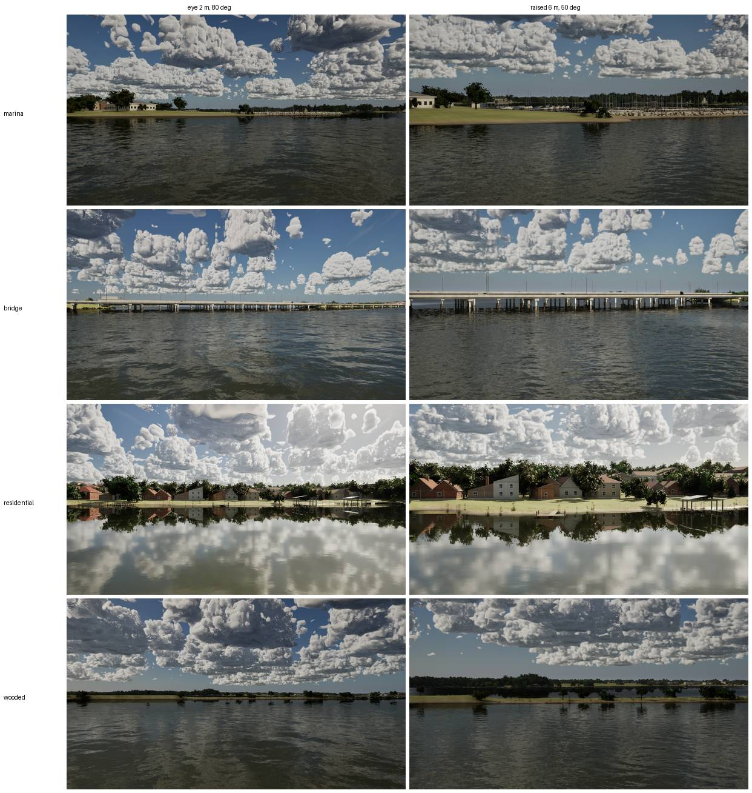
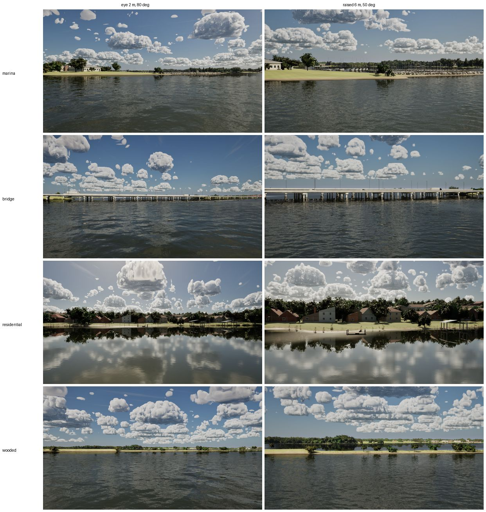

# Near-shore fidelity audit, Lake Ray Hubbard (Ultra, report only)

What the shore looks like within about 300 m of the boat, judged against the Ultra north star (2025-2026 AAA: Forza
Horizon 6's Japan, AC Shadows, KCD2, MSFS 2024's photogrammetry, Indiana Jones). No code. Main f501e684, Bean's
RTX 4090, 1920x1080, uncooked, AfternoonBreeze at 6 kn.

## How the stills were taken

Launch args only. The boat is placed with `-SailingStartAt` and `-SailingKeepStart`, and the camera is fixed in the
world with `-SailingCamWorld`, 60 m nearer the shore than the boat, facing it. The boat is out of frame, so the shore is
120 to 300 m away. `-SailingCapture=Drone` gives the eye view (2 m up, 80 deg) and `Chase` the raised one (6 m, 50 deg).
These two capture presets are the world-placed ones; HelmEye stays on the boat. Times are 12:30 and 15:00.

| Shore | Where (map north, east m) | Looking |
| --- | --- | --- |
| Rush Creek marina | boat 5, -110; camera 5, -70 | east, into the slips and the breakwater |
| I-30 bridge shore | 7000, 877 to 7060, 880 | north, at the bridge |
| Residential (Rowlett, the most houses within 300 m off the bridges and marina) | 8835, 2115 to 8775, 2115 | south |
| Wooded (no houses within 500 m) | 2364, -3574 to 2395, -3625 | north-west |

## The gaps, biggest first

| # | Gap | What it looks like here | Against the references |
| --- | --- | --- | --- |
| 1 | **Houses are boxes** | The residential shore is the worst view in the set ([houses](houses.jpg)). Every house is one of a few gabled boxes with flat walls in a single brick or siding colour. They have small painted windows in a regular grid, no eaves, gutters, porches, decks, garages or fences, and no roof texture beyond a flat colour. Repeats are easy to spot. | Forza and AC Shadows sell a town with varied massing, deep eaves and window reveals, materials that weather, and clutter. A Ray Hubbard lakefront is two-storey brick and stone houses with covered patios, pools, wooden decks and boathouses. |
| 2 | **The shore edge** | Lawn runs to a uniform sand strip and then the water. No bulkheads or riprap on the residential shore (most of Ray Hubbard's developed shore is concrete or rock bulkhead), no wet band or mud, no debris. Private docks are thin pergola frames with nothing moored. A few cattails stand alone on the lawn. | The water line is where the eye checks realism at this range: material change, wet darkening, small-scale clutter. |
| 3 | **Lawns and ground** | One flat yellow-green plane behind every house and along the wooded shore: no mowing pattern, paths, beds, fences, cars, play sets or patio furniture. | |
| 4 | **The wooded shore is a strip** | The "wooded" spot is a low grass spit with a dozen isolated trees, with the real woods 1 km behind ([wooded](wooded.jpg)). The lidar crowns are where the trees are, but the shore band has no understory: no shrubs, saplings, dead wood or brush between the trees. | KCD2 and AC Shadows: layered forest edges, brush and deadfall. |
| 5 | **The marina** | At 250 m it reads: masts, slips, a white walkway rail, the riprap breakwater ([marina](marina.jpg)). The breakwater's rocks are one large rounded shape repeated in a line. Boats in the slips are hulls and masts without covers or furling. The clubhouse is a box. | Fine at this range; the rock repetition is the first thing to go. |
| 6 | **The I-30 bridge** | The silhouette and light poles are right. The deck and piers are clean extruded concrete: no expansion joints, drainage stains, water-line staining, bent caps or graffiti ([bridge](bridge.jpg)). | Indiana Jones' and Forza's infrastructure weathers: streaks under every joint and a dark band at the water. |
| 7 | **Shore trees** | Leaf-card trees out to 1 km (#323) hold up at 120-300 m. Species and sizes repeat across the residential shore, and the canopy is one height. | Close; variety is the gap. |

Not gaps here: the water's reflections of the shore (the residential shore at 6 kn reads right), the sky at noon, and
the far shore past 1 km (`docs/ultra-far-shore`).

## What each would cost

PC and Mac are working sessions of one Claude session each. "Assets" are what Bean would need to provide. Everything
proposed is free and commercial-OK (CC0 ambientCG, Poly Haven, and Bean's own phone photos, which stay in git-ignored
`Data/Reference/raw`). No Fab, MetaHuman or paid stock is required. The $75 cap is untouched; one optional item is
listed.

| # | Fix | PC | Mac | From Bean |
| --- | --- | --- | --- | --- |
| 1 | House kit v2 in `HouseKit.cpp` and `build_houses.py`: hip and gable roofs with eaves and gutters, window reveals and frames, porches and covered patios, garages, chimneys and stone accents; per-house material variety from CC0 scans (brick, stone, siding, shingle, ambientCG); a rear deck and fence per lot by seed | 2-3 sessions | gate and a High cost check (VSM marking with more geometry) | 10-20 phone photos of real Ray Hubbard / Rowlett lakefront houses from the water (reference only, no faces or plates) |
| 2 | Shore edge: bulkhead (concrete cap and stone) and riprap types by house lot from the houses bake; a wet band and mud strip in `M_Terrain`; boathouses and lifts with a moored boat at a share of docks; cattail clumps at the water, not on lawns | 2 sessions | water-line blend touches the near water: Mac reviews | photos of 3-4 bulkheads and boathouses up close |
| 3 | Lot dressing from the houses bake: mowing stripes and bare patches in the lawn material; paths, beds, fences, a car or boat trailer by seed (Blender props, `build_props.py`) | 1-2 sessions | gate | none |
| 4 | Forest-edge understory along wooded shore cells: shrub and sapling cards, deadfall logs (Blender, CC0 bark already in) | 1 session | High cost check (more cards in VSM) | 3-4 photos of a wooded Ray Hubbard shore |
| 5 | Breakwater from 6-8 rock shapes with CC0 rock scans (Poly Haven); boat covers and furled sails on the marina neighbours' berthed dresses | 1 session | none | photos of the RCYC breakwater (optional) |
| 6 | Bridge weathering in `M_WorldSurface`: joint streaks, a water-line band, pier caps and bents in `WorldKit` | 0.5-1 session | none | 2-3 photos of the I-30 piers from the water |
| 7 | More species variety on the residential shore (the eight species' weights by lot), and a second height class | 0.5 session | none | none |

Optional, within the cap: a commercial-licence boathouse or dock model (about $20-40) would save part of #2's modelling.
I'd try the procedural route first.

Recommended order: 1, 2, 3 together (they're one residential-shore pass and share the houses bake), then 4, then 5-7.

## Where each gap stands (after phases 1 to 3, Oct 27 2026)

Three PC passes, each its own PR: phase 1 (#348, `phase-1/`), phase 2 (#351, `phase-2/`), phase 3 (`phase-3/`). All
procedural, no downloads or spend; each was measured against main on Ultra and High.

| # | Gap | Now | What's left |
| --- | --- | --- | --- |
| 1 | Houses are boxes | **Improved.** Gutters and downspouts, driveways, back patios (covered with a slider, or a raised deck) on every full-detail house. | The massing itself (window reveals, porches, chimneys, stone accents, CC0 material scans) is still the G6 kit. It needs the reference photos the audit asked for. |
| 2 | The shore edge | **Fixed** on the residential shore. Bulkheads or stepped riprap by bank slope, side fences, paths to the water, boathouses with a lift and a covered boat where no charted dock is near, and no cattails on mown lawns. | No wet band or mud strip in `M_Terrain` yet (the Mac owns the water line). Boathouses skip lots that already have an OSM dock. |
| 3 | Lawns and ground | **Improved.** Mowing stripes and dry patches in `M_Terrain`, paths and fences. | No cars, trailers, play sets or patio furniture. |
| 4 | The wooded shore is a strip | **Fixed.** Yaupon, dogwood and coralberry under and between the crowns, saplings, deadfall, brush piles and snags along every wooded shore (about 117k shrubs on Ray Hubbard, +0.15 ms GPU where they fill the frame). | |
| 5 | The marina breakwater | **Fixed.** Twelve rock shapes, sizes spread like armour stone, chinking, a toe, and each rock its own shade and wet line. | Boat covers and furled sails on the berthed dresses were not part of this pass. |
| 6 | The I-30 bridge | **Improved.** Joint stains down the fascia over every pier, streaks from the caps, a deeper waterline ring, grimed caps. | Pier bents and caps keep their shapes; no graffiti. |
| 7 | Shore trees | **Improved.** About 20,000 young yard trees, a second height class from lot palettes. | Still the eight species with two models each. |

Galveston Bay's house tiles were not rebaked with phase 1's kit (`HOUSES_WORLDS=GalvestonBay scripts/bake_houses.py`).
