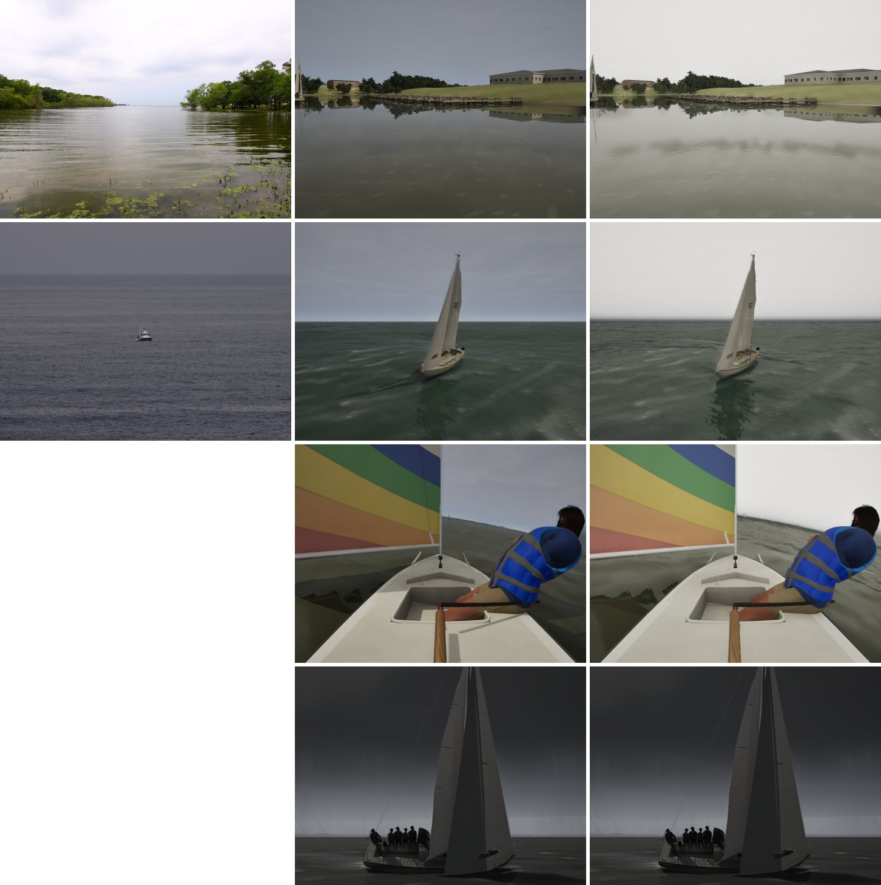

# An overcast as bright as the light under it

Realism audit Oct 23 (`docs/realism-audit-1023/`), item 2. In the G5 overcast-shore photo the overcast is near white,
several times brighter than the grass and trees under it. Ours was a mid-grey deck about as bright as the lawn: deck to
lawn 2.6:1, deck to trees 4.2:1, in linear light. A uniform overcast lights a white surface to exactly its own
luminance, so grass, with an albedo of about 0.2, should read about a fifth of the deck.

## Cause

Two things were inconsistent.

- **The deck's base was dark.** Volumetric clouds dominated by single scattering leave a thick deck's underside dim.
  In nature it glows with the sunlight diffused down through it: a quarter to a third of the sun for a stratus deck
  of optical depth about 20.
- **The ground was lit by more than the deck.** The direct sun never dropped below 12% under cloud
  (`CloudShade = 0.12 + 0.88 x visibility`). That light fell on the ground but appeared nowhere in the sky.
  Measured at fixed exposures, the sky light alone also lit the lawn to about half the deck's brightness, twice what a
  lawn's albedo allows.

## Fix

Under a closed deck (stratus coverage 0.8 to 0.95, the same test as `bClosedDeck`, where the live clouds take the
whole sky):

- **The deck base glows.** `CLOUD_CODE` emits, in proportion to the extinction (the shelf face's method),
  `DeckGlow.x x SunLum x sin(sun elevation)`. `ASailingEnvironment` sets `DeckGlow.x` to 0.3 x the deck x
  (1 - CloudDarkness), so the glow fades as the deck thickens toward rain and storm (their diffuse transmission is
  nearer 0.1). The sky cache never draws it, because it steps aside under a closed deck.
- **The direct sun has no floor.** The 12% floor stood for the light a deck scatters down; that light now comes from
  the deck itself, through the sky light. The boat no longer casts a shadow under an overcast.
- **The sky light is a quarter.** This was measured, not derived. At full strength, lit by the glowing deck, the
  ground read about half the deck. At 0.25 the deck-to-trees ratio comes close to the photo's.

The exposure needs no change. The meter's clear-sky baseline with its 10% gloom adaptation already lands near EV 1,
where the frames match the photo.

| (linear, mean) | deck | lawn | trees | water |
|---|---|---|---|---|
| G5 photo (still23) | 0.94 (clipped) | | 0.10 | 0.38 |
| main | 0.25 | 0.10 | 0.06 | 0.07 |
| this branch | 0.76 | 0.24 | 0.13 | 0.25 |

Storm and squall views are unchanged: their stratus is under 0.8, and their darkness takes the glow off. The Gulf
swell view's horizon now runs from a bright deck down to the dark green sea, which item 5 (the Gulf's water colour)
addresses next.

## Stills

Columns: photo, main, this branch. Rows: the overcast shore, the Gulf swell, the Sunfish reach (overcast, no photo),
and the squall (no photo; unchanged).

The swell photo (still07) is a heavier overcast, with the sky darker than in the shore photo. Real overcasts span that
range. The deck-to-ground ratio is the physical part; the deck's absolute brightness follows the preset.
