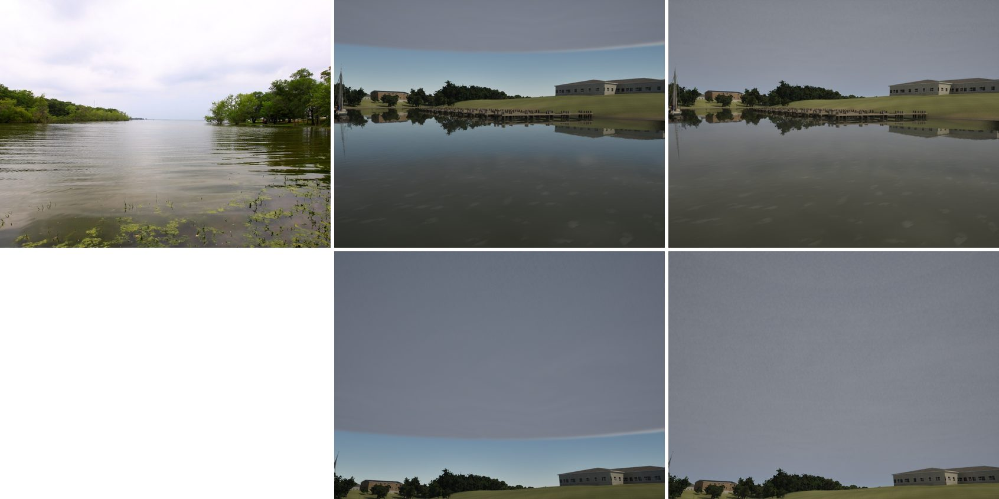

# Overcast to the horizon (realism audit item 6)

The realism audit (`docs/realism-audit-1022/`) found the overcast deck's edge visible overhead. Under Overcast, a curved
grey edge crossed the sky 10–20° up, with clear-looking blue sky below it down to the horizon.

## Cause

It was not the weather map's fade. The sky cache (C2) draws the far clouds into a panorama on the sky dome, and the live
volumetric clouds stop at 5 km. Under an overcast:
- The visibility is 12 km, and the dome sits behind the haze at up to 90% opacity, so the cached far deck hardly shows.
  A debug build that painted the cache flat grey wherever it marched showed nothing either.
- The haze's tint was its "crisp" blue (0.42, 0.52, 0.68), since Overcast's haze is low, so beyond the live deck's 5 km
  the sky read clear.

The curved edge is the live clouds' 5 km handover, seen at a constant elevation.

## Fix

Both changes are in `ASailingEnvironment` (`SailingEnvironment.cpp`):
- **Under a closed deck by day (stratus coverage over 0.8), the live clouds take the whole sky,** as they already do under a storm
  and a night deck (`UpdateSkyCache`'s `bClosedDeck`). The live march carries the deck to the horizon, as
  `-SailingNoSkyCache` shows. Rain's deck (coverage 1) gets the same.
- **The haze goes neutral grey as the stratus deck closes** (`DeckGrey`, from 0.5 to 0.95 coverage): the air under an
  overcast is lit by the grey deck, not by blue sky.

## Stills

The G5 shore scene: the real photo (Lake Tawakoni under an overcast, from the G5 pack) left, main 881e413c middle, this
branch right. The bottom row is the same view looking up 25°.

## Cost and gate

- **Two views under Overcast** on the packaged game, High (a temporary copy of `bench-visual.sh` with the view's own
  weather set to Overcast: `BENCH_EXTRA` doesn't override a view's own args): the beat at 15 kn 61.9 fps, the helm eye
  58.3 fps.
- **`--scope clouds`:** pass, 229/229 tests. beam8 59.9, beat15 60.7, storm High 51.0, gulf-sea 63.4, helm-eye 61.2, bridge 65.1,
  storm Medium 71.4.
