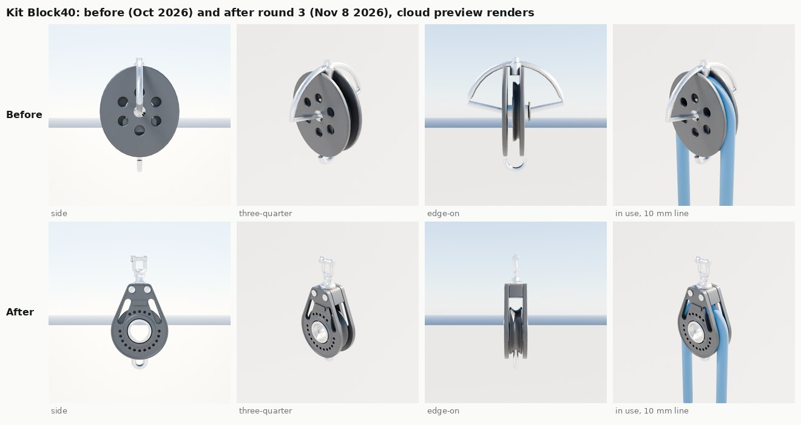
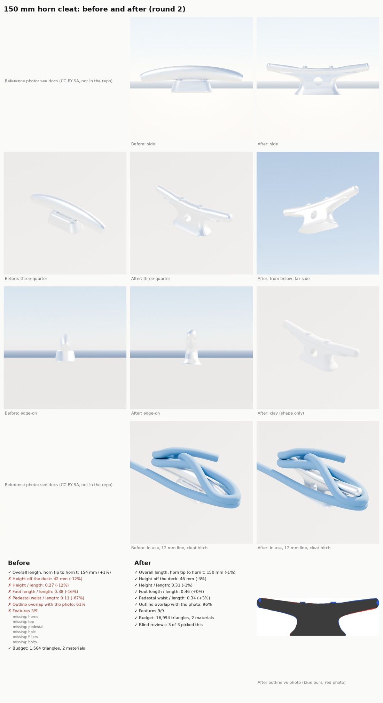
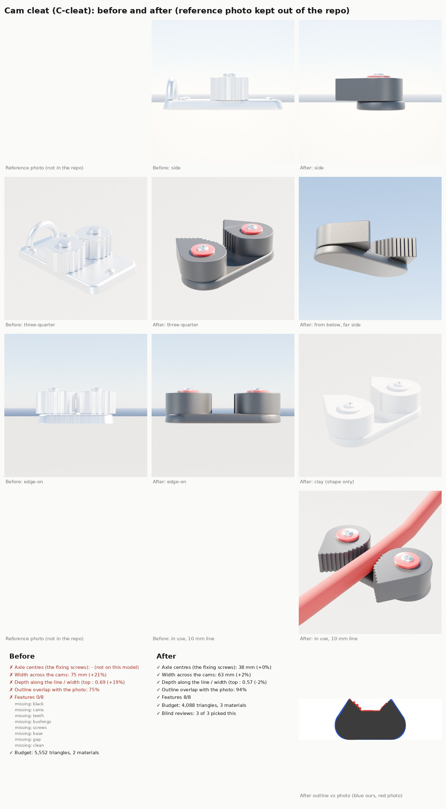
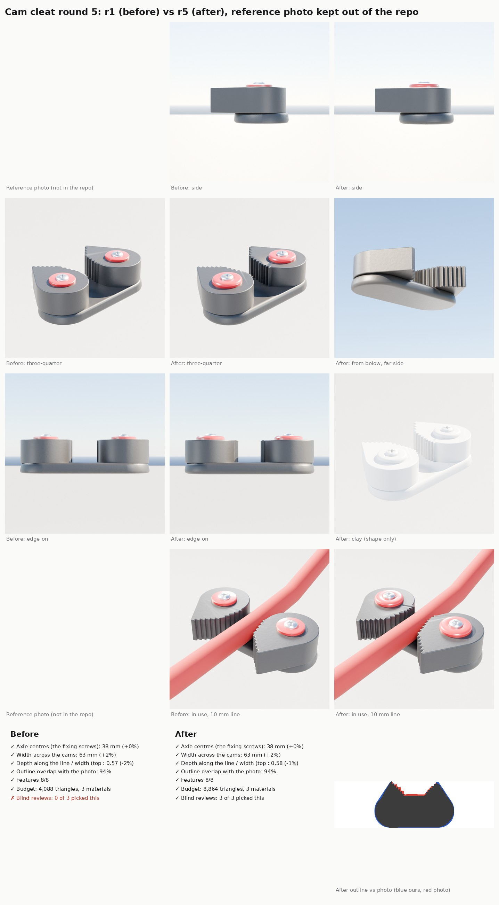

# Part detail loop (Nov 8 2026)

Bean's ask: raise the detail of the boats' hardware and interiors one part at a time, using reference photos and
models of the real thing, and judge our version against them. This page is the method and its first test on the kit's
40 mm block (`Block40`). The plan with the research behind it is the Claude Doc "Boat part detail loop"
(https://claude.ai/artifact/PyoTHzsGwyUzmJBAzvUXSc).

## The loop

Once per part:

1. **Part card** (`Tools/boatkit/partloop/parts/<part>.json`): what it is, which boats use it, how close the camera
   gets, and what it replaces.
2. **Reference pack**: photos (square-on side view first, then three-quarter, edge-on, in use) and any 3D models,
   kept in the git-ignored `Data/Reference/raw/parts/<Part>/`. The repo only gets the links and the numbers read off
   them. Only commercial-OK licences (CC0, CC BY, CC BY-SA, public domain, our own photos); manufacturer drawings and
   bought models are for measuring only. Photos with people never go in.
3. **Sizes and features**: catalogue sizes with a tolerance, proportions measured on the square-on photo, and a list of
   the features you'd notice at arm's reach. `score.py --save-mask` cuts the reference outline out of the photo (check
   its overlay before trusting it).

Each round:

4. **Build** the part in `Tools/boatkit/bk_parts.py` (a script, never a hand-edited mesh: research below).
5. **Render** with `partloop/render_views.py`: the same views every round (six turntable stills, two in use with a
   10 mm line for blocks, a clay still, two orthographic outlines) and `stats.json`.
6. **Score** with `partloop/score.py`, five checks:

   | Check | Pass |
   |---|---|
   | Sizes | every catalogue size within its tolerance (5% overall, 2% sheave), photo proportions within 5-10% |
   | Outline | the side outline overlaps the photo's by 90% or more (intersection over union) |
   | Features | every feature on the card: by object name and material slot where it can, by eye (`review.json`) where it can't |
   | Blind review | three fresh reviewers, shown the photos and this round against the last as A/B in shuffled order: this round wins at least 2 of 3, and nobody calls it the wrong part |
   | Budget | 20,000 triangles and 8 material slots for the Nanite hero (the light copy is a quarter) |

7. **Fix and log**: the reviewers' "remaining differences" become the next round's list. Stop when all five pass and
   the reviewers' notes are small.
8. **Bean's sheet**: `partloop/make_sheet.py` lays the reference photo, both rounds and the scorecards side by side.
   Sheets with a third party's photo stay out of the repo (credited when shared).
9. **In game** (PC): build the kit, import, `SailingSim.Visual.HardwareKit`, then a close-up still on the boat.

### Why this shape

- AI modellers do best writing Blender scripts and refining them over rounds with feedback, not editing meshes by hand
  (LL3M, arXiv 2508.08228; BlenderAlchemy, 2404.17672; BlenderGym, 2504.01786, where memory of earlier rounds helps).
- Vision models agree with people about 79% of the time when asked which of two 3D renders is better (GPTEval3D,
  2401.04092; Gen3DEval, CVPR 2025), so a blind A/B vote is a fair taste check.
- They are weak at fine spatial judgement (sizes, left/right, small offsets: "What's up", 2310.19785; "Lost in Space?",
  2601.22228), so shape and size are judged by numbers, and the AI's eye only decides what numbers can't.

## First test: Block40

The kit's 40 mm single swivel block with becket (catalogue: 86 mm overall, 40 mm sheave, 10 mm line). Before is the
October kit part from `_block_parts`; after is round 3 of `_modern_block_parts`, which Block40 now uses (the other
blocks still use the old builder: they are later parts in the loop).

| Round | Overall | Cheek h/w | Head/cheek | Outline | Features | Triangles | Blind review |
|---|---|---|---|---|---|---|---|
| Before | 64 mm (-26%) | 1.08 (-19%) | 0.51 (+11%) | 78% | 4/11 | 6,924, 3 slots (one empty) | won 0 of 3 against r1; all three called it the wrong part ("gyroscope", "gimbal or reel") |
| r1 | 86 mm | 1.29 | 0.43 | 96% | 11/11 | 16,216 | won 3 of 3 against before (confidence 5, 5, 5) |
| r2 | 86 mm | 1.29 | 0.44 | 96% | 11/11 | 19,480 | **lost**: won 1 of 3 against r1 (its small bright hub read as a generic pulley) |
| r3 | 86 mm | 1.29 | 0.44 | 96% | 11/11 | 15,014, 2 slots | won 3 of 3 against r1 (confidence 3, 4, 3) |

Targets: 86 mm overall, cheek height/width 1.33 and head/cheek 0.46 (measured on the square-on photo). Thickness
across the cheeks is 20 mm, reported only: there is no edge-on reference yet.

What changed from before to r3:

- Teardrop moulded cheeks (round round the sheave, narrowing to a flat head with two rivets) instead of round discs;
  rounded edges and a shallow rim pocket.
- A large open hub (hollow stainless axle in a bearing race, see-through), a near-closed ring of lightening holes
  round it and two shoulder windows showing the sheave.
- Grooved sheave sized for 10 mm line; swivel with collar, post and eye; D-shackle with pin and pin head; becket loop.
- Made-up TERNWAY plate on the cheek.
- The old stainless hoop that stuck out sideways is gone, and so is the empty material slot.

The loop earned its keep: the scorecard found the old part 25% short, the wrong shape and over a slot, and the blind
review caught round 2 going backwards before it shipped.

Still different from the photos (the reviewers' shared notes on r3, for a later round):

- The hub's stainless ring renders bright where real blocks show a black-edged hole.
- The cheeks are flat slabs; real ones have a domed raised lip and a bulge round the sheave.
- Edge-on the head reads boxy, with a gap above the sheave (left for the line).
- The shoulder windows are straight wedges, not sculpted; the hole ring crowds the plate.
- The cloud preview's materials make black plastic grey and stainless too white (the same for before and after).

The outline matches the Harken photo at 96% because the teardrop is the shape every modern small-boat block shares;
the hole pattern, lined hub, windows and TERNWAY plate are our own (the kit's rule: generic shapes, no maker's logo).

### In the game (waits for the PC)

The cloud built and exported the whole kit with the `bpy` module: only Block40 changed (every other part's triangles,
slots, size and sockets match `Inputs/boat-kit/kit.json`). `Inputs/boat-kit/kit.json` is left as it is, because it must
match the imported assets: the PC's import copies the new one. On BEN-PC, after Bean's "resume":

    scripts\windows\make-boatkit.ps1 -Import      # the whole kit: the import copies kit.json whole
    scripts\windows\test.ps1 -Filter SailingSim.Visual.HardwareKit

then a close-up still of a block on the J/22 in the game for the sheet. Block40 isn't placed by a layout yet, so the
close-up uses the gallery (`-SailingGallery=SM_Kit_Block40`).

## Running it

    python3 Tools/boatkit/partloop/render_views.py Block40 Artifacts/partloop/Block40/r3          # bpy module, or blender -b -P ... --
    python3 Tools/boatkit/partloop/score.py Tools/boatkit/partloop/parts/block40.json Data/Reference/raw/parts/Block40 Artifacts/partloop/Block40/r3
    python3 Tools/boatkit/partloop/make_sheet.py <ref photo> Artifacts/partloop/Block40/before Artifacts/partloop/Block40/r3 sheet.jpg \
        --title "40 mm block: before and after" --credit "<photo credit>" [--in-use <photo crop>]

`score.py` and `make_sheet.py` need numpy, scipy and Pillow. A round's `review.json` holds the manual ticks and the
blind result (`{"ticks": {...}, "blind": {"runs": 3, "wins": 3, "wrong_part_votes": 0, "pass": true, "vs": "r1"}}`).
The blind reviewers each get the reference photos and the two rounds' four views as "Candidate A" and "Candidate B"
(order shuffled, not told which is new) and answer which reads more like a real block at arm's length, how confident
(1-5), whether either is the wrong part, the manual feature ticks for each, and up to six remaining differences.

Blender 5.x note: an EXACT boolean with a cutter that has no material added an empty slot to the part, which broke
`build_kit.py` for Block29, Ratchet57 and FiddleCam. `bk_geom.boolean` now gives such a cutter the part's first
material (the result is the same as Blender 4's).

## References for Block40

None of these are in the repo; the git-ignored copies are in `Data/Reference/raw/parts/Block40/` on whichever machine
runs the loop.

| Reference | Used for | Licence |
|---|---|---|
| [Harken 57C block](https://commons.wikimedia.org/wiki/File:Harken_57C_block.jpg) (Prillen) | outline mask and proportions (square-on; a 57 mm block, so proportions only) | CC BY-SA 3.0 |
| Bean's photo of the J/22's mainsheet at Rush Creek | the look in use: black moulded cheeks, swivel, fiddle | ours |
| [Details of a Nordic Folkboat 03](https://commons.wikimedia.org/wiki/File:Details_of_a_Nordic_Folkboat_03.jpg) | three-quarter view, cheek thickness, rivets | see the Commons page |
| [Traveller (sailing)](https://commons.wikimedia.org/wiki/File:Traveller_(sailing).jpg) | head and shackle on a car | see the Commons page |
| [Violinblock](https://commons.wikimedia.org/wiki/File:Violinblock.JPG) | becket and shackle | see the Commons page |
| [Regattablock](https://commons.wikimedia.org/wiki/File:Regattablock.JPG) | sheave and strap (older style) | see the Commons page |
| Catalogue sizes: [CLC Boats](https://clcboats.com/products/harken-swivel-carbo-block-40mm), [Rooster](https://europe.roostersailing.com/products/128827), [West Marine](https://www.westmarine.com/harken-40mm-carbo-air-single-block-24112203.html) | 86 mm overall, 40 mm sheave, 10 mm line, 44 g | numbers only |

No CC0 3D model of a modern block turned up (the October boat fidelity research and this round); one CC BY museum block
from an 1805 wreck is the wrong era. 3D downloads would be for looking at only in any case.

## Second test: HornCleat (Nov 8, Mac lane)

Bean asked for a second run on another common part ("something like a C-cleat"), read as the classic horn cleat: the
kit's `HornCleat`, which sits on the J/22's bow and stern and (in its 100 mm size) on the Sunfish. It was built and
scored in the cloud with the `bpy` module, like Block40, while the PC lane does the 4-sheave block and vang.

Card: `Tools/boatkit/partloop/parts/horncleat.json`. Target: a 6 in (152 mm) cast aluminium open-base cleat, 47.8 mm high
(the catalogue's 1.88 in for a 6 in open-base cleat), side proportions from a square-on photo of the same style.

| Round | Length | Height | Height/length | Foot | Waist | Outline | Features | Triangles | Blind review |
|---|---|---|---|---|---|---|---|---|---|
| Before | 154 mm | 42 mm (-12%) | 0.27 (-12%) | 0.38 (-16%) | 0.11 (-67%) | 61% | 3/9 | 1,584 | lost 0 of 3 to r1; all three called it the wrong part ("banana-shaped grab bar", "curved bracket on a plinth") |
| r1 | 150 mm | 46 mm | 0.31 | 0.46 | 0.34 | 96% | 9/9 | 13,208 | won 3 of 3 against before (confidence 5, 5, 5) |
| r2 | 150 mm | 46 mm | 0.31 | 0.46 | 0.34 | 96% | 9/9 | 16,994, 2 slots | won 3 of 3 against r1 (confidence 1, 2, 2: rounder knob ends, no step under the horn end-on) |

Targets: height/length 0.311, foot 0.455 and waist 0.328 of the length (measured on the photo). The width across the foot
(29 mm) is reported only: there is no end-on reference yet.

How it is built (`_cast_cleat_parts`): a pedestal lofted from horizontal rounded-rectangle sections (its side outline
is the photo's, as fractions of the length), one oval horn swept tip to tip with round knob ends, fused by a voxel
remesh so the joins get a casting's soft fillets, then cut flat underneath, drilled with the line hole, reduced to the
budget and given two stainless hex bolt heads in spot faces. r2 narrowed the pedestal's top under the horn (r1 showed a
step end-on), rounded the knob ends and kept more triangles so they don't facet.

`score.py` gained size ids for parts that aren't blocks (length, height, width, aspect_full, foot, waist, measured on
the whole outline) and `"whole": true` on the card's outline; `render_views.py` dresses cleats with a 12 mm line in a
cleat hitch; `make_sheet.py` takes `--zoom`, `--line` and `--in-use-label`. Block40's numbers are unchanged.

Still different from the photos (the reviewers' shared notes on r2, for a later round):

- The horns read slimmer than the photo's chunky horns; the top dips a little more than the near-level real one.
- The bolt heads are small; real ones are broader and sit flush in recessed pads.
- The line hole is a plain drilled hole; real ones sit in a softened, recessed boss.
- The surface is perfectly smooth (no casting texture): a material job, not a shape one.

In the game: nothing changes until the PC's `make-boatkit.ps1 -Import` (the whole kit build passed in the cloud and
only HornCleat and Block40 differ from `Inputs/boat-kit/kit.json`). The new cleat is 4.6 mm taller; its sockets keep
their names (`Wrap`, `HornFwd`, `HornAft`) and gain `Hole`.

| Reference | Used for | Licence |
|---|---|---|
| [Boat Cleat](https://commons.wikimedia.org/wiki/File:Boat_Cleat.jpg) (Roman Tokman) | outline mask and proportions (square-on) | CC BY-SA 4.0 |
| [Klampe 01 KMJ](https://commons.wikimedia.org/wiki/File:Klampe_01_KMJ.jpg) (KMJ) | knob ends, fillets, bolt heads (three-quarter) | CC BY-SA 3.0 |
| Sea-Dog 6 in open-base cleat listing; 6 in cast aluminium cleat listings (sailboatparts.com, flagdesk.com) | 1.88 in height; bolt centres 1 to 2 in | numbers only |

Note for the next run: Wikimedia rate-limits the cloud's shared address; fetching the standard 1280 px thumbnail
(`/thumb/.../1280px-<name>`) one file at a time, 30 s apart, works.

## Third test: the boom vang

The J/22's 4:1 vang and its two 40 mm fiddle blocks (one with a cam cleat), judged as parts and in place on the boat:
[vang.md](vang.md).

## Fourth test: the cam cleat (Bean's C-cleat)

Bean's "C-cleat" was the cam cleat, not the horn cleat: he sent a product photo of a black composite one (two toothed
teardrop cams on red bushings, stainless screws, a low moulded base). The kit's `CamCleat` sits on the J/22's jib
risers and three times a side on the ILCA. The old one was a machined aluminium plate with two ribbed drums and a
fairlead loop, which the blind reviewers all took for a different part.

The repo's sheet leaves the reference tiles blank: Bean's photo is a maker's product photo, used for measuring only
and kept out of the repo.

Card: `Tools/boatkit/partloop/parts/camcleat.json`. Target: the common 38 mm axle-centre class (Selden, Allen A.676,
Ronstan and Barton list 38 mm hole centres), about 61 mm across; the top view's depth/width (0.585) and the axle
spacing (0.618 of the width) are measured on the photo.

| Round | Axle centres | Across | Depth/width (top) | Top outline | Features | Triangles | Blind review |
|---|---|---|---|---|---|---|---|
| Before | none | 75 mm (+21%) | 0.69 (+19%) | 75% | 0/8 | 5,552, 2 slots | lost 3 of 3 to r1; called the wrong part |
| r1 | 38 mm | 63 mm (+2%) | 0.57 (-2%) | 94% | 8/8 | 4,088, 3 slots | won 3 of 3 against before (confidence 5, 5, 5) |
| r2 | 38 mm | 63 mm | 0.57 | 94% | 8/8 | 3,752 | lost 3 of 3 to r1 (confidence 3, 3, 3): lower cams and bolder 3 mm teeth looked cruder |

r1 ships. A third try (thinner base plate, thicker moulded base, rounded cam tops) fell to 88% on the outline and was
dropped without a review. Height (18.7 mm) is reported only: there is no side photo yet.

How it is built (`cam_cleat`): a rounded moulded base; each cam is the hull of its axle circle and three points (the
tip toward the lead, the inner bulge, the outer shoulder), with fine raked teeth on the inner flank only; a red
bushing (`Graphics` slot) and a stainless pan-head Phillips screw on each axle. Sockets `Line` and `Lead` keep their
names (`Line` sits 3.5 mm lower than before, between the cams), and `AxleL`/`AxleR` are new.

`score.py` reads a top outline (`outline_top.png`, laid long side across), takes `"view": "top"` and `"flip": true` on
the card's outline, and measures `across`, `depth`, `top_aspect` and `axles`; `render_views.py` renders the top outline
and dresses cam cleats with a 10 mm line between the cams; `make_sheet.py` leaves a blank tile for a missing image and
shows "-" for a size a round doesn't have. Block40's and HornCleat's numbers are unchanged.

**Round 5 (Bean: "improve a bit if you can").** r4 sank the bushings into counterbores, thickened the base and deepened
the teeth; it lost 1 of 3 to r1 (reviewers read the photo's bushings as standing proud). r5 keeps the bushings proud
but chunkier and rimmed (14 mm across, 2.4 mm tall), rounds the cams' top edges (2 mm bevel), runs the teeth on round
onto the inner side of the round back (0.06 W behind the axle, 1.5 mm deep) and thickens the base to 5.5 mm. It
passes every check (axles 38 mm, across 63 mm, depth/width 0.58, top outline 94%, 8/8, 8,864 triangles) and won
3 of 3 against r1 (confidence 2, 2, 2: deeper wrapped teeth, chunkier redder bushings).

Still different from the photo (the reviewers' shared notes on r1 and r5, for a later round):

- The cams are tall and slab-sided; real ones are lower, softly domed and blend into the base.
- The base reads as a thin plate; the real one is a thicker moulding with a bridge between the cams.
- The teeth should wrap the whole inner flank and cut deeper.
- The bushings read pale pink and flat; real ones are deep red and recessed (partly the studio light: the black reads
  grey under it too).
- The gap between the cams looks a little wide.

In the game: nothing changes until the PC's `make-boatkit.ps1 -Import`. The whole kit build passed in the cloud and
only CamCleat differs from `Inputs/boat-kit/kit.json` besides the already-merged Block40, HornCleat and fiddle parts.

| Reference | Used for | Licence |
|---|---|---|
| Bean's product photo (Nov 8, in the project thread) | top-view outline mask, proportions, features | measuring only, not in the repo |
| [Selden cam cleats](https://pdf.nauticexpo.com/pdf/selden-mast/cam-cleats/21696-130258.html), [Rooster 130005](https://www.roostersailing.com/products/130005), [Barton K cam cleat](https://www.marinesuperstore.com/deck-hardware/cleats-and-fairleads/barton-k-cam-cleat) | 38 mm axle centres, overall size | numbers only |

## Tillers and the tiller extension

A wooden tiller (laminated ash and mahogany, the J/22's), a new metal one (aluminium, the Sunfish's and ILCA's) and the
extension, in their own file `bk_part_tiller.py`; long parts get their own renders (`render_long.py`) and sheet
(`make_long_sheet.py`): [tiller.md](tiller.md).

## Next parts

In order of how close the camera gets on the J/22 (the horn cleat, the mainsheet and vang fiddles and the cam
cleat are done above): the jib winch, the tiller and extension and the mast-base turning blocks. Each gets its own card,
reference pack and rounds, and Bean's sheet before it ships.

## Course marks and the crew-overboard buoy

The drills' and races' engine-shape placeholders replaced with kit parts that float (origin on the waterline):
`RaceMark`, `LessonMark`, `PinBuoy`, `HorseshoeBuoy`, and the game's loader for them: [marks.md](marks.md).

## Sunfish deck gear

The Sunfish's mainsheet ratchet block (kit `Ratchet57` rebuilt), its boom blocks, the snap hook on the bridle, the
eye-bolt joint at the tack and 38 mm spars, from the class rigging manuals: [sunfish.md](sunfish.md).

## In game on the PC (Nov 9 2026, branch pc/content-import-nov8)

The kit was regenerated and imported on Bean's PC from main b5c20498 (`make-boatkit.ps1 -Import`, 60 parts plus the
three course marks) and shot uncooked at 1920x1080 on Ultra and High (`ingame/part-<view>-<tier>.jpg`, 15:00, 10 kn, TWA 60,
crew still). The hero J/22 in these stills is main's committed hero (the Mac's rebuild): the PC's hero rebuild waits on
#567. Close-ups:

- Good: the masthead fly (`part-masthead`), traveler (`part-traveler`), stern with tiller, outboard and gudgeons (`part-stern`),
  the WinchPlain and cam cleats on the cabin top (`part-winch`, `part-jibtrack`), and the gooseneck at the mast foot (`part-gooseneck`).
- Missed: `part-jibcam` is blocked by the windward crew's hat; `part-boomend` frames the cockpit because the boom is
  eased out to leeward; `part-bow` shows the foredeck but not the stemhead and horn cleats up close. Asking for port
  tack (`-SailingTWA=-60`) did not move the crew or boom.

GPU (Ultra, `gpu.total_ms`, two 20 s runs each): helm-eye 8.90 / 8.57 on main's content before, 8.48 / 8.48 after;
the 1.5 m cockpit close-up 8.45 / 8.82 before, 8.57 / 8.62 after. No change outside noise.

Kit refresh and fleet rebuild on the PC (Nov 9 2026): `ingame/kit-ratchet-*` and `ingame/kit-slip-*` (#576, the kit on main 170323cb), and `ingame/fleet-sunfish-ratchet-high`, `ingame/fleet-sunfish-ratchet2-high` and `ingame/fleet-slip-fenders-high` (the fleet hulls and berthed dresses rebuilt: #553's Sunfish deck gear, #562's fenders and dock lines).
