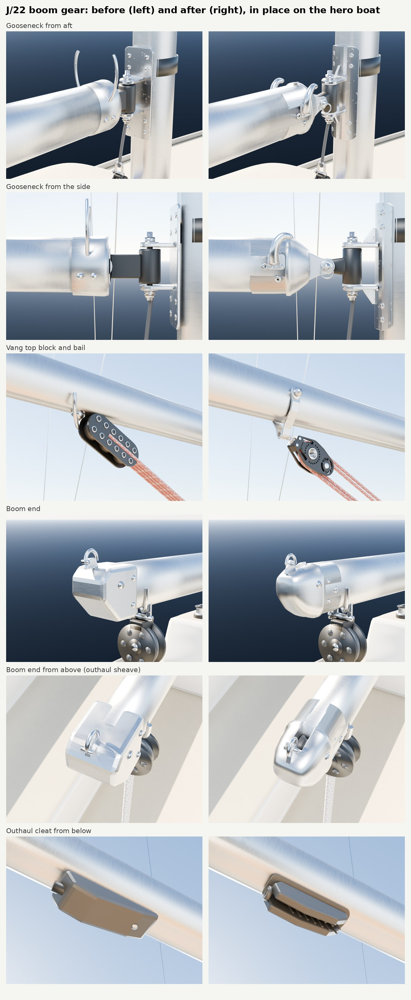

# J/22 boom gear: gooseneck, boom end, outhaul cleat and vang (Nov 8 2026)

The part detail loop ([README](README.md)) run on a whole assembly of the hero J/22 rather than one kit part: the
gooseneck, the boom's aft end, the outhaul cleat and the vang, in `Inputs/j22-hero/j22_boomgear.py` (with small changes
in `j22_details.vang`, `build_j22_hero.py` and `bake_j22_hero.py`). Bean flagged the gooseneck as unchanged after the
October photo pass; the list of next passes (Nov 8) put this assembly second.

## What changed

- **Gooseneck.** The mast plate now follows the mast's oval aft face (the old flat plate stood off it by up to 20 mm at
  the edges), with dimpled countersunk screws and a weld bead and gusset behind each tang. The black block between the
  tangs is now a toggle: a barrel round the vertical bolt on two nylon washers, a short neck, and an eye across the boat
  for the lift pin. The boom's casting has a lip proud of the boom, three pop rivets a side, the bolt-rope groove running
  out through it, and a nose that tapers into a fork whose cheeks wrap round the toggle's eye, with a boss round the pin
  each side. Before, the fork and the lift pin were buried inside the boom's sleeve. The quick-release pin has a smaller
  pull ring. The reef (port) and cunningham (starboard) hooks are stubby cast ram's horns on riveted plates, replacing
  tall wire hooks.
- **Boom end.** A cast cap plugged into the boom with a lip and rivets, its top swept down aft. The outhaul sheave (now
  grooved) sits in a slot cut through the top, its axle heads each side. A cast lug and D-shackle on top carry the
  topping lift. Before, it was a faceted extruded block with the sheave hidden inside.
- **Outhaul cleat.** A clam cleat: a base curved to the boom's underside, two jaws with seven angled ridges inside each,
  a fairlead hoop aft, and screws down the channel. Before, it was a grey wedge.
- **Vang.** The boat kit's `Fiddle40` (the vang test, [vang.md](vang.md)) hangs from a new strap bail: a 16 x 3 mm
  stainless strap from a 1/4 in through-bolt down round the boom's underside to a loop (the Kenyon K-10456 kind). It is
  part of the boom in the game (`VangBlock`, `VangBlock_bail`). The lower `FiddleCam` sits on the mast-base tang, cam
  up, and the line is reeved 4:1 through both, in the stills only, because the game draws the vang as live rope. This
  replaces `big_block`, a flat perforated bar that every reviewer called the wrong part. The vang thread's follow-up
  ("put the kit's fiddles on the hero's boom and mast foot") is done for the boom.
- **A fix the renders found.** The gooseneck's black toggle belonged to the mast in the game (`BOOM_PARTS` didn't list
  it), so it stayed pointing aft when the boom swung. It is now part of the boom.

## What stays the same in the game

- Every socket in `J22H_sockets.json` and every part's origin are identical. The build was checked with
  `J22H_SOCKETS_ONLY=1` against the committed file. `Gooseneck_vpin` (the boom's pivot) and `BoomEnd_outhaul`
  (`Boom_Clew`) keep their centres. `Boom_Vang` used to be read off the old bail's centre and is now pinned by an
  `anchor_Boom_Vang` empty at the same point.
- The full bake (`bake_j22_hero.py`, FBX per part) runs clean on the new build.
- Triangles: the whole hero goes from 554,880 to 606,016, inside the 650k cap. The boom gains about 21k for `Fiddle40`
  and the bail; `FiddleCam` (28.7k) is in the rigging still only.

| Group | Before | After |
|---|---|---|
| Gooseneck | 4,272 | 9,432 |
| Boom end | 1,092 | 2,778 |
| Outhaul cleat | 348 | 2,572 |
| Vang top block and bail | 2,540 | 21,346 |
| Vang lower block (still only) | 3,536 | 28,748 |

## Blind reviews

Three fresh reviewers for each pair, shown the same seven views as Candidate A and B in shuffled order, plus Bean's
photo of the J/22's boom, bail and blocks (`partloop/render_boomgear.py`; views: gooseneck from aft, from the side and
from above, vang top block, boom end from the side and from above, outhaul cleat from below).

| Round | Against | Result |
|---|---|---|
| r2 (r1 was a first look only) | before | **won 3 of 3** (confidence 4, 4, 4). All three called parts of before the wrong thing: "perforated domino", "cheese grater" (vang block), "machined billet" (boom end), "bar of soap" (outhaul cleat) |
| r3: shorter, boxier casting nose, stubby horns, flatter boom end | r2 | **lost**: won 0 of 3 (confidence 2, 2, 3). The shorter nose read as "a bulbous dome", "a lamp housing" |
| r4: r2's nose, r3's horns, pull ring and boom end | r2 | **won 3 of 3** (confidence 2, 3, 3), every reviewer on the gooseneck rows (the horns: r2's "read as shepherd's crooks or coat hooks") |
| final | | r4 plus one fix: a reviewer saw a "stray dark tab" at the horn tip in the side view (the casting's groove insert stood proud over the nose). It is now cut back to the lip. No new vote |

Still different from real hardware (the reviewers' shared notes on the final round, for a later pass):

- The black toggle reads as rubber. Bean's October photo (`mast-boom-gooseneck-connector`, on the PC) is why it is
  black. If the real one is cast aluminium or stainless, it's a one-word material change.
- The boom-end cap is still a smooth rounded casting. From the side, the sheave slot can't be seen (it shows from
  above).
- The mast plate is long, with eight screws. It is built from Bean's photo, so it stays until a measured photo says
  otherwise.
- The rope in the stills is pale, a cloud-preview material. The game's live rope has its braid.
- The castings share the extrusion's brushed sheen. A duller cast finish belongs to the texture loop (`CastAlu`).

## References

| Reference | Used for | Licence |
|---|---|---|
| Bean's photo of the J/22's boom, bail and fiddle blocks at Rush Creek (upload 84310630) | the bail and block look, the reviewers' reference | ours (crop only, no people) |
| Bean's October photos `mast-boom-gooseneck-connector`, `boom-end`, `boom-vang-closeup`, `outhaul-sheet-cleet` (on the PC, private) | the layout already built into the hero (plate, tangs, toggle, casting, hooks, cap, cleat) | ours; not in the cloud this run |
| Rig-Rite J/22 spar parts list (search result text; the site is blocked from the cloud) | Hall 077 boom section; gooseneck casting PR-7624 and toggle PR-7623; boom bail K-10456 for a 1/4 in bolt; outhaul casting PR-8005 | numbers only |

A measured close-up of the lesson boat's gooseneck (square to the side, and from aft) would let the outline and size
checks run on the next pass.

## Running it

    python3 Inputs/j22-hero/build_j22_hero.py -- out                 # bpy module, or blender -b --factory-startup -P ... --
    J22H_SOCKETS_ONLY=1 python3 Inputs/j22-hero/bake_j22_hero.py -- out/j22_hero.blend out   # sockets: diff against J22H_sockets.json
    python3 Tools/boatkit/partloop/render_boomgear.py out/j22_hero.blend Artifacts/partloop/BoomGear/r4

With the pip `bpy` module, import `bpy` before running the scripts (they import `bmesh` at the top). A checkout
without Git LFS needs `J22H_FONT` pointed at any TTF font for the hero's decals.

## In the game (waits for the PC)

The hero's FBX and maps in `Inputs/j22-hero/fbx` and `textures` are not rebuilt here. After Bean's "resume", the PC
lane rebuilds and bakes the hero and re-imports `SM_J22H_Boom` and `SM_J22H_Mast`, then takes a close-up of the
gooseneck and boom end in the game for the sheet.
