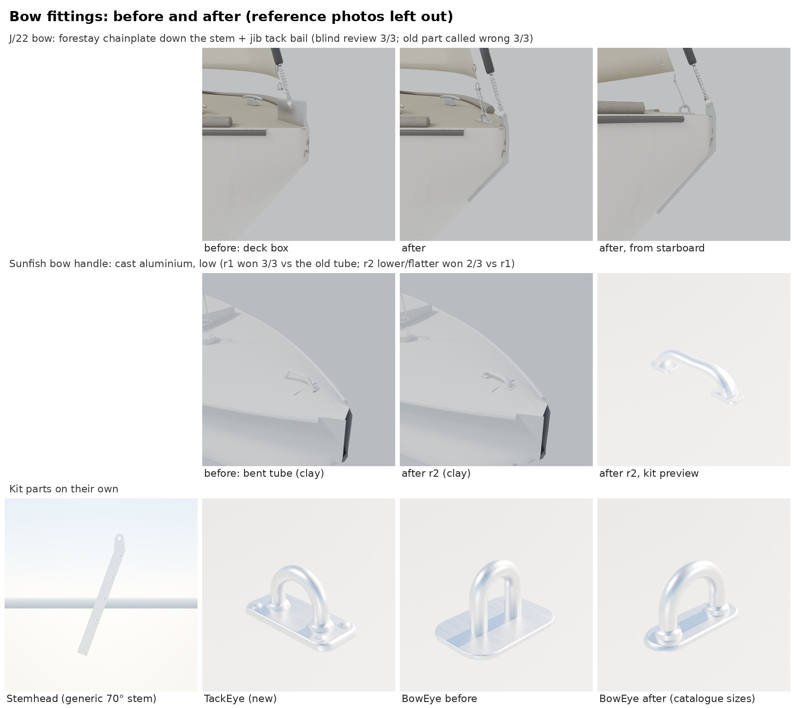

# Bow fittings (part detail loop, Nov 9 2026)

Item 11 of the next-passes list ("bow fittings"), slice boats first: the J/22 hero and the Sunfish. Method:
[README.md](README.md). Code: `Tools/boatkit/bk_part_bow.py` (Stemhead, TackEye, BowEye, BowHandle), placed by
`Inputs/j22-hero/build_j22_hero.py` (`stem_fitting`, `forestay_pin`) and `Tools/blender/build_fleet.py` (the Sunfish's
`dinghy_detail`). Cards: `Tools/boatkit/partloop/parts/{stemhead,tackeye,boweye,bowhandle}.json`.

(The sheet in the repo leaves out the reference photos; the project-files copy has Bean's IMG_9224 crop and the
Commons Sunfish photo beside the renders.)

## What the photo showed

Bean's lesson photo IMG_9224 (TX 7295 EC on its lift, Oct 4 2026, from the dock off the starboard bow) shows the J/22's
bow fittings clearly, and they are not what the hero had:

- The forestay's chainplate is a **stainless flat bar set edge-on along the stem's leading edge**, through-bolted side
  to side, its top standing up past the deck edge as the tang the forestay's toggle pins through. The hero had a
  12 x 9 cm stainless box standing on the foredeck 7 cm aft of the stem, with the forestay pinned to it.
- The jib tacks to a **separate U-bail on a plate** a hand's width aft, on the centreline. The hero's jib tack shackle
  hung in the air 11 cm above the deck.
- An open bow: no pulpit, no roller, and no bow eye on the upper stem (the lower stem is out of frame).

## Parts

| Part | What | Size | Triangles | Blind review |
|---|---|---|---|---|
| Stemhead (rebuilt) | Forestay chainplate: 6 mm bar 30 mm deep, 10 mm proud of the stem, a tang with a 10.5 mm hole (3/8 in pin) 34 mm over the deck edge, bolts every 65 mm (dome head one side, acorn nut the other). Takes the stem's own line (`stem=`), or a straight `rake`. | GUESSES off the photo against the toggle | 3,204 (light 800) | in place, after vs before: **3 of 3**, confidence 4, 4, 5; all three called the old deck box the wrong part |
| TackEye (new) | Jib tack bail: 8 mm rod, legs 30 mm apart, 30 mm high, on a 66 x 28 mm plate with four screws | GUESSES off the photo | 2,112 (light 528) | (judged with the Stemhead above) |
| BowEye (rebuilt) | Trailer bow eye: 3/8 in rod, legs 36.5 mm apart, 37 mm proud, on an oval plate | catalogue (Hardin Marine 3/8 x 2 1/2 in) | 2,392 (light 598) | not placed on a slice boat: kit only |
| BowHandle (new) | Sunfish bow handle: cast aluminium, a flattened oval grip 32 mm high arched over two oval feet 112 mm apart, an oval-head screw in each | GUESSES from class photos (no drawing public) | 11,244 (light 2,810) | r1 vs the old tube: **3 of 3**, confidence 4, 4, 4 (one called the tube the wrong part); r2 (lower, flatter section, flatter feet) vs r1: **2 of 3**, confidence 4, 3 (the loser 3) |

The jib's tack shackle now ties down to the bail with a grey Dyneema strop (two legs and a turn under the bail). The
class boats' jib foot sits close to the deck; the hero's jib tack stays where it was (11 cm up), so the strop is a GUESS
that bridges it.

The Sunfish renders in place are clay grey: the fleet boats' slots are packed (`PackFit`), so the preview can't give the
handle its own colour. The kit preview shows the aluminium.

## Socket change (J/22 hero)

`ForestayTack` (the bake reads `StemPin_pin`) moves to the new tang, over the stem's edge as in the photo: from
(3.38, 0, 0.850) to (3.438, 0, 0.824) hero metres, 5.8 cm forward and 2.6 cm down. The game draws the forestay wire from
it (`BoatModelVisuals.cpp`) and the telltale point lerps from it; the visual tests only check it exists. The hero's
forestay turnbuckle (`TB_fore`) starts at the same pin. No other socket moves.

## Still different from the photos (reviewers' notes)

- J/22: the strop's braid texture reads as a chain at a distance; the real bail and the toggle's jaw look chunkier; the
  photo's bow cleats are open chocks or cleats nearer the stem than the hero's two horn cleats (0.42 m aft), a separate
  pass if Bean wants it.
- Sunfish: still a little tall and round for some reviewers; no painter tied to it.

## On the PC (after Bean's "resume")

    scripts\windows\make-boatkit.ps1 -Import      # the whole kit (Stemhead, BowEye rebuilt; TackEye, BowHandle new)
    scripts\windows\test.ps1 -Filter SailingSim.Visual.HardwareKit

then rebake and import the hero J/22 (`bake_j22_hero.py`, `scripts/import_j22_hero.py`: the stem fitting, the bail, the
strop and the moved `ForestayTack`), and rebuild the Sunfish (and the Catalina 22, whose Stemhead now sits at its stem)
with `make-boat-models.ps1`. Then a close-up still of each bow in the game for the sheet.

## References

| Reference | Used for | Licence |
|---|---|---|
| Bean's IMG_9224 (TX 7295 EC, Oct 4 2026) | the J/22's bow layout, measured by eye | ours; not in the repo (people elsewhere in the frame) |
| [J/22 sailboat on crane 8040](https://commons.wikimedia.org/wiki/File:J22_sailboat_on_crane_8040.jpg), [Jay2PLay on trailer](https://commons.wikimedia.org/wiki/File:J-22_sailboat_Jay2PLay_on_trailer.jpg), [Knot Bad 4541](https://commons.wikimedia.org/wiki/File:J22_sailboat_Knot_Bad_4541.jpg) | open bow, jib tack close to the deck | see each Commons page |
| [Sunfish rigged for sailing](https://commons.wikimedia.org/wiki/File:Sunfish_rigged_for_sailing.jpg) | the handle's size and height on the boat | see the Commons page |
| Rigrite J/22 parts list (RR 79-J22 stemhead, 3/8 in pin) | pin size | numbers only |
| Hardin Marine 3/8 x 2 1/2 in bow eye; Marine Fasteners 1011179 | bow eye sizes | numbers only |
| Zim 48102 / West Coast Sailing 20915 (ISCA Sunfish bow handle) | what the part is | numbers only |
