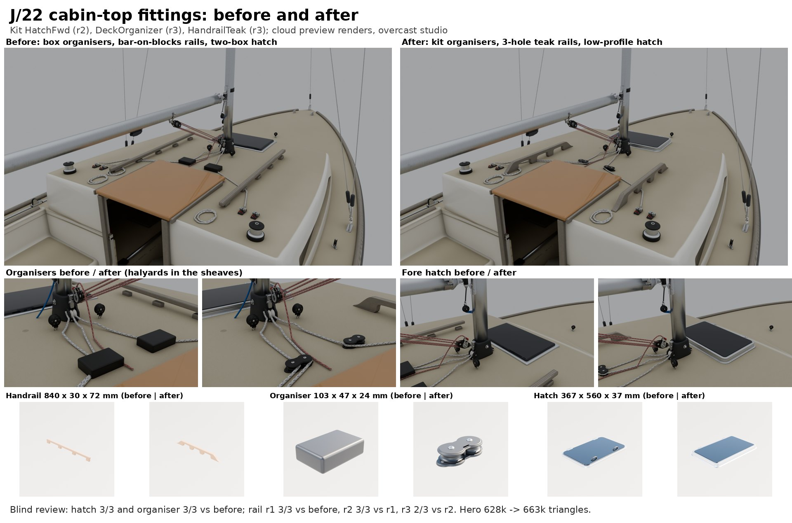

# Cabin-top fittings (Nov 9 2026)

Item 9 on the next-passes list: the J/22's fore hatch, halyard organisers and teak handrails through the part detail
loop ([README](README.md)). Three kit parts, built in `Tools/boatkit/bk_part_cabintop.py` (bk_parts loads it at its end,
so its `HatchFwd` and `HandrailTeak` replace the older builders of the same name; `DeckOrganizer` is new). Cards:
`Tools/boatkit/partloop/parts/hatchfwd.json`, `deckorganizer.json`, `handrailteak.json`.

Bean's sheet with the photo crops is in the project files (`part-detail-loop/cabintop_before_after.jpg`): it uses his
dock photo IMG_9224, which stays out of the repo with the rest of the lesson photos.

## References

No free photo or 3D model of these parts turned up (Wikimedia Commons is rate-limited from the cloud and the maker sites
are blocked), so shape came from Bean's dock photo of TX 7295 and sizes from catalogue listings, numbers only:

| Part | Sizes | Shape |
|---|---|---|
| HandrailTeak | three-loop teak rail 33 in (0.84 m), four-loop 43 in; 2-3/8 in high, 1 in across, holes 10-1/16 in apart (Whitecap / West Marine listings) | IMG_9224: three hand holes a side, tall broad feet, arched holes open to the deck, long sloped ends, dark weathered teak; reads taller and chunkier than the catalogue rail |
| DeckOrganizer | 40 mm composite two-sheave organiser: 104 mm long, 24 mm high, 70 g (marinestore.co.uk, mauripro.com, theboatwarehouse.com.au listings) | IMG_9224: black halyard hardware on the cabin top aft of the mast |
| HatchFwd | low-profile hatches (Lewmar, Vetus Magnus, Bomar): 30-40 mm high, flanged extruded aluminium frame, 10-12 mm smoked acrylic, handles inside, hinges on one edge | catalogue descriptions only |

## What they are now

- **HatchFwd** (9,832 triangles at the J/22's 360 x 560 mm, 4 slots): flanged frame with a rolled edge and countersunk
  screws every 85 mm, a sloping wall up to a black gasket, an aluminium lid band 14 mm across the top round a smoked
  acrylic pane standing 3 mm proud, two hinge knuckles with pins standing past the frame on one edge, two lever handles
  with bosses and cam tongues under the pane, a made-up TERNWAY plate on the band. Sockets `HandleS`, `HandleP`, `Hinge`,
  `Pane`. Same `w` (along X) and `d` options as before.
- **DeckOrganizer** (8,324 triangles, 2 slots; `sheaves` option, sizes 40 and 50): two grooved 40 mm sheaves on
  upright axles between dog-bone base and top plates, a raised rim on the top, a web at the waist, a screw tab at each
  end, stainless axle heads with hex sockets, a TERNWAY plate at the waist. 103 x 47 x 24 mm. Sockets `Base`,
  `Line0`, `Line1` (the groove's middle).
- **HandrailTeak** (3,300 triangles at 0.84 m / 3 holes, 1 slot): one plank, 72 x 30 mm, arched hand holes 46 mm tall
  open to the deck, broad feet flaring into it, long sloped ends, an 8.5 mm roll on every long edge, teak bungs over
  the bolts. Sockets `Grip0..n`. Same `length` and `loops` options as before.

## The checks

Sizes all pass (within 5%; the rail's height and width against the photo, wider tolerances). No outline check: there
is no square-on photo of any of the three. Features all ticked. Blind review: three fresh reviewers each round, shown
Bean's photo crops and the two rounds as A and B in shuffled order.

| Part | Round | Size | Blind review |
|---|---|---|---|
| HatchFwd | before | 365 x 559 x 46 mm (loop handles on top) | |
| | r1 | 362 x 560 x 36 | not reviewed (r2 followed at once: wider band, hinge knuckles) |
| | r2 | 367 x 560 x 37 | won 3 of 3 against before (confidence 3, 3, 3); one reviewer called the old loop handles on the lid wrong for a low-profile hatch |
| DeckOrganizer | before (hero box) | 80 x 120 x 35 | all three called it the wrong part ("project enclosure", "soap bar") |
| | r1 | 47 x 103 x 26 | won 3 of 3 against before (5, 5, 5) |
| | r2 | flat top, no crown or plate | **lost** 0 of 3 against r1 (2, 2, 2): the rim and waist plate read as a moulded part |
| | r3 | r1 at the catalogue's 24 mm height | (r1's shape, plates 1.6 mm lower) |
| HandrailTeak | before (kit) | 840 x 30 x 61, flat bar on square feet | |
| | r1 | 839 x 25 x 61, arched holes, sloped ends | won 3 of 3 against before (3, 3, 4) |
| | r2 | 839 x 28 x 67, broader feet, taller holes | won 3 of 3 against r1 (2, 3, 3) |
| | r3 | 839 x 30 x 72, 46 mm holes | won 2 of 3 against r2 (3, 2, 2) |

What the reviewers still see (for a later round):

- Rail: every round they asked for it taller and chunkier still, with holes as tall as the bar is deep or more; one
  counted four holes in the photo (the aft end is half hidden by a line; three is the read here). The preview teak is
  pale; the hero's own weathered teak is dark.
- Organiser: the sheaves show all round the waist (real ones are shrouded at the back); the base tabs stick out past
  the top plate.
- Hatch: the preview acrylic reads as an opaque blue-grey slab, so the handles under it barely show from above;
  reviewers wanted a hint of the frame and handles through it. The game's `CabinWindow` is the same opaque smoke.

## On the J/22 hero

`Inputs/j22-hero/build_j22_hero.py` now places the three kit parts with `kit_part`:

- Handrails: `HandrailTeak`, 0.84 m with three holes, starting 0.22 m forward of the cabin's aft end, 0.46 m out (it was
  a 1.09 m bar on five blocks). `Handrail_S/P` keep their names, so `HandholdCabin_S/P` and the Teak bake group follow.
- Organisers: `DeckOrganizer` a side at the same spot (it was an 80 x 120 x 35 mm box); each halyard now runs in its own
  sheave's groove, the outer cam's line on the outer sheave.
- Fore hatch: `HatchFwd` at the same place and size (`FWD_HATCH`, 360 x 560 mm with its frame), hinge forward; it was two
  boxes. Its frame's opening covers the cut `j22_interior` makes under it.

The hero went from 628,428 to 663,300 triangles. `render_j22_hero.py` has three new views: `cu_cabintop`,
`cu_forehatch`, `cu_organiser`. `Tools/boatkit/layouts/j22.json` (the light J/22) takes the same hatch size and rail
(0.84 m, three holes).

Open question for Bean: the dock photo shows a raised white panel on the cabin top aft of the mast and no clear hatch
ahead of it, where the hero (and this pass) keeps the fore hatch. A photo looking down on the cabin top would settle
where the J/22's hatch is and what it looks like.

## In the game (waits for the PC)

Nothing here is imported yet: `Inputs/boat-kit/kit.json` and the hero's FBX are left as they are, because they must
match the imported assets. On BEN-PC after Bean's "resume":

    scripts\windows\make-boatkit.ps1 -Import      # the whole kit: new HatchFwd, HandrailTeak, DeckOrganizer
    scripts\windows\test.ps1 -Filter SailingSim.Visual.HardwareKit

then the hero J/22 rebuild, bake and import (with the other waiting hero changes), and the light J/22 re-dress from
`layouts/j22.json`. The Catalina 22, Corsair 880 and Catalina 30 also use `HatchFwd` and `HandrailTeak`
(`Tools/blender/build_fleet.py`, same options), so they pick up the new parts at their next fleet rebuild; nothing
there changes until then.
