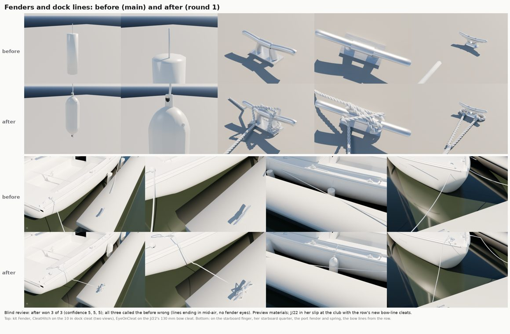

# Fenders and dock lines (Nov 2026)

Item 12 of the next-passes list: the fenders and dock lines on Bean's boat in her slip. Before this pass the J/22's
in-slip dress (`Tools/blender/build_berthed.py`, dress 0, which the player's boat wears tied up in her slip) drew each
fender as a plain 10-sided tube with a 4-sided line, and each dock line as a 5-sided 12 mm tube that ended at a fixed
point 0.5 m up, nowhere near a cleat (the bow lines ended over the water). The kit's `Fender` was a 150 x 500 mm
lathe with ring ribs and wire eyes.

## What real ones are (free sources: catalogue listings and sizing guides)

- **Fender**: a twin-eye ribbed vinyl fender, 6.5 x 22 in (165 x 559 mm), the size listed for 20 to 30 ft boats
  (Polyform G-4 class twin-eye listings on marineengine.com; Taylor Made and generic 6.5 x 23 in ribbed listings).
  Straight body, rounded shoulders into blunt ends, a moulded eye lug at each end, an inflation valve on a shoulder.
  The 30 footer gets 8.5 x 27 in.
- **Dock line**: 3/8 in (9.5 mm) three-strand nylon for boats to about 27 ft (BoatUS, West Marine and Sea-Dog sizing),
  with a 12 in (305 mm) spliced soft eye (Sea-Dog 3/8 in x 15 ft). 1/2 in on the 30 footer.
- **Making fast** (ASA 101): the spliced eye goes round the boat's cleat, the line is made fast on the dock's cleat with
  a cleat hitch: a turn round the base (far horn first), a figure eight over the top, a locking hitch, the tail on the
  dock. Fender lines are clove-hitched to a shroud or a deck fitting.

## The kit parts (`Tools/boatkit/bk_part_docking.py`, ropework maths in `bk_ropework.py`)

| Part | What | Triangles, slots |
|---|---|---|
| `Fender` (rebuilt) | twin-eye ribbed vinyl fender, 165 x 559 mm, 12 lengthwise ribs, moulded eye lugs with an 18 mm hole, valve; origin at the top eye's hole (it hangs from there) | 8,432, 1 (WhitePlastic) |
| `DockLineEye` | 3/8 in three-strand line with a 12 in soft eye and five tucks tapering to the cut ends | 14,524, 1 (Rope) |
| `CleatHitch` | the line made fast on the club's 10 in dock cleat (rope only, cleat frame) | 17,928, 1 (Rope) |
| `EyeOnCleat` | the eye dropped round the J/22's 130 mm horn cleat, under both horns, throat and splice leading off | 12,734, 1 (Rope) |

Three-strand rope is real geometry (three right-hand strand helices, one lay every 3.3 diameters), so the lay shows
without a texture; the berthed dress has no UVs, so geometry is the only way it can show there.

## On the boat (`Tools/blender/build_berthed.py`)

- Fenders: the same twin-eye shape (ribbed, or plain in a navy cover on the covered variants), hung from their top eye.
  On the J/22 the forward fender's line is clove-hitched to the lower shroud a hand's width above the turnbuckle, the
  aft one to a deck fitting by the jib track.
- Dock lines in a slip (J/22, Catalina 22): each a spliced eye round her cleat, over the rail, a little slack, and a
  cleat hitch on a real dock cleat where `FMarina::Load` and `AMarinaActor::DockKitPlacements` put it: the bow lines to
  two new cleats on the row's edge ahead of each berth (`RowCleatPoints`, MarinaActor.cpp), the starboard stern line to
  the starboard finger's end cleat and the port quarter's spring to the port finger's middle cleat, so two neighbours
  sharing a finger never make fast on the same cleat.
- The Catalina 30 lies alongside a pier the dress can't see: her lines keep their old ends, in the new rope.
- J/22 heights and cleats follow the hero (`J22H_sockets.json`, kit layout), since the player's boat is the hero.
- Triangles: J/22 dress 0 goes from 1,776 to 88,732 (variants 75,824 to 98,526); Catalina 22 73k to 96k; Catalina 30
  15k to 36k. Nanite and shadowless, one mesh per variant instanced across the marina, but the Mac world gate should
  check the marina's frame time.

## Review

| Round | Blind review |
|---|---|
| r1 | won 3 of 3 against before (confidence 5, 5, 5); every reviewer called the before plainly wrong (lines ending in mid-air, an eyeless drum of a fender) |

Still different from the real thing (the reviewers' shared notes on r1):

- The dock cleat hitch reads as a tangle from the dock: the figure eight and locking hitch don't separate cleanly.
- The fender's ribs barely show in the preview light; the eye lugs read small.
- The eye at the 130 mm boat cleat reads as two parallel strands more than an eye round the horns.
- The spans are nearly straight; 3/8 in nylon would droop a little more. Tails trail rather than lie flaked.

No photo references this run (the cloud can't download from Wikimedia), so there is no outline score; sizes are the
catalogue numbers.

## In the game

- **Mac**: compile (`MarinaActor.cpp`: `RowCleatPoints`, two row-edge cleats per berth in `DockKitPlacements` and in the
  fallback boxes), world gate (marina frame time with the heavier dresses).
- **PC, on resume**: rebuild the berthed dresses (`scripts\windows\make-boat-models.ps1`, the `build_berthed.py`
  loop) and import them (`import_boats.py berthed`); `make-boatkit.ps1 -Import` for the kit's new and rebuilt parts
  (`Inputs/boat-kit/kit.json` is left for that import, as in earlier passes); rebake the marina only if the fallback
  boxes are used (the kit-mesh path places the new cleats at run time). Then an in-game close-up in the home slip.
- Not done (game code): the player's lines when she ties up away from her slip (the T key) are physics only, nothing
  is drawn; and in her slip the dress's hitches ride with the boat, so if she surges in the slip they drift a few cm off
  the dock cleats. Drawing the player's dock lines live from her cleats to the dock's would fix both.
- Edge slips: the first berth of each row side has no finger on one side, so its lines on that side end over the water.
