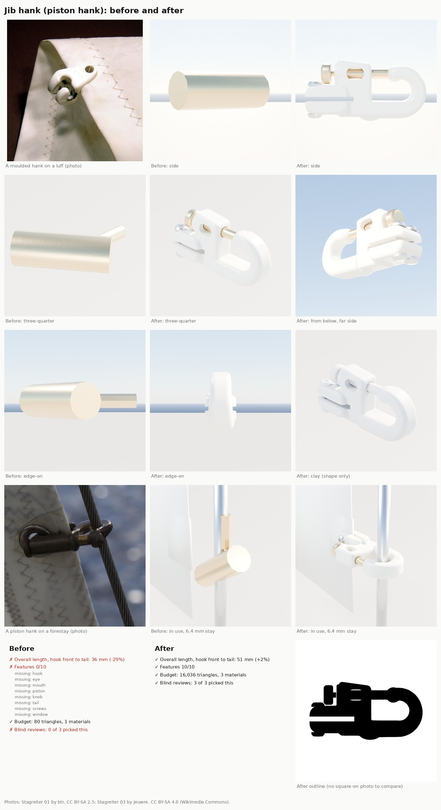

# Jib hank (Nov 8 2026)

Bean's hardware reference sheet (middle row, fourth: "Jib Sail Hank") asked for each part to go through the loop
([README.md](README.md)). This is the jib's piston hank: the small clip that holds a hank-on jib's luff to the forestay.
The kit had none; the only hank in the project was the J/22 hero proof of concept's, a plain bronze cylinder with a pin
(`Inputs/j22-hero/build_j22_hero.py`).

Card: `Tools/boatkit/partloop/parts/jibhank.json`. Builder: `Tools/boatkit/bk_part_jibhank.py` (its own file, loaded by the
`bk_part_*.py` block at the end of `bk_parts.py`, so parallel part threads don't edit the same lines). Target: a moulded
nylon piston hank for 6.4 mm (1/4 in) wire, 50 mm overall, brass piston, two screws through the sail (catalogue).

## Rounds

| Round | Length | Eye / mouth (clear, for 6.4 mm wire) | Features | Triangles | Blind review |
|---|---|---|---|---|---|
| Before | 36 mm (-29%) | no eye | 0/10 | 80, 1 slot | lost 0 of 3 to r1; all three called it "a plain cylinder with a stub", not a hank |
| r1 | 49.9 mm | 8.4 / 8.6 mm | 10/10 | 17,836, 3 slots | won 3 of 3 against before (confidence 5, 5, 5) |
| r2 | 50.9 mm | 8.0 / 7.4 mm | 10/10 | 16,612, 3 slots | won 2 of 3 against r1 (confidence 3, 3, 3): rounded window, clearer split tail, bigger knob and piston |
| r3 | 51.0 mm | 8.2 / 7.5 mm | 10/10 | 16,036, 3 slots | won 3 of 3 against r2 (confidence 2, 2, 2): plain brass cap instead of a knurled thumbwheel, softer join of hook and body |

No outline check: none of the free photos is square-on (the card has `"outline": null`, as the vang's does). Instead
`partloop/render_hank.py fit` casts rays through the built mesh and checks the hook really works: the eye clears a 6.4 mm
wire by at least 1 mm and the mouth (piston drawn back) is wider than the wire.

How it is built (`_jib_hank_parts`): the hook is a swept rounded section that leaves the body's underside chunky and
tapers round the eye to a rounded tip; a block holds the piston and its top rises toward the knob; the tail's two cheeks
are a taller block below the piston's line. A web where hook and body meet, a boss round the knob, and a voxel remesh
with smoothing fuse it all into one moulding with soft fillets. Then the luff slot, the piston's bore, the rounded side
window and the screw holes are cut, and it is reduced to the budget. Brass piston and flat-topped knob, two stainless
pan-head screws with cross recesses (heads on top, nuts below).

The part's frame differs from the deck fittings because it hangs on a wire: the origin is the stay's centre in the eye
and the stay runs along the part's Y, so the J lies in XZ and the loop's "side" view is the square-on one. The sail's
plane is parallel to XY, 3.4 mm below the eye's centre, aft along -X. Sockets: `Stay`, `Luff`, `Piston`, `Knob`.

New material slots in `scripts/make_materials.py`: `WhitePlastic` (UV-stabilised ivory nylon) and `Brass`. They become
`MI_Boat_WhitePlastic` and `MI_Boat_Brass` the next time make-content runs.

Still different from the photos (the reviewers' shared notes on r3, for a later round):

- The hook is still slimmer than the real chunky curl, and its tip a small bead where real ones are blunt and lipped.
- The body is a boxy block with a flat top; real ones sweep from the tail into the hook in one curve.
- The window is small; the catalogue's is a larger rounded pocket.
- The tail is a thin split plate with small screws; real cheeks are broader with bigger heads.
- The preview light washes the white out (the same for every round; a lighting job, not a shape one).

## Putting it on the boats (not done yet)

The jib in the game is cloth (`FSailCloth`) on a forestay line, so the hanks belong to the sail, not to a deck layout:

1. Mac: run make-content for the two new material instances.
2. PC: `scripts\windows\make-boatkit.ps1 -Import` (the whole kit) so `SM_Kit_JibHank` and its light copy exist.
3. Game: place 8 or 9 hanks evenly up the J/22 jib's luff, each with its `Stay` socket on the forestay line and its X
   axis aft along the sail, moving with the cloth's luff points; draw the light copy beyond arm's length. The J/22 class
   boats often carry bronze hanks: a bronze variant (same builder, brass body) is a small follow-up if Bean wants it.
4. A close-up still on the boat for Bean, as for every part.

## Running it

    python3 Tools/boatkit/partloop/render_views.py JibHank Artifacts/partloop/JibHank/r3
    python3 Tools/boatkit/partloop/render_hank.py in_use Artifacts/partloop/JibHank/r3       # on a stay with the luff in the slot
    python3 Tools/boatkit/partloop/render_hank.py fit Artifacts/partloop/JibHank/r3          # eye and mouth vs the wire
    python3 Tools/boatkit/partloop/render_hank.py before Artifacts/partloop/JibHank/before   # the old hank (loop only)
    python3 Tools/boatkit/partloop/render_hank.py in_use_before Artifacts/partloop/JibHank/before
    python3 Tools/boatkit/partloop/score.py Tools/boatkit/partloop/parts/jibhank.json Data/Reference/raw/parts/JibHank Artifacts/partloop/JibHank/r3

Built and rendered in the cloud with the `bpy` module (Blender 5.2.3). `build_kit.py --only JibHank` exports the hero
(16,036 triangles) and light (4,008) copies with all four sockets.

## References

None of these are in the repo; the git-ignored copies are in `Data/Reference/raw/parts/JibHank/`.

| Reference | Used for | Licence |
|---|---|---|
| Bean's hardware reference sheet (Nov 8 2026, "Jib Sail Hank") | the target look: white body, brass piston and knob, two screws | a third party's catalogue picture: looking at only, not in the repo |
| [Stagreiter 01](https://commons.wikimedia.org/wiki/File:Stagreiter_01.jpg) (btr) | moulded hank on a luff: hook curl, screw through the tail | CC BY-SA 2.5 |
| [Stagreiter 02](https://commons.wikimedia.org/wiki/File:Stagreiter_02.jpg) (btr) | the hook's plane square to the sail | CC BY-SA 2.5 |
| [Stagreiter 03](https://commons.wikimedia.org/wiki/File:Stagreiter_03.jpg) (Jeuwre) | a piston hank on a forestay: how it sits in use | CC BY-SA 4.0 |
| Nylon piston hank for 1/4 in wire: [Defender](https://defender.com/en_us/ronstan-pacific-piston-hank), Vela Sailing Supply listings | 50 mm long, nylon body, brass piston, screws, 8 g | numbers only |

The sheet in this folder uses the two CC BY-SA photos (credited on it); the copy for Bean with his reference picture is
in the project files only.
