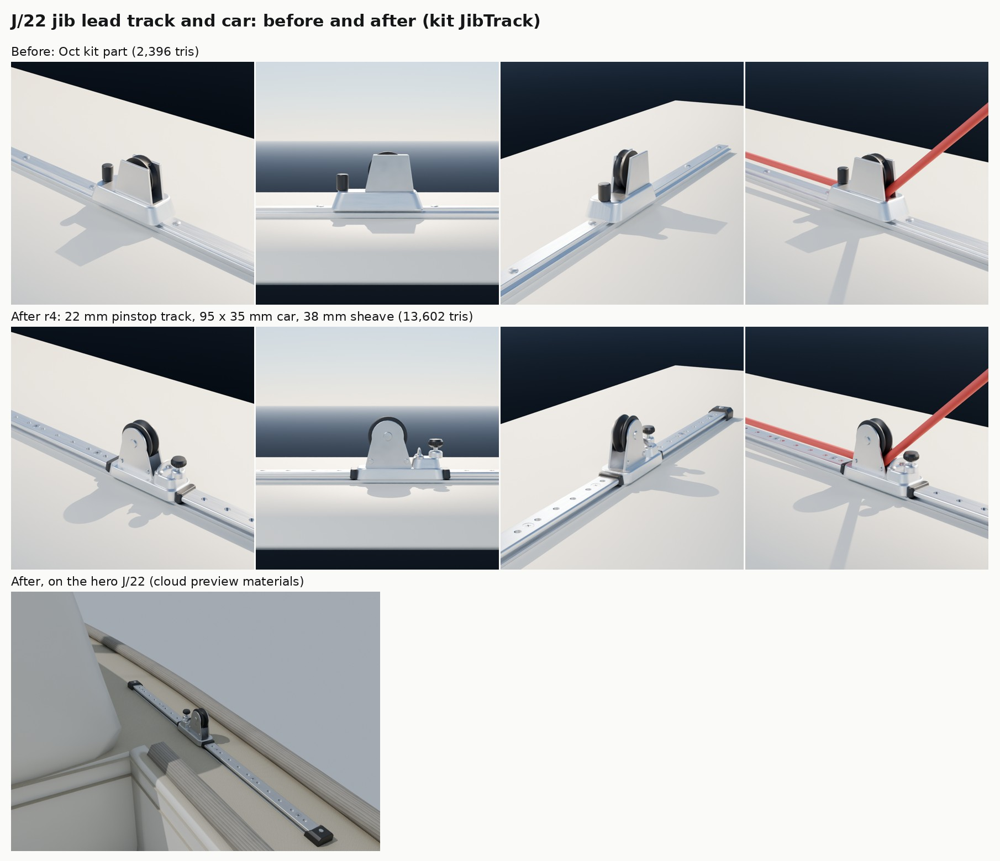

# J/22 jib lead: track, car, stops and lead sheave (Nov 9 2026)

The part detail loop ([README](README.md)) on the kit's `JibTrack` (and `TrackCar`, the same car on its own). It is
item 4 on the list of next passes: the J/22's jib sheet runs through it on every tack, a metre from the helm. The hero
J/22 places it on each side deck beside the cockpit's forward end (`build_j22_hero.py`, `kit_part("JibTrack", ...)`),
and `Tools/blender/build_fleet.py` puts the 450 and 900 mm versions on two fleet boats.

## What changed

Both parts now live in `Tools/boatkit/bk_part_jibtrack.py`; the loader at the end of `bk_parts.py` imports it and its
`@part`s replace the old ones.

- **Track.** A 22 mm small-boat T-section (a 25 mm foot, a waist the car's lips run under, a 22 mm head) instead of a
  25 mm bar. A row of pinstop holes along the top every 25 mm, and flat-head screws in countersinks every 100 mm (the
  catalogue's 5 mm fasteners at 100 mm), flush, with a cross recess. Before, raised round screw heads and no holes.
- **End stops.** A moulded black stop over each end with one screw on top, its inboard face sloped. Before, none.
- **Car.** A 95 x 35 mm slider (catalogue: 95 mm, 35 mm) with black moulded end caps, a low saddle aft under the
  sheave and a raised shoulder forward. The sheet now runs **under** the sheave, between the cheeks, and leaves aft over
  the car's end, as on a real genoa car (the car pulls the sheet down; the old car's sheave sat low in a tub and the
  sheet had nowhere to go).
- **Sheave.** 38 mm (catalogue), grooved for 8-12 mm line, black, on a stainless bearing race, between two stainless
  cheeks whose tops stop inside the sheave's rim so the rim shows; axle heads and two cheek rivets.
- **Pinstop and eye strap.** A spring pinstop on the forward shoulder (turned housing, pin, knurled round pull knob)
  and a low flat eye strap just forward of the cheeks, where the J/22 class's 2:1 jib sheet is tied.
- Three slots as before (Aluminium, Stainless, BlackPlastic). `JibTrack` 600 mm: 13,602 triangles (was 2,396); the
  light copy about 3,400. `TrackCar`: 9,996 (was 1,584).

## What stays the same in the game

- `Sheave` is still the sheave's centre at (10, 0, 45) mm, so the hero's `JibLead_S`/`JibLead_P` sockets don't move.
  The build was checked with `J22H_SOCKETS_ONLY=1`: `J22H_sockets.json` comes out identical. `CarFwd` and `TrackEnd`
  are unchanged too.
- New sockets: `Lead` (where the sheet runs, under the sheave, 20.5 mm up), `SheetEye` (the eye strap) and `Plunger`.
  Nothing in the game reads them yet. The game's live jib sheet still aims at `JibLead` (the sheave's centre), so in
  the game it passes through the sheave rather than under it; pointing the rope at `Lead` is a small Mac code step for
  later.
- The hero's stills now drape the sheet under the sheave (`build_j22_hero.py`, the `JibSheetLee` and `JibSheetLazy`
  waypoints). The whole hero goes from 606,016 to 625,564 triangles (two tracks).

## Rounds

| Round | Sizes | Features | Triangles | Blind review |
|---|---|---|---|---|
| Before | width 40 mm (+14%) | 3/9 | 2,396 | |
| r1-r2 | | | | first looks only: the car was built 11 mm too low (sunk into the track) and its sheave mid-car, so the sheet ran into the pinstop |
| r3 | pass | 8/9 | 10,970 | **won 3 of 3** against before (confidence 4, 4, 4). Two called before nearly the wrong part: "a block in a moulded tub", "a fairlead or a lead block in a tub" |
| r4 | pass | 9/9 | 13,602 | **won 3 of 3** against r3 (confidence 3, 2, 2): a deeper waist on the track, slimmer end caps inside the car's outline, a low flat eye strap, a knurled round knob instead of a star |

No outline check: no square-on photo with a licence we can use turned up (Wikimedia Commons rate-limited the cloud and
maker sites are blocked), so the card's `outline` is null and the reviewers judged against the catalogue description.

Still different from the real thing (the reviewers' shared notes on r4, for a later pass):

- The track's waist is hard to see from the side at arm's length; it reads as a flat bar.
- From some angles only the near cheek reads (both are there, the same silver as the car); a real car's cheeks are
  often a different finish from the anodised car.
- The knob still reads to some as a clamping knob; a real pinstop knob is a plain round pull.
- The end stops are plain moulded blocks; real low-load stops are smaller.
- A measured photo of the lesson boat's car (square to the side) would let the outline check run and settle its
  colours (silver or black track, black or grey sheave).

## References

| Reference | Used for | Licence |
|---|---|---|
| Harken J/22 one-design deck layout (search-result text; the site is blocked from the cloud) | 22 mm small-boat track and a 22 mm car on each side deck | numbers only |
| Harken 2751 22 mm low-beam pinstop track listings (sailingservices.com, fisheriessupply.com) | 600 mm = 252 g (so a ~155 mm2 section), 5 mm flat-head screws every 100 mm, 6061-T6 hard-anodised | numbers only |
| Harken G226S 22 mm pinstop slider car listings (sailingservices.com, velasailingsupply.com) | 95 mm long, 35 mm wide, 38 mm sheave, line to 12 mm (replaces the older 393 cars) | numbers only |
| Harken 2750 pinstop eye-strap car listings (westcoastsailing.net, defender.com) | the eye strap, 88 x 33 mm | numbers only |
| North Sails J/22 tuning guide; UCI J/22 sailing manual; West Coast Sailing J/22 2:1 jib sheet listing | use: sheet from the clew to the car's sheave, 2:1 sheet tied to the car's eye, lead moved aft a hole or two in a breeze | text only |

Estimates (no catalogue number): track height 11 mm, pinstop hole pitch 25 mm, cheek shape, knob size, end-stop size.

## Running it

    python3 Tools/boatkit/partloop/render_views.py JibTrack Artifacts/partloop/JibTrack/r4          # bpy module
    python3 Tools/boatkit/partloop/render_jibtrack.py Artifacts/partloop/JibTrack/r4x                # car close-ups, in use
    python3 Tools/boatkit/partloop/score.py Tools/boatkit/partloop/parts/jibtrack.json Data/Reference/raw/parts/JibTrack Artifacts/partloop/JibTrack/r4

Run `render_jibtrack.py` from a checkout of main for the "before" close-ups (it builds whatever is registered).
The hero's own close-up of the starboard lead is `render_j22_hero.py <blend> <out> cu_jiblead`.

## In the game (waits for the PC)

The kit's `kit.json` and the hero's FBX are not rebuilt here. On BEN-PC: `scripts\windows\make-boatkit.ps1 -Import`
(the whole kit), then rebuild and bake the hero and re-import `SM_J22H_Hull`, then a close-up of the jib lead on the
boat in the game.
