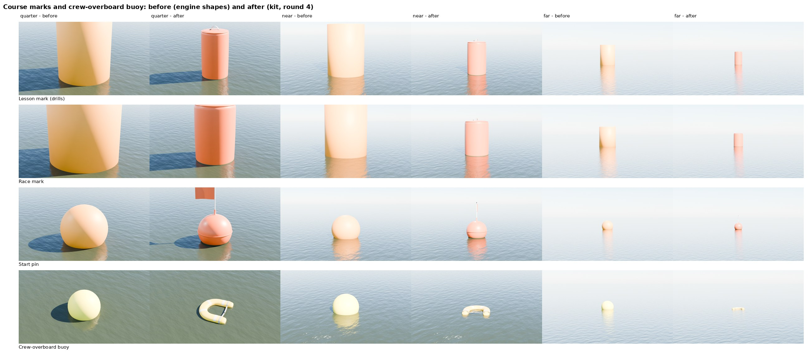

# Course marks and the crew-overboard buoy (Nov 8 2026)

The drills and races drew placeholders: `SailboatPawn::UpdateDrillVisuals` an orange engine cylinder for each lesson
mark (1.2 m across, 2.0 m tall) and a yellow sphere for the crew-overboard "dummy"; `ATrafficManager::StartRace` a
1.6 x 2.2 m cylinder for each race mark and a 1.1 m sphere for the pin. This run replaces them with four kit parts in
`Tools/boatkit/bk_part_marks.py`, sized from the catalogues, and teaches the game to load them.

| Part | What | Size | Triangles, slots |
|---|---|---|---|
| `RaceMark` | inflatable cylindrical racing mark: faded orange PVC, welded vertical seam and cap flanges, webbing lifting handle and valve on top, webbing loop and stainless ring underneath | 0.90 m across, 1.50 m overall, 0.20 m under | 14,524, 5 |
| `LessonMark` | the same at the school size | 0.61 m across, 1.22 m (4 ft), 0.15 m under | 14,524, 5 |
| `PinBuoy` | the start pin: an inflatable ball (two welded halves) on a fibreglass staff with an orange flag and a weight on its foot | 0.80 m ball, staff tip 1.34 m up, 45 x 30 cm flag | 12,636, 6 |
| `HorseshoeBuoy` | US Type IV horseshoe buoy: faded yellow vinyl over foam, welded edge seams, four reflective patches, web strap and snap across the open end; floats flat | 610 x 585 x 100 mm, about a third under | 6,308, 4 |

Unlike deck fittings these float, so the **origin is on the waterline**. New library slots in `make_materials.py`:
`MarkVinyl` (sun-faded orange PVC with a soft clear-coat sheen), `MarkScum` (the band from the waterline to 25 mm above
it, algae and silt over the orange) and `MOBVinyl` (faded yellow).

## Rounds

There is no photo reference this time: Wikimedia's upload host is blocked from the cloud container (every download was
reset), so sizes come from catalogue numbers and the blind reviewers judged against what they know of the real things.
The cards (`partloop/parts/racemark.json`, `lessonmark.json`, `pinbuoy.json`, `horseshoebuoy.json`) have
`"outline": null`. Renders are `partloop/render_marks.py`: each part floating on a lake from a J/22 helm's eye
(1.3 m) at a few metres, at 25 to 30 m, and a close quarter view; `--before` draws the engine shapes as the game places
them today.

| Round | Change | Blind review |
|---|---|---|
| r2 | first full build (r1 plus a deeper orange and a visible scum band) | won 12 of 12 against the placeholders (confidence 5 throughout); every reviewer called the yellow sphere the wrong object |
| r3 | 6% domed caps, two seams, bigger handle and flag, slack horseshoe strap, shorter ends | **lost** to r2 on all four (1 of 3 each): the domes read as a cone or bottle cap, the seam's foot in the scum band read as a defect, the slack strap as a broken tail |
| r4 | r2's shapes; overall height now includes the cap domes (catalogue height), seam stops above the waterline, darker scum band | won 3 of 3 (lesson mark, race mark) and 2 of 3 (pin, coin flips) against r2; r2's beige band read as a plinth. The horseshoe is r2's |

Sizes (score.py): race mark 917 x 927 mm (+2%, +3%), horseshoe 560 x 615 mm (-4%, +1%); all within the 20,000 triangle and
8 slot budget.

Still different from a real one (the reviewers' shared notes on r4):

- The preview renders the orange pale and pinkish (AgX in the cloud preview; the same for before and after). Check the
  colour in game.
- The PVC is perfectly smooth: no tension wrinkles or sag; the seam is a crease more than a flat weld strip.
- The handle and valve are hard to see from the helm; the pin's flag is stiff and edge-on from some angles.
- The horseshoe is small and low from 15 m (true to size; a drill may want it easier to spot).

## In the game

`CourseMarks::Load(Part)` (Source/SailingSim) returns `/Game/Boats/Kit/SM_Kit_<Part>` when it has been imported, and
null otherwise. `UpdateDrillVisuals` and `StartRace` use the kit mesh at the water's height, scale 1, its own
materials and a turn so the seams don't all face one way; until the import they draw the engine shapes as before.
`SailingSim.Visual.CourseMarks` checks the imported sizes and that each floats with its origin on the waterline (it
passes with a note before the import). The marks don't bob with the waves (neither did the placeholders).

On BEN-PC after Bean's "resume":

    scripts\windows\make-boatkit.ps1 -Import
    scripts\windows\test.ps1 -Filter SailingSim.Visual

The import also builds `MI_Kit_MarkVinyl`, `MI_Kit_MarkScum` and `MI_Kit_MOBVinyl` from the library.
