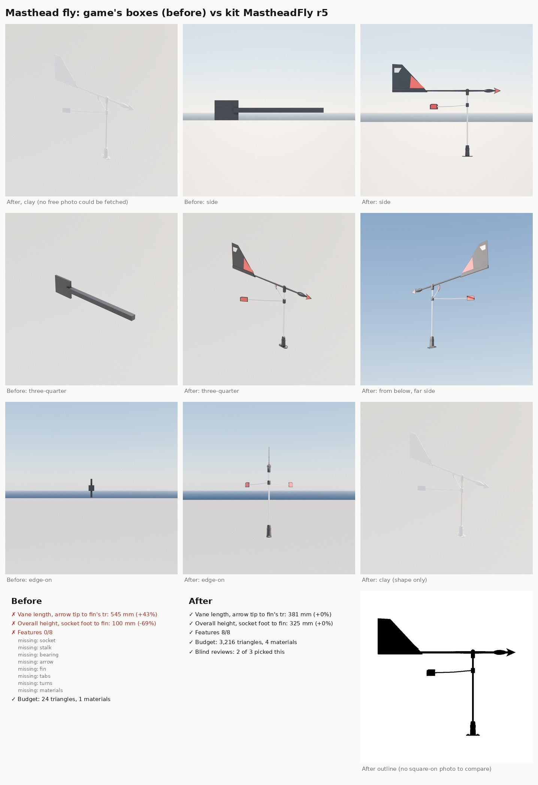

# Masthead fly (Nov 8 2026)

Bean asked for a modelling pass on the masthead fly, the wind indicator on top of the mast, through the part detail loop
([README.md](README.md)). The kit had no masthead fly. The game draws one from two black boxes (`SailboatPawn`:
`FlyArrow`, 450 x 25 x 25 mm, and `FlyVane`, 120 x 10 x 100 mm, floating 80 mm above the masthead with no stalk), and
`Tools/blender/build_fleet.py` gives the fleet boats a bare 0.35 m stainless stick.

Card: `Tools/boatkit/partloop/parts/mastheadfly.json`. Builder: `Tools/boatkit/bk_part_mastheadfly.py` (its own file,
loaded by the `bk_part_*.py` block at the end of `bk_parts.py`). Target: the common keelboat fly of the "Windex" type
(a trademark; the model carries no brand): 15 in (381 mm) vane, 12.75 in (324 mm) tall, for boats of about 20 to 40 ft
such as the J/22. Size `10` builds the 10 in dinghy model (254 mm vane, about 240 mm tall).

## What it is

A black flanged socket screwed to the masthead with a tapered boss and a lock collar; a thin stainless stalk; a vane
turning on a bearing cap at the top (a moulded oval arm, a barbed arrowhead with red reflector inlays and a teardrop
counterweight forward, a tall fin with a long swept leading edge aft, mostly black, with a red reflective triangle low
and forward and a white strip along the top); and under it a collar with two wire arms reaching aft 34 degrees either
side of the centreline to red reflector tabs (the close-hauled marks the helm lines the vane up with). An optional bird
spike (`spike=True`) stands 240 mm above the cap, as on the fly in Bean's Rush Creek photo.

Frame: origin at the socket's foot on the masthead's top plate, +Z up, the vane drawn pointing forward (+X), tabs aft.
Sockets: `Mount`, `Pivot` (the bearing, on the arm's line), `VaneTip`, `TabL` / `TabR`.

Because the game turns its vane to the apparent wind (`MastheadFly->SetRelativeRotation`), the kit also has the two
halves: `MastheadFlyVane` (the turning vane, origin at the pivot) and `MastheadFlyMount` (socket, stalk and tabs, with a
`Pivot` socket where the vane goes). New material slot `RedPlastic` (red reflective film) in `scripts/make_materials.py`;
it becomes `MI_Boat_RedPlastic` the next time make-content runs.

## Rounds

| Round | Vane / height | Features | Triangles | Blind review |
|---|---|---|---|---|
| Before (game boxes) | 545 / 100 mm | 0/8 | 24, 1 slot | lost 0 of 3 to r3; all three called it the wrong part ("a square plate on a bar") |
| r1 | 381 / 322 mm | 8/8 | 3,210, 4 slots | (look check only) big red and white panels filled the fin; Bean's photo shows a dark vane |
| r2 | 381 / 322 mm | 8/8 | 3,250, 4 slots | fin black with a smaller red triangle and white strip; bird spike on |
| r3 | 381 / 322 mm | 8/8 | 3,218, 4 slots | won 3 of 3 against before (confidence 3, 3, 3); spike off by default (the catalogue height excludes it), thicker tab wires |
| r4 | 381 / 325 mm | 8/8 | 3,216 | lost 1 of 3 to r3: tabs moved up close under the vane read as tucked against the arm |
| r5 | 381 / 325 mm | 8/8 | 3,216, 4 slots | won 2 of 3 against r3 (confidence 1, 1, 1): taller socket, slimmer flange, longer swept fin, tabs at 180 mm |

All five checks pass on r5 except the outline, which is not checked: no square-on photo could be fetched (the card has
`"outline": null`). upload.wikimedia.org refused the cloud session all evening, so the references are the catalogue
numbers and Bean's own Oct 4 photo of a fly on a Rush Creek mast (a crop with no people; measure and compare only, not in
the repo). The repo copy of the sheet shows the clay render where the reference photo goes; the copy with Bean's photo
is in the project files.

`partloop/render_masthead.py` renders a part on the top 1.2 m of a J/22-size mast (render-only dressing) from the cockpit
and from abeam, and registers `MastheadFlyGameBoxes` (the game's two boxes) for the before round. Every round, before
included, was rendered at the -1 stop exposure of `render_metal.py`.

Reviewers' remaining notes on r5: bolder or larger reflective film on the fin; tabs and arrow a little small next to the
vane; the socket could read more as a moulded block. Not done: the club burgee on a stick (an older style), placing the
part in the game (`SailboatPawn`'s boxes and `build_fleet.py`'s stick still draw today), and the in-game close-up, which
waits for the PC.
