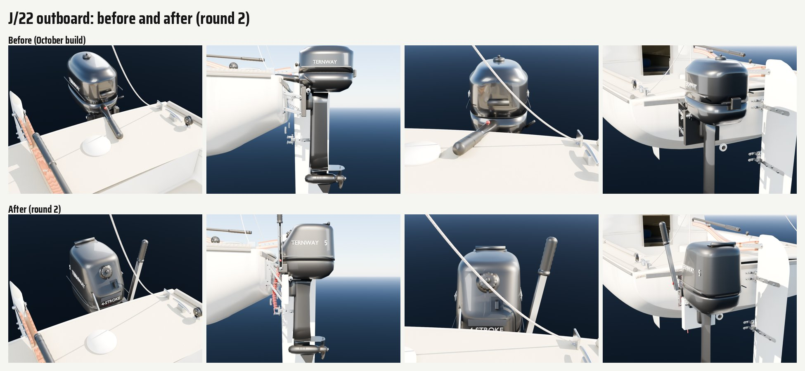

# J/22 outboard and transom bracket (Nov 9 2026)

The part detail loop ([README](README.md)) run on the hero J/22's outboard, item 8 on the list of next passes. The
motor and its bracket are built in `Inputs/j22-hero/j22_outboard.py` and are part of the hull in the game (no sockets).

## Reference

Bean's lesson photos from Rush Creek (Oct 2026) show the club boat's motor from the helm: a black 4-6 hp
single-cylinder long-shaft four-stroke, its tiller arm folded up while sailing, a red coiled kill cord hanging from the
front of the pan, a white parallel-arm transom bracket with a lift lever. Only crops with no people were used
(IMG_9273, IMG_9266), and they stay in the project files, not here: they show a real maker's marks, and the model uses
the kit's made-up TERNWAY instead. Sizes are catalogue numbers only (20 in / 508 mm long shaft, 25-27 kg, 7.8 in prop).

## What changed

- **Cowl.** A tall, straight-sided cowl (0.43 m long, 0.29 m wide, 0.38 m from the clamp's top to the top) with a raked
  front face, in place of the squat domed one. On the face: a big knurled fuel cap high up in a dark well, the choke
  lever in its slot below it, a badge plate and "4-STROKE". A carry handle sunk in a recess at the back of the top.
  TERNWAY and the horsepower on both sides, set onto the curved surface.
- **Pan.** The shift lever (with its N) on the inboard front corner, the kill switch and clip at the front, and the red
  coiled lanyard hanging from it, bowing forward clear of the clamp.
- **Tiller arm.** Folded up as it is stowed under sail (it lay forward over the aft deck): an open aluminium channel
  leaning a little outboard, with the throttle cable inside, braces, the stop button, and a ribbed black twist grip.
- **Shaft.** 508 mm from the clamp's top to the cavitation plate (a 20 in long shaft; it was 620 mm). The cavitation
  plate stays where it was, so the clamp and pad sit 0.11 m lower and the bracket's arms run down to them.
- **Bracket.** Light anodised aluminium (`CastAlu`) instead of stainless, side cheeks, longer arms, a long lift lever
  with a black knob, a white HDPE pad. A black swivel yoke with a friction knob joins the swivel to the pan.
- **Finish.** `OutboardBlack` is satin (roughness 0.42, clear coat 0.25) instead of glossy (0.28, 0.6), in
  `j22_materials.py` and `materials.json`.

Triangles: the outboard group goes from 12,876 to 20,778; the whole hero from 631,628 to 639,530, inside the 650k cap.
Every socket in `J22H_sockets.json` is unchanged (checked with `J22H_SOCKETS_ONLY=1`).

## Blind reviews

Three fresh reviewers each, shown the two photo crops and six views of each candidate as A and B in shuffled order
(`partloop/render_outboard.py`: from the helm, port side, from astern, square from forward, bracket, leg and prop).

| Round | Against | Result |
|---|---|---|
| r1: tall cowl, cap, handle, folded tiller, kill cord, 20 in shaft, satin finish, aluminium bracket | before | **won 3 of 3** (confidence 4, 4, 4). All three called the old cowl a dome, "kettle", "helmet" or "pill", with the tiller pointing into the cockpit |
| r2: more rake, cap higher in a well, choke lever, N shift lever, longer kill cord, channel tiller leaning outboard, lift lever, swivel yoke | r1 | **won 2 of 3** (confidence 2, 2, 2): the tiller's lean and the visible kill cord won it; the third preferred r1's upright tiller |

Nobody called either round the wrong part.

Still different from the photos (the reviewers' shared notes on r2, for a later round):

- The cowl still reads soft and rounded (a "jerry can" from forward); the real one is crisper, its front more raked and
  flat, with a recessed intake at the top rear.
- The band between the cowl and the bracket is too plain: the real motor shows a busy black mass of swivel and tilt
  castings there.
- The bracket is slight: the real one has chunkier white plates and a yellow spring or latch part.
- The real kill cord hangs longer and looser, down toward the deck.
- The cloud preview's materials make the satin black read grey (as for every part in this loop).

## In the game (waits for the PC)

The hero is baked on the PC: after Bean's "resume", rebuild and bake the hero (`build_j22_hero.py`, then
`bake_j22_hero.py`) and reimport `SM_J22H_Hull`, as for the boom gear (boomgear.md). No code or socket change.

## Running it

    python3 Inputs/j22-hero/build_j22_hero.py -- <out>       # bpy module: import bpy first, then run the script
    python3 Tools/boatkit/partloop/render_outboard.py <out>/j22_hero.blend <dir> [--samples N]

`OB_ONLY=side,front` renders some views only; `OB_W`, `OB_H` set the size. Card: `partloop/parts/outboard.json`.
The kit's own `Outboard35` (Catalina 22, Corsair, berthed boats) is still the October part: a later pass.
