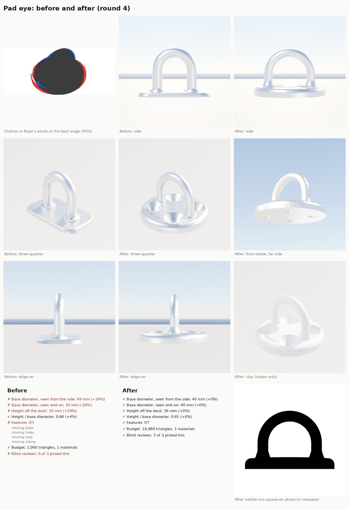

# Pad eye (part detail loop, Nov 8 2026)

Bean's hardware reference sheet (Nov 8) asked for each part on it to be modelled; this page is the **pad eye**: a round
stainless base screwed down through four countersunk holes, with a round-bar loop for a shackle, a block or a line's
end. The kit's old `Padeye` was a U-bolt on a rectangular plate with two nuts, a different part. The method is the
loop in [README.md](README.md).

(The sheet in the repo shows the photo's outline, not the photo: Bean's reference sheet is a third party's picture.
The full sheet with the photo is in the project files, `part-detail-loop/padeye_before_after.jpg`.)

## What changed

- Round 40 mm base (the catalogues' 6 mm round pad eye: 33 / 40 / 50 mm bases for the 5 / 6 / 8 mm sizes), 26 mm
  tall, a rounded rim and a gently domed top.
- Four big countersunk screw holes on the diagonals, nearly reaching the rim, with through holes for No. 8 screws
  (`Screw1`..`Screw4` sockets at the bottom of each cone).
- A round-bar loop (4.8 mm bar) whose legs land between the holes, fused to the base by a voxel remesh so the feet
  get a forging's fillets: one piece, no nuts.
- Small raised TERNWAY lettering following the rim (the kit's made-up maker).
- Sockets: `Eye` (inside the top of the loop, where a shackle pin bears), `Base`, `Screw1`..`Screw4`. The loop lies
  along X, so a line led along the deck runs through it.
- Sizes: `33`, `40` (default), `50` mm base diameter (was `40` / `50` / `65` mm plate length).

## Rounds

| Round | Base | Height | Features | Photo outline | Triangles | Blind review |
|---|---|---|---|---|---|---|
| Before | 49 x 30 mm rectangle | 33 mm (+29%) | 3/7 | 80% | 1,060 | lost 0 of 3 to r1; all three called it the wrong part ("rectangular eye strap / U-bolt plate") |
| r1 | 40 mm round | 26 mm | 7/7 | 90% | 13,024 | won 3 of 3 against before (confidence 5, 5, 5) |
| r2 | 40 mm | 26 mm | 7/7 | 90% | 12,958 | won 3 of 3 against r1 (3, 3, 2): deeper countersinks, thicker base, smaller feet |
| r3 | 40 mm | 26 mm | 6/7 | 90% | 15,876 | won 2 of 3 against r2 (3, 2; one for r2): bigger cones, heavier bar, rounder rim; its flush stamp couldn't be seen |
| r4 | 40 mm | 26 mm | 7/7 | 90% | 16,480, 1 slot | won 3 of 3 against r3 (3, 2, 3): raised lettering, softer feet |

All five checks pass on r4: sizes (within 0.1 mm of the catalogue), outline (see below), features 7/7, blind review
3 of 3, budget 16,480 of 20,000 triangles and one material slot.

### The outline check without a square-on photo

There is no square-on photo of this style of pad eye, so `score.py`'s outline check can't run (the card's `outline`
is null, as for the vang). Instead the new `partloop/photo_outline.py` renders the part's silhouette from 168 angles
and finds the one that best overlaps the outline cut from Bean's three-quarter photo (white background, so the mask
is clean; small holes are filled in both, so a countersink's bright bore doesn't count against either). r4 overlaps it
90% (pass 85%); the old part manages 80% at its best angle. It checks the loop's height and width against the base
and the base's thickness; it can't see the holes.

### Proportions from the photo

Bar 0.10, hole circle 0.325, countersink 0.31 and plate thickness 0.09 of the base diameter were measured on Bean's
photo (a three-quarter view, so roughly). The build ended at 0.12, 0.31, 0.30 and 0.12: the reviewers in r2 called the
bar thin and the base a thin slab, and the holes moved in a little so their cones don't break the rim.

## Still different from the photo (the reviewers' notes on r4)

- The base could be thicker still, with a fuller rolled rim and a more visible dome.
- Side-on, the loop's feet read a little like collars; the photo's blend is wider and smoother.
- The loop reads a touch tall and staple-like (straight legs, round top); the photo's is a rounder hoop.
- Countersink size split the reviewers (two said smaller than the photo, one larger).
- The cloud preview's stainless shows heavy brushing streaks; the real part is polished. A material job.

## In the game

Nothing changes until the PC's `make-boatkit.ps1 -Import` (the whole kit build passes in the cloud; against
`Inputs/boat-kit/kit.json` only `Padeye` differs from this change, beside the earlier loop parts that also wait for
the import). `Padeye` isn't placed by a layout yet, so the close-up uses the gallery (`-SailingGallery=SM_Kit_Padeye`).
Placing it on the boats (the J/22's jib sheet and vang anchor points, tie-downs) is a later step with the other parts
from the sheet.

## Running it

    python3 Tools/boatkit/partloop/render_views.py Padeye Artifacts/partloop/Padeye/r4              # bpy module
    python3 Tools/boatkit/partloop/photo_outline.py mask <photo crop> Data/Reference/raw/parts/Padeye/bean.mask.png
    python3 Tools/boatkit/partloop/photo_outline.py render Padeye Artifacts/partloop/Padeye/r4      # bpy module
    python3 Tools/boatkit/partloop/photo_outline.py score Data/Reference/raw/parts/Padeye/bean.mask.png Artifacts/partloop/Padeye/r4
    python3 Tools/boatkit/partloop/score.py Tools/boatkit/partloop/parts/padeye.json Data/Reference/raw/parts/Padeye Artifacts/partloop/Padeye/r4

The part lives in its own file, `Tools/boatkit/bk_part_padeye.py`: `bk_parts.py` imports every `bk_part_*.py` at its
end (so parts built by different threads don't edit the same lines), and its `@part("Padeye")` replaces the old
U-bolt builder, which stays in `bk_parts.py` unused.

## References

| Reference | Used for | Licence |
|---|---|---|
| Bean's hardware reference sheet (Nov 8 upload, "Pad Eye" tile) | the look, the outline match, proportions | third party's product photo: comparison only, kept in git-ignored `Data/Reference/raw/parts/Padeye/` |
| Round 316 pad eye listings: US Stainless (6 mm x 40 mm, 8 mm x 50 mm), Five Oceans FO-2101 (5 mm, 33 mm), S3i / QD round pad eye tables (6 mm: H 26, h 17, W 17) | sizes | numbers only |
