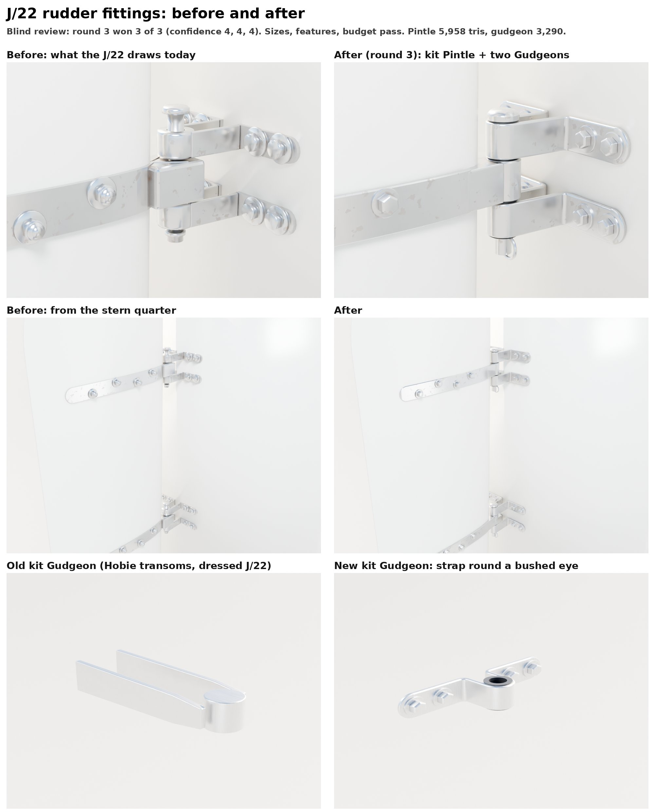

# Rudder fittings: J/22 gudgeon and pintle (Nov 8 2026)

Bean's ask: raise the quality of the rudder and its attachment hardware with the part detail loop (README.md). A
separate thread does the tillers; this one leaves them alone. The parts are in their own file,
`Tools/boatkit/bk_part_rudder.py`, which bk_parts' loader imports.

## What changed

- **`Gudgeon`** (rebuilt, same name and frame): one stainless strap, 25 x 4 mm, bent flange, leg, wrapped round the
  eye, leg, flange. The flange ends are round, there is a black acetal bush with lips in the eye, and two hex bolts
  with washers go through each flange. The new `offset` option sets how far the pin sits aft of the transom: 26 mm by
  default, the old part's socket, so build_fleet's Hobie and the dressed J/22 layout place it unchanged. The J/22's
  offset is 50 mm. The old part was a plain cylinder between two flat bars running into the hull.
- **`Pintle`** (new): two 30 mm flat straps lying on both faces of the blade, following its NACA section and
  round-ended aft. Four staggered through-bolts have hex heads to starboard and nylocks to port. A round barrel on the
  pin is joined to the straps by a tapered neck. The 1/2 in pin has a domed head and a keeper ring through it under the
  lower lug. Options: `blade` (thickness), `chord`, `length`. Its `LugUpper` and `LugLower` sockets are where the two
  gudgeons' `Pin` sockets go (28 mm above and below).

The rudder in the game is visual only. It turns about `RudderPivot` (BoatModelVisuals), and the steering forces come
from the physics' own foil numbers, so no rudder socket, blade or collision shape changed.

## Scores (round 3)

| | Gudgeon | Pintle |
|---|---|---|
| Sizes | 27.2 mm strap with bush lips (target 27), 144 mm span (138, +4%), 39.6 mm deep (39.3) | 298 mm long (313, -5%), pin 101 mm head to foot (100) |
| Outline | not checked: no square-on photo this session | not checked |
| Features | 5/5 | 7/7 |
| Budget | 3,290 tris, 2 slots (8,000 small-part budget) | 5,958 tris, 2 slots (12,000) |
| Blind review | won 3 of 3 against the J/22's current fittings in place (confidence 4, 4, 4), no wrong-part votes | same assembly |

The blind review compares assemblies, because that's how Bean sees them: `partloop/render_rudder_assembly.py` renders
the hero's blade and transom with either the hero's own pintles and gudgeons (`--before`, j22_steering) or the kit's,
both in the hero's materials.

- Round 2 (square block on the pin, low hex heads, stubby pin) won 2 of 3, but one reviewer called it "a door hinge"
  (a wrong-part vote), so it failed.
- Round 3 replaced the block with a round barrel and a tapered neck, used taller hex heads, a proper pin head and a
  longer tail with a visible keeper ring, and a 4 mm strap. It won 3 of 3.

Still different (the reviewers' notes, for a later round):

- The gudgeon's 90 degree bends read a little like an L-bracket.
- The keeper ring is on the big side.
- There is a visible step where the strap meets the barrel's neck.
- The cloud preview's stainless is speckled matte, not polished. That is the same for before and after.

## References

The cloud session could not download photos (Wikimedia's image hosts and the chandlers' sites were blocked). The look
comes from Bean's J/22 photos as already built into the hero (`tiller-transom-attachemnt`, `-2`, on the PC, private),
and the sizes from catalogue numbers read from search results:

| Reference | Used for |
|---|---|
| Schaefer 81-47 J/24 upper gudgeon (Vela Sailing Supply, Fisheries Supply, Sound Boatworks listings) | 1/2 in pin, 1 x 3/16 in strap, 3 5/16 in strap length, four fasteners, 1 1/2 in rudder |
| Schaefer 81-49 gudgeon pin | 3 7/8 in (98 mm) pin |
| Hero J/22 blade (`Inputs/j22-hero/j22_steering.py`) | 37.8 mm thick at the upper pintle, 34.1 mm at the lower, chord 0.35 m |

## Running it

    python3 Tools/boatkit/partloop/render_views.py Pintle Artifacts/partloop/Pintle/r3
    python3 Tools/boatkit/partloop/score.py Tools/boatkit/partloop/parts/pintle.json - Artifacts/partloop/Pintle/r3
    python3 Tools/boatkit/partloop/render_rudder_assembly.py Artifacts/partloop/RudderJ22/r3 [--before]

## In the game (waits for the PC)

`Inputs/boat-kit/kit.json` is left alone (the PC's import copies it). After Bean's "resume", run
`make-boatkit.ps1 -Import`. Then fitting follows the hardware-fit plan: swap the hero J/22's
`build_pintles`/`build_gudgeons` for the kit parts at the same sockets (two Gudgeons with `offset=0.05` per Pintle). The
dressed J/22 layout's GudgeonUpper/Lower would also need that offset.

## Next: the Sunfish

A Sunfish rudder head (cast cheeks, kick-up pivot, tension springs, 3/8 in pintle, tiller ears and bolt) and its
transom gudgeon with the spring clip are built in round 1 but held back. Without a photo of the real head, most of
its shape is a guess. They go in a second PR once there is a reference.
