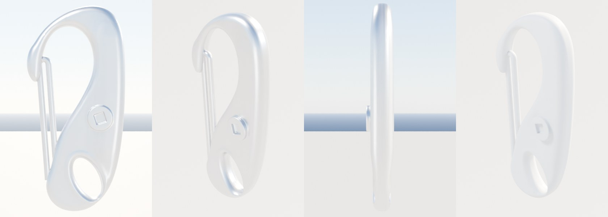

# Snap hook (part detail loop, Nov 8 2026)

Bean's hardware reference sheet (Nov 8) asked for each part on it to be modelled through the part detail loop
([README](README.md)); this is the snap hook, top left on the sheet: the forged stainless hook spliced onto halyards,
spinnaker sheets and dock lines. The kit had no snap hook before (the nearest stand-in was the 5 mm D-shackle), so it is
a new kit part, `SnapHook`, built in its own file `Tools/boatkit/bk_part_snaphook.py`.

Card: `Tools/boatkit/partloop/parts/snaphook.json`. Target: the 75 mm size (75 mm long, 67 g, forged 316 stainless);
proportions from Bean's photo, which is close to square-on.

| Round | Length | Length/width | Outline | Features | Weight (stainless) | Triangles | Blind review |
|---|---|---|---|---|---|---|---|
| Before | none in the kit (D-shackle: 29 mm) | 3.08 | 53% | 1/8 | | 776 | |
| r1 | 74.7 mm | 2.11 | 95% | 8/8 | | 16,308, 1 slot | (not run: r2 followed straight on, see below) |
| r2 | 74.7 mm | 2.11 | 94% | 8/8 | 49 g | 16,308 | won 3 of 3 against r1 (confidence 3, 3, 3) |
| r3 | 74.7 mm | 2.09 | 94% | 8/8 | 64 g | 16,306 | won 3 of 3 against r2 (confidence 3, 3, 3) |
| r4 | 74.7 mm | 2.08 | 93% | 8/8 | 67 g | 16,308 | won 3 of 3 against r3, but confidence 1, 1, 1: all three called it close to a coin toss |
| r5 | 74.7 mm | 2.08 | 93% | 8/8 | 71 g | 16,308, 1 slot | not rerun: Bean's own change after looking at r4 |

Target length/width 2.10 (measured on the photo). Weight is the model's volume at stainless steel's 7.98 g/cm³ against the
catalogue's 67 g: a useful check on thickness, since there is no edge-on photo. All five checks pass from r2 on.

What changed round by round:

- r1: the traced outline, one forged body (see below), a wire gate, the eye and a riveted boss.
- r2: r1's traced opening ran right down to the boss, leaving a thin neck above the eye; re-traced so the palm is a broad
  plate round the boss and eye, as in the photo. Reviewers: "eye set in a solid palm web" against r1's "ring hanging off
  a narrow neck".
- r3 (the reviewers' notes on r2): thicker forging (r2 weighed only 49 g), the square rivet sunk in the boss (it wasn't
  showing), a raised rounded rim round the eye, a rounder nose, the eye a little smaller and leaning more.
- r4: heavier gate wire (2.3 mm, legs further apart), the eye leaning further, a slightly broader palm and longer nose lip;
  the weight now matches the catalogue. The reviewers could barely tell r3 and r4 apart, so the loop stopped there.
- r5 (Bean, after r4): the ring round the eye was too thin on the gate side and bottom. The eye is smaller and moved
  toward the spine, and the outline's bottom-left is a little fuller, so the ring is about twice as thick there. It now
  weighs 71 g, 6% over the catalogue.

How it is built: the body is one signed distance field, sampled on a 0.25 mm grid and meshed with surface nets (numpy
only, which ships with Blender, so the PC's kit build needs nothing new). The field is the traced outline with the eye cut
out, made into a slab whose edges are rounded almost to an oval (80% of the half-thickness), 6.2 mm thick at the palm,
8.2 mm along the spine and 5 mm at the nose, plus the raised boss with its square recess and the rim round the eye. A light
smooth and a decimate bring it to the budget. The gate is a separate stainless wire loop. Frame: the eye's centre is the
origin, the hook up +Z, spine +X, the riveted face toward -Y. Sockets: `Eye` (where the line is made fast), `Bite` (where a
ring or sail head sits under load), `Nose`, `Gate`. Sizes 50, 75 and 100 mm scale the 75 mm build (the catalogue family).

Still different from the photo (the reviewers' shared notes on r4, for a later round):

- The gate still reads thin at arm's length; the real one is a heavier doubled loop with a clear pivot at the palm.
- The nose should hook down harder, with a notch the gate tip seats in.
- The reviewers wanted the eye bigger and tilted more; Bean preferred a thicker ring (r5), which wins.
- The boss and rivet should be larger and prouder; the decimated square reads slightly hexagonal in three-quarter.
- The back could bow out more (a banana shape) and the body look chunkier edge-on.
- The cloud preview's stainless renders flat white, so the polished look is missing (the same for every part).

Loop changes made for this part (small, shared):

- `partloop/mask_white_bg.py` (new): a reference outline from a catalogue-style photo of a bright part on white, turned so
  its long axis is vertical. `score.py --save-mask` only finds a dark part on a busier background.
- `score.py`'s outline overlap needed a wider canvas for a lopsided outline (most of a snap hook's mass is on the spine
  side); the same fix reached main from the pad eye thread first, so this PR uses that.
- `bk_render.py`: the camera's near clip is 1 mm (the same line the bow shackle thread adds): the D-shackle's edge-on
  outline was empty before.
- The part sits in its own file and registers itself through the shared loader at the end of `bk_parts.py` (already on
  main).

In the game: nothing changes until the PC's `make-boatkit.ps1 -Import`. The whole kit build passes in the cloud with the
new part: `SnapHook` 16,308 triangles (light copy 4,076), every other part as before. `Inputs/boat-kit/kit.json` is
left for the PC's import to replace, as for Block40 and HornCleat. Nothing places a snap hook on a boat yet: the next step
is the halyard ends at the J/22's mast and the spinnaker sheets (a follow-up, with rope).

| Reference | Used for | Licence |
|---|---|---|
| Bean's hardware sheet (project upload, Nov 8), the "Snap Hook" photo | outline and proportions (traced square-on, turned upright) | a catalogue photo: measuring only, not in the repo; the before/after sheet that shows it stays in the project files |
| 75 mm forged snap hook listings (e.g. [Blue Marine Store](https://www.bluemarinestore.com/wichard-safety-snap-hook/)) | 75 mm, 67 g; A 12 mm and B 10 mm (not scored: the listings don't say which is which); 50 and 100 mm sizes | numbers only |

Wikimedia Commons has a few spring snap hook photos (Category:Spring snap hook) but rate-limited the cloud for the whole
session; a square-on Commons photo would let the outline check use a licensed reference instead of Bean's sheet.
