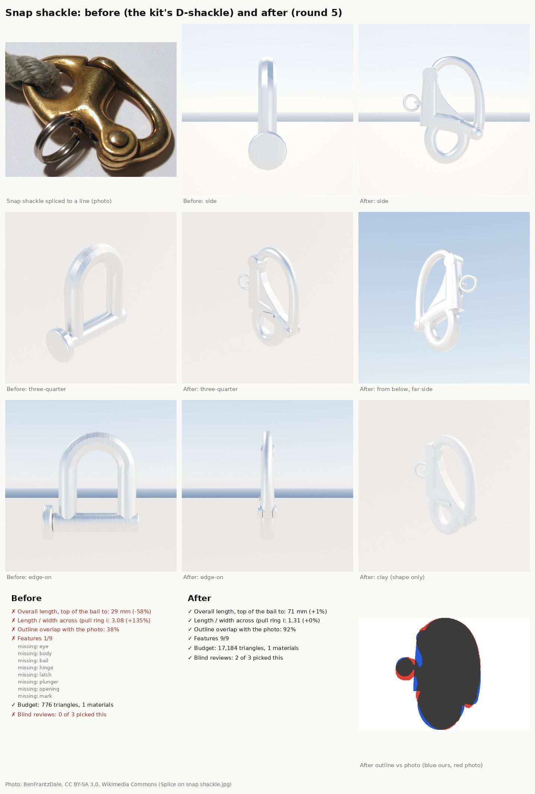

# Snap shackle (part detail loop, Nov 8 2026)

Bean's hardware reference sheet (Nov 8) asked for each part on it to be modelled through the loop
([README.md](README.md)). This is its "Snap Shackle": a 70 mm stainless snap shackle with a **fixed eye** (the sheet's
photo is the fixed-eye kind, not a swivel eye), a hinged bail that snaps shut on a spring plunger, and a pull ring that
opens it under load. On a J/22 these are on the spinnaker sheets, guys and halyard, clipped to the kite's corners.

The kit had no snap shackle, so "before" is the nearest part it had, the 5 mm `ShackleD` (a screw-pin D-shackle), the
stand-in a layout would have used.

Files (kept apart from the shared files so several part threads can run at once):

- `Tools/boatkit/bk_part_snapshackle.py`: the builder, kit part `SnapShackle`, sizes 50 / 70 / 90 mm.
  `bk_parts.py`'s loader at its end imports it, like the other parts in their own files.
- `Tools/boatkit/partloop/parts/snapshackle.json`: the card.
- `Tools/boatkit/partloop/render_inuse_snapshackle.py`: the two in-use stills (a 10 mm sheet eye-spliced round the eye
  and a sail's clew ring in the bail; render-only). `--part ShackleD` dresses the before part the same way.

## Results

Targets: 70 mm overall (catalogue), length / width 1.31 (measured on the square-on photo, pull ring included), outline
90% or better, 9 features, 20,000 triangles and 8 slots.

| Round | Overall | Length / width | Outline | Features | Triangles | Blind review |
|---|---|---|---|---|---|---|
| Before (`ShackleD`) | 29 mm (-58%) | 3.08 (+135%) | 38% | 1/9 | 776 | lost 0 of 3 to r4; all three called it the wrong part ("a plain D-shackle") |
| r1 | 70 mm | 1.24 | 89.5% | 7/9 | 19,184 | (r4 judged against it) |
| r4 | 70 mm | 1.27 | 90.7% | 8/9 | 17,684 | won 3 of 3 against before (confidence 5, 5, 5); won 2 of 3 against r1 (4, 3; lost one at 3) |
| **r5** | 71 mm | 1.31 | 91.8% | 9/9 | 17,184, 1 slot | won 2 of 3 against r4 (confidence 3, 3; lost one at 3), nobody called it the wrong part |

r2 and r3 were working rounds (r2 had a bug that squared off every section; r3 added the web between the column and
the crossbar), not reviewed. A weight check agrees with the sizes: r5's volume is 12.1 cm³, 95 g in stainless against
the catalogue's 90 g.

How it is built: the body (the eye, the diagonal crossbar, the plunger column, the hinge knuckle and a web between the
column and the crossbar) is swept along paths traced off the photo and fused by a voxel remesh, so the joins get a
forging's soft fillets, then reduced to the budget. The bail is round bar that thickens toward the hinge and ends in a
fork either side of the knuckle; a cross pin with domed heads holds it. The latch boss at the top of the column has the
plunger's end in its face; the plunger's lug comes out of a slot in the column with a 10 mm split ring on it. A made-up
TERNWAY mark sits on the crossbar's face (no real maker's logo). Frame: the origin is where a clew ring bears inside
the bail and the part hangs along -Z (like the blocks); sockets `Bail`, `Eye` (inside the eye's bottom bar), `Hinge`,
`Latch`, `Ring`.

r5 over r4: a bigger eye sitting more in line under the body, a stouter bail at the hinge, a thinner web with softer
fillets, a larger latch boss and pin heads, and a smaller, tighter pull ring (the r4 reviewers' shared notes).

Still different from the photos (the r5 reviewers' shared notes, for a later round):

- The web between the column and the crossbar reads as a flat triangle with hard edges; the real body is a rounder
  forging with a raised rim round the openings.
- The latch boss and the crossbar's hinge end still look small next to the real part's chunky pivot.
- The pull ring reads thin; the real one is a heavier doubled split ring.
- No surface character in the cloud preview (polish, stamped mark); the preview's stainless renders near white for
  every round alike.

## Fix to the shared loop scripts

- `bk_render._camera` sets the near clip to 1 mm: the default 0.1 m clipped small parts (a 30 mm shackle) in the close
  views and left the before part's edge outline empty. The same line came from the bow shackle thread.
- This part also needed the wider frame in `score.py`'s outline overlap (a lopsided outline with the pull ring out to
  one side crashed it); the pad eye thread landed the same fix first.

## In the game (waits for the PC)

Nothing changes in the game until the PC's `make-boatkit.ps1 -Import` (the kit build with `--only
SnapShackle,ShackleD,Block40` passed in the cloud; `Inputs/boat-kit/kit.json` is left as it is, as for the other loop
parts). No layout places a snap shackle yet: putting them on the J/22's spinnaker sheets and halyard comes with the
spinnaker rigging work, on the PC lane.

## References

None of these are in the repo; the git-ignored copies are in `Data/Reference/raw/parts/SnapShackle/`.

| Reference | Used for | Licence |
|---|---|---|
| Bean's hardware reference sheet, "Snap Shackle" (a maker's product photo) | outline mask and proportions (near square-on) | third party: measuring only, never shared |
| [Splice on snap shackle](https://commons.wikimedia.org/wiki/File:Splice_on_snap_shackle.jpg) (BenFrantzDale) | in use, three-quarter: bail, plunger, pin head, ring; the sheet's photo | CC BY-SA 3.0 / GFDL |
| [Amsterdam RAI METS 2011 (015)](https://commons.wikimedia.org/wiki/File:Amsterdam_RAI_METS_2011_(015).JPG), [(016)](https://commons.wikimedia.org/wiki/File:Amsterdam_RAI_METS_2011_(016).JPG) (S.J. de Waard) | trade-show snap shackles of several sizes and eye styles | CC BY-SA 3.0 |
| Wichard 2472 (fixed eye, 70 mm) retailer listings (Jimmy Green, Blue Marine Store, CE Marine) | 70 mm long, A 21 mm, B 13 mm, 90 g | numbers only |

The listings don't say what A and B measure; on the photo the bail's inside width is about 21 mm and the eye's about
15 mm, which fits A as the bail opening. No free 3D model of a snap shackle turned up.
