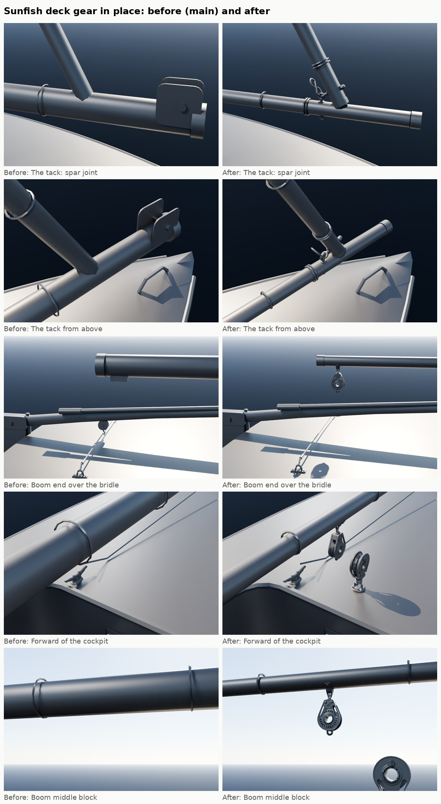
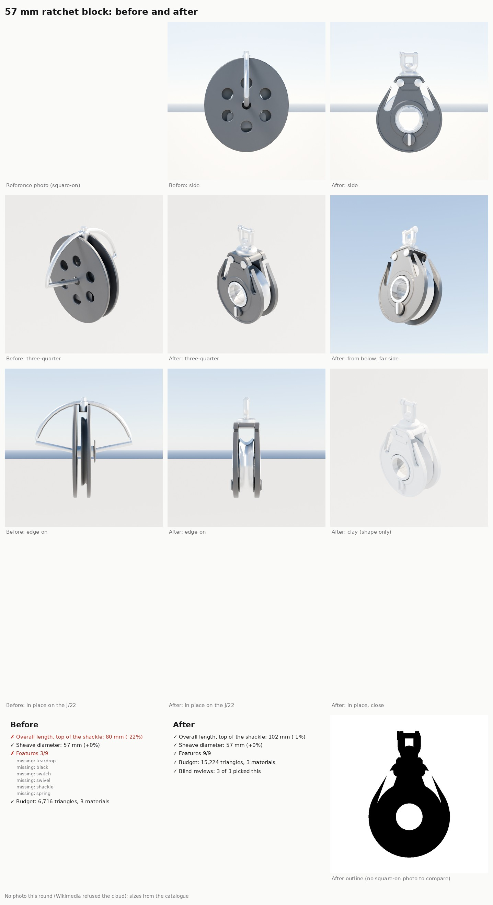

# Sunfish deck gear (Nov 2026)

Modeling item 5 on the slice's list of next passes ("Next modeling and texture passes"): the Sunfish's mainsheet
ratchet block, the bridle hook, the halyard cleat and the boom-to-yard jaws, run through the part detail loop
([README.md](README.md)). The class rigging manuals (LaserPerformance 2018, SERO 2025 SOL) showed three of the four
places the model was wrong as well as plain:

- **The mainsheet.** On a Sunfish the sheet's end clips to the bridle with a snap hook, runs up to a block at the
  boom's aft end, forward along the boom to a second block, and down to a ratchet block on an eye on the deck
  *forward of the cockpit, aft of the daggerboard trunk*. The model had a 29 mm block on the after deck (where the
  Sunfish has none), a black block hooked onto the bridle wire and a stainless box under the boom's end, and the game
  drew a 4:1 tackle from the boom to the bridle.
- **The tack.** The yard and the boom are joined by two interlocking eye bolts, and the sail's tack hooks to the
  boom's eye bolt with an S-hook. The model had two stainless jaw cheeks on a through-bolt, a fitting the Sunfish
  doesn't have, with the yard's foot running into the boom.
- **The spars** are 1 1/2 in (38 mm) round tube; the model's boom was a 79 x 60 mm oval and the yard 48 mm.
- **The halyard cleat** was already right: the kit's HornCleat (100 mm, through the loop in November) on the deck
  forward of the cockpit, port side. Nothing changed.

## What changed

| Where | Before | After |
|---|---|---|
| Ratchet block | kit `Block29` standing on the after deck | kit `Ratchet57` (rebuilt, below) on a stand-up spring, shackled to the kit `Padeye` 12 cm forward of the cockpit (`layouts/sunfish.json`); hull socket `MainsheetRatchet` at its axle |
| Boom blocks | a stainless box at `Boom_Mainsheet` | kit `Block40` hanging from a new `SparStrap` at the boom's end (`Boom_Mainsheet`, now its axle) and another over the front of the cockpit (new socket `Boom_MidBlock`) |
| Bridle | black block and hook fixed to the wire | the wire and its eye straps only; the game hangs the kit's `SnapHook` on the wire where its car was (it rides the bridle with the trim) and draws one part of sheet from it to the boom |
| Tack | jaw cheeks, bolt and nuts | two kit `EyeBolt`s linked (the yard's turned square to the boom's), an `SHook` up to the tack, two twice-round tack ties; the yard's foot raised 5 cm to sit on them |
| Spars | 79 x 60 mm oval boom, 48 mm yard | 38 mm round tube both, with flush end plugs |
| Sheet in the game | boom end -> computed middle point -> hand; 4 parts to the bridle | boom end -> `Boom_MidBlock` -> `MainsheetRatchet` -> hand; 1 part to the snap hook (falls back to the old lead on a model without the sockets) |

Code: `Tools/boatkit/bk_parts.py` (`_modern_block_parts` takes `overall`, `head`, `hk`, `ratchet`, `holes`;
`_mb_ratchet_sheave`; `Ratchet57(standup)`), the new `Tools/boatkit/bk_part_sunfish.py` (`EyeBolt`, `SHook`,
`SparStrap`), `Tools/blender/build_fleet.py` (`kit_part` returns the part's sockets and takes an `xf` matrix; layout
entries can name a `socket`; the Sunfish boom and bridle), `Source/SailingSim/Private/BoatModelVisuals.cpp` (the
Sunfish's sheet and snap hook). New `partloop/render_sunfish.py` renders the gear in place for any checkout.

## Ratchet57

The kit's 57 mm ratchet block (Sunfish and ILCA mainsheets) was a round flat disc with six holes and a wire hoop:
all three blind reviewers called it "a film reel", the wrong part. It is now the modern moulded-cheek block of the
Block40 round, at the catalogue's ratchet size (Harken 2135 class: 103 mm overall, 57 mm sheave, 10 mm line), with a
shorter head, no hole ring, a grey aluminium sheave whose groove floor is pressed into twelve flats (the ratchet
drum), an on/off switch on each cheek, a 6 mm swivel shackle and, for the Sunfish, a stand-up spring.

| Round | Overall | Sheave | Features | Triangles | Blind review |
|---|---|---|---|---|---|
| Before | 80.5 mm (-22%) | 57 mm | 3/9 | 6,716, 3 slots | lost 3 of 3; all three: wrong part ("film reel", "perforated disc") |
| r1 | 102.2 mm (-1%) | 57 mm | 9/9 | 15,224 (16,960 with the spring), 3 slots | won 3 of 3 (confidence 5, 5, 5) |
| r2 | 102.2 mm (-1%) | 57 mm | 9/9 | 15,224, 3 slots | Bean's note on r1 |

r2 (Bean, Nov 9: "a very thin connection part in the profile"): edge-on, the swivel between the head and the shackle
read as a thin stalk. `_mb_swivel_shackle` takes `neck` (default 1, so Block40 and the fiddles are unchanged); Ratchet57
uses 1.6: the post 1.6 times thicker, the eye's wire 1.6, the collar a fifth wider, the shackle's bow wire half as thick
again and its legs a little wider apart.

Outline: not checked. The square-on reference (the Harken 57C photo on Wikimedia Commons, used for Block40) could not be
fetched: Wikimedia answered the cloud with HTTP 429 all session. The blind reviewers judged from the catalogue's
description. Run `score.py` again with the photo's mask when a machine has it.

Still different (the reviewers' shared notes, for a later round): the cheeks read flat (no moulded ribs or raised rim),
the on/off switch is a small slot where real ones are a bigger marked lever, the two head rivets look large, and the
sheave's facets barely show in the studio light.

## In place: blind review

Before (main) against after, the tack and the boom's end block, deck forward of the cockpit, with two Commons photos of
Sunfish under sail as references: **after won 3 of 3 (confidence 4, 4, 4)**; all three called the old jaw cheeks a
made-up fitting; no wrong-part votes against the new gear.

Their remaining notes:

- The yard's foot meets the boom about 20 cm aft of the boom's forward end; on the boat they meet at the very end.
  That follows the sail: the yard runs where the physics' sail strips put the luff (`main[0]` and `main[-1]` luff_x),
  and the game's cloth and boom pivot are built on the same numbers, so moving it is a sail-shape change, not a fitting.
- The boom's own eye bolt is hard to see under the yard's.
- Real spars are brighter, matte aluminium (the preview material).

## Not done here

- **Gooseneck.** The Sunfish's boom carries a bronze gooseneck that hooks round the mast, and the boom pivots there.
  The game pivots the boom at the tack (`BoomPivot` at `MainLuffX`), 0.65 m forward of the mast, so a gooseneck on the
  boom would swing off the mast as the boom eases. It needs the pivot moved to the mast first (sail cloth and boom
  angle code, Mac lane).
- **Sunfish rudder head** waits for Bean's photo; the metal tiller is the tiller thread's (#545).
- The game's snap hook needs the kit imported (`SM_Kit_SnapHook`); until then the old black car rides the bridle.

## In the game (PC, after "resume")

    scripts\windows\make-boatkit.ps1 -Import       # the kit: Ratchet57 rebuilt; EyeBolt, SHook, SparStrap new
    scripts\windows\make-boat-models.ps1           # the Sunfish (hull, boom) and the ILCA (its Ratchet57 is taller)

Then the Mac builds the game code (`scripts/build.sh`, `SailingSim.Visual` tests) and a close-up still of the Sunfish's
cockpit and tack. Triangles (cloud build): Sunfish hull 47,046 -> 65,998 (ratchet block, spring and pad eye), boom
2,358 -> 16,356 (two blocks, straps, eye bolts, S-hook); the whole kit builds (62 parts) and the ILCA still builds.

## References

None are in the repo; local copies in the git-ignored `Data/Reference/raw/parts/Sunfish/`.

| Reference | Used for | Licence |
|---|---|---|
| [Sunfishdinghy closeup](https://commons.wikimedia.org/wiki/File:Sunfishdinghy_closeup.jpg) (Melongrower) | the sheet's lead (bridle to boom end, down to the front of the cockpit), spar size, the tack | CC BY-SA 3.0; people in it: measuring only |
| [Sunfish rigged for sailing](https://commons.wikimedia.org/wiki/File:Sunfish_rigged_for_sailing.jpg) (Flickr) | spars meeting at the tack, deck layout | CC BY-SA 2.0; people in it: measuring only |
| Sunfish rigging manuals (LaserPerformance 2018; SERO 2025 SOL); Sunfish forum notes on the mainsheet eyestrap | the eye bolts, S-hook, sheet lead, ratchet's place, halyard horn cleat | text only |
| Harken 2135 listings (Rooster 128613, Sound Boatworks, Defender) | 103 mm, 57 mm, 10 mm line, 85 g | numbers only |
| Rig Rite / Murrays Sunfish spar listings | 1 1/2 in spars, 2 1/4 in mast, bronze gooseneck | numbers only |
