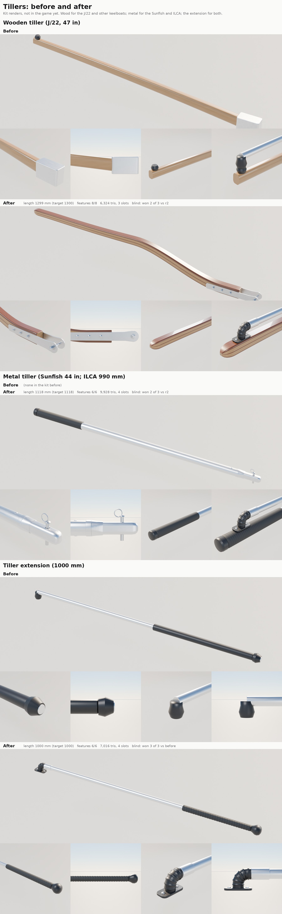

# Part detail loop: tillers and the tiller extension (Nov 8 2026)

Bean's ask (Nov 8): improve the tiller's quality with the [part detail loop](README.md) and make two types, a wooden
tiller and a metal one, with the tiller extension where boats have one. A separate thread does the rudder and its
fittings on the transom, so this page stops at the tiller's own hardware.

The kit's tillers are now built in their own file, `Tools/boatkit/bk_part_tiller.py` (bk_parts.py imports every
`bk_part_*.py`); the old `Tiller` and `TillerExtension` builders are gone from `bk_parts.py`.

## What they are now

| Part | What it is | Size (kit default) | Triangles, slots |
|---|---|---|---|
| `Tiller` | Laminated wooden tiller: varnished ash with mahogany strips (the pattern on Bean's J/22), rectangular with eased edges, 2 x 1.5 in at the butt tapering to the grip, rising 4.75 in from the rudder end, rounded hand end. Two stainless side straps through-bolted into the butt (three carriage bolts, domed heads one side, nylocks the other) carry it on the rudder head's pivot bolt (hex head and washer, nylock). | 47 in (1194 mm) tiller, 1300 mm with the straps | 6,324, 3 (Wood, WoodMahogany, Stainless) |
| `TillerAlu` | Dinghy metal tiller: 32 mm anodised aluminium tube; at the rudder end a moulded insert lofted from the tube's round down a short taper and step to a rounded tongue that slides into the rudder head, the retaining pin through it with a pull ring, two pop rivets; a textured rubber grip over the last 240 mm and a plastic end cap. `carbon=True` builds it in carbon. | 44 in (1118 mm, the Sunfish's), `size="990"` the ILCA's | 9,928, 4 |
| `TillerExtension` | Ribbed urethane universal joint on a plate with two screws, bending over so the stick lies along the tiller when stowed, a ferrule onto a 19 mm anodised tube, a textured grip over the far 280 mm, a rubber ball knob. `black=True` for a black tube. | 1000 mm overall; sizes 610, 914 (the Sunfish's 36 in), 1000, 1220 | 7,016, 4 |

Frames: a tiller's origin is the pivot it steers about (the wooden tiller's bolt, the metal tiller's retaining pin), the
tiller running along -X and rising in +Z. Sockets: `Stock` (the pivot), `ExtPivot` (on top near the hand end, where the
extension's joint goes), `Hand`, and on the wooden tiller `Butt`. The extension's origin is the foot of its joint
(`UJ`), with `Grip` and `Tip`.

New library slot: `WoodMahogany` (scripts/make_materials.py BOAT_LIBRARY, a varnished dark wood for the laminations'
dark strips). The existing `Wood` stays the varnished ash.

## Which boats get which

| Boat | Tiller | Extension | Why |
|---|---|---|---|
| J/22 (slice) | wooden `Tiller`, 47 in | `TillerExtension` 1000 | J/22 tillers are laminated ash and mahogany (Rudder Craft and H&L make them; Bean's lesson boat has one). The hero J/22 draws its own steering from Bean's photos (Inputs/j22-hero/j22_steering.py), so the kit tiller is for the layout copy and other keelboats. |
| Sunfish (slice) | metal `TillerAlu`, 44 in | `TillerExtension` 914 (36 in) | The factory has shipped a 44 in aluminium tiller rigged with a 36 in extension since it moved from wood to aluminium and fibreglass foils. Older Sunfish (and many club boats) still have varnished wooden tillers; the build_fleet Sunfish draws a wooden one today. |
| ILCA | metal `TillerAlu`, 990 mm | 1070 to 1220 mm | 32 mm aluminium is the class's standard tiller; carbon (`carbon=True`) is allowed. |
| Catalina 22 (stretch) | wooden `Tiller` (size 1300) | 1000 | laminated wooden tillers are standard on small cruisers. |
| Hobie 16 | metal (its own tiller arms and crossbar in build_fleet) | baked | aluminium tiller arms. |

## Rounds

| Round | What changed | Blind review |
|---|---|---|
| Before | `Tiller`: one swept bar in one varnish, a plain aluminium box for a head, a black knob; `TillerExtension`: tube on a lathed rubber stub, smooth grip | all six reviews called the old parts the wrong thing ("broom handle", "curtain rod", "walking cane", "gas strut") |
| r1 | first build of all three | (looked at; the loop's square stills framed the whole length, so `render_long.py` was added) |
| r2 | darker mahogany strips (new slot), gentler S; extension's joint now bends over itself | wooden tiller won 3 of 3 against before (confidence 5, 5, 5); extension 3 of 3 (5, 5, 5); metal tiller r2 won 3 of 3 against r1 (2, 2, 2) |
| r3 | wood: the rise in the first 40% then straight, more taper, thicker straps; metal: lofted insert instead of a box, smaller ring, shorter finer grip, flatter cap; extension: tighter joint, smaller plate and knob | wood won 2 of 3 against r2 (2, 2); metal 2 of 3 (3, 3); extension **lost** 0 of 3 (its tighter joint read as a plumbing elbow): the extension stays as r2 |
| r4 | wood only: one smooth rise over two thirds of the length (one r3 reviewer saw a kink), most of the depth taper through the rise | **lost** 1 of 3 against r3 (2, 2): two reviewers saw r4's longer rise as a deeper S. The wooden tiller stays as r3 |

Sizes (score.py): wooden tiller 1298.6 mm overall (target 1300, 0.1%), metal tiller 1118.0 (1117.6), extension 1000.0
(1000). All well inside the 20,000-triangle and 8-slot budget.

The loop's outline check (overlap with a square-on photo) isn't scored for these: there is no commercial-OK square-on
photo of either tiller (the cloud can't reach Wikimedia or the shops' pages), and Bean's lesson photos have people in
them. Sizes come from the catalogues; the look from Bean's photos and the reviewers.

## Still different from the real ones

The reviewers' shared notes on the final rounds, for a later pass:

- Wood: every reviewer still wants it straighter (the photo's tiller rises only slightly, so a lower `rise` may suit some boats); the depth taper doesn't show at arm's length; the varnish reads copper on top and pale on the sides; the laminations are even and graphic; real ones vary in tone and width with the grain. The straps reach well
  past the wood as an open fork; on Bean's boat they are shorter and wrap the rudder head (the rudder thread's part). The
  hand end could be fuller.
- Metal: the insert still reads as bright aluminium; many real ends are black moulded plastic. The pull ring is a little
  big. The tube is very clean.
- Extension: the joint is shown bent 90 degrees (stowed); the grip ribbing is even like hose; the ball knob is large.
- The cloud preview's materials make stainless too white and varnish a little orange (the same for before and after).

## In the game (waits for the PC)

Nothing is imported or placed yet. On BEN-PC after Bean's "resume":

1. `scripts/make_materials.py` (adds `MI_Boat_WoodMahogany`), then `scripts\windows\make-boatkit.ps1 -Import` (the whole
   kit; the import copies kit.json).
2. Placement, with the hardware fitting plan: the J/22 layout already places `Tiller` and `TillerExtension` at its
   rudder sockets (Tools/boatkit/layouts/j22.json); the Sunfish's metal tiller replaces the wooden bar build_fleet draws
   in `sunfish_rudder_head` (and its baked extension) once Bean picks metal for the Sunfish. A fleet boat that places the
   wooden tiller through `place_kit` needs `WoodMahogany` appended to build_fleet's `SLOTS`.

## Running it

    python3 Tools/boatkit/partloop/render_views.py Tiller Artifacts/partloop/Tiller/final          # bpy module
    python3 Tools/boatkit/partloop/render_long.py Tiller Artifacts/partloop/Tiller/final --ext-length 1.0
    python3 Tools/boatkit/partloop/score.py Tools/boatkit/partloop/parts/tiller.json <refs> Artifacts/partloop/Tiller/final
    python3 Tools/boatkit/partloop/make_long_sheet.py sheet.jpg --title "Tillers" \
        --section "Wooden tiller (J/22)" Artifacts/partloop/Tiller/before Artifacts/partloop/Tiller/final ...

`render_long.py` is new: whole-length three-quarter and side views at 1800 x 600, each end close up (lit for the
close-up), and for a tiller the kit extension laid on its `ExtPivot` (render-only). Its studio runs the lights and sky at
40%, which keeps a pale varnished part from washing out. `make_long_sheet.py` lays those out before above after.

## References

None of these are in the repo.

| Reference | Used for | Licence |
|---|---|---|
| [Rudder Craft J/22 tiller](https://mauripro.com/products/rud-jbo-22-til) | 47 in, butt 2 x 1.5 in, 4.75 in rise | numbers only |
| H&L J/22 tiller (owner report, [sailboatowners.com](https://forums.sailboatowners.com/threads/j22-tiller-fits-perfectly.188233/)) | alternating 1/4 in mahogany and ash, 2.25 in butt | numbers only |
| Bean's lesson photos (IMG_9271, IMG_9273; Data/Reference/raw/j22-lessons) and the tiller photos behind j22_steering.py | lamination pattern, straps, look in use | ours; people in frame, never in a sheet |
| [SERO Sunfish 44 in aluminium tiller with 36 in extension](https://seroinnovation.com/product/sunfish-44-rigged-aluminum-tiller-with-36-extension), Murray's | Sunfish tiller and extension lengths | numbers only |
| [Sunfish (sailboat)](https://en.wikipedia.org/wiki/Sunfish_(sailboat)), sailingforums.com | the factory's move from wooden to aluminium tillers | facts only |
| [ILCA standard tiller](https://duvoisinnautique.ch/laser/724-tiller-standard-for-laser.html), RWO set listings | 32 mm, anodised insert, plastic end cap, 990 mm | numbers only |
| [Ronstan Battlestick](https://www.westmarine.com/ronstan-41inch-aluminum-lightweight-battlestick-554105.html), Harken length guide | 5/8 and 3/4 in tubes, urethane joint with a cover plate, lengths | numbers only |
