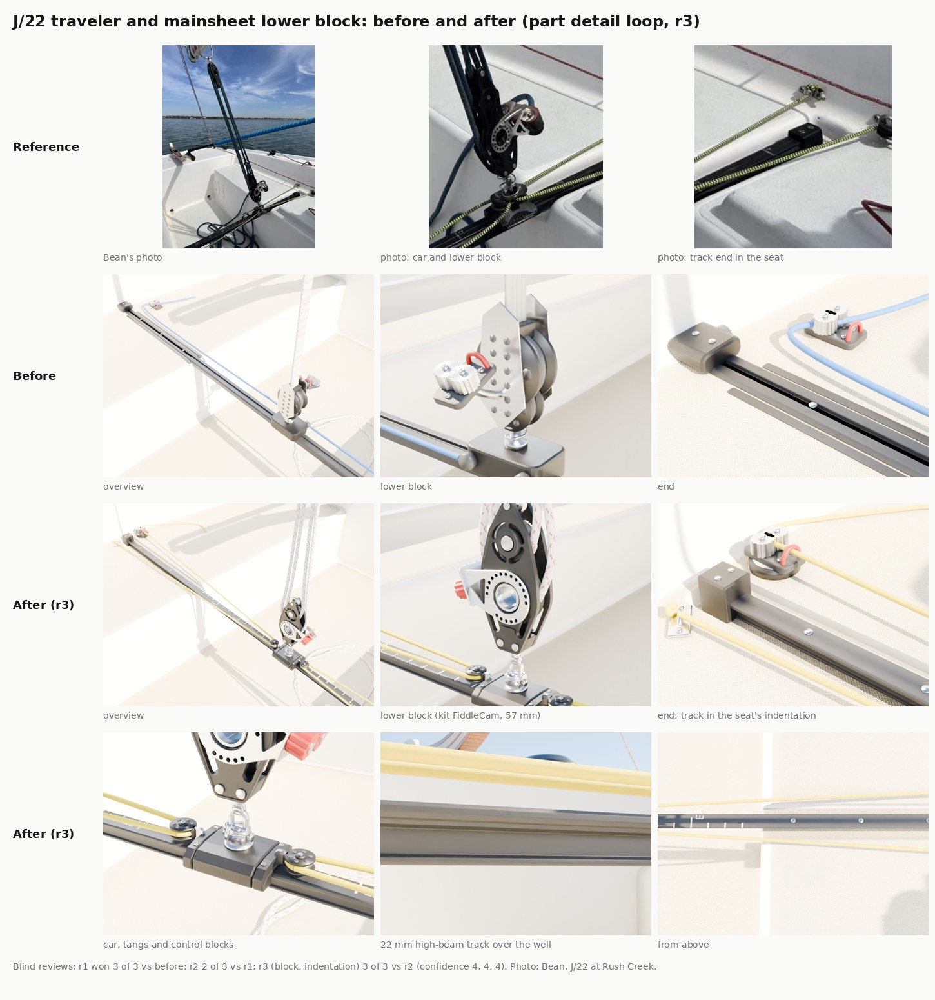

# J/22 traveler: track, car, end stops, control lines and the mainsheet's lower block (Nov 8-9 2026)

The part detail loop ([README](README.md)) run on the hero J/22's mainsheet traveler, item 3 of the Nov 8 list of
next passes. The traveler is `traveler()` and the lower block `lower_block()` in `Inputs/j22-hero/j22_mainsheet.py`; the
seats' indentation is cut in `build_j22_hero.py`; one flat material (`TravLine`) is new in `j22_materials.py`. Round 3
followed Bean's review of the PR (Nov 9: "make the block look more like the photos ... the track is in an indention in
the cockpit seats").

## What changed

- **Track.** A 22 mm high-beam track (the Harken J/22 layout's track, the kind made to span a cockpit) instead of a
  32 mm flat T-bar. The section has a 22 mm head with ball races under its edges, a stem and a foot, 19 mm deep, so it
  reads as an extrusion where it bridges the well. Flat-head screws every 100 mm where it lies on the seats.
- **The seats' indentation (r3).** A moulded trough 56 mm wide is cut across each seat top (a boolean on the cockpit
  liner, rounded edges, open to the well, running 12 mm past the track's end). Its floor is where the track's foot sits,
  so the track lies in it with its head 4 mm proud of the seat, as on the club boat. Before, the track was buried in the
  seat between two flat dark strips.
- **Lower block (r3).** The boat kit's `FiddleCam` at its 57 mm size, the block the vang run built from the same photo
  of this boat: black moulded cheeks, the cam cleat with red jaws on its perforated aluminium bracket round the big hub,
  a becket. It stands head down on the car's pivoting shackle, axles fore and aft, with a stainless coil spring round
  the swivel. Before, it was two sheaves between flat drilled stainless plates with a cam on a separate arm, which every
  reviewer called the wrong part. The mainsheet's four parts in the stills now come down onto the block's sheave from
  either side (they had been spread fore and aft).
- **Index marks.** The crew's white marks over the well, as on the club boat in Bean's photo: a tick every 25 mm, a
  long tick and a numeral (1 to 3) every 100 mm out from the middle, both sides.
- **End stops.** A taller, square black block over each end of the track with two screws on top, instead of a
  rounded cap with a sheave in it.
- **Car.** The catalogue's 73 x 57 mm car: one black body wrapping the track's head, its top chamfered, moulded end
  caps sloping down to the ends with a screw each side, and a pivoting shackle base (boss, two ears and a pin) under the
  lower block's swivel. Before, it was a flat box with two small sheaves stuck on one side.
- **Control.** 2:1 each side, as the catalogue gives for a main under 140 sq ft: the line dead-ends on an eye strap on
  the seat (with its stopper knot), runs in to a small block on a stainless tang at the car's end, and back out to a cam
  cleat on a swivel base on the seat, its tail lying aft on the seat. The line is yellow, like the club boat's
  yellow-and-black braid. Before, a single blue line ran past the car to a separate cam.

## What stays the same in the game

- Every socket in `J22H_sockets.json` but one is identical (checked with `J22H_SOCKETS_ONLY=1`): `Traveler_C/S/P`
  come from the track's top and ends, which did not move, and the new block's big sheave is placed where the old one's
  was, so `MainsheetBlock` stays. `MainsheetCam` (a crew hand point; no game code reads it) is now the kit block's
  jaws: (-214.16, 0, 52.63) to (-206, -5.33, 51.33). The committed file has the new value.
- The traveler is part of `SM_J22H_Hull`, so the car, blocks and lines are drawn at the centre of the track. The game
  still slides its own small car (`TravelerCar` in `BoatModelVisuals.cpp`) with the trim. Making the hero's car and
  control lines move with it would be a small Mac code step (a separate moving part), not in this pass.
- `TravLine` is a new flat material: the bake writes it into `materials.json` and `scripts/import_j22_hero.py` makes
  `MI_J22H_TravLine` from it like the other flat ones. The flecks in the photo are not in it (a flat colour).
- Triangles: the hero goes from 606,016 to 638,272 (the traveler and lower block from 15,952 to 59,508; the block is
  the kit's 28,748), inside the 1.2M cap.

| Group | Before | After |
|---|---|---|
| Track and its slot | 708 | 756 |
| Screws | 576 | 768 |
| Marks and numerals | 0 | 1,896 |
| End stops | 1,168 | 1,048 |
| Car, tangs and their blocks | 452 | 7,912 |
| Eye straps | 0 | 1,032 |
| Cam cleats and swivel bases | 6,376 | 6,808 |
| Control lines and tails | 1,904 | 4,864 |
| Lower block, swivel and spring | 4,768 | 34,600 |

## Sizes

| Size | Target | Built | Source |
|---|---|---|---|
| Track width | 22 mm | 22 mm | catalogue (22 mm track) |
| Track section | 217 mm² | 230 mm² (+6%) | the catalogue weight, 586 g/m, over aluminium's 2.70 g/cm³ |
| Track height | none | 19 mm | not listed: reported only |
| Screw spacing | 100 mm | 100 mm | catalogue hole spacing |
| Car | 73 x 57 mm | 73 x 57 mm | catalogue (the J/22's 22 mm car with pivoting shackle and control tangs) |
| Control purchase | 2:1 | 2:1 | catalogue guidance for under 140 sq ft |

No outline check: there is no square-on photo of the car or the track's end.

## Blind reviews

Three fresh reviewers for each pair, shown Bean's photo and three crops of it, and the same four views of each
candidate as A and B in shuffled order (`partloop/render_traveler.py`: overview at about the photo's angle, the car, the
starboard end, the track over the well).

| Round | Against | Result |
|---|---|---|
| r1 | before | **won 3 of 3** (confidence 5, 4, 4). All three called before the wrong part: "a plain rounded slider box on a slotted rail flanked by loose flat strips", "a generic sliding-door rail" |
| r2: marks every 25 mm with bigger numerals, taller square stops, black lower car, smaller blocks, a knot at the dead end, slimmer section | r1 | **won 2 of 3** (confidence 2, 3; the loss at 2). Winners cited the marks and the stops; the one loss preferred r1's lower, rounder stop and sparser marks |
| r3 (Bean's review): the kit FiddleCam as the lower block, the seats' indentation, the sheet's parts onto the sheave; a fifth view of the block | r2 | **won 3 of 3** (confidence 4, 4, 4). All three called r2's lower block the wrong part ("a flat perforated stainless plate on bare sheaves") and saw r3's track "sunk in a recess in the seat" |

Still different from the real traveler (the reviewers' shared notes on r2 and r3, for a later pass):

- The control line is flat yellow; the real one is a yellow braid with black flecks. A rope material on the hull would
  need the import to handle it.
- The car still reads big and boxy, though it is the catalogue's size; the real one is lower with the tangs blended
  into its ends, and its tang blocks are smaller.
- The seat fittings: the real boat has a small turning block and a compact dead end set further outboard; ours are a
  cam cleat on a round base and a flat eye strap close to the stop. A photo of the lesson boat's seat ends would settle
  which cam and block it uses.
- The marks are too regular; the real ones are hand-painted and worn.
- The seat's cam cleat has pale aluminium jaws on a big base; the real one is a compact dark cleat with red jaws. The
  swivel between the car and the block is bulky; the real one is slimmer.
- The indentation's edges are soft; the real moulding has a crisper edge.
- Black parts render mid-grey in the cloud preview (the same for every round).

## References

| Reference | Used for | Licence |
|---|---|---|
| Bean's photo of the J/22's mainsheet and traveler at Rush Creek (upload 84310630) | the look: black track with painted marks, square end stops, small car, yellow two-part control | ours (no people) |
| Harken J/22 layout (uploads 20109d18, c64b7434) | which parts: 22 mm high-beam track, the car | measuring only, not in the repo |
| Retailer listings for the 22 mm car with pivoting shackle and control tangs, the 22 mm high-beam track, and small-boat end controls | the numbers in the sizes table | numbers only |

## Running it

    python3 Inputs/j22-hero/build_j22_hero.py -- out                 # bpy module, or blender -b --factory-startup -P ... --
    J22H_SOCKETS_ONLY=1 python3 Inputs/j22-hero/bake_j22_hero.py -- out/j22_hero.blend out   # sockets: diff against J22H_sockets.json
    python3 Tools/boatkit/partloop/render_traveler.py out/j22_hero.blend Artifacts/partloop/Traveler/r2 [--quick] [--views=photo,car]

With the pip `bpy` module, import `bpy` before running the scripts. A checkout without Git LFS needs `J22H_FONT`
pointed at any TTF font. The part card is `Tools/boatkit/partloop/parts/traveler.json`.

## In the game (waits for the PC)

The hero's FBX and maps in `Inputs/j22-hero/fbx` and `textures` are not rebuilt here. The PC lane rebuilds and bakes
the hero, re-imports `SM_J22H_Hull` (and `MI_J22H_TravLine`), then takes a close-up of the traveler in the game for
the sheet.
