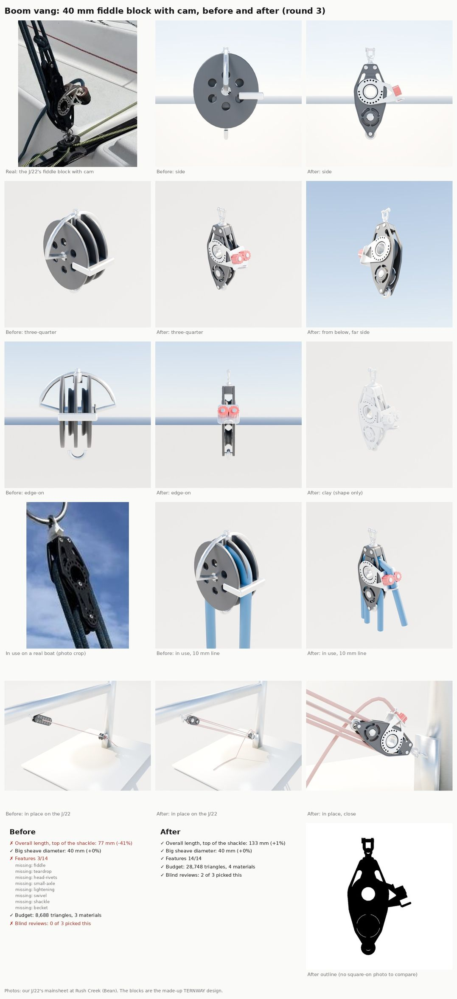

# Second test: the boom vang's fiddle blocks (Nov 8 2026)

Bean, after the Block40 sheet: "there are different varieties of these, including the boom vang, the 4 sheave blocks
(often used for the mainsail) ... do a test run to create one of those or the boom vang since they are more complex and
detailed." This is the loop ([README](README.md)) run on the J/22's 4:1 vang: its two 40 mm fiddle blocks, and the
vang put together in place.

## What was built

- **`FiddleCam`** (rebuilt): the vang's lower block, and the mainsheet's on the traveller car. A 40 mm fiddle (a big
  sheave under the head and a 26 mm one in line below it, so the big sheave's lines pass outside the narrow lower
  cheeks) with a becket and a cam cleat. The October part was really a side-by-side double in a round disc with a cam:
  all three blind reviewers called it the wrong part ("a generic double pulley").
- **`Fiddle40`** (new): the same fiddle without the cam and becket, the vang's top block under the boom (the hero's
  vang today hangs a plain long block there, `j22_boomgear.big_block`).
- Both share Block40's family and its builders, now split into helpers (`_mb_cheek`, `_mb_sheave`, `_mb_hub`,
  `_mb_rivet`, `_mb_swivel_shackle`; Block40's geometry is byte-identical): moulded cheeks with a rim, the open lined
  hub with its ring of holes, shoulder windows, head rivets, swivel and D-shackle. New for the fiddle: kidney slots round
  the small sheave, a riveted pin for its axle, a becket pin through a tail of the cheeks, and the cam unit (an
  aluminium bracket on each cheek, a ring round the big hub with the cheek's holes through it, an arm with a triangular
  window out to a bent-up plate carrying two red toothed cams and a fairlead hoop, turned 22 degrees to line up with the
  tail's lead off the big sheave).
- **The vang in place** (`partloop/render_assembly.py vang`): Fiddle40 on the boom's bail, FiddleCam on a tang at the
  mast foot (cam up), the line reeved 4:1 (the becket to the top's small sheave, round the bottom's small sheave, round
  the top's big sheave, round the bottom's big sheave and out through the cam) with its tail falling to the cabin top,
  at the hero's positions (J22H_sockets MastBase and Boom_Vang). The "before" is the hero's vang as built today
  (`j22_details.vang` with its top blocks swapped for `big_block`, as `build_j22_hero.py` does). Both use the same
  stand-in mast, boom and cabin top and the hero's rope.

## Scores

FiddleCam, catalogue target 131 mm overall (top of the shackle to the bottom of the becket), 40 mm sheave:

| Round | Overall | Features | Triangles | Blind review |
|---|---|---|---|---|
| Before | 77 mm (-41%) | 3/14 | 8,688, 3 slots | lost 3 of 3 to r1; all three: wrong part |
| r1 | 131.5 mm | 12/14 (cam, lightening ticked by 0 and 1 of 3) | 28,766 | won 3 of 3 (confidence 5, 5, 5) |
| r2 | 132.7 mm | 14/14 | 28,680, 4 slots | won 3 of 3 against r1 (3, 4, 3) |
| r3 | 132.7 mm | 14/14 | 28,748, 4 slots | won 2 of 3 against r2 (2, 2, 2: close) |

Fiddle40: 113.9 mm against the catalogue's 115 (-1%), 19,998 triangles, 2 slots; its cheeks are FiddleCam's.

The vang in place: the new one won 3 of 3 against today's hero vang (confidence 5, 5, 5); all three called the old
one the wrong part ("a flat perforated bar with no sheave", "the line reads as one strand", "gear wheels instead of a
cam"). Their main note, the cam pointing down at the deck, is fixed in the sheet's render (the lower block turned over,
so the tail leads up and aft out of the cam).

Budgets: 30,000 triangles for FiddleCam (one and a half single blocks plus a cam cleat) and 24,000 for Fiddle40, 8 slots
each; build_kit's light copies are a quarter. The outline check is **not run** for these two: no square-on photo of a
modern fiddle with a licence we can use turned up (Commons was rate-limited from the cloud, maker sites are blocked), and
Bean's photo is at an angle. `score.py` now reports a card with `"outline": null` as not checked rather than failed. A
square-on photo of the J/22's vang blocks would let it run.

What each round changed, from the reviewers' notes:

- r1 to r2: the cam read as "one red cam in a grey box", so the moulded housing went and both cams stand open on a
  metal plate, level with the hub; the second ring of dots round the small sheave read as a metal ring, so it became
  four kidney slots with the sheave showing through; a fuller shoulder under the big sheave (round 1 read as a diamond).
- r2 to r3: the cams "stick straight out sideways" and the arm was "short and boxy", so the cam unit turns along the
  tail's lead, the arm is longer with a bigger window, the cams a little smaller.

Still different from the photos (the r3 reviewers' shared notes, for a later round):

- The cams' teeth read as coarse gear lobes; real cam jaws are finer flutes on a smoother cylinder.
- The cheeks read as thin flat plates; real ones are thicker mouldings with a raised rim and more, larger slots along
  the body.
- The bracket still reads a little solid next to the real skeletal casting.
- In the vang render the rope is a smooth pale tube (the hero's rope material in the cloud preview) and the tail is
  stiff; the game's live rope has its braid.

## The tools, extended for this run

- `score.py`: `overall_all` (to the lowest point, a becket), `sheave2` (a fiddle's small sheave), and `"outline": null`.
- `render_views.py`: for a fiddle, a second line over the small sheave; with a `Cam` socket, the tail leaves the big
  sheave on its tangent and runs through the jaws along `CamLead`.
- `render_assembly.py` (new): a part in place on the J/22, before and after, from the same views (side, from aft and
  above, close, clay).
- `make_sheet.py`: `--ref-label` and `--assembly <before> <after>` (a row of the part in place); without an outline
  compare it shows the after's outline.

## In the game

Nothing in the game changes until the PC builds and imports the kit: FiddleCam is rebuilt and Fiddle40 is a new
`SM_Kit_Fiddle40` (the import copies the new `kit.json`, as for Block40). The J/22 itself still draws today's vang (the
hero's `VangBlock` on the boom and three rope strands to the mast foot; the hero's lower block is not in the game at
all). Putting the kit's fiddles on the hero's boom and mast foot, with the live rig line reeved through them, is the
follow-up that makes this show on the boat.

## Running it

    python3 Tools/boatkit/partloop/render_views.py FiddleCam Artifacts/partloop/FiddleCam/r3
    python3 Tools/boatkit/partloop/score.py Tools/boatkit/partloop/parts/fiddlecam.json Data/Reference/raw/parts/Vang Artifacts/partloop/FiddleCam/r3
    python3 Tools/boatkit/partloop/render_assembly.py vang Artifacts/partloop/Vang/after
    python3 Tools/boatkit/partloop/render_assembly.py vang Artifacts/partloop/Vang/before --before
    python3 Tools/boatkit/partloop/make_sheet.py <lower block photo> Artifacts/partloop/FiddleCam/before Artifacts/partloop/FiddleCam/r3 sheet.jpg \
        --ref-label "Real: the J/22's fiddle block with cam" --in-use <upper block photo> \
        --assembly Artifacts/partloop/Vang/before Artifacts/partloop/Vang/after

`render_assembly.py` builds the hero's materials (`j22_materials.build_all`, textures to `J22H_TEX`, default under the
output dir); a checkout without Git LFS falls back to a system font for the hero's decals.

## References

| Reference | Used for | Licence |
|---|---|---|
| Bean's photo of the J/22's mainsheet at Rush Creek (both fiddle blocks, the lower with its cam and becket) | the look, the cam bracket, the reviewers' reference | ours (crops only, no people) |
| Harken's J/22 deck layout drawings (Bean's uploads) | where the vang and mainsheet blocks go | measuring only |
| Catalogue sizes: Harken 2655 (40 mm fiddle, swivel: 115 mm) and 2658 (with becket and cam: 131 mm, [Rooster](https://www.roostersailing.com/products/128689)) | sizes | numbers only |

The design is our own TERNWAY family (the kit's rule: generic shapes, no maker's logo). One reviewer of the vang noted that a
ring of holes round the hub is close to one maker's look; the kit's plate and the hole and slot patterns are our own.
