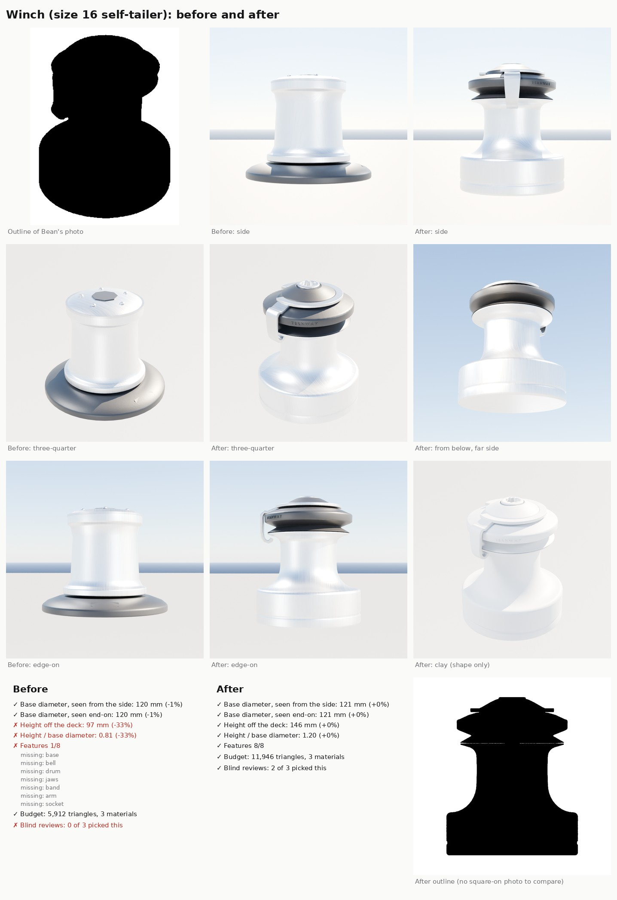

# Winch (part detail loop, Nov 8 2026)

Bean asked for a better winch and sent a photo of a modern self-tailing winch (a wide matte base, a bell into the drum,
a black self-tailing ring with ribbed jaws, a polished stripper arm, a star handle socket). The kit's old `Winch16`
was a plain silver spool on a flat black dish, 97 mm tall: a third short for a size 16, with no self-tailer and no arm.
The method is the loop in [README.md](README.md).

(The sheet in the repo shows the photo's outline, not the photo: Bean's photo is a third party's picture. The full
sheet with the photo is in the project files, `part-detail-loop/winch_before_after.jpg`.)

## What changed

`Winch16` now lives in its own file, `Tools/boatkit/bk_part_winch.py` (the loader block at the end of `bk_parts.py`
imports it and its `@part` replaces the old one).

- Size 16 self-tailer at catalogue size: 121 mm base, 65.7 mm drum, 145.5 mm tall (one-speed size 16 self-tailer
  tables).
- Turned base with a fine plinth line and a soft shoulder, a concave bell flaring up into the drum, the drum flaring at
  its top into the lower jaw's lip. No screws on show (they are under the drum on a real one).
- Black self-tailer: an open V groove for the line, a ring wider than the drum with 60 ribs round its outer band and
  over its rim, a smooth panel with moulded TERNWAY lettering (the kit's made-up maker), a dark top rising to the cap.
- Polished stripper arm: a crescent round the cap, an arm out over the jaws and down the side whose tip curls in
  toward the drum (where the tail leaves the winch).
- A glossy black cap rising as a cone from inside the stripper's crescent, with the polished handle socket set down in
  it nearly flush (about 1.5 mm proud) and a deep ten-point star hole (Bean's round 4).
- Sockets: `Drum`, `Handle` (top of the socket), `Tail` (on the arm), `Jaws` (in the groove).
- Sizes: `6` is a new plain-top build (90 mm base, 60 mm drum, 82 mm tall, no self-tailer: the size 6 plain-top that
  retailers list for the J/22), `8`, `16` (default), `20`, `30`, `40` scale the self-tailer to the catalogue bases (102,
  121, 130, 152, 175 mm), so `Tools/blender/build_fleet.py`'s size pick keeps working.
- Budget: 11,946 triangles and three slots (Aluminium, BlackPlastic, Stainless); the light copy about 3,000. The card's budget
  is 12,000, tighter than the loop's usual 20,000, because the J/22 carries two and the fleet boats up to four.

## Rounds

| Round | Height | Features | Photo outline | Triangles | Blind review |
|---|---|---|---|---|---|
| Before | 97 mm (-33%) | 1/8 | 89% | 5,912 | lost 0 of 3 to r1; all three called it the wrong part ("a bollard or spool on a flat dish") |
| r1 | 145.5 mm | 7/8 | 95% | 11,352 | won 3 of 3 against before (confidence 5, 5, 5) |
| r2 | 145.5 mm | 7/8 | 94% | 11,680 | won 2 of 3 against r1 (4, 3; one for r1 at 3): an open V groove, a taller ribbed band, a heavier arm with a longer hook; the ribs buried the lettering |
| r3 | 145.5 mm | 8/8 | 94% | 11,680, 3 slots | won 2 of 3 against r2 (3, 2; one for r2 at 2): a smooth lettered panel in the ribs, finer ribs |
| r4 | 145.5 mm | 8/8 | 94% | 11,946, 3 slots | won 2 of 3 against r3 (3, 3; one for r3 at 2): Bean's notes, the socket set deeper in a black sloped cap |

Sizes, features, budget and the blind review pass on r4. The outline can't be checked square-on (the card's
`outline` is null): Bean's photo is taken from about 30 degrees above, so `photo_outline.py` found the best angle
instead and r4 overlaps it 94%. That number says little here: any round winch shape scores high from above (the old
spool managed 89%), so the sizes and the reviewers carry this part.

Both kinds stay in the kit so boats can differ (Bean, Nov 8): the self-tailer (default) and the plain-top (`size="6"`).
The J/22 question: the class layouts and retailers list a size 6 plain-top winch (no self-tailer) for the J/22's
cabin-top halyard winches. The J/22 layouts still ask for the default `Winch16`, so they get the self-tailer from
Bean's photo (145 mm tall, where the real one is 82). Switching the J/22 to `size="6"` is a one-word change in
`Tools/boatkit/layouts/j22.json` and `Inputs/j22-hero/build_j22_hero.py`, left for Bean's call.

## Still different from the photo (the reviewers' notes on r4)

- The metal renders white in the cloud preview (the preview material, the same for before and after). Bean's photo
  is a matte grey anodised winch; the game's `Aluminium` is satin silver, as on most small-boat winches. Grey would need a
  new paint in `scripts/make_materials.py`'s library and the PC to rebuild the materials.
- The arm reads as a flat strap; the real one is a thicker casting whose tip hooks harder under the jaws.
- The ribs are coarser than the photo's fine moulded ribs, and the lettering is small.
- The cap renders grey in the cloud preview (the studio lights the black plastic grey; the game's BlackPlastic is
  near black). The photo's socket collar is a little wider.

## In the game (waits for the PC)

Nothing is imported: `Inputs/boat-kit/kit.json` is left as it is (the PC's import copies the new one). On BEN-PC, after
Bean's "resume": `scripts\windows\make-boatkit.ps1 -Import`, `scripts\windows\test.ps1 -Filter
SailingSim.Visual.HardwareKit`, then rebuild the J/22 hero so its two cabin-top winches pick the new part up.

## Running it

    python3 Tools/boatkit/partloop/render_views.py Winch16 Artifacts/partloop/Winch16/r4
    python3 Tools/boatkit/partloop/score.py Tools/boatkit/partloop/parts/winch.json Data/Reference/raw/parts/Winch16 Artifacts/partloop/Winch16/r4
    python3 Tools/boatkit/partloop/photo_outline.py render Winch16 Artifacts/partloop/Winch16/r4
    python3 Tools/boatkit/partloop/photo_outline.py score Data/Reference/raw/parts/Winch16/bean.mask.png Artifacts/partloop/Winch16/r4

Bean's photo is on a dark blue background, so `photo_outline.py mask` (made for white backgrounds) doesn't cut it; the
mask was made by keeping pixels that aren't strongly blue (blue minus red under 45), the largest region, holes filled.
