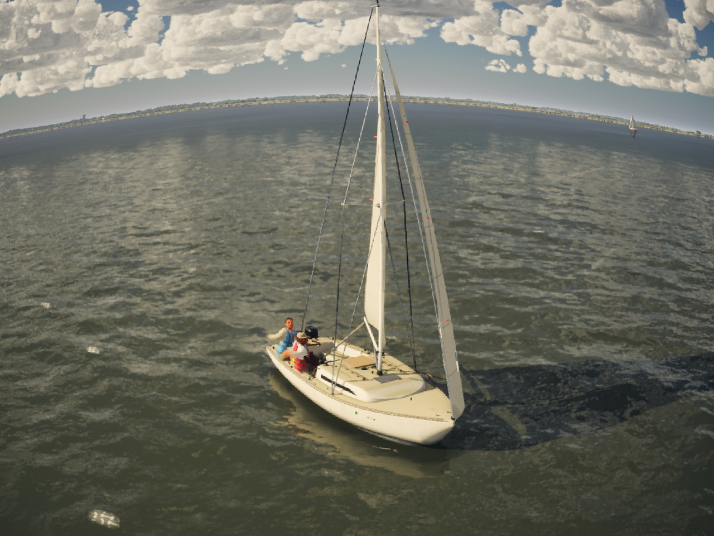
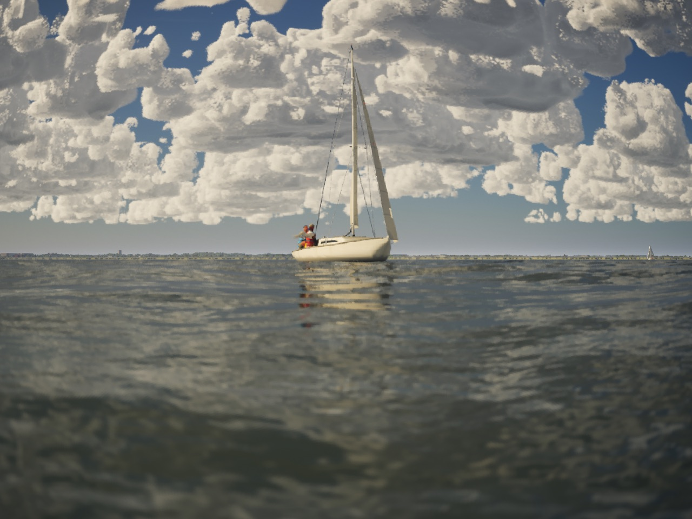
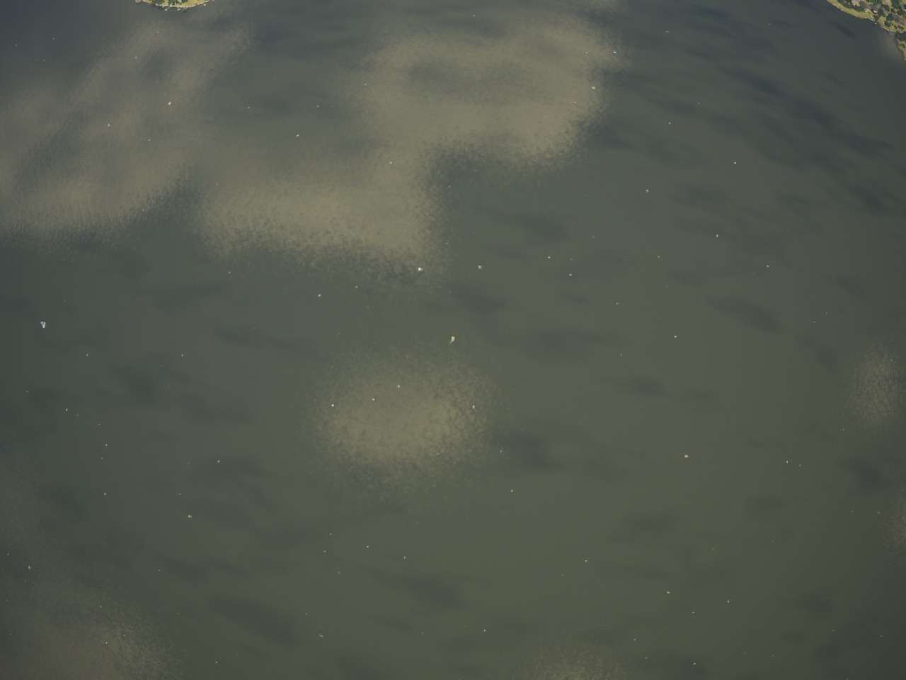
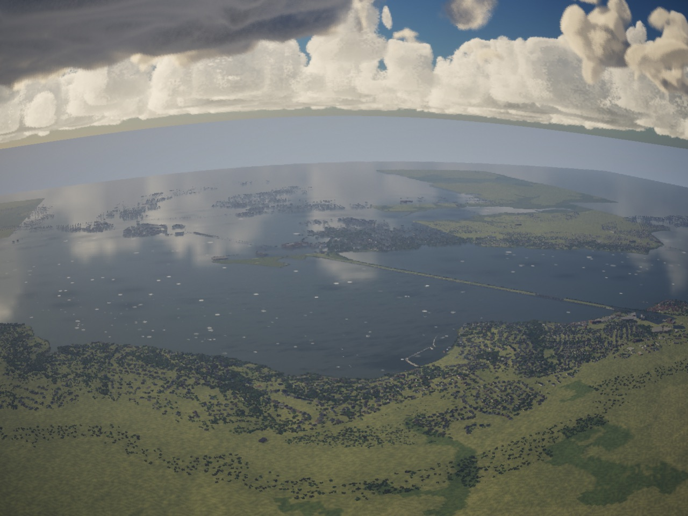
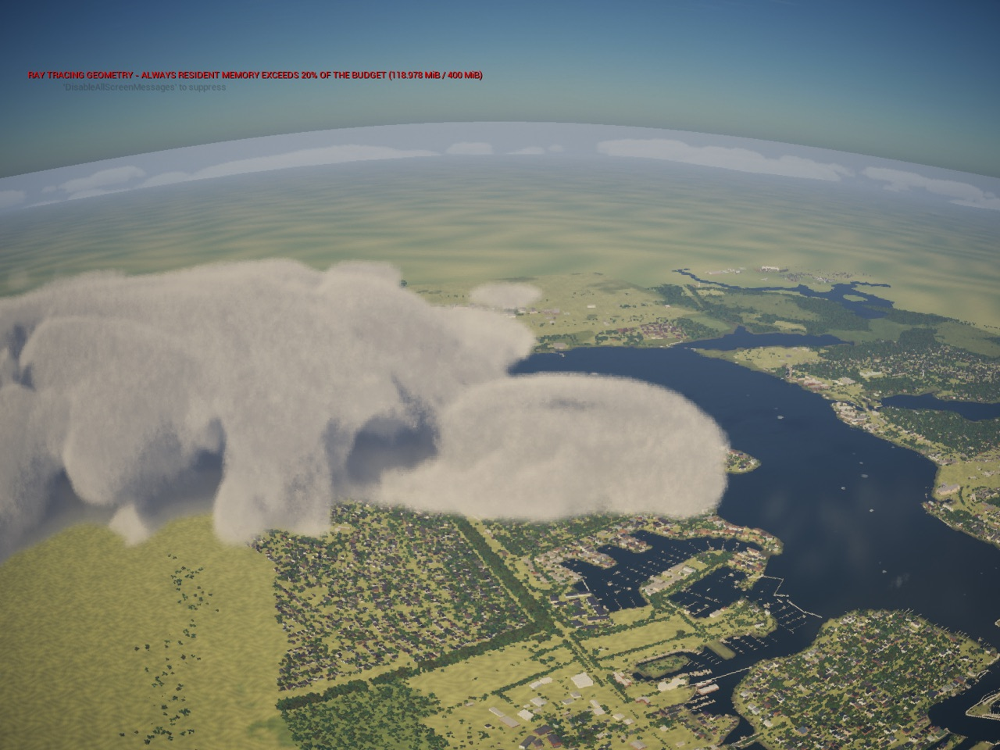

# Photo mode PR 1: the free camera (Oct 28 2026)

Bean's ask: photo mode should fly freely around the world, not stay anchored to the boat. The brief is
`Inputs/photo-mode/brief.md` on the inputs branch (28dfb5d1). The range is Bean's pick: 5 km from the player's boat.

## What the player gets

Press 9, or hold View on a controller for half a second. The camera starts where the chase camera is, and the world
holds still.

| | Keyboard and mouse | Controller |
|---|---|---|
| Fly (level heading, like a drone) | W A S D | Left stick |
| Down / up | Q / E | LT / RT |
| Look | Mouse | Right stick |
| Tilt (Dutch angle, +-45 deg); level | Z / C; X | LB / RB; R3 |
| Speed 0.5, 2, 8, 30, 120 m/s | Wheel | D-pad up / down |
| Fast (x5), slow (x0.2), held | Shift, Ctrl | L3 |
| Orbit the boat / fly | Tab | View (tap) |
| Back to the boat | F | Y |
| Hide the hint and readout | H | B |
| Take a photo | Enter | A |
| Leave | 9 or Esc | View (hold) or Menu |

- Motion eases in and out over about a quarter second.
- Orbit turns about the boat, and the wheel moves it in and out.
- A readout shows the base speed, and how far from the boat once inside the last 500 m.

Limits:
- **Leash:** a soft 5 km from the boat. The speed outward falls off over the last 500 m and the camera stops at 5 km.
- **Ceiling:** 1,500 m.
- **Floor:** never under the wave at the camera plus 15 cm, so wave-top shots work, and never under the ground plus 50 cm.
- **Collisions:** a 20 cm sphere swept on the visibility channel stops it at hulls, docks and bridges. Where the
  instanced shore kit has no collision, it passes through.

Every command is a row on the Controls screen and on the controls card. Photo commands are their own key layer, so they
share keys with the boat's.

## How it is built

- **`AFreeCamera`** (`FreeCamera.h`, math in `FreeCameraMath.h`) has fly, look and orbit modes, with the limits and the
  sweep. It holds no photo logic.
  - The owner feeds it each frame: `Update(dt, input)`, `AddLook`, `StepSpeed`, `SnapTo`, `SetMode`.
  - The leash anchor is a parameter, so the replay's free camera and the showroom's orbit can reuse it.
  - It is client-only and never touches a boat. No `FBoatControls` are sent while flying.
- **The pawn's photo mode** spawns the camera at the chase camera's place and copies the lens. It blends the view over
  in 0.3 s, and its depth of field and lens profile now go on the free camera. Leaving blends back to the untouched chase
  camera.
- **The hold (online rule 9)** is `ASailingGameMode::SetWorldHeld`.
  - Before, the brief read the pawn's early return as stopping the world, but the game mode advanced the world clock
    too. So in photo mode the traffic, weather and tide kept moving; only the player's boat stopped.
  - Held now, the clock stops, and with it the boats, traffic, weather, tide and the water's time. The wake, spray,
    lightning, rain curtains and the traffic boats' sails stop too.
  - The renderer, streaming and the camera keep running.
- **Input:** `IMC_Photo` sits at priority 1 over the boat's context, so its keys hide the boat's. The left stick, WASD,
  the triggers and the shoulders fly the camera and never reach the tiller or sheets.
  - The membership rules are `SailingBindings::InPhotoContext` and `InBoatContext`.
  - Every button now fires on `ETriggerEvent::Triggered` with a Pressed trigger, which works as `Started` did. The
    exceptions are the pad's photo toggle (a 0.5 s hold of View) and anything else on that button (the controls card
    sailing, the orbit in photo mode), which take the tap.
  - A key list saved before this PR gets the new commands' defaults (`USailingInputSettings::AddMissingActions`). It
    does not get View-hold or A for an action it already had, so photo mode and the shutter stay on 9 and Enter there.
- **Stills:** `-SailingPhoto=<s>` opens photo mode at that sim time. `-SailingPhotoCam="<fwd m>,<right m>,<up m>[,<yaw>,<pitch>]"`
  places the camera relative to the boat, through the limits. Without a yaw and pitch it faces the boat.

## Departures from the brief

- **Movement is two 1D actions,** PhotoForward and PhotoRight, instead of one 2D PhotoMove. Each then has a row and a
  direction on the Controls screen, like the boat's commands.
- **There is a PhotoRollReset command** for the brief's "R3 or X resets roll": keyboard X, pad R3.
- **PhotoPanel is left for PR 2.** It would have been a key with nothing to open.
- **PhotoHideUI is H and B** (the brief's Menu-hold is the pad's pause).

## Stills (High, Mac, uncooked)

The log lines are the camera's own placement, through its limits.

- Opened from the chase camera:
  
- At the waterline, asked for 0 m up. Placed 28 m off, 0.1 m up: on the wave.
  
- 1 km up, 500 m off; the boat is the speck at the centre:
  
- Asked for 7 km out and 2.5 km up. Placed on the 5 km leash at 1,500 m, looking back:
  
- The same on Galveston Bay. No holes in the far tiles at 5 km and 1,500 m (tiles load to 26 km). The red line is the
  uncooked editor build's ray-tracing memory warning, not the game's:
  

## Tests

- `SailingSim.UI.PhotoFreeFly.Limits`: the leash's soft stretch and clamp; the floor over the wave, the trough, a shoal
  and land; the ceiling and a summit above it; the speed steps; the ease at 60 and 30 fps.
- `SailingSim.UI.PhotoFreeFly.Camera`: the actor in a bare world.
  - Flown out at 600 m/s for 20 s, it never passes 5 km.
  - Flown down, it stops 15 cm over the water; flown up, at 1,500 m.
  - It stops at a wall's face less its sphere. This caught a bug: after stopping, the next sweep started touching the
    wall and went through it.
  - Orbit faces the pivot, the wheel moves it in, and back-to-boat leaves it still.
  - A still placed past the limits lands on them.
- `SailingSim.UI.PhotoFreeFly.Input`: the context swap and the triggers.
  - The left stick steers when sailing and flies in photo mode, and every shared key is photo mode's while it is open.
  - The boat's context carries no camera commands.
  - Hold and tap on View; the press triggers on 9 and Esc; A is the shutter only in photo mode.
  - The layers; no photo key twice.
  - An old saved list gets the new commands.
- `SailingSim.Smoke.PhotoWorldHeld`: held, the world clock stands for two seconds; let go, it runs on from where it
  stood.
