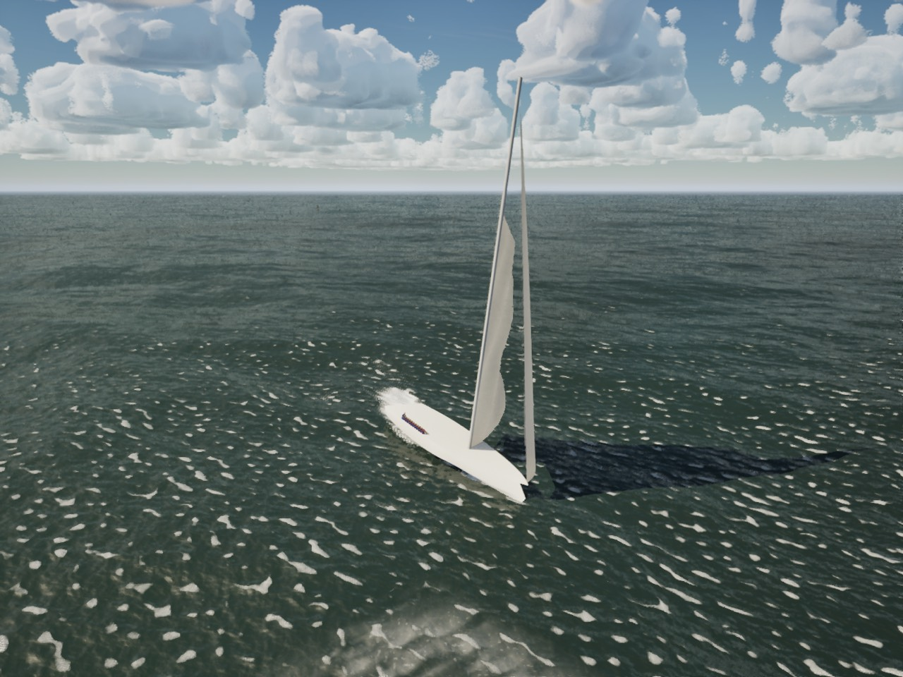

# Prologue: scripted scenes and crew stations

Bean's opening level replaces the Title-to-first-lesson flow: about ten minutes on a 30 m maxi in a Mediterranean
mistral (30–35 kn gusting 40, light rain, a short steep 3–4 m sea), a captain calling orders that teach the controls,
no free sailing, then a cut to the lake club and the Day Sailor career. This step builds the machinery every later
step fills with data: a scene read from a JSON file, judged by the sim, shown by the HUD.

| Step | What | State |
| --- | --- | --- |
| 1 | Data-driven scripted scenes | done |
| 2 | Crew-station control mode ([below](#step-2-crew-stations)) | done |
| 3 | The maxi class ([below](#step-3-the-maxi)) | done |
| 4+ | The gale preset, the captain's voice, cameras, the first-launch flow (prologue, then Easy/Realistic, then the career) | later |

## How it runs

- **Data:** `Content/Prologue/prologue.json`, staged loose like `Content/Career` (`DefaultGame.ini`). Check it with
  `python3 Tools/prologue/validate.py` (`--self-test` shows it rejecting broken scenes).
- **Sim:** `Sailing::FScriptedScene` (`Source/SailingPhysics/Public/ScriptedScene.h`), plain C++ like `FDrillRunner`,
  with its own small JSON reader so it still builds standalone. `LoadText` checks the file; `Start(Boat, MeanWindKn)`,
  then `Update(Boat, Input, Dt)` once a physics frame on the sim clock. `FSceneInput` is the crew's input: the
  `FBoatControls`, the station they hold and the crew actions done this frame. The scene judges every answer from the
  boat's telemetry and those controls (online rule 8), never from the HUD.
- **Game:** `-SailingPrologue=1` makes a session a prologue (the first-launch wiring comes later). `ASailingGameMode`
  loads the scene, sails it on its own boat (`setting.boat`: the maxi since step 3, on `setting.reefs`, in the scene's
  wind; `-SailingPrologueBoat=J22` sails the stand-in, `setting.stand_in`, for comparison; `-SailingBoat`,
  `-SailingWind`/`-SailingGust` still win), and steps it from the player's boat
  (`ASailboatPawn::TickAfterPhysics` hands over the boat, the merged controls, the player's station, the station
  controls they worked, and the **crew action** button, Space or X on the pad, which answers a call that asks for an
  action). The boat starts on the first checkpoint's pose; R
  (reset) goes back to the last checkpoint and its pose. The front end is off in a prologue run.
- **HUD:** `SSailHud` shows the caption bottom centre in the rules callout's panel ("Captain"), with the keys that
  answer it (from the live bindings), in every HUD mode.
- **Voice:** each call id resolves to `/Game/Audio/Pack/Voice/<id with . and - as _>` (`captain_ease_jib`) if the pack
  has it, played when the call or a repeat goes out. There are none yet; the caption carries the scene.
- **Save:** a finished scene is kept by id under `progress.scenes` (`FSailSave::FSceneRecord`): done, plays, best time,
  the last finish's answered, assisted and repeated counts, first completion (UTC). Added in version 1 without a
  version change (a missing field reads as empty). `IsSceneDone("prologue")` is what makes it skippable after the
  first play. Bench, capture and automation runs never write it.

## The data format

```json
{
  "schema_version": 1, "id": "prologue", "title": "Mistral",
  "setting": { "boat": "Maxi", "world": "mistral-coast", "weather": "Mistral", "rain": "light",
               "wind_kn": 32, "gust_kn": 40, "sea_hs_m": 3.5,
               "stand_in": { "boat": "J22", "wind_kn": 25, "gust_kn": 32 },
               "then": { "cut": "lake-club", "tier": "day-sailor" } },
  "assist_caption": "I've got it. Watch how it's done, then it's yours.",
  "cameras": ["deck-wide", "jib-sheet", ...], "stations": ["helm", "grinder", ...], "actions": ["clip-on", "grind"],
  "steps": [
    { "id": "ease-jib", "camera": "jib-sheet",
      "trigger": { "type": "gust", "over_mean_kn": 6, "after_s": 4, "or_after_s": 45 },
      "call": { "id": "captain.ease-jib", "caption": "Gust! Ease the jib! Ease, ease!",
                "retry": "She's rounding up! Let the jib sheet out, a good arm's length!",
                "ok": "That's it. Feel her come back on her feet." },
      "expect": { "type": "sheet", "sheet": "jib", "by": 0.12, "within_s": 4 },
      "retry_after_s": 3, "crew_takes_over_after": 3 }
  ]
}
```

A step waits for its **trigger**, then the captain makes the **call**; the scene watches for the **expected** answer.
If it does not come within `within_s`, the call repeats `retry_after_s` later (in the `retry` wording when there is
one); after `crew_takes_over_after` repeats the rest of the crew does it and says `assist_caption` (0: repeat for
ever). Nothing ever fails the scene: it only counts answered steps, assisted steps, repeats and restarts. On success
the `ok` line shows for 3 s and the scene goes to `next` (a step id, `"end"`, or by default the following step).

| Trigger `type` | Fields | Fires when |
| --- | --- | --- |
| `previous` | | the step before succeeded |
| `time` | `at_s` | the scene clock reaches it |
| `gust` | `over_mean_kn` | the true wind at the boat passes the scene's mean wind by this much |
| `twa` | `twa_min_deg`, `twa_max_deg` | \|TWA\| is inside the band |
| `heel` | `heel_above_deg` | \|heel\| is above it |
| `speed` | `speed_above_kn` | boat speed is above it |
| `past-mark` | `bearing_deg`, `meters` | she has sailed this far along the bearing (true) from where the scene started |

Every trigger takes `after_s` (at least this long after the step became current); all but `time` take `or_after_s`
(fire anyway after this long, so a calm patch never stalls the story).

| Expect `type` | Fields | Answered when |
| --- | --- | --- |
| `none` | `seconds` | narration: that long after the call |
| `sheet` | `sheet` (main, jib), `by`, `at_least`, `at_most`, `controls` | eased (`by` > 0) or trimmed (`by` < 0) that far from where it was at the first call, and / or past an absolute value (0 = in, 1 = out) |
| `tack` / `gybe` | | the wind is on the other side and settled: \|TWA\| 30–100 for a tack, over 100 for a gybe |
| `hold` | `hold_s`, `twa_min_deg`/`twa_max_deg`, `max_heel_deg`, `min_speed_kn`, `station`, `controls` | all the given conditions held for `hold_s` |
| `station` | `station` | the crew member holds that station |
| `action` | `action` | the crew action was done after the call |

`controls` (step 2) names station controls the crew member must work after the call, in that order, at the step's
station: `wheel`, `jib-sheet`, `grinder`, `main-sheet`, `traveller`, `traveller-dump`. All take `within_s` (default 10). Every step names its `station` (one of the scene's `stations`: `helm`, `jib-trimmer`, `main-trimmer`): the scene puts
the crew member there when the step begins. A step may be a `checkpoint` (a restart point) with a `restart` pose
(`twa_deg`, `speed_kn`: where the game puts the boat), and a `camera` (one of the scene's `cameras`: a named view the
renderer may use). Unknown fields, triggers and expectations, repeated or reserved ids, a `next` that names no step, a
camera, station or action the scene does not list are all refused by both the loader and the validator; the validator
also wants call ids under `captain.`, captions under 120 characters, a pose on every checkpoint, the first step a
checkpoint, every step at a station, every step reachable and the scene reaching its end. A control the step's
station does not work is refused by both.

## The seven steps

Placeholder captions in the captain's voice; the later steps only change data.

| # | Id | Station | Trigger | Call | Answer | Camera |
| --- | --- | --- | --- | --- | --- | --- |
| 1 | `clip-on` (checkpoint, TWA 60 at 8 kn) | jib trimmer | 3 s in | "Clip on to the jackline before you do anything else." | action `clip-on` in 10 s | deck-wide |
| 2 | `ease-jib` | jib trimmer | a gust 6 kn over the mean (or 45 s) | "Gust! Ease the jib!" | the jib sheet eased 0.12 in 4 s | jib-sheet |
| 3 | `ready-about` (checkpoint, TWA 55 at 8 kn) | helm | 8 s after | "You're on the wheel. Ready about!" | a tack in 25 s (the crew work the sheets) | helm-over-shoulder |
| 4 | `grind` | jib trimmer | at once | "Back on the jib. Grind! Bring the new sheet in, all the way!" | the grinder, jib in to 0.4 in 25 s (step 3: the maxi's J4; 0.15 in 14 s on the J/22) | grinder |
| 5 | `take-helm` (checkpoint, TWA 150 at 10 kn) | helm | 6 s after | "Take the helm. Bear away and let her run down the face of this one." | the wheel, TWA 130–170 for 8 s | wave-face |
| 6 | `dump-main` | main trimmer | a gust 8 kn over the mean, 10 s on (or 40 s) | "Squall! Dump the traveller, then ease the main!" | the traveller dump, then the mainsheet, main out past 0.8 in 6 s | squall-astern |
| 7 | `the-break` (checkpoint, TWA 140 at 9 kn) | helm | 12 s after | "There's the break. Harbour on the bow. Bring her up onto a reach." | the wheel, TWA 60–120 for 6 s, then the end | harbour-ahead |


## Measured

Oct 18 2026, M5 Pro, packaged build: `scripts/gate.sh --scope ui` passed (181 tests; helm-eye High 60.5 fps, beam8
High 64.2). With the scene running and the callout up (`ONLY=beam8 BENCH_EXTRA=-SailingPrologue=1
scripts/bench-visual.sh 12 prologue-callout High`) beam8 High is 64.5 fps; the storm view on Medium is 68.5 fps.

## Tests

- `SailingSim.Prologue.Scene`: the whole scene headless on the J/22 stand-in in 25 kn with a scripted crew member at
  the stations the scene names (the wheel, the jib sheet and grinder, the traveller dump and mainsheet) and the rest of
  the crew in `FStationControls`; gusts to 35 kn when a step waits for one. Oct 18 2026: all 7 steps answered, none
  assisted, no repeats, 83 s of sim time, the calls in order with captions and camera hints; the result saved by id
  and read back (two plays, best time kept, an unfinished run ignored).
- `SailingSim.Prologue.Repeats`: ignoring the first "ease the jib" brings the softer repeat and the scene still finishes
  (7 answered, 1 repeat, 90 s); a crew member who never answers gets 6 steps done by the crew after 17 repeats and the
  scene still finishes (533 s); a restart after the tack goes back to its checkpoint and the scene finishes.
- `SailingSim.Prologue.Validator`: the shipped file loads; an unknown trigger, a dangling `next`, a repeated id, an
  unknown expectation, an unlisted camera, a misspelt field and broken JSON are each refused with a reason.
- `SailingSim.Prologue.Stations` (step 2): the merge gives the crew every control the player's station does not work;
  a player at the jib on the wheel, mainsheet and traveller dump leaves the boat sailing exactly as without; the grind
  times above (4–12 s in 25 kn, quicker in 12 kn); the playthrough at the stations.
- `SailingSim.UI.GamepadBindings`: the station layer keeps its buttons through the boat layer's swaps and swaps within
  its own.
- `SailingSim.Save.RoundTrip` carries a scene record.

The J/22 will not tack on the helm alone in 25 kn (`RunTack(25)` fails; 20 kn tacks in 6.3 s), so the crew tack the
way a crew would in heavy air: the jib let fly and the main in hard to head up, then the jib held aback and the main
eased to push the bow down onto the new tack. Since step 2 that is `FStationControls`' crew, so a player at the wheel
gets it too.

## Step 2: crew stations

Bean's design: in the prologue the player is crew on a big boat and works one station at a time; the scene moves them
between stations and the rest of the crew hold everything else, so a player at the jib cannot steer.

- **Sim:** `Sailing::FStationControls` (`Source/SailingPhysics/Public/CrewStation.h`, plain C++). `Reset(Boat,
  Controls, Station)`, `MoveTo(Boat, Station)`, then `Step(Boat, FStationInput, Dt)` every physics step returns the
  controls to step with: `Merge(Station, Player, Crew)` takes the controls the station works from the player's hands
  and the rest from the crew. Ownership: the helm the tiller (as a wheel), the jib trimmer the jib sheet (and backing
  it), the main trimmer the mainsheet and traveller; `None` (normal sailing) everything. `TakeWorked()` reports the
  station controls the player worked (`StationControlBit`), which the scene reads as `FSceneInput::Worked`.
- **The crew:** `FAutoTrim` on the sheets, sail shape and hiking; `FAutopilot` on the wheel holding the course the
  player left (no higher than close-hauled); and the heavy-air tack while the player steers one (the J/22 will not tack
  on the helm alone in 25 kn): as the helm goes down the jib is let fly and the main hard in, through the wind the jib
  is held aback and the main eased, then the new sheet is ground in.
- **The wheel:** the tiller keys or stick turn it at the boat's rate (`WheelHardOverSeconds`, 0.9 s amidships to hard
  over on the stand-in) and it stays where it is put.
- **The grinder:** trimming the jib in at a station is grinding, for the crew too. Line speed is
  `effort x min(MaxLineSpeedMs, efficiency x GrinderPowerW / sheet load)`: 300 W at the handle, 80% through the winch,
  0.6 m/s unloaded, over 3 m of sheet travel. The sheet load is the jib's sail force from the telemetry times 1.6 (the
  clew holds the leech and foot; Harken's sizing rule, 0.00431 x area ft² x AWS kn² lb, is 2400 N for the J/22's jib
  at 30 kn apparent), or 0.5 rho AWS² x the jib's area before the first step. Hold the grind key to grind, or tap it
  (each tap is 0.35 s of grinding, about half a turn); the jib-trim key grinds too. Through the wind the old sheet is
  let go (the jib sheet goes to fully eased) and the new one has to be ground in. Easing is free (0.5 of the travel a
  second).
- **The main trimmer:** mainsheet and traveller at the pawn's usual rates; the traveller dump puts the car to leeward
  in one go.
- **Game:** the pawn is in station mode whenever a scene runs (`ASailboatPawn::UpdateStations`, never on traffic boats
  or the ghost; normal mode is unchanged). The player's hands go to the station merge each frame instead of straight to
  the controls, and the steps run the merge (`FBoatStepJob::Stations`, on the physics task). The scene's station order
  arrives by `GetStationSerial()`; a reset to a checkpoint starts the crew again from the reset boat.
- **Input** (built from `USailingInputSettings`, rebindable in Input.ini and on the Controls screen in both columns):

  | Command | Key | Pad |
  | --- | --- | --- |
  | Crew action (answer the captain) | Space | X |
  | Grind the jib winch (tap or hold) | G | A |
  | Dump the traveller | X | B |
  | Move to the next station | F | Y |

  These four are a **station layer** (`SailingBindings::IsStationAction`, `SameLayer`): only live at a crew station,
  where the crew hold the boat's other commands, so they share keys and buttons with wing-on-wing, the backstay,
  learning mode, righting and hiking without clashing; a rebind swaps only within its layer (Menu and the controls
  card clash with both). At a station the pawn ignores the boat's other button commands.
- **HUD:** the callout's header shows the station ("You: jib trimmer"); its hint is the key for the next control the
  call asks for ("G: grind (tap or hold)", "X: dump the traveller", "A / D: turn the wheel"), or the station key when
  the player has walked away from the step's station. The corner hint offers the station key instead of steering away
  from the helm.


### Measured (step 2)

Oct 18 2026, `SailingSim.Prologue.Stations`: grinding the J/22's jib sheet from fully eased to 0.15 (the grind step's
"all the way") takes **6.8 s** of grinding in 25 kn and **4.5 s** in 12 kn (power-limited for the last metre in the
gale, at the winch's top speed in the breeze). The whole scene with the scripted crew member at the stations: all 7
steps answered, none assisted, no repeats, 87 s, 2.6 m of sheet ground; the stations at the calls are jib trimmer,
jib trimmer, helm, jib trimmer, helm, main trimmer, helm.

Packaged build, Oct 18 2026: `scripts/gate.sh --scope ui` passed (182 tests; helm-eye High 60.3 fps, beam8 High
63.0); the storm view on Medium (`ONLY=storm scripts/bench-visual.sh 12 stations-storm Medium`) is 68.3 fps.

## Step 3: the maxi

The prologue's boat: a made-up 100 ft racing maxi, built by the PC as a model (`maxi-hero`: `Tools/boats/maxi/ref.json`
and `sections.json`, copied here) and here as a physics class, `EBoatType::Maxi` in `FBoatConfig::Make`
(`Source/SailingPhysics/Private/Fleet.cpp`). Every number has its reason in the comment beside it.

- **Hull: the exported sections themselves.** `FHullShape` can now be a table of stations (`Stations`: half sections
  keel to sheer, stern to bow) instead of the formula; `DeckHalfBeam`, `SheerHeight`, `KeelLineDepth` and `BottomZ`
  follow them, so the hydrostatics, wetted hull, grounding, wake, crew placement and water clip all see the model's
  hull. `Tools/boats/maxi/make_maxi_hull.py` writes them into `MaxiHullData.inl` (rerun it when the PC re-exports).
  The formula's parameters are kept as a stand-in fit (the water material's hull clip, `BoatExport`).
- **Displacement:** the canoe body's 37.13 m^3 plus the fin, bulb and rudders (3.03 m^3 from ref.json's plan forms,
  `FBoatConfig::AppendageVolume`: fixed appendages now float their own volume, at their centroid) float her 40.2 t in
  the sim's fresh water; ref.json's 42 t is the same volume in sea water within 2%. Ballast: the steel fin (3.06 t) and
  20 t of lead in the bulb; 12 crew of 88 kg on the rail (2.6 m out on average).
- **Righting curve** (from the hull and keel): GM 5.9 m; righting moment 0.94 MN m at 30 deg, 1.13 at 45, positive
  past 110 deg (GZ 5.3 m); knocked down to 85 deg she is back under 2 deg in 30 s.
- **Appendages:** a fixed T-keel (the fin's area carries the bulb's and canoe body's side force; the bulb is the
  grounding footprint at 6.0 m), twin spade rudders 1.75 m off the centreline canted 8 deg (the windward blade lifts
  out heeled; the leeward one ventilates from 40 deg, not the single rudders' 30), wheel steering
  (`FBoatConfig::WheelHardOverSeconds` 1.6 s, which the station wheel reads).
- **Rig:** masthead sloop, mast 44.5 m above the deck, square-top main 335 m^2, a non-overlapping J1 245 m^2, A2 720
  m^2 off the sprit. **Reefs:** one (87% of the luff, the J3 at 55% of the J1) and two (74%, the J4 at 35%): the gale
  sails. `FBoatConfig::ReefJibFraction` changes the headsail with each reef (the small boats keep theirs).
- **Resistance:** wetted area from the sections' girth (114.7 m^2); residuary the J/22's Delft-shaped table scaled by
  slenderness cubed through the hump, the planing dinghies' rise past Fn 0.7; windage from the mast's frontal area.
- **Engine:** 150 hp diesel, 13 kN of bollard pull.
- **The estimated polar** (`FleetReferencePolar`, `Tools/boats/maxi/estimate_polar.py`): no published polar, so the
  Catalina 30's and the J/22's ORC polars are scaled to her by Froude number, sail area / displacement and Reynolds
  number and averaged; the same scaling from the Catalina 30 lands within 4% of the J/22's own polar on average (17% at
  worst), and the maxi is far outside the fleet (displacement-length 43), so the tolerance is 30%. `scripts/polar.sh
  --boat maxi` sails it, `--scenarios` runs the heavy-air tacks and the gust.
- **The scene's assisted limits:** `FSceneLimits` (`EasyAssists.h`): a 35 deg heel cap (FEasyAssists' righting assist),
  the rudders keeping three quarters of the grip they lose to ventilation, yaw damped twice as hard. The pawn applies it
  while a scene runs (after Easy mode's); normal sailing never does.
- **Stations:** `FStationConfig::For` gives the maxi two linked pedestals the player grinds with three more grinders
  (1.4 kW, 80%, 1.2 m/s top gear), 8 m of J3/J4 sheet, her wheel rate, slower main and traveller; her crew tack on the
  helm and the trim (`bTackHelp` off: the J/22's heavy-air help stopped her head to wind).
- **The game's edge:** the scene's `setting.boat` ("Maxi") picks her and `setting.reefs` (2, new) her sails; until the
  mistral coast exists she sails the Gulf world's offshore spot (15 nm south of Galveston, the only water deep enough
  for her draft). `-SailingPrologueBoat=J22` sails the stand-in on the lake as before. She is not on the Boat screen or
  in the pause menu's boat row yet; `-SailingBoat=Maxi` works for stills, drawn by the fleet's procedural stand-in from
  her physics (`ModelMeshesFor` has no meshes for her yet). Save id `Maxi`.
- **The scene retuned for her:** the grind step asks for the jib in to 0.4 in 25 s (the J4's last metre against 40 kN
  of sheet load is a minute's work); every other step already fits her.



### Measured (step 3)

Oct 18 2026, standalone and `SailingSim.Physics.Maxi*`, `SailingSim.Prologue.*`:

| | |
| --- | --- |
| Floating draft (canoe body) | 0.959 m (ref.json 0.95) |
| Centre of buoyancy | x -2.375, z -0.259 (export -2.342, -0.272) |
| At rest | level within 0.04 deg, on her lines within 1 mm |
| Polar | 15 points within 30%: 6 kn upwind 9.0 kn at 52 deg, 10.5 reaching; 10 kn 11.7 / 14.6; 16 kn 12.2 / 16.1, 15.3 at 150 with the A2 |
| Helm upwind (10-16 kn) | 2.0-4.3 deg of weather helm |
| Tack, 30 kn, two reefs | 17.2 s, 10.5 kn down to 3.6 (full sail: she cannot) |
| 40 kn gust on a close reach (TWA 70), sheets held, limits off | heel 39 deg, rounds up to 47 deg off the wind, no capsize |
| ... limits on | heel 30.2 deg, 5 deg off course, no broach |
| ... broad reach (TWA 100), limits on | heel 30.1 deg, 21.3 to 25.5 kn |
| Broad reach, 30 kn gusting to about 37, two reefs (reference check) | one-second peak 30.3 kn (band 18-34), most tilt 20 deg |
| Grind, 32 kn, two reefs: fully eased to 0.40 | 23.1 s (to 0.20: 65.7 s); 4.7 s in 12 kn. The J/22: 6.8 s to 0.15 in 25 kn |
| The scene on the maxi, 32 kn gusting 40 | 7 steps answered, none by the crew, no repeats, 112 s, 3.3 m of sheet ground (the J/22 stand-in: 84 s) |
| A crew member who never answers | the crew do all 7 after 20 repeats; the scene finishes (650 s) |

Packaged build, Oct 18 2026: `scripts/gate.sh --scope boats` passed (185 tests; High: beam8 62.5 fps, beat15 60.7,
marina 59.4, helm-eye 58.3, slip 52.1, crew 52.5). The prologue on the maxi uncooked (`scripts/run-game.sh 20
-SailingPrologue=1 -SailingBoat=Maxi -SailingWorld=Gulf -SailingLaunch=2 -SailingQuality=High`): 58-60 fps.

A known gap: in the reference checks' gustier field (gust intensity 0.15, gusts near 48 kn) the polar's crew, who ease
only as far as their trim lets them, broach her on a broad reach under two reefs; the scene's limits hold her (38.5 deg,
21 kn mean). The check runs at 0.10.

### What the model needs

For the PC, so the hero sits on the physics:

- **Waterline:** the physics floats her on the sections' design waterline (body Z = 0, the export's frame) with the
  canoe body 0.959 m deep (0.95 in ref.json: 9 mm of sinkage). Keep the model's origin on the DWL amidships of the
  waterline, X forward, as exported; the pawn places the model's origin at the physics origin.
- **Hull:** the physics is `sections.json` as exported (21 stations, 11 points each). A re-export means copying both
  JSON files into `Tools/boats/maxi/` and rerunning `make_maxi_hull.py` (then `SailingSim.Physics.MaxiHull` checks the
  draft, centre of buoyancy and displacement).
- **Sockets** the pawn reads (`BoatModelVisuals.cpp`, the J/22 hero's names): on the hull `MastStep` (x 3.1),
  `RudderPivot` and `RudderPivot_1` (the two stocks, x -12.9, y -/+1.75), `ForestayTack` (x 14.75, z 2.95),
  `BackstayPlate`, `JibLead_S`/`_P` (the genoa tracks), `JibTailer_S`, `Traveler_C` and `Traveler_S` (x -11.4),
  `LazySheetVia`, and the crew's `Seat`, `FootBrace`, `SideDeck`, `HandholdCoaming`, `HandholdCabin` with `_S`/`_P`;
  on the mast `MastBase`, `LowerTang`, `Hounds`, `MastheadAft`; on the boom `Boom_Vang`, `Boom_Mainsheet` (the boom
  hangs on the physics gooseneck, z 2.15); on the rudder `RudderStock` and `TillerEnd` (a point on the wheel's rim
  for the helm's hand: the pawn reads it as the tiller end). No `Outboard` (set `bOwnOutboard`: the diesel is inboard).
- **Code:** `ASailboatPawn::ModelMeshesFor` needs a `Maxi` entry (`/Game/Boats/Maxi/SM_Maxi_*`, `BoatTags` has 8);
  `SailingSim.Visual.FleetMesh` should hold the hero to the physics hull (LOA 30.48, beam 7.2) like the fleet's; the
  catalogue's Boat screen skip (`SailCatalog::MakeBoats`) and the pause menu's skip come out when she is offered.
  `BoatExport` is not needed (the model is the source of the hull).

## What the later steps need

- **The HUD's wheel:** none drawn yet (`FStationControls::GetWheel()` is there for it).
- **The gale preset and the mistral world (step 4):** `setting.weather`, `world`, `rain`, `sea_hs_m` are recorded but
  not applied yet; the game mode applies the scene's wind and gust, and the maxi sails the Gulf's offshore spot until
  the mistral coast exists. The gale sails are the maxi's two reefs (main 74% of the luff, the J4).
- **The maxi's model (the PC, `maxi-hero`):** what the physics needs from it is in [step 3](#what-the-model-needs).
- **Cameras:** the renderer reads `FScriptedScene::GetCamera()`; nothing consumes it yet.
- **Voice:** record the seven calls (and repeats) as `/Game/Audio/Pack/Voice/captain_<step>` with licence rows.
- **The first-launch flow (step 7):** title, prologue, Easy/Realistic, career; skip from `IsSceneDone("prologue")`;
  `setting.then` names the cut (`lake-club`) and the tier (`day-sailor`).
- **Pacing:** the real scene is about ten minutes; the placeholder steps run in a minute and a half when every call is
  answered. Longer narration (`none` steps) and the maxi's slower manoeuvres make up the rest.
