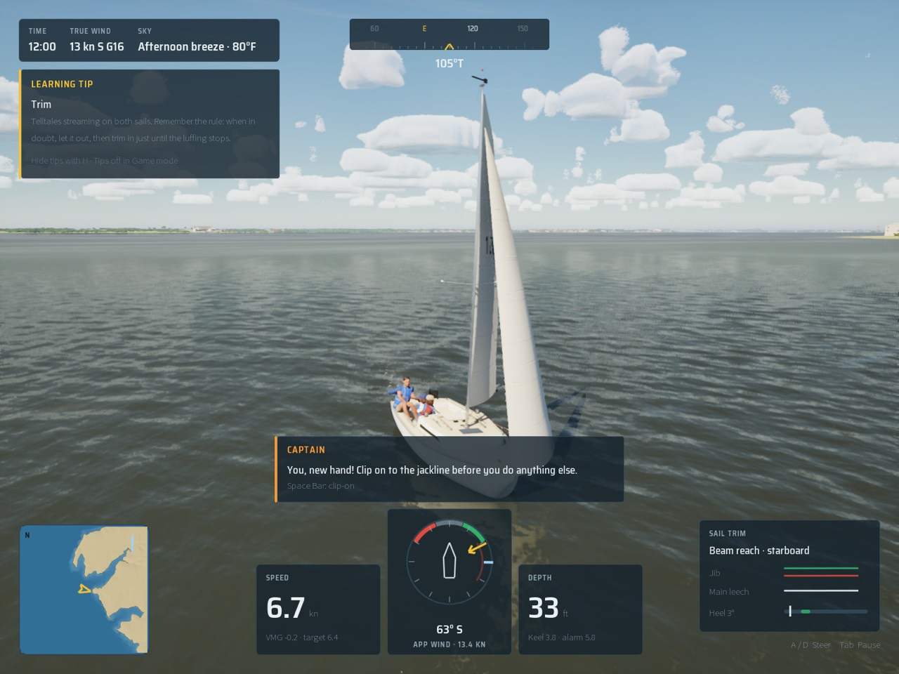

# Prologue, step 1: scripted scenes

Bean's opening level replaces the Title-to-first-lesson flow: about ten minutes on a 30 m maxi in a Mediterranean
mistral (30–35 kn gusting 40, light rain, a short steep 3–4 m sea), a captain calling orders that teach the controls,
no free sailing, then a cut to the lake club and the Day Sailor career. This step builds the machinery every later
step fills with data: a scene read from a JSON file, judged by the sim, shown by the HUD.

| Step | What | State |
| --- | --- | --- |
| 1 | Data-driven scripted scenes (this page) | done |
| 2 | Crew-station control mode (stations, crew actions as input) | next |
| 3 | The maxi class (`Tools/boats/maxi/ref.json`, `sections.json` on `maxi-hero`) | later |
| 4+ | The gale preset, the captain's voice, cameras, the first-launch flow (prologue, then Easy/Realistic, then the career) | later |

## How it runs

- **Data:** `Content/Prologue/prologue.json`, staged loose like `Content/Career` (`DefaultGame.ini`). Check it with
  `python3 Tools/prologue/validate.py` (`--self-test` shows it rejecting broken scenes).
- **Sim:** `Sailing::FScriptedScene` (`Source/SailingPhysics/Public/ScriptedScene.h`), plain C++ like `FDrillRunner`,
  with its own small JSON reader so it still builds standalone. `LoadText` checks the file; `Start(Boat, MeanWindKn)`,
  then `Update(Boat, Input, Dt)` once a physics frame on the sim clock. `FSceneInput` is the crew's input: the
  `FBoatControls`, the station they hold and the crew actions done this frame. The scene judges every answer from the
  boat's telemetry and those controls (online rule 8), never from the HUD.
- **Game:** `-SailingPrologue=1` makes a session a prologue (the first-launch wiring comes later). `ASailingGameMode`
  loads the scene, sails it on the stand-in boat and wind (`setting.stand_in`: the J/22 in 25 kn gusting 32 until the
  maxi and the gale exist; `-SailingWind`/`-SailingGust` still win), and steps it from the player's boat
  (`ASailboatPawn::TickAfterPhysics` hands over the boat, the controls, the station `helm`, and the **crew action**
  button, Space, which answers a call that asks for an action). The boat starts on the first checkpoint's pose; R
  (reset) goes back to the last checkpoint and its pose. The front end is off in a prologue run.
- **HUD:** `SSailHud` shows the caption bottom centre in the rules callout's panel ("Captain"), with the keys that
  answer it (from the live bindings), in every HUD mode.
- **Voice:** each call id resolves to `/Game/Audio/Pack/Voice/<id with . and - as _>` (`captain_ease_jib`) if the pack
  has it, played when the call or a repeat goes out. There are none yet; the caption carries the scene.
- **Save:** a finished scene is kept by id under `progress.scenes` (`FSailSave::FSceneRecord`): done, plays, best time,
  the last finish's answered, assisted and repeated counts, first completion (UTC). Added in version 1 without a
  version change (a missing field reads as empty). `IsSceneDone("prologue")` is what makes it skippable after the
  first play. Bench, capture and automation runs never write it.

## The data format

```json
{
  "schema_version": 1, "id": "prologue", "title": "Mistral",
  "setting": { "boat": "Maxi", "world": "mistral-coast", "weather": "Mistral", "rain": "light",
               "wind_kn": 32, "gust_kn": 40, "sea_hs_m": 3.5,
               "stand_in": { "boat": "J22", "wind_kn": 25, "gust_kn": 32 },
               "then": { "cut": "lake-club", "tier": "day-sailor" } },
  "assist_caption": "I've got it. Watch how it's done, then it's yours.",
  "cameras": ["deck-wide", "jib-sheet", ...], "stations": ["helm", "grinder", ...], "actions": ["clip-on", "grind"],
  "steps": [
    { "id": "ease-jib", "camera": "jib-sheet",
      "trigger": { "type": "gust", "over_mean_kn": 6, "after_s": 4, "or_after_s": 45 },
      "call": { "id": "captain.ease-jib", "caption": "Gust! Ease the jib! Ease, ease!",
                "retry": "She's rounding up! Let the jib sheet out, a good arm's length!",
                "ok": "That's it. Feel her come back on her feet." },
      "expect": { "type": "sheet", "sheet": "jib", "by": 0.12, "within_s": 4 },
      "retry_after_s": 3, "crew_takes_over_after": 3 }
  ]
}
```

A step waits for its **trigger**, then the captain makes the **call**; the scene watches for the **expected** answer.
If it does not come within `within_s`, the call repeats `retry_after_s` later (in the `retry` wording when there is
one); after `crew_takes_over_after` repeats the rest of the crew does it and says `assist_caption` (0: repeat for
ever). Nothing ever fails the scene: it only counts answered steps, assisted steps, repeats and restarts. On success
the `ok` line shows for 3 s and the scene goes to `next` (a step id, `"end"`, or by default the following step).

| Trigger `type` | Fields | Fires when |
| --- | --- | --- |
| `previous` | | the step before succeeded |
| `time` | `at_s` | the scene clock reaches it |
| `gust` | `over_mean_kn` | the true wind at the boat passes the scene's mean wind by this much |
| `twa` | `twa_min_deg`, `twa_max_deg` | \|TWA\| is inside the band |
| `heel` | `heel_above_deg` | \|heel\| is above it |
| `speed` | `speed_above_kn` | boat speed is above it |
| `past-mark` | `bearing_deg`, `meters` | she has sailed this far along the bearing (true) from where the scene started |

Every trigger takes `after_s` (at least this long after the step became current); all but `time` take `or_after_s`
(fire anyway after this long, so a calm patch never stalls the story).

| Expect `type` | Fields | Answered when |
| --- | --- | --- |
| `none` | `seconds` | narration: that long after the call |
| `sheet` | `sheet` (main, jib), `by`, `at_least`, `at_most` | eased (`by` > 0) or trimmed (`by` < 0) that far from where it was at the first call, and / or past an absolute value (0 = in, 1 = out) |
| `tack` / `gybe` | | the wind is on the other side and settled: \|TWA\| 30–100 for a tack, over 100 for a gybe |
| `hold` | `hold_s`, `twa_min_deg`/`twa_max_deg`, `max_heel_deg`, `min_speed_kn`, `station` | all the given conditions held for `hold_s` |
| `station` | `station` | the crew member holds that station |
| `action` | `action` | the crew action was done after the call |

All take `within_s` (default 10). A step may be a `checkpoint` (a restart point) with a `restart` pose
(`twa_deg`, `speed_kn`: where the game puts the boat), and a `camera` (one of the scene's `cameras`: a named view the
renderer may use). Unknown fields, triggers and expectations, repeated or reserved ids, a `next` that names no step, a
camera, station or action the scene does not list are all refused by both the loader and the validator; the validator
also wants call ids under `captain.`, captions under 120 characters, a pose on every checkpoint, the first step a
checkpoint, every step reachable and the scene reaching its end.

## The seven steps

Placeholder captions in the captain's voice; the later steps only change data.

| # | Id | Trigger | Call | Answer | Camera |
| --- | --- | --- | --- | --- | --- |
| 1 | `clip-on` (checkpoint, TWA 60 at 8 kn) | 3 s in | "Clip on to the jackline before you do anything else." | action `clip-on` in 10 s | deck-wide |
| 2 | `ease-jib` | a gust 6 kn over the mean (or 45 s) | "Gust! Ease the jib!" | jib eased 0.12 in 4 s | jib-sheet |
| 3 | `ready-about` (checkpoint, TWA 55 at 8 kn) | 8 s after | "Ready about! Bring her bow through the wind!" | a tack in 25 s | helm-over-shoulder |
| 4 | `grind` | at once | "Grind! Bring the new jib sheet in, all the way!" | jib in to 0.35 in 8 s | grinder |
| 5 | `take-helm` (checkpoint, TWA 150 at 10 kn) | 6 s after | "Take the helm. Bear away and let her run down the face of this one." | at the helm, TWA 130–170 for 8 s | wave-face |
| 6 | `dump-main` | a gust 8 kn over the mean, 10 s on (or 40 s) | "Squall! Dump the main!" | main out past 0.8 in 4 s | squall-astern |
| 7 | `the-break` (checkpoint, TWA 140 at 9 kn) | 12 s after | "There's the break. Harbour on the bow. Bring her up onto a reach." | TWA 60–120 for 6 s, then the end | harbour-ahead |



## Measured

Oct 18 2026, M5 Pro, packaged build: `scripts/gate.sh --scope ui` passed (181 tests; helm-eye High 60.5 fps, beam8
High 64.2). With the scene running and the callout up (`ONLY=beam8 BENCH_EXTRA=-SailingPrologue=1
scripts/bench-visual.sh 12 prologue-callout High`) beam8 High is 64.5 fps; the storm view on Medium is 68.5 fps.

## Tests

- `SailingSim.Prologue.Scene`: the whole scene headless on the J/22 stand-in in 25 kn with a scripted crew (FAutoTrim
  and FAutopilot answering each call; gusts to 35 kn when a step waits for one). Oct 18 2026: all 7 steps answered, none
  assisted, no repeats, 83 s of sim time, the calls in order with captions and camera hints; the result saved by id
  and read back (two plays, best time kept, an unfinished run ignored).
- `SailingSim.Prologue.Repeats`: ignoring the first "ease the jib" brings the softer repeat and the scene still finishes
  (7 answered, 1 repeat, 90 s); a crew member who never answers gets 6 steps done by the crew after 17 repeats and the
  scene still finishes (533 s); a restart after the tack goes back to its checkpoint and the scene finishes.
- `SailingSim.Prologue.Validator`: the shipped file loads; an unknown trigger, a dangling `next`, a repeated id, an
  unknown expectation, an unlisted camera, a misspelt field and broken JSON are each refused with a reason.
- `SailingSim.Save.RoundTrip` carries a scene record.

The J/22 will not tack on the helm alone in 25 kn (`RunTack(25)` fails; 20 kn tacks in 6.3 s), so the scripted crew
tacks the way a crew would in heavy air: the jib let fly and the main in hard to head up, then the jib held aback and
the main eased to push the bow down onto the new tack. A player tacking the stand-in in 25 kn needs the same (B backs
the jib).

## What the later steps need

- **Step 2, crew stations:** a real station and crew-action input in the sim layer (today the pawn reports `helm` and
  turns Space into the step's expected action); `grind` as a station's control rather than the jib sheet's value
  (with trim assist on, the assist trims the jib and answers it); a gamepad button for the crew action.
- **Step 3, the maxi:** `setting.boat` names it; drop `stand_in` (or keep it for the tests) and retune the sheet
  amounts and TWA bands on the maxi's polar.
- **The gale preset and the mistral world:** `setting.weather`, `world`, `rain`, `sea_hs_m` are recorded but not
  applied yet; the game mode applies only the stand-in wind and gust.
- **Cameras:** the renderer reads `FScriptedScene::GetCamera()`; nothing consumes it yet.
- **Voice:** record the seven calls (and repeats) as `/Game/Audio/Pack/Voice/captain_<step>` with licence rows.
- **The first-launch flow (step 7):** title, prologue, Easy/Realistic, career; skip from `IsSceneDone("prologue")`;
  `setting.then` names the cut (`lake-club`) and the tier (`day-sailor`).
- **Pacing:** the real scene is about ten minutes; the placeholder steps run in a minute and a half when every call is
  answered. Longer narration (`none` steps) and the maxi's slower manoeuvres make up the rest.
