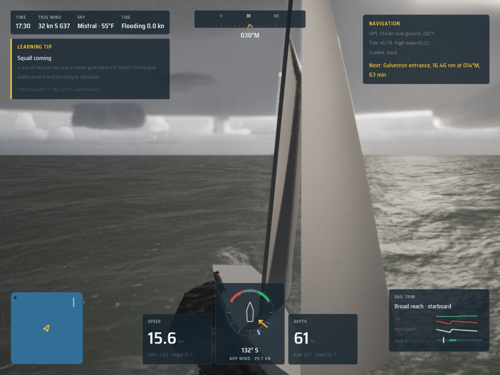
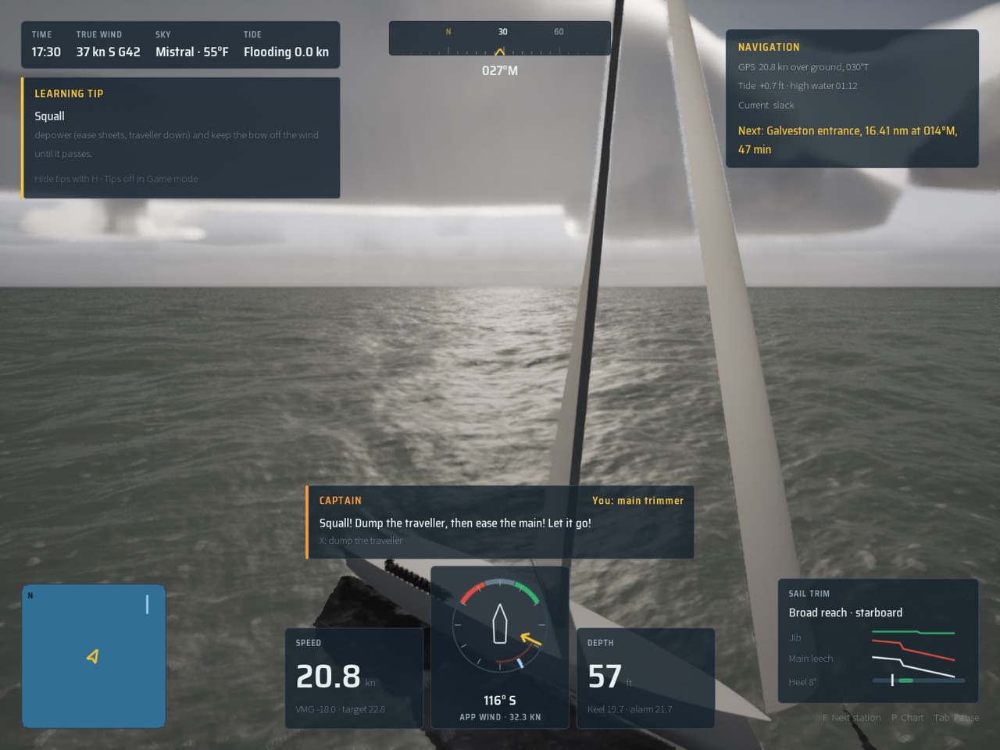
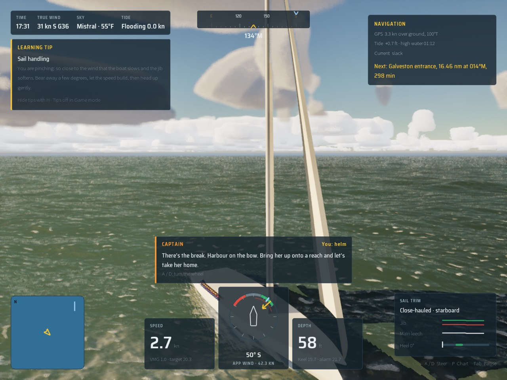

# The prologue in the mistral (step 4)

Three moments of the prologue on the maxi in the `Mistral` preset (High, uncooked editor build, Oct 18 2026). The maxi is
still the fleet's procedural stand-in, at the Gulf's offshore spot (`setting.world_stand_in`, the mistral from the
south: see [the README](../README.md#step-4-the-mistral)).

| Moment | Still |
| --- | --- |
| Before the squall: 5 s into "dump the main", the deck dark astern, 32 kn gusting 37 |  |
| In the squall: its wind on her, 36 kn gusting 42, rain, the captain's call |  |
| The break: 45 s into "the break", the deck broken up and the low sun out, 31 kn |  |

Made with (`scripts/run-game.sh`, the HUD and the captain's callout left on):

```bash
A="-SailingPrologue=1 -SailingBoat=Maxi -SailingWorld=Gulf -SailingLaunch=2 -SailingQuality=High"
scripts/run-game.sh 5 $A -SailingPrologueStep=dump-main -SailingCamYaw=165 -SailingCamPitch=-6 -SailingShot=gale-before
scripts/run-game.sh 16 $A -SailingPrologueStep=dump-main -SailingCamYaw=150 -SailingCamPitch=-8 -SailingShot=gale-squall
scripts/run-game.sh 45 $A -SailingPrologueStep=the-break -SailingCamYaw=20 -SailingCamPitch=-6 -SailingShot=gale-break
```

then `sips -s format jpeg -s formatOptions 70 -Z 1280`. The Gulf has no harbour where "the harbour shows ahead": that
waits for the mistral coast.

## Performance

Oct 18 2026, M5 Pro, packaged Development build. `scripts/gate.sh --scope clouds` passed: 187 tests; on High beam8 62.3
fps, beat15 62.7, storm 47.2, gulf-sea 71.9, helm-eye 60.3, bridge 65.7; storm on Medium 68.1.

The prologue view itself (`ARGS="-SailingPrologue=1 -SailingBoat=Maxi -SailingWorld=Gulf -SailingLaunch=2
-SailingQuality=<tier> -SailingPrologueStep=<step>" scripts/bench-mac.sh 15`, 1440x1080, [bench.csv](bench.csv)):

| Start | High fps (p99 ms) | Medium fps (p99 ms) | High GPU: clouds and fog, water |
| --- | --- | --- | --- |
| The opening (`clip-on`) | 62.0 (17.6) | 89.3 (12.2) | 2.9, 3.3 ms |
| The squall (`dump-main`) | 57.1 (18.8) | 83.5 (13.0) | 3.9, 3.3 ms |
| The break (`the-break`) | 58.9 (18.7) | 85.8 (12.8) | 3.4, 3.1 ms |

The squall is the heaviest moment, 12 fps over High's 45 and 23 over Medium's 60. The headroom for step 8 (Medium 60 and
High 45 with everything in) is what the maxi's hero model, her MetaHuman crew and the cameras have to fit in: about 4.7 ms
a frame on either tier at the squall.
