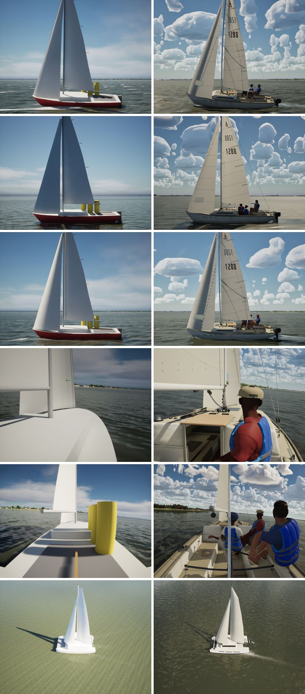
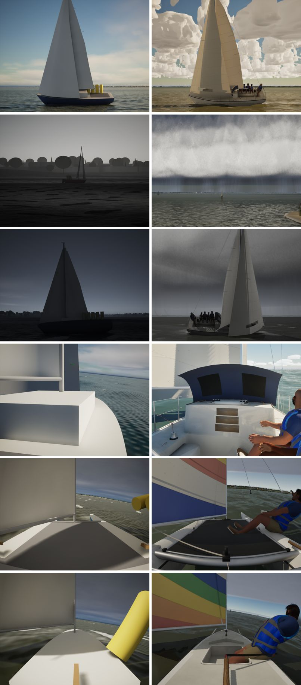
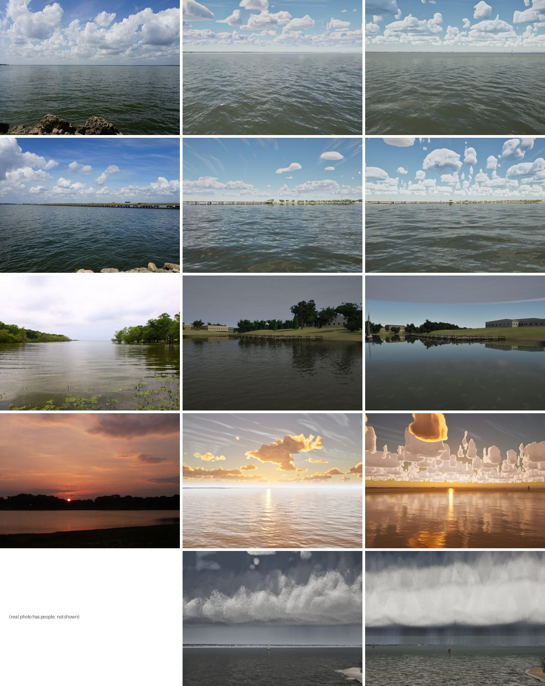
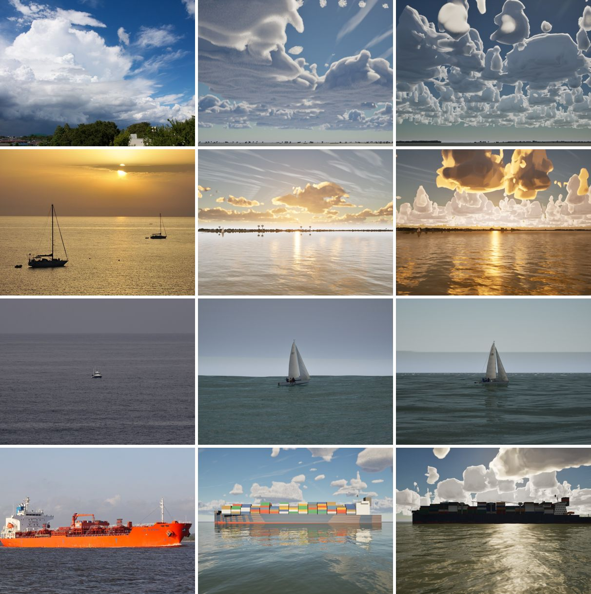
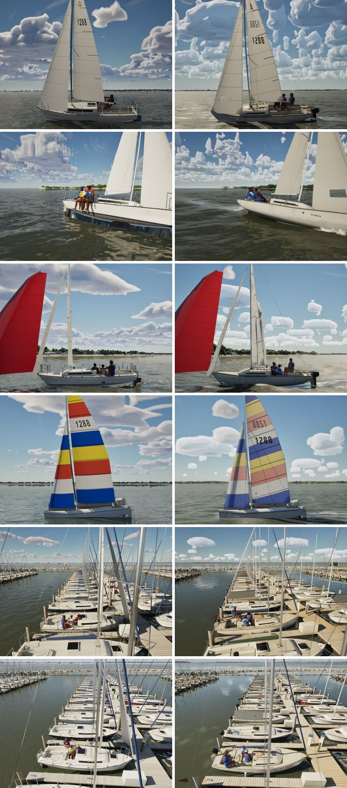

# Realism audit, Oct 22 2026

A look-truth pass on main d6036d51 (#257) with the MetaHuman crew. The phase-8 method (`docs/phase-8/reference-kit/method.md`) asks for matched real and game stills, compared side by side.

Two sets of stills, recaptured today on High in the capture mode (`scripts/capture-scenes.sh`):
- **The phase-8 reference scenes** (`docs/phase-8/reference-scenes.csv`, 12 scenes). Their references are YouTube clips, so here each is compared with its Oct 12 phase-8 capture and the phase-8 scores (`docs/phase-8/compare/scores.csv`).
- **The G5 blind pack** (`docs/graphics-5/blind/scenes.csv`, 15 scenes). Each is matched to a Commons photo already in the repo (CC0/BY/BY-SA, credits in `docs/graphics-5/blind/credits.md`), and compared with the Oct 14 G5 capture.

Real photos that show people are left out of the sheets: the shelf cloud's beach, and the J/24 and Hobie racing photos.

## Contact sheets

Phase-8 scenes, the Oct 12 capture left and today right:

G5 scenes, real photo left, Oct 14 middle, today right:

G5 boat scenes, Oct 14 left and today right (their real photos have people in them):

## What improved since phase 8

- **Boats:** the boxes and cylinders are gone. Every boat has a modelled hull, deck, cockpit and fittings, and the J/22 has its own kit (traveller, cams, tracks).
- **Crew:** MetaHuman crew in place of yellow cylinders.
- **Sails:** cloth sails with numbers, battens and telltales.
- **Marina:** a dressed marina.
- **Sky:** volumetric cumulus and a storm with a shelf cloud and rain.
- **Water:** turbid lake water with chop, caps and wake.

The phase-8 scores' main tell, the boat geometry (4 on every boat scene), is gone. Against the photos, the lake water, haze, shore and bridge (rows 1–4 of the first G5 sheet) are now close.

## The ten biggest remaining gaps

Ranked by how much each would improve the look: how often it is on screen, times how far off it is. Lanes as the project splits them: the Mac does physics, clipping, crew, water, sky and FSailCloth; the PC does models, materials, the sails' look and rope. The sizes are rough.

| # | Gap | Where it shows | Lane | Size |
|---|---|---|---|---|
| 1 | **Fair-weather cumulus are smooth, rounded blobs and stacked columns.** There are no cauliflower billows, no dark flat bases and no sunlit, crisp tops. It is worse than the Oct 14 G5 capture: every small cell stands as an extruded pillar, and the big ones are plastic. Real Texas cumulus have hard, bright, lumpy tops over flat grey bases. | Every fair-weather view: chase, drone, cumulus, bridge, dusk | Mac (sky, CLOUD_CODE) | 1–2 days |
| 2 | **Low-sun clouds and sky.** At dusk the clouds are white-grey with glowing orange rims, standing in columns, and the sky above them stays a neutral grey-blue. In the photos the whole sky and the clouds' undersides turn orange and red, and the clouds go dark against the glow. | Dusk and evening views (rh-c30-evening, dusk, lakesunset) | Mac (sky) | 1 day |
| 3 | **The sails are flat and chalky.** No shading from their draft, no translucency against the light, and the far side's sail number shows through mirrored and nearly as strong as the near one ("1288" reversed over "1288"). | Every boat view | PC (M_SailCloth look) | 0.5–1 day |
| 4 | **The lake reflects too little sky at grazing angles.** In the photos the open lake toward the horizon reads blue-grey, the sky reflected off the chop. Ours stays olive-grey to the horizon, with a pale band where it meets the sky. | Every open-water view (lakeopen, bridge, chase backgrounds) | Mac (water) | 0.5–1 day |
| 5 | **The shelf cloud's face is too bright.** Under a storm the face reads near white. In photos it is dark slate with paler striations, and the bright light is only on its sunlit edge. #255 lit the face by emission (`FACE_PALE` 0.3), and that is likely too much once the face is opaque. | Storm views | Mac (sky) | 2 hours |
| 6 | **The overcast deck's edge shows overhead.** Under Overcast (the shore view) a curved grey edge crosses the top of the frame, likely where the stratus deck ends at the weather map's fade, about 32 km out (not yet checked). | Overcast views looking up | Mac (sky) | 2–4 hours |
| 7 | **The spinnaker and the coloured sails have no shading.** The J/22's red spinnaker is one flat red: no seams, no shading from its shape, no shadow from the main. The Hobie's and Sunfish's panels are flat colour too. | Spinnaker and dinghy views | PC (sail look) | 0.5–1 day |
| 8 | **Weak bow wave and wake at speed.** At 6–7 kn the J/22 leaves a faint trail. In the photos there is a curling bow wave, a white quarter wave and a visible Kelvin wake. | Chase and drone views | Mac (water: FWakeGrid, foam) | 1 day |
| 9 | **Boats don't sit in the water.** There is no contact shading or darkened water at the waterline, and no hull reflection in the near water. The hulls look pasted on, most at a distance. | Chase and marina views | Mac (water) / PC (hull materials) | 0.5–1 day |
| 10 | **Shorelines are clean.** No reeds, weeds or grass at the waterline, no wet margin, the trees standing straight from mown grass. The Tawakoni photos show reeds and green weed at the edge. | Shore and marina views | PC (models) | 1–2 days |

Also seen, but smaller:
- The container ship is a dark silhouette against a bright sky (backlit at 17:00). It is probably right for the light, but it reads heavy.
- The swell view's horizon has a pale haze band.
- The crew's hands-on-knees idle repeats.

## Next

Item 1, the fair-weather cumulus, is the top Mac-lane item. It is being fixed as its own PR.
