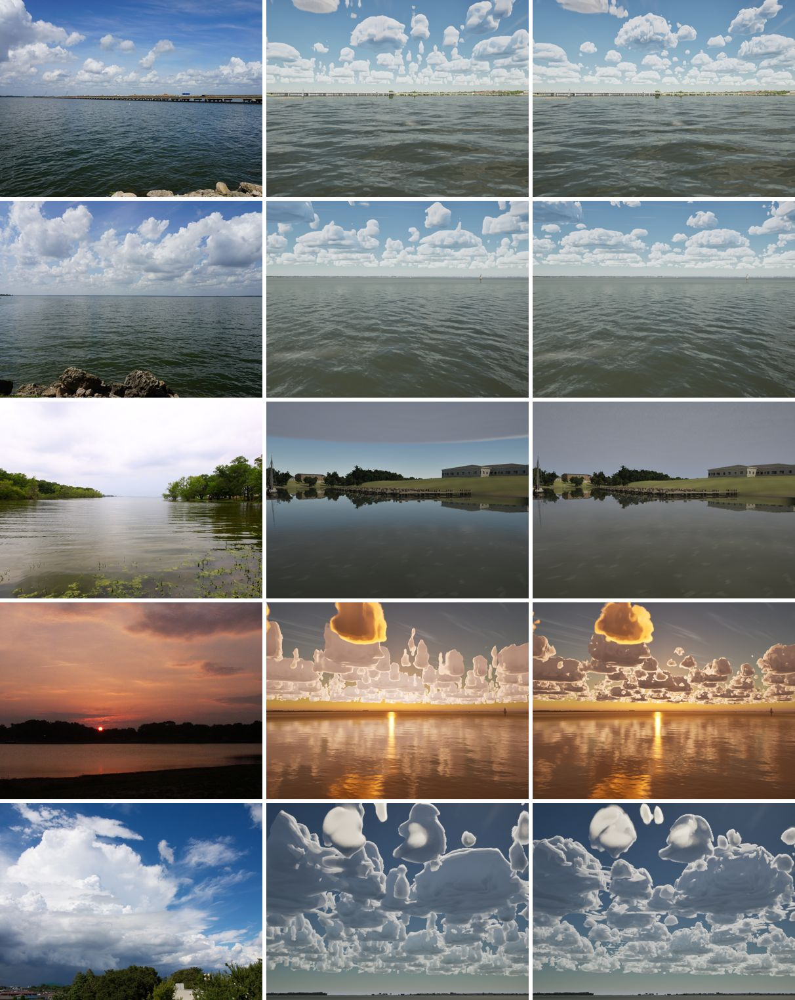
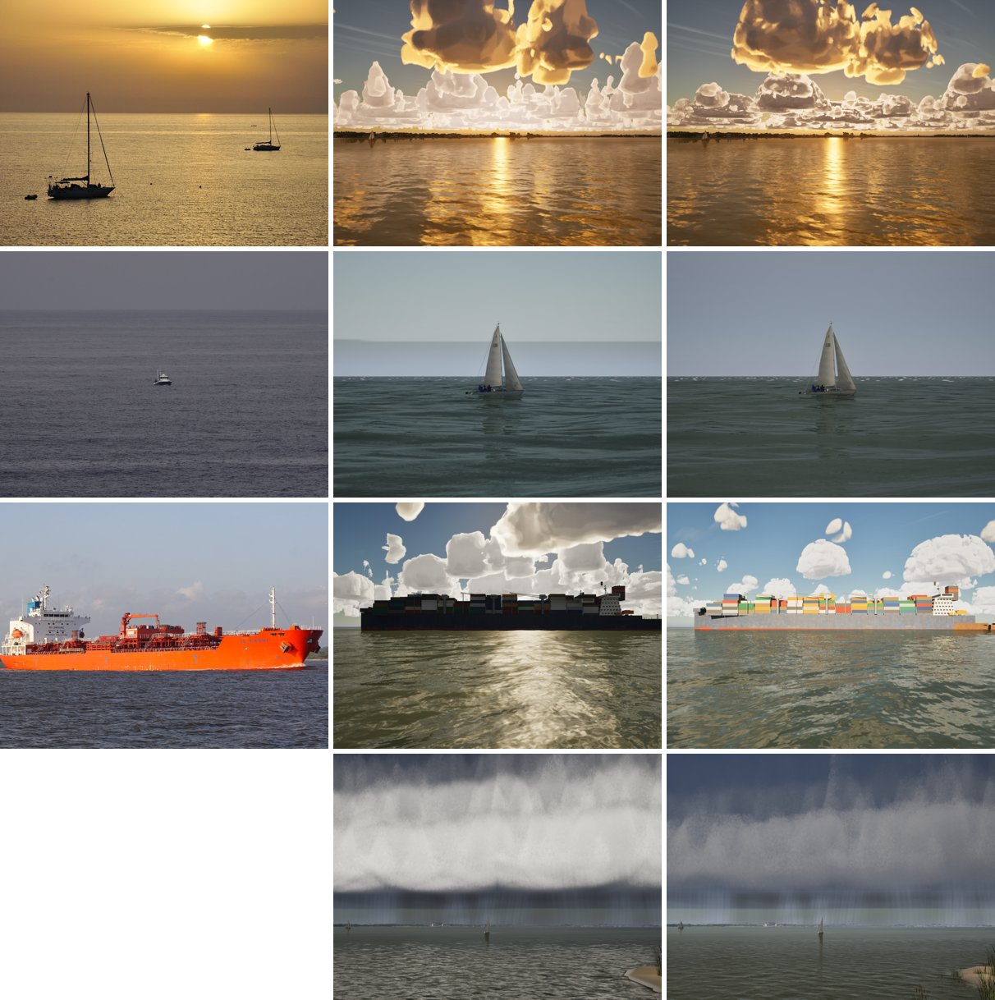
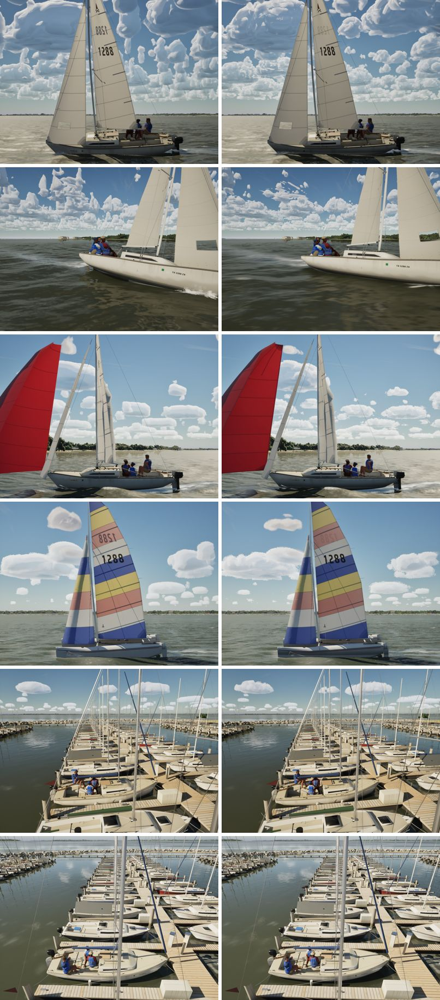
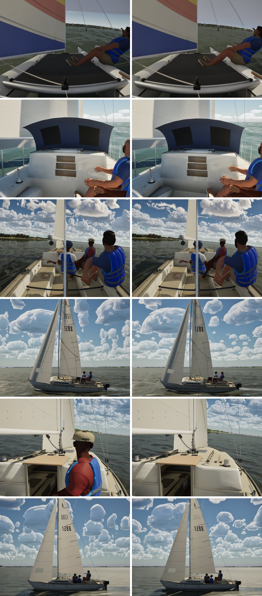
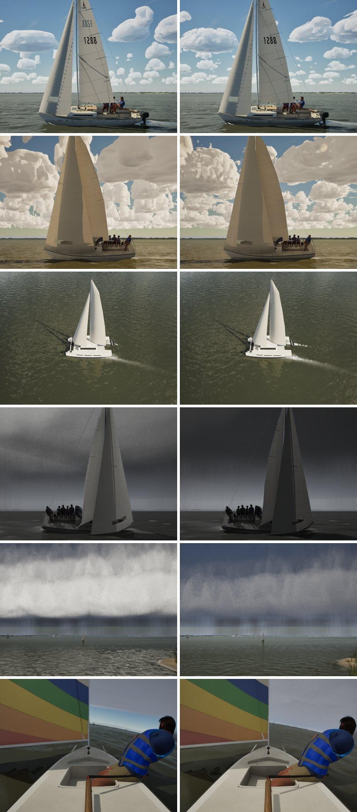

# Realism audit, Oct 23 2026

The second look-truth pass, on main e2e3a0e5 (#273), one day after `docs/realism-audit-1022/`. It uses the same method
and the same scenes, recaptured on High in the capture mode (`scripts/capture-scenes.sh`, 14 s):
- the 12 phase-8 reference scenes (`docs/phase-8/reference-scenes.csv`);
- the 15 G5 blind-pack scenes (`docs/graphics-5/blind/scenes.csv`).

Each is compared with yesterday's capture and, for the G5 scenes, with its Commons photo. As before, real photos that
show people are left out: the shelf cloud's beach, and the J/24, J/22 and Hobie photos.

The same day's full sweep (`scripts/gate.sh --scope all --force` on e2e3a0e5) passed: all 230 tests, and every view on
every tier is above its floor.

## Contact sheets

G5 scenes: real photo left, Oct 22 middle, today right. Bridge, open lake, overcast shore, sunset, cumulus:

Dusk, Gulf swell, ship, storm shelf (no photo):

G5 boat scenes, Oct 22 left and today right. Their real photos have people in them. Chase, crew, spinnaker, Hobie,
marina, slip:

Phase-8 scenes, Oct 22 left and today right. Bay Hobie, Gulf passage, action cam, heavy chase, helm on a reservoir,
light chase:

Moderate chase, Catalina 30 evening, drone over a catamaran, squall, storm, Sunfish reach:

## What changed since Oct 22

Items 1, 5, 6, 8 and 9 of yesterday's list were fixed. Items 2, 3, 7 and 10 were improved in part.

- **Cumulus (item 1; #260, #271).** Cells are as tall as they are wide, and their outlines are cauliflowered by packed
  lobes. The pillars and glossy balloons are gone (cumulus, bridge, chase, moderate chase).
- **Storm (item 5; #255, #256, #259).** The shelf's face is dark slate over a rain wall, not white (shelf, storm,
  squall).
- **Overcast (item 6; #263, #272).** The deck reaches the horizon. Its edge no longer shows overhead (Sunfish reach), and
  the haze band on the sea's horizon is gone (swell).
- **Low sun (item 2, in part; #265).** The far clouds go darker against a low sun.
- **Water at the boat (items 8 and 9; #262, #269, #270).** The wake and quarter wave show at speed, and the hulls have
  contact shading at the waterline.
- **Sails (items 3 and 7, in part; #261, #264, #267).** The far side's number is now faint, not nearly as strong as the
  near one. Shadow edges on the sails no longer step.
- **Shore (item 10, in part; #266).** Reeds and bank grass on the Rush Creek shore.

## The ten biggest remaining gaps

Ranked as before: how often a gap is on screen, times how far off it is. Lanes as the project splits them: the Mac does
physics, clipping, crew, water and sky; the PC does models, materials, the sails' look and rope. The sizes are rough.

| # | Gap | Where it shows | Lane | Size |
|---|---|---|---|---|
| 1 | **The lake is olive-brown, not blue-grey.** In the Tawakoni photos the open lake reads blue-grey to slate, mostly sky reflected off the chop. Ours is olive to the horizon, and olive-brown seen from above. This was yesterday's item 4. It is parked for a low-angle Lake Ray Hubbard reference: the roughness and specular trials changed little, and the Tawakoni photos may be a bluer lake. | Every open-water view (bridge, open lake, chases, drone) | Mac (water: body colour, sky reflection at grazing angles) | 0.5–1 day, once a reference is in |
| 2 | **An overcast is too dark against the ground.** In the shore photo the overcast is near white, several times brighter than the grass and trees. Ours is a mid grey deck, about as bright as the lawn. A Lambertian surface lit by a uniform overcast is as bright as the sky only if it is white; grass at about 0.2 albedo should read about five times darker than the deck. | Overcast views (shore, Sunfish reach, swell) | Mac (sky: deck luminance against the incident-metered exposure) | 0.5 day |
| 3 | **A low sun leaves the sky blue-grey.** In the sunset and Aeolian photos the whole sky goes orange to gold, and the haze near the sun glows. Ours keeps a neutral blue-grey above the horizon band, with lit cloud rims over it. The clouds' undersides got darker in #265; the sky did not. | Sunset, dusk and evening views (lakesunset, dusk, C30 evening) | Mac (sky: atmosphere and haze at low sun) | 1 day |
| 4 | **Cumulus outlines glow, and the horizon is packed.** Each cell has a bright rim all round, like a drawn outline, and toward the horizon the small cells pack into a solid band. In the photos the edges away from the sun are no brighter than the body, and there is clear sky between the far clouds. | Every fair-weather view | Mac (sky: CLOUD_CODE edge light, cell spacing with distance) | 0.5–1 day |
| 5 | **The sails are flat and chalky.** There is still no shading from their draft and no translucency against the light. The far side's number is faint now (#261) but still shows. | Every boat view | PC (M_SailCloth look) | 0.5–1 day |
| 6 | **Under a squall the white sails go nearly black.** Today the shaded sides of the main and jib read close to black against the storm sky. Yesterday they were grey. White cloth under a dark deck is still lit by the whole sky and stays paler than the cloud. This is likely a side effect of the storm gloom (#256, #259) on the sky light, and needs checking. | Squall and storm views with a boat | Mac (sky light under the storm) / PC (sail material) | 2–4 hours to find |
| 7 | **The open sea is green.** In the swell photo the open Gulf is dark blue-grey, the same family as the sky. Ours is bottle green. That suits the bay and the lake, but not the Gulf's open water. | Gulf views (swell, Gulf passage) | Mac (water: the Gulf body's albedo and extinction in `WaterBodyFor`) | 2–4 hours |
| 8 | **The spinnaker and the coloured sails are flat colour.** The red spinnaker still has no shading from its shape and no seams (#264 changed its colour), and the Hobie's and Sunfish's panels are flat too. | Spinnaker and dinghy views | PC (sail look) | 0.5–1 day |
| 9 | **The overcast shore is a mown lawn to the water.** The shore photo has weed in the shallows, trees overhanging the water and a ragged edge. Ours has clean grass meeting the water in a line. #266 added reeds and bank grass at Rush Creek, but not on this stretch. | Shore views (shore, marina background) | PC (models: shore margin along the whole lake) | 1 day |
| 10 | **In the helm view the trimmer has gone.** On Oct 22 the trimmer sat in front of the helm in the upwind reservoir view. Today the cockpit ahead is empty. They may have moved to the rail (a placement change on Oct 22–23) or be placed out of view. If the move is right it is not a gap, but an empty cockpit in the most-used view needs checking. | Helm view (j22-helm-reservoir, helm-eye) | Mac (crew placement) | 1–2 hours to check |

## Smaller

- **Ship.** The container ship is now lit and coloured (#268), not a silhouette.
- **Reflection on calm water.** The marina's reflections are good, but the far shore's reflection on the calm lake
  (shore) is sharper than the photo's.
