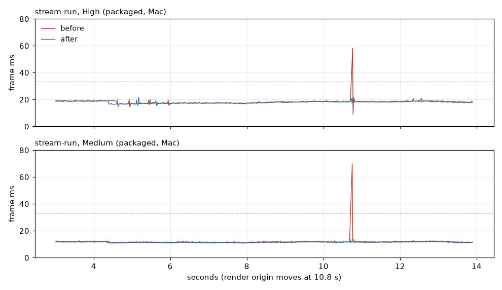

# The re-centre hitch

World streaming (`docs/world-streaming/`) moves the render origin by 19.2 km when the boat is 20 km from it
(`UWorld::SetNewWorldOrigin`). The frame it happened in took 56-58 ms on High and 70-73 ms on Medium, against 18 and
12 ms for the frames around it. It now takes about 21 ms on High and 14 ms on Medium.

## Where the time went

An Unreal Insights trace of the uncooked stream-run view on High (`-trace=cpu,frame -statnamedevents`, exported with
`UnrealInsights -NoUI -ExecOnAnalysisCompleteCmd=TimingInsights.ExportTimingEvents ...`) showed:

| Thread | Scope | ms |
| --- | --- | --- |
| Render | `FSceneRenderer::PrepareDistanceFieldScene` > `UpdateDistanceFieldObjectBuffers` | **53.0** (33 processing, 20 uploading) |
| Game | `SendAllEndOfFrameUpdates` > `DeferredRenderUpdates_GameThread` (the reeds and six riprap HISMs, mostly `CalcBoundsImpl`) | 13.7 |
| Render | `FScene::ApplyWorldOffset` (the engine's own shift of every primitive, light and octree) | 1.4-1.9 |
| Game | `ULevel::ApplyWorldOffset` (every actor and component) | 0.4 |

The engine's shift itself is cheap. The cost comes after it. On a shift, `UInstancedStaticMeshComponent::OnUpdateTransform`
tells its instance data manager that the primitive's transform changed (`PrimitiveTransformChanged`). At the end of the
frame every instanced mesh then recomputes its bounds over all its instances. It also sends all its instances to the
renderer again, which puts each one through the distance-field scene (and Lumen's) once more.

An instance census at the re-centre on the Texas coast found 380,000 riprap boulders in six movable HISMs
(`ABridgesActor`), all in the distance-field scene. There were also 200,000 reed clumps (`ALakeTerrainActor::PlaceReeds`),
already out of it. Everything else instanced came to under 50,000.

The same path runs whenever those actors move, not only at a re-centre. `ABridgesActor` and the terrain actor follow the
tide in 2 cm steps, so on the coast each step paid the same distance-field update. That cost was not measured separately.

## The fix

- The riprap boulders are out of the distance-field scene (`bAffectDistanceFieldLighting = false`). They were already
  out of the ray-tracing scene (Perf 2), which is what High's Lumen traces. Taking them out of Lumen as well
  (`bAffectDynamicIndirectLighting`) gained nothing more, so they stay in it. Medium's software Lumen could have used their
  distance fields, but a Medium still of the Galveston shore with and without them showed no visible difference.
- The riprap and reed HISMs keep conservative bounds (`SetUseConservativeBounds(true)`: the bounds are cached in the
  component's frame and only grow) and cannot affect navigation (`SetCanEverAffectNavigation(false)`; the game has no
  navmesh). Each of those had cost a pass over every instance whenever the actor moved. The game thread's end-of-frame
  updates in the re-centre frame went from 13.2 to 4.1 ms.

There was nothing to spread over several frames. The engine's own shift takes 2 ms, and what followed it is now gone.

## Numbers (packaged, Mac, M5 Pro, 12 s stream-run, `-SailingBenchTrace`)

| Run | avg fps | p99 ms | game ms | game p99 ms | re-centre frame ms |
| --- | --- | --- | --- | --- | --- |
| High, before (3 runs) | 54.5 / 55.0 / 54.7 | 20.12 / 20.43 / 20.99 | 2.95 | 5.31-5.73 | **58.3 / 57.7 / 57.2** |
| High, after (3 runs) | 55.1 / 55.6 / 55.2 | 20.52 / 19.53 / 20.51 | 2.93 | 4.96-4.97 | **21.1 / 20.9 / 21.1** |
| Medium, before (2 runs) | 83.9 / 84.5 | 12.50 / 12.64 | 2.37 | 4.26-4.68 | **69.9 / 73.5** |
| Medium, after (2 runs) | 86.6 / 86.1 | 12.20 / 12.29 | 2.33 | 4.02-4.15 | **14.0 / 14.3** |

The "before" build is this branch with the two actor changes reverted, so the frame trace is the same.

## Measuring

- `-SailingBenchTrace`'s `<shot>.frames.csv` now has, after `t_s,frame_ms`, the game, render, RHI and GPU times the
  engine last published (`game_ms,render_ms,rhi_ms,gpu_ms`). They lag the frame by one or two, and `render_ms` read
  0.001 for long stretches of uncooked runs, so trust `frame_ms` and use Insights for the split.
- `scripts/bench-mac.sh` copies `<shot>.frames.csv` from a single run too (it used to only in list mode).
- The re-centre logs the render thread's time for the engine's own shift: `World streaming: the scene's shift took
  N ms of render thread`.

## Left as they were

- **The PC's Ultra stream-run** (p99 22.0 ms, game-thread p99 19.5 ms on main d667272e) was not rerun here. On the Mac
  the stream-run's game thread has no spikes besides the re-centre (busy-time p99 5 ms; streaming, terrain and trees
  under 1.1 ms in any frame). If the PC's game-thread p99 stays high after this, it needs a trace there.
- **A 2-3 ms game-thread blip every 2 s** (`ASailingEnvironment`'s tick, the weather map) is in every view, not only
  streaming.
- **Other instanced meshes still go through the same path at a shift.** It is cheap now (no other set has more than
  10,000 instances in the distance-field scene). A large new instanced set should get the same three settings if it lives
  on an actor that moves.
- **Editor-only ensure at startup on the Texas coast:** `FDFMatrix::MakeToRelativeWorldMatrix` reports precision loss in
  `UpdateDistanceFieldObjectBuffers` on frame 2 of an uncooked run. It was there before this change and is not
  investigated here.
