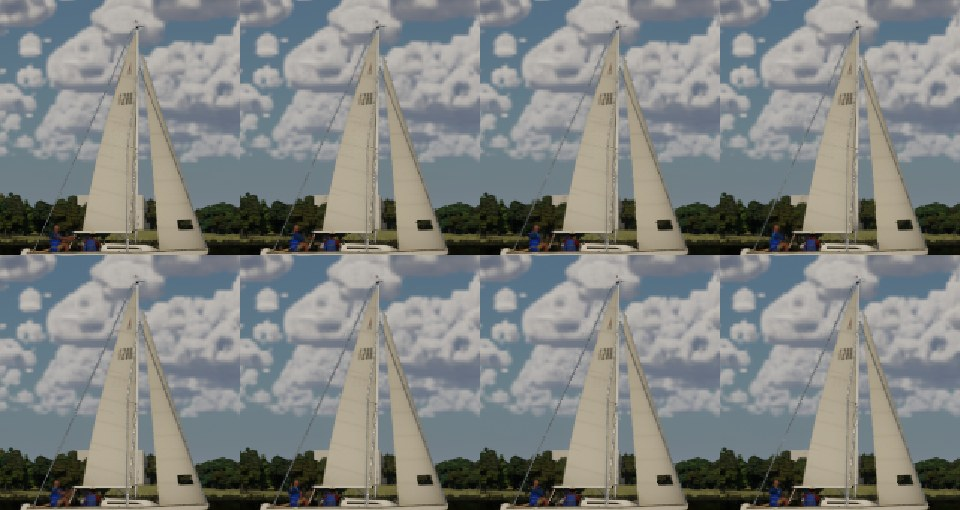
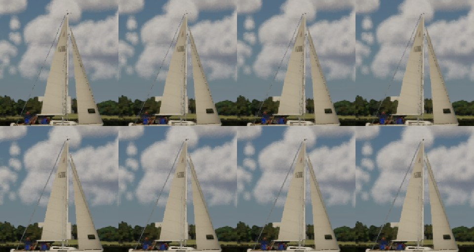
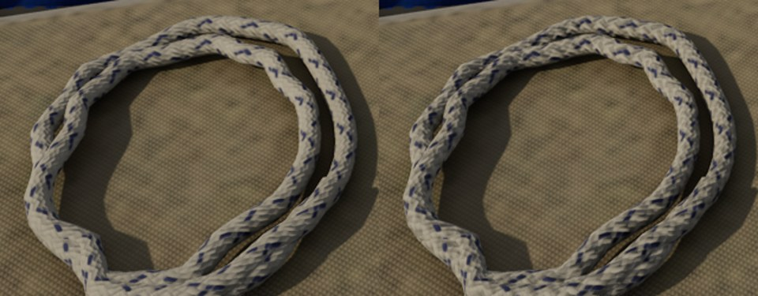
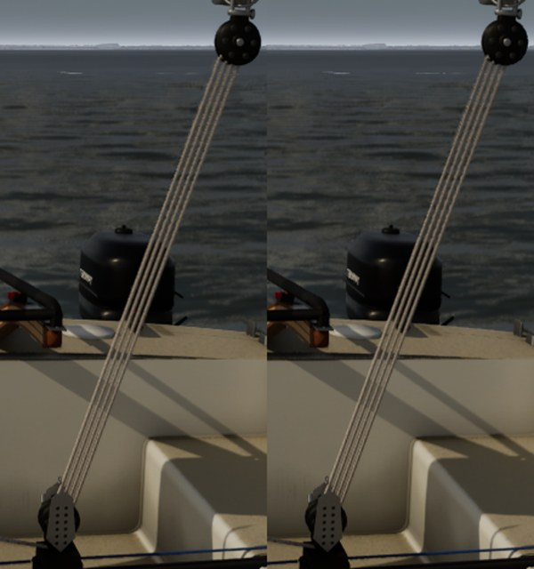

# Rig lines (Ultra audit #6)

> **Since `docs/gelcoat-rt/`:** the per-vertex minimum width is done on the CPU per ring (`RingRadius` in
> `BoatModelVisuals.cpp`), not by world position offset in the materials. The WPO version cost the Mac's base pass
> 0.48 ms at helm eye. The materials below no longer carry `MinPx` or the vertex colour's radius. The rope's lay is unchanged.

The Ultra audit (`docs/ultra-audit-1024/`) found shrouds, stays, halyards and sheets stair-stepping and flickering in
wide shots, and lines reading as smooth tubes close up.

## Why they flickered

Boat fidelity 4 gave every rig line a minimum on-screen width of 0.8 px, computed once per line at its **middle's**
distance (`BoatModelVisuals.cpp`). A backstay runs from the transom, close to a chase camera, to the masthead 9 m up.
So the far end drew under 0.8 px and fell between pixel centres from frame to frame: the dashed, crawling top of the
line in the wide shot. The near end drew wider than it needed. The radius also stepped by a quarter at a time, which
re-uploaded the section and changed the braid's scale (U runs over 5 drawn diameters) with distance.

## What changed

- **Minimum width per vertex, in the material.** Each line's true radius goes in its vertex colour's green (2.55 cm
  full scale, `kLineRadiusScaleCm`), built once with the tube. `M_RigRope` and `M_RigWire`
  (`scripts/import_boat_detail.py`, `screen_width()`) push each ring out along its normal until it is `MinPx` (1.2 px)
  across at that ring's own distance: `View.ViewToClip` and the render resolution give centimetres per pixel. The
  shadow pass keeps the true width (`ShadowReplace`). The CPU widening is gone; the braid now keeps its true scale.
  `-SailingNoMinLineWidth` sets `MinPx` to 0 (a dynamic instance).
- **A lay close up.** `M_RigRope` adds the cover's carriers as the eye reads them at arm's length: S and Z helices at
  45 deg, four round, a period of 0.8 diameter along the rope, the carrier on top alternating at each crossing. It
  ridges the colour, roughness and normal (combined with the braid normal map). It fades out where a carrier falls
  under about a pixel, by its own screen derivative, so it never crawls. The braid map's finer 24-carrier pattern and
  Boat fidelity 4's yarn streaks stay underneath.

### Tried and dropped: a coverage fade

The textbook fix for sub-pixel lines is to widen them and fade by the lost coverage (true width over drawn width),
dithered for TSR or TAA to resolve. I tried that at 1.5 px with interleaved gradient noise and a masked material. Under
TSR and TAA the history clamp ate the dither: the backstay was fainter (contrast 9 against 23) and no steadier. Even
with a floor of 0.75 px of ink, flicker rose from 0.275 to 0.361 on Ultra. An opaque 1.2 px line, always covering a
pixel centre in every row, beat it.

## Flicker, wide shot (J/22 at 55 m, the backstay against the sky)

`flicker.py` (scratch) samples the backstay row by row in seven consecutive frames (`-SailingRecord=0.5
-SailingRecordInterval=0 -SailingSlowMo=0.25`). For each row it takes the line's contrast (the local sky's median minus
the darkest pixel within 5 px of the line). **Flicker** is each row's temporal standard deviation over its mean,
averaged. A control path through the same sky 22 px to the side gives the clouds' own contrast and wobble.

| Tier | Contrast before | Contrast after | Flicker before | Flicker after | Row wobble over the sky's, before | After |
| --- | --- | --- | --- | --- | --- | --- |
| Ultra (TSR) | 22.9 | 28.7 | 0.275 | **0.162** | 1.36 | 1.25 |
| High (TAA) | 19.7 | 22.5 | 0.241 | **0.149** | 1.32 | 0.94 |

Flicker drops by about 40% on both tiers. The line is a little heavier (contrast up a quarter), as an unbroken
1.2 px line should be against a broken 0.8 px one.

Frames 0 to 3, before above and after below (crops at 1.5x, nearest neighbour):

| Ultra | High |
| --- | --- |
|  |  |

Before, the backstay's upper half breaks into dashes in frames 1 and 2. After, it is whole in every frame.

## Close up (Ultra, cockpit at 1.3 m)

| The coiled tail on the cockpit seat (before, after) | The mainsheet's parts (before, after) |
| --- | --- |
|  |  |

The coil now reads as braided rope, with chevrons and strands, instead of a patterned tube. The mainsheet's parts,
4 to 5 px across, show only a trace of the lay: their carriers are under a pixel there, so the fade holds it back.

## Frame cost

J/22 at 25 m, rig against the sky, 1920x1080, 20 s, Bean's RTX 4090. Main's rig lines are rebuilt against the
branch's (scratch `rigbench.ps1`). GPU is bench.json's `gpu.total_ms`.

| Tier | GPU before ms | GPU after ms | Game thread before ms | Game thread after ms |
| --- | --- | --- | --- | --- |
| Medium | 3.72 | 3.75 | 8.89 | 8.53 |
| High | 4.81 | 4.83 | 10.28 | 9.98 |
| Ultra | 7.07 | 7.00 | 10.52 | 10.44 |

The GPU is unchanged, within noise. The vertex work is a few instructions a ring, and the rope's lay costs a few ALU
in the pixel shader. The game thread is a little lighter: no per-line widening, and no re-upload as the camera's
distance crosses a widening step.

## Checks

Full suite 234/234 on the PC after merging main 58753358 (MSVC clean). `SailingSim.Visual.RigClearance` records the lines as built, before any on-screen widening, so it is unaffected.
