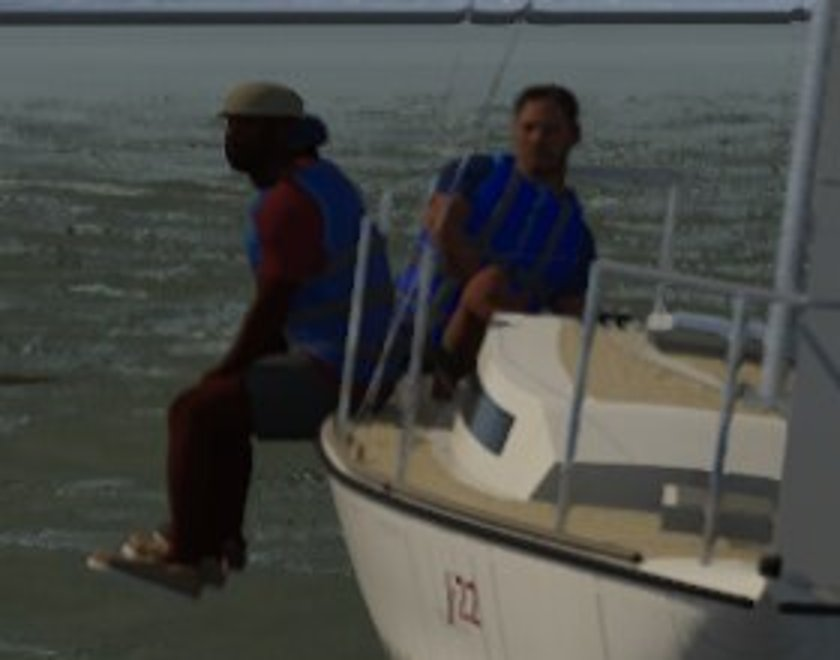
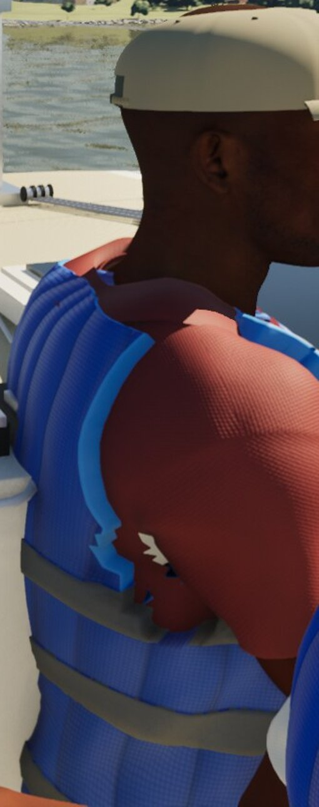

# Round 11: the two crew tells

Round 11 scored 20 of 20 again (`/mnt/project-files/sailing-sim-g5/blind-results-2026-10-14.md`). Bean gave only two
reasons, and both were about the crew:

- still02 (`r11-bay-storm`): "people do not hang their legs over a sailboat like that"
- still07 (`r11-lake-cockpit`): "lack of detail, person looks like a doll"

## 1. Legs over the side: fixed in this branch

Before, the rail stance (`ECrewStance::RailHike`) faced outboard. The thighs went over the deck edge and the lower legs
hung down the topsides. The forward J/22 sailor sat at x -0.65, beside the cabin trunk and 7 cm forward of the
cockpit well. With nothing under their feet there, the legs dangled in the air. Bean's lesson photos show the crew
sitting on the side deck or seat, facing inboard, with their feet in the cockpit.

What changed:

| Where | Before | After |
| --- | --- | --- |
| `CrewFacingYaw` | +90 deg × side (outboard) | -80 deg × side (inboard, turned 10 deg toward the bow) |
| `CrewJointRotations`, RailHike | Legs over the edge (72/78 deg), trunk leaning out forward | Thighs across the deck, lower legs down into the well (84/82 deg sitting up, 76/60 deg hiked). Trunk leans back 6 to 32 deg, head kept up and turned 20 deg toward the bow, hands on the knees |
| `CrewPlacement`, rail pelvis | Rail - 0.02 m (on the edge) | Rail - 0.12 m (a hand's width in on the side deck) |
| `CrewPlacement`, crew x on keelboats | The bow sailor could sit beside the cabin | Non-helm crew are clamped to the cockpit well, from its aft end + 0.3 m to its forward end - 0.12 m. On the J/22 that brings the bow sailor from -0.65 to -0.84 m |

The physics crew model (`CrewOffset`, heel moment) is unchanged. Only the drawn figure moves.

Tests (`VisualTests.cpp`):

- Visual.Crew: the rail stance hiked leans back (neck behind pelvis), the knees are inboard of the hips, and the lower
  legs are down.
- The rail sitter faces -80 deg on the starboard rail.
- Visual.CrewFeet: RailHike now joins the stances whose heels and toes must stay inside the hull plan (no foot over
  the side), on every boat and both tacks, sitting up and hiked.

The Mac still needs to build and run the gate. It also needs to recapture `r11-bay-storm` and a starboard and port
beat at 12 kn so we can look at the fix.

Watch for:

- On the J/22 the bow and trimmer are now 0.36 m apart along the boat (they were 0.55 m), so their shoulders may
  touch. If they visibly overlap, move the trimmer 0.1 m aft. The helm is 0.55 m behind the trimmer.
- The Catalina 30 and Corsair crews also use the rail stance. Their feet go to the floor through the existing ground
  IK.

## 2. "Person looks like a doll": diagnosis, fixes for the PC to import

These are from the still at full size, ranked by how much each one says "game". Every fix here changes an asset, so
the PC imports it and renders it before and after.

1. **The vest's armhole tears in the seated pose.** At the right shoulder the light-blue piping turns into a zigzag,
   red polo shows through, and a white shard sits on the shirt. The vest is skinned by closest point from the
   MetaHuman T-shirt (`import_crew_clothes.py`). When the arm swings forward and down for a seated stance, the
   upper-arm weights drag the armhole's edge, while the cut-away polo underneath (6 cm inside the armhole) deforms
   differently. Fix:
   - In the import, smooth the vest's weights within about 8 cm of the armhole toward clavicle and spine.
   - Or open the armhole 2 cm wider and keep the polo's cut-away 9 cm in.
   - Check Cockpit, RailHike and Helm at hike 0 and 1 from the side.
2. **Pool-toy channels.** The foam shell has 4 mm pillows every 6.5 cm all the way round (`M_CrewFabric` `ChanPeriod`,
   `MI_Crew_PFDShell`), and with the shiny nylon it reads as an inflatable. The school's vests (Bean's photos: royal
   blue Type III, "X2O") have two large flat front panels, flat grey webbing with three buckles and loose strap
   tails. Fix:
   - Make the front panels flat. Channels go only on the back and sides: in `FABRIC_CODE`, skip the channel
     where |U| is under a front half-width of about 0.19 m.
   - That needs the vest's U to be 0 at the front centre on every role: `build_vest.py` uses
     `atan2(c.x, c.y)`, which puts U = 0 at the back when `FRONT` is -1.
   - Widen the back channels to about 0.10 m.
   - Add 15 to 20 cm strap tails hanging from the buckles.
3. **The polo is too clean.** The knit is one even pattern over a smooth, muscular shoulder, with no pull folds where
   the arm goes forward, and the collar's point stands off the neck. Fix:
   - Add diagonal pull creases from the shoulder seam toward the armpit in `build_polo.py` (seated sailors all have
     their arms forward).
   - Lower the knit's normal strength at capture distance.
   - Press the collar point down onto the vest.
4. **The cap and skin.** At 1 m the cap is one flat khaki with no visible stitching and no sweat or wear band. The
   skin shades evenly, with no sweat sheen on the neck. These are smaller. Add a darker sweat band and edge wear to
   `MI_Crew_CapCloth`. A little more roughness variation on the neck would also help.
5. **Pose.** The still predates #74, the CMU idles. The helm sat dead upright with the far shoulder raised. With the
   idles and the reaction layer this should read less like a mannequin. Recapture `r11-lake-cockpit` before deciding
   whether more is needed.

Constraints held: free, commercial-OK sources only. No filming. Bean's lesson photos were only looked at for
reference, and nothing from them is in the repo.
