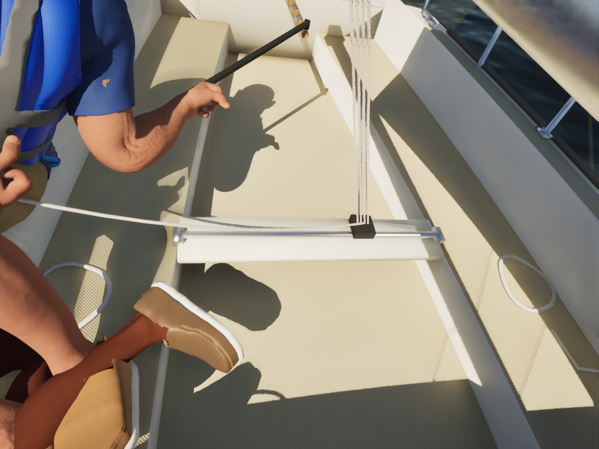
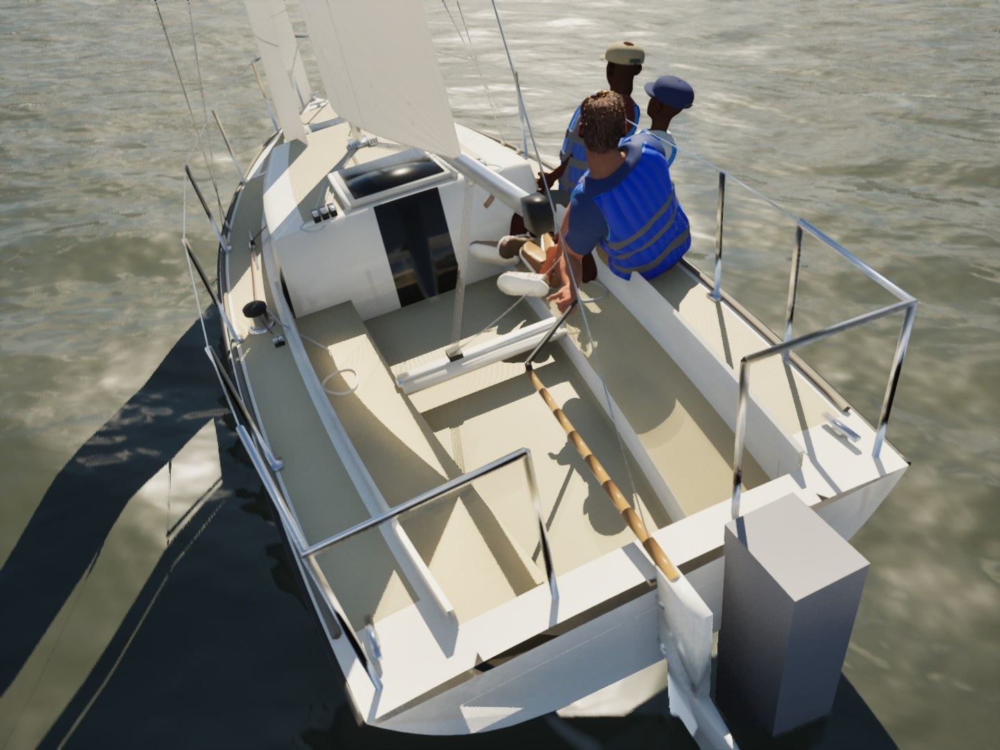
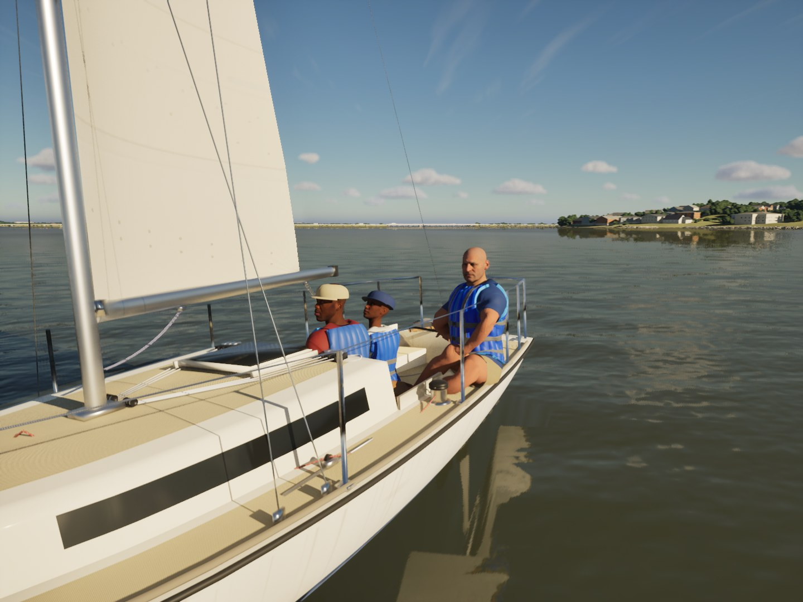

# Round 12: the crew tell

Round 12 scored 20 of 20 (`/mnt/project-files/sailing-sim-g5/blind-results-2026-10-14.md`). Bean named the people on
three frames:

- still01 (`r12-galv-kemah`, a distant boat): "people on the boat"
- still03 (`r12-j22-mainsheet`): "people's body parts not positioned realistically and lack detail"
- still07 (`r12-crew-idle`): "people look fake"

The winch close-up (still02) has nobody in it. Its tell ("lack of wear and tear, some of the anchor points do not look
real/too blocky") is about the boat's surfaces and fittings, which belong to the boat kit. v1 is frozen, so this branch
only changes how the existing crew system places and poses the crew. It needs no new assets, no capture and no filming.

## What the stills show

- **The foot in the air.** The helm's near shoe has its heel on the seat and its toe pointing up at about 30 degrees,
  well off the floor. The cause: the foot planting (`PlantFeet`) moves the ankle onto the floor by two-bone IK on the
  leg, and the foot turns with the calf. When the leg reaches down or forward to the floor the knee opens, so the heel
  lands and the toe lifts. Nothing then put the sole flat. A foot that hung a few centimetres over the floor also stayed
  there, because only feet inside the boat were moved.
- **The open hand on the tiller extension.** The fingers close (grip 0.75 to 1), but the wrist keeps the stance's
  turn, so the closed fingers meet the extension end-on. It reads as an open hand held beside the stick, not a fist
  round it. The mainsheet hand has the same problem, less visibly.

- **The crew bunched forward.** The J/22's helm sat at x -1.75, which is 0.2 m forward of the traveler (x -1.95) and
  0.55 m behind the trimmer. All three sat in the forward half of the cockpit against the cabin, and the after half
  was empty (still11). On the lesson boats, and in J/22 photos generally, the helm sits aft of the traveler, about
  level with the tiller's end, and holds the extension across the body.

## Fixed in this branch (code only)

| Where | Before | After |
| --- | --- | --- |
| `CrewPose.cpp` `LevelFeet` (in `PlantAllFeet`) | A planted foot kept the calf's angle: heel down, toe up | A seated sailor's foot (`FCrewGround::bSeated`: Helm, Cockpit, RailHike; not hiking under a dinghy's straps) standing on one floor level turns at the ankle (up to 45 deg, fading out 2 to 5 cm over the floor) until the sole lies flat, then is planted again. A foot across a seat's edge or the bridge deck stays as planted |
| `CrewPose.cpp` `CurlFingers` | The thumb curled 25/45/40 deg and stood up off a held line | 38/58/50 deg |
| `CrewPose.cpp` `PlaceHands`, `FCrewHands::Along` | The wrist kept the stance's turn | The hand turns (up to 55 deg) so the held line runs across the palm, index knuckle to little finger, and then reaches. The palm still closes on the target |
| `BoatModelVisuals.cpp` | | The tiller extension (from `TillerEnd`), the mainsheet tail (from the car) and the jib tail (from the self-tailer) pass their direction to the hand |
| `CrewMotion.cpp` bracing | | A bracing hand on the coaming or the cabin-top handrail holds it fore and aft |
| `CrewMotion.cpp` `CrewPlacement` | J/22 helm at x -1.75 | J/22 helm at x -2.26 at most (`SternX + TillerLength + 0.15`), 0.3 m aft of the traveler. The physics crew model is unchanged; only the drawn figure moves |

Tests:

- `SailingSim.Visual.CrewFeet`: every boat, both tacks, sitting up and hiked. A seated foot standing on one floor level has
  heel and toe within 4 cm of each other on the J/22.
- `SailingSim.Visual.MetaHumanCrew` (where the MetaHumans are installed): holding a line, the knuckles run along it
  (within 20 deg, or 40 deg better than before), and the palm still closes within 5 cm of the target.

What the Mac needs to do: build, then run the crew gate (`scripts/gate.sh --scope crew`) and the tests. Then recapture
`r12-j22-mainsheet`, `r12-crew-idle` and `r12-j22-cockpit` with `SCENES=docs/round-12/game/scenes.csv scripts/capture-scenes.sh` so
we can compare before and after. The cockpit view (`\`) keeps its eye where it was, and the helm figure is hidden there.

Watch for:

- The helm's mainsheet hand now reaches forward to the car, which is about 0.3 m ahead of them. If the arm looks
  stretched, hold the tail closer to the lap (`Toward * 30` in the mainsheet hold).
- The helm's forward foot may land on the traveler's bridge (x -1.95, between the seats). `CrewFloorZ` doesn't know the
  bridge is there, so check the cockpit still.
- A wrist turned the full 55 deg could look bent. If it does, lower `MaxRad` in `PlaceHands`.

## What "lack detail" points to: for the PC, building on the round 11 list

The round 11 doll list (`docs/round-11/crew/README.md` section 2: vest armhole, pool-toy channels, plain polo, cap) has
not landed yet. still07 still shows the even horizontal pillows on all three vests, and that stays the top item. Round 12
adds these, ranked:

1. **Deck shoes** (still03). Each shoe has a thick, bright white rim round a flat tan upper, which reads as a slipper or
   a toy. Fix it in `build_shoes.py`: make the sole an off-white gum with a darker toe bumper, add siping on the edge,
   stitching and lace eyelets, and give the leather some roughness variation and creases at the toe.
2. **Shorts** (still03, still07). They are one flat khaki with no folds where a seated hip and knee bend. Add pull
   creases at the hip and behind the knee (a normal map is enough) and a hem.
3. **Skin on the arms and legs at close range** (still03). The forearm is evenly smooth and shiny: there is no arm
   hair, no tan line at the sleeve, and no roughness variation. `tune_crew_skin.py` turns on the face's micro detail;
   the body needs the same, plus a faint tan line at the polo's sleeve and the shorts' hem.
4. **Faces at 4 to 5 m** (still07). All three look straight ahead with the same calm expression. That is a motion item,
   not an asset one. The gaze already glances at the telltales, upwind and ahead (`In.Gaze` slots). A squint in the sun
   and the odd word between the crew would need facial animation, which comes after v1.

Constraints held: free, commercial-OK sources only, no filming. Bean's lesson photos were only looked at for reference,
and nothing from them is in the repo.

## Mac run 1 (5e1aa53b, `../crew-after/`) and the fix

145 of 149 tests passed. Two things broke the other four:

- `LevelFeet` levelled against the higher of the two floors under the heel and toe. Across a level change (the bridge deck
  forward of the well, a seat's edge) it put the toe into the deck.
- A first version also lowered seated feet hanging 1 to 15 cm over the floor. That made hiked feet jump as the clips moved
  them (CrewClipLimits) and pulled a knee below its hip (Smoke.CrewAnimation).

The lowering is gone. Levelling now needs heel and toe over one level, before and after the turn, and fades out from 2 to
5 cm over the floor. The thumb wraps further. The helm's foot on the traveler bridge is left as it is: it rests on top of
the bridge, and J/22 helms do brace a foot there.

## Follow-up: the traveler bridge (the thumb is its own follow-up)

The Mac's gate on #94 found two leftovers.

- **The helm's forward shoe on the traveler bridge.** The heel sat on the bridge's edge with the toe raised.
  `CrewFloorZ` and `CrewInsideBoat` now know the J/22's bridge (`FCrewCockpitWell::BridgeX/BridgeHalfX/BridgeZ`: x -1.75
  ± 0.08 between the seats, top 0.485 m, solid down to the sole, from `build_j22.py`). A foot sunk into it is planted on
  top. `LevelFeet` now accepts a foot resting across a step's edge, with its other end over the lower floor, so long as
  the turn puts neither the heel nor the toe into what is under it. That was the toe-into-deck case from the first Mac
  run. The `-SailingJ22Hero` model has its traveler on the floor at x -1.95 instead, and nothing there knows about it yet.
- **The thumb stood straight up off the extension.** Not fixed here. A 40 deg swing of the thumb's base across the palm
  (tried both ways about the palm's normal) moved the closed thumb's tip by 0 to 3 mm on every MetaHuman, where it should
  move several centimetres. So the turn is not reaching the MetaHuman thumb as intended: the bone chain, its names or the
  rest-pose axes need looking at on the skeleton itself. That is a follow-up PR; this one keeps #94's thumb curl.

Tests: `Visual.CrewFeet` checks the bridge as a floor that is solid underneath.

Mac run on #97 (147 of 149) and the fix:

- `Visual.CrewFeet` failed on the Corsair 880's helm (heel 0.60 m, toe 0.67 m): the new no-penetration rule had also replaced
  #94's rule for a foot on one level, and turned flat there the heel or toe dips a few millimetres, so the turn was refused.
  A foot over one level is levelled as in #94 again; the no-penetration rule only applies across a step's edge.
- `Visual.MetaHumanCrew`: the thumb's swing barely moved its tip on any hand, either way (148 of 149 on the second run), so
  the thumb half came out of this PR (above).

## Follow-up 2: the thumb

The swing about the palm's normal (#97, taken out) moved a closed thumb's tip by 0 to 3 mm on every MetaHuman: their
thumb lies close to that normal, so the turn spun it about itself. `BuildCrewRig` now closes each skeleton's fist and
turns the thumb's base straight toward the index finger's middle joint, 40 deg at most (`FCrewRig::ThumbWrap`, scaled by
the grip in `CurlFingers`). `Visual.MetaHumanCrew` logs each hand's wrap angle and tip distance and checks the closed tip
comes at least 1 cm nearer the index finger. Recapture `r12-j22-mainsheet` to see it; if the thumb now goes into the
index finger, lower the 40 deg cap.

Mac run 1 on #100 (149 of 149, gate passes): the base's 40 deg wrap brought `thumb_03` from 6.1 to 2.6-2.9 cm of
`index_02`, and the still shows the thumb leaning toward the fingers but still standing above the fist. `thumb_03` is the
thumb's last joint, so its tip was still past the finger. Now each thumb joint turns in turn, base first (55, 30, 30 deg at
most, `FCrewRig::ThumbTurn`), so the estimated tip comes down onto the skin of the index finger's middle bone, 1 cm off
its centre line.

## Follow-up 3: the hero J/22's floating foot

With #95 the player's J/22 is the hero model, whose traveler track lies on the sole. The helm's forward shoe then hung
toe-up in the air (`crew-after/r12-j22-mainsheet-hero95.jpg`) at about the height of the light model's bridge: the
stance puts that foot there, and the planting only ever lifted feet out of the boat, never lowered a hanging one. Now,
sitting in a cockpit (`FCrewGround::bFeetDown`: Helm and Cockpit), a foot over the well's sole and up to 25 cm above it
goes down onto it by leg IK, fading out by 32 cm, and is then laid flat as before. Feet over a seat, the bridge or outside
the well are left alone. `Visual.CrewFeet` checks that no such foot hangs 3 to 25 cm over the sole.
