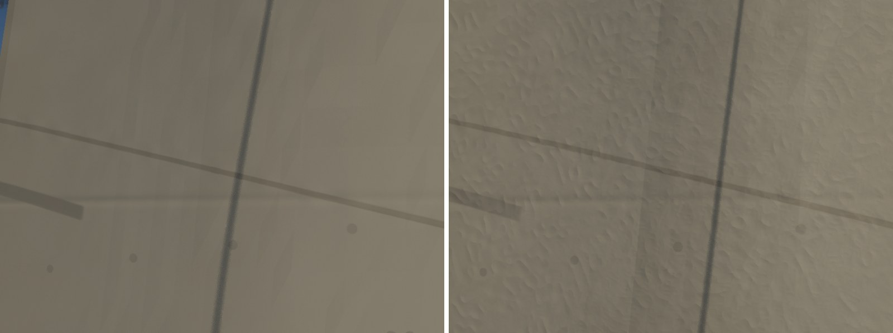
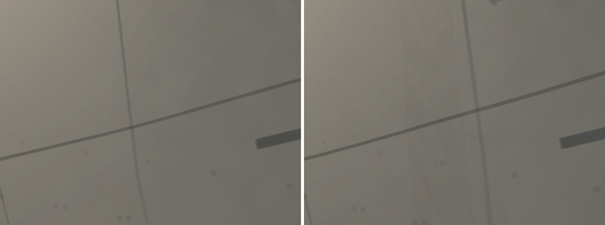
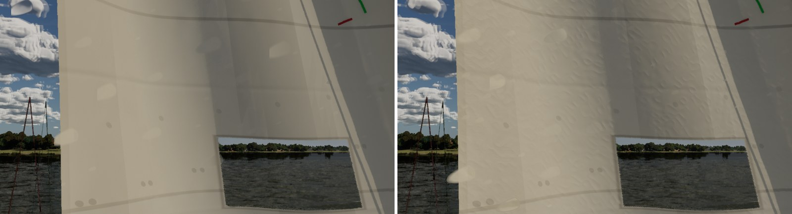

# Sail cloth shading (Ultra audit #5, the shading half)

The Ultra audit (`docs/ultra-audit-1024/`) found the sails reading as smooth plastic sheets close up: no crinkle, no
weave, and #308's cloth wrinkles visible only as silhouette and not as shading. #308 put the wrinkles in the geometry.
This pass shades the cloth in `M_SailCloth` (`SAIL_CODE` in `scripts/make_materials.py`). `FSailCloth` is unchanged.

Everything here is under `Detail` (the pawn sets 1 on High and Ultra), so Medium and Low draw what they did.

## What changed

- **Crinkle.** Used Dacron's resin breaks in fine creases. Two octaves of ridged value noise (3 cm and 1.2 cm cells)
  go into the normal as slopes, about 5 deg at a crease line, more with `Age`/`Care`. Each octave is turned off the
  cloth's axes (34 and 75 deg) and bent by a slow warp. Without that, the cells' ridges read as a grid maze. An octave fades out where its crease would fall under about two pixels, so nothing
  crawls at range. A crease line is a little rougher (+0.08): the broken resin is duller.
- **Weave.** A 0.6 mm plain weave in the normal, only where a pixel covers under 0.3 mm (the cloth at arm's length).
- **Wrinkle shading.** The surface curvature the material already measures for the belly (`kc`) now also shades
  #308's wrinkles. Their curvature runs to tens per metre, against the belly's under one. Past 2 /m a valley darkens
  by up to 25%, because it sees less sky, and a ridge lightens by 6%. The belly's own `hollow` term is unchanged. Like
  `hollow`, it is screen-derivative based, so ray-traced hits skip it.
- The scrim (`Layout` 4) and the window keep their own looks; the crinkle skips laminate layouts.

## Look (Ultra, 1920x1080; main on the left, this branch on the right)

| View | Sheet |
| --- | --- |
| Main, windward side, 1.6 m |  |
| Main, lee side, 1.6 m |  |
| Jib, 1.4 m |  |

The cloth's shape differs a little between runs, because the cloth simulation isn't deterministic from launch.

## GPU ms (`gpu.total_ms`; base pass, Lumen), Bean's RTX 4090, 1920x1080

Mean of two 20 s runs each.

| View | Tier | Main | This branch |
| --- | --- | --- | --- |
| Main close (sail fills the frame) | High | 5.08 (2.31, 0.65) | 5.12 (2.31, 0.67) |
| | Ultra | 7.46 (2.83, 0.80) | 7.43 (2.84, 0.80) |
| Sails, 9 m | High | 5.04 (2.18, 0.60) | 5.11 (2.23, 0.63) |
| | Ultra | 7.66 (2.67, 0.64) | 7.72 (2.70, 0.64) |

The difference is within the 4090's run-to-run noise (about 0.05 to 0.1 ms here). The per-pixel work is about forty ALU
operations and no texture reads, and it is skipped past two pixels per crease. The Mac's High is the real measure, so
this branch belongs in the boats gate.

## Measuring

`-SailingNoSailDetail` turns off all of `Detail`, not only this pass. The table swaps main's `M_SailCloth.uasset` in
place of this branch's on the same build.
