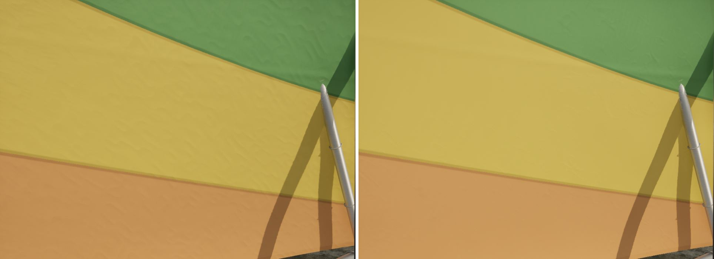
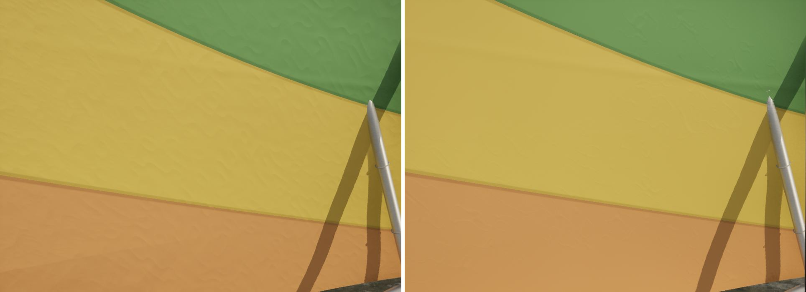
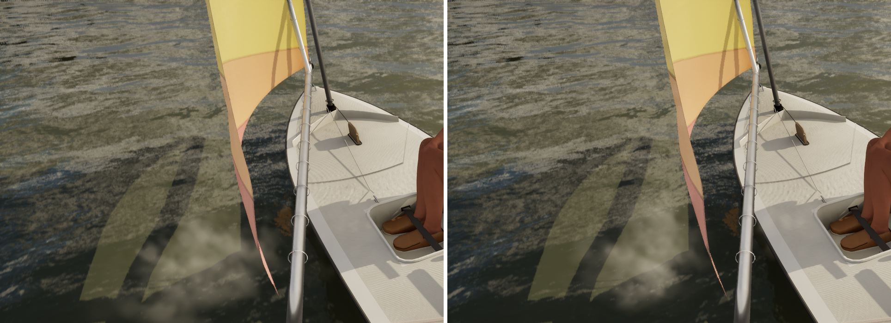
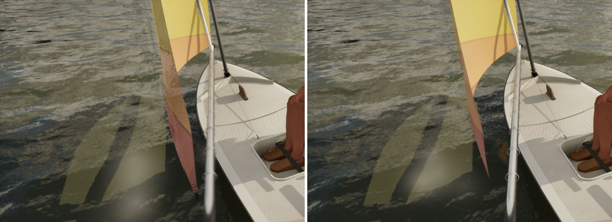
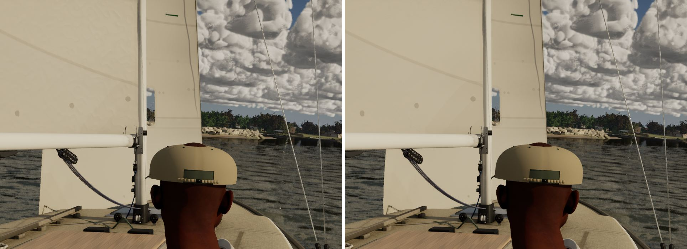
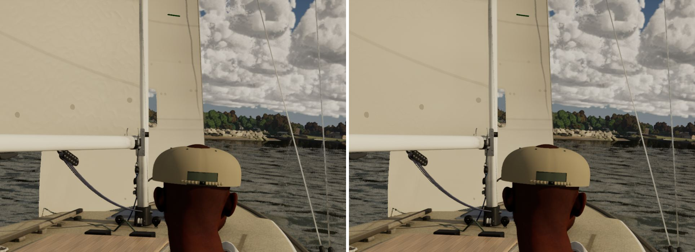
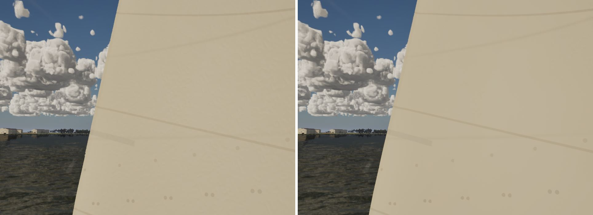
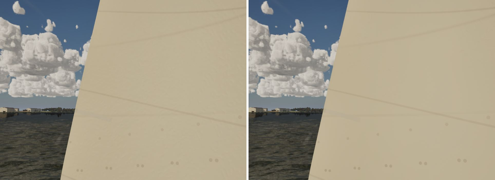
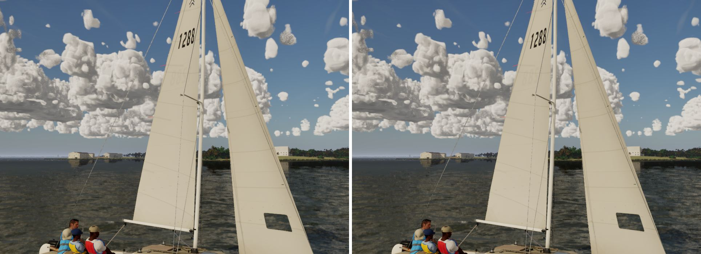
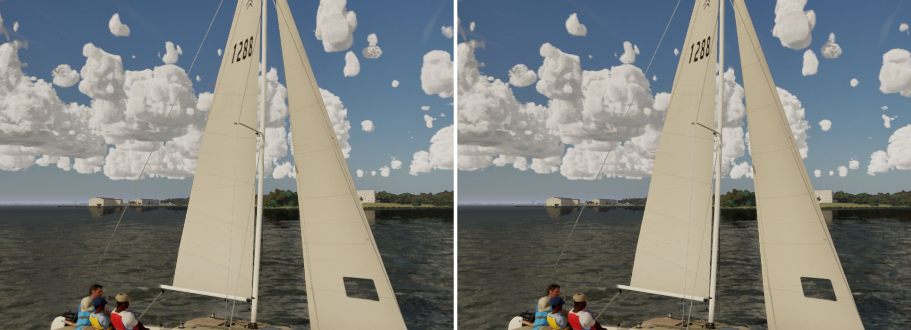

# Sail crinkle: creases in patches, not all over (Nov 7 2026)

Bean, from the Sunfish's helm: the sail reads as crumpled paper (`docs/boats/close-up/notes.md` item 3). The cause was
the crinkle in `M_SailCloth` (`SAIL_CODE` in `scripts/make_materials.py`, under `Detail`, so High and Ultra only).
It was a ridged value noise: a tent in every 3 cm and 1.2 cm cell. Every cell was a dent, so the whole sail looked
hammered.

The material is shared by every sail in the fleet, so this changes every boat, not only the Sunfish. I looked at the
Sunfish (helm and cockpit views) and the J/22 (helm, main at 1.6 m, both sails at 9 m). The other boats get the same
code.

## What changed

- **Patches.** A slow value noise in 40 cm cells over a threshold that follows the sail's age (`thC = 0.78 - 0.40 ageC`,
  edge +/-0.12). The creases cover about a fifth of a cared-for new sail, a third at the default age and two thirds
  of an old sail. Between the patches the cloth is smooth.
- **Fold lines.** Inside a patch, the creases are the 0.5 contours of the same two octaves as before (3 and 1.2 cm, turned off the
  cloth's axes and warped). Each is drawn as a narrow Gaussian fold, `exp(-x^2/wd^2)`, with `wd = 0.045` in noise
  units, and flat cloth between the folds. The fold's slope is set directly by `sAmp`, not by how steep the noise happens
  to be.
- **Tuning (PC, round 2).** The first push (`sAmp 0.11`, `wd 0.06`) fixed the paper look, but a patch on the Sunfish's
  green panel still read as embossed. Round 2 uses `sAmp 0.08` (a fold's peak slope is 3.9 deg at the default age and
  6 deg on an old sail) and `wd 0.045`, a sharper line.
- **Unchanged.** The weave, the wrinkle shading and the distance fade are as before. An octave fades out once its fold
  falls under about two pixels. Depth is in cm, so the 3 cm octave is gone by about 5 m and the 1.2 cm octave by about
  2 m. From 5 to 10 m there is no crinkle left to crawl. The 9 m stills show none, before or after.

## Look (1920x1080, uncooked; main on the left, this branch on the right; crops at full resolution)

The Sunfish and J/22 helm and cockpit views are `Artifacts/boats-closeup/stills.ps1`'s: 15:00, 10 kn, TWA 60. The
J/22 main and sails are `docs/sail-cloth-shading`'s: 15:00, 12 kn, TWA 70, crew still. The cloth's shape varies a little
from run to run.

| Boat, view | Ultra | High |
| --- | --- | --- |
| Sunfish, helm-eye |  |  |
| Sunfish, cockpit chase |  |  |
| J/22, helm-eye |  |  |
| J/22, main at 1.6 m |  |  |
| J/22, sails at 9 m |  |  |

What the stills show:

- **Sunfish helm.** Main crinkles all over, like crumpled paper. This branch is smooth Dacron, with faint crease
  patches on the green and orange panels.
- **Sunfish cockpit.** Both are smooth at this size; the change hardly shows.
- **J/22 helm.** Main's sail looks lumpy and hammered. This branch's is smooth.
- **J/22 main at 1.6 m.** Main has an even fine crinkle. This branch is smooth, with a few faint crease patches,
  which read as creases, not stains.
- **J/22 sails at 9 m.** No crinkle in either (faded by distance). This branch's jib is slightly cleaner.

## GPU cost (Sunfish helm-eye, Ultra, 1920x1080, Bean's RTX 4090; `gpu.total_ms`, base pass, Lumen)

| State | Run 1 | Run 2 | Mean |
| --- | --- | --- | --- |
| main | 7.64 (2.92, 0.76) | 7.40 (2.81, 0.77) | 7.52 |
| first push (sAmp 0.11, wd 0.06) | 7.38 (2.80, 0.76) | 7.58 (3.02, 0.77) | 7.48 |
| this branch (sAmp 0.08, wd 0.045) | 7.37 (3.11, 0.76) | 7.43 (2.85, 0.77) | 7.40 |

All three are within the run-to-run noise. The patch noise adds four hashes and a smoothstep. The fold costs one `exp`
in place of the ridged `abs`. Cloth outside a patch (`cover == 0`) skips both octaves.

## Tests

`scripts\windows\test.ps1 SailingSim.Visual`: 73 passed, 0 failed.
