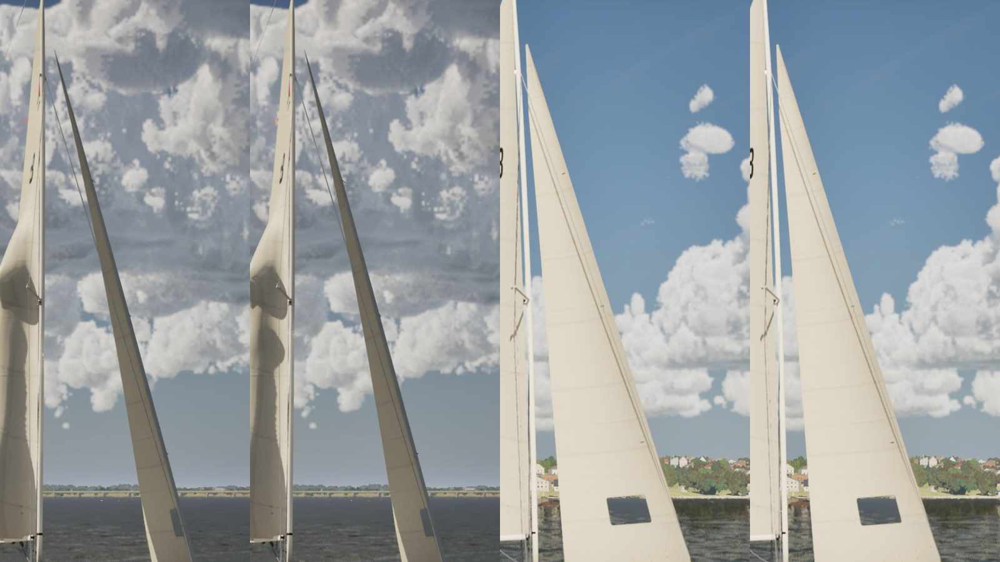
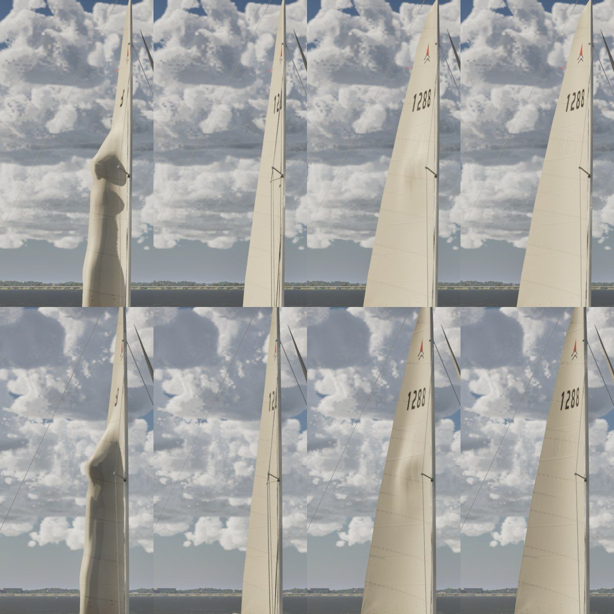
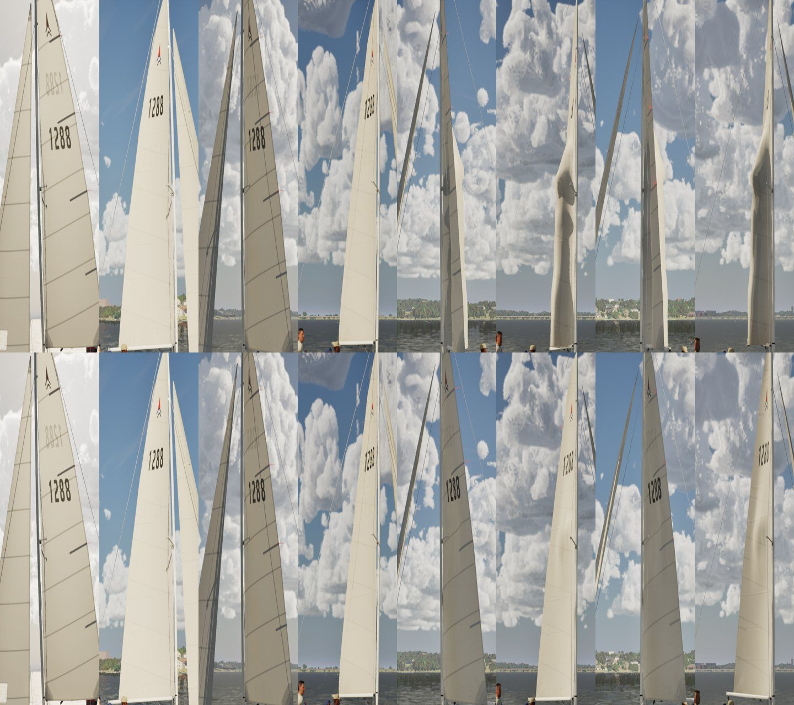
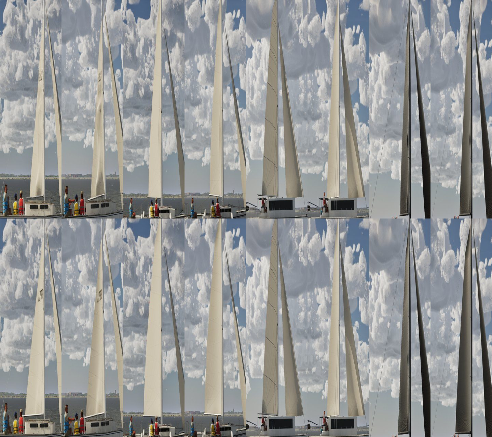

# The dent in the main (Oct 27 2026)

Bean's playtest: "The mainsail on the J22 (and maybe other boats) now has an odd indentation that is very prominent and
does not match how sails fill with wind, and it does not change depending on the wind direction."

## What it was

J/22 stills in 12 kn at TWA 45, 90, 135 and 158 on both tacks, chase and helm eye. The comparison is main against main
with #352's `SailCloth.cpp` reverted (7a37028f's).

- **Close-hauled and reaching (TWA 45 and 90):** the main is clean in both builds.
- **Broad reach and run (TWA 135 and 158):** the eased main has a deep, dark trough at the spreader's height. It is the
  same in both builds, so #352's spreader dent didn't bring it.

The trough is the older shroud dent in `FSailCloth::KeepClear`. Running, the physics boom is eased to 72–80 deg, past
the shroud. The cloth's target turned the whole main off the wires by at most 0.2 rad (11 deg, "a sheet's few degrees")
and left the rest to the dent. The dent turns a band of cloth 15 cm wide, fading over 45 cm, by up to 0.6 rad (34 deg)
where it passes the shroud.

That folds a trough into the sail at mid-height. A real main eased onto its rig doesn't do that: the boom stops at the
shroud and the sail lies against the shroud and spreader, with at most a crease.

The dent showed only from 135 deg on, so it does move with the point of sail. But a player who eases the main fully at
any wind angle sends the boom past the shroud, which is probably what Bean saw.

## Variants (TWA 135 top row, 158 bottom row; port tack, chase)

1. Main.
2. The dent off.
3. The turn's limit at 0.6 rad.
4. Both.

## The change

`kMainTurnMax` goes from 0.2 to 0.6 rad. The main turns as one, as far as its wires need, like a boom stopped at the
shroud. The dent is kept for what is left: a twisted head on the upper shroud, or the belly on the spreader.

- **Close-hauled and reaching** nothing touches a wire, so nothing changes.
- **Running** the sail lies flat on the rig, with a faint crease where it is pressed on the spreader.
- **The physics strips are untouched,** so no polar can move. The boom is drawn turned with the sail (`GetFootTurn`), as
  before.

## J/22, main (top) against this branch (bottom)

TWA 45, 90, 135 and 158, each on starboard then port.

## The other boats with spreaders

TWA 135 and 158 on port tack, main (top) against this branch (bottom): Catalina, Corsair 880, Lagoon 42, Maxi 100. The
Catalina had the same crease. The others showed little and are unchanged or smoother.

## Tests

`SailingSim.Visual.SailDent` builds a J/22-like rig and drives the main's target shape:
- **Boom 10 deg (TWA 45) and 35 deg (TWA 90):** within 0.00 cm of the undented shape (the test allows 1 cm).
- **Boom 80 deg (TWA 158):** turned and dented only on the sail's own, leeward side.
- **The other gybe:** the same dent, mirrored within 0.00 cm.

`SailingSim.Visual.RigClearance` still fails a wire through the main, and finds none.

Also in this PR: `SailingSim.Coast.GalvestonSwell`'s mask-build wall-clock check is now under 2 s instead of 0.5 s. It
failed once on the PC under load (326 ms alone), and a few hundred ms per extra march is still caught.
