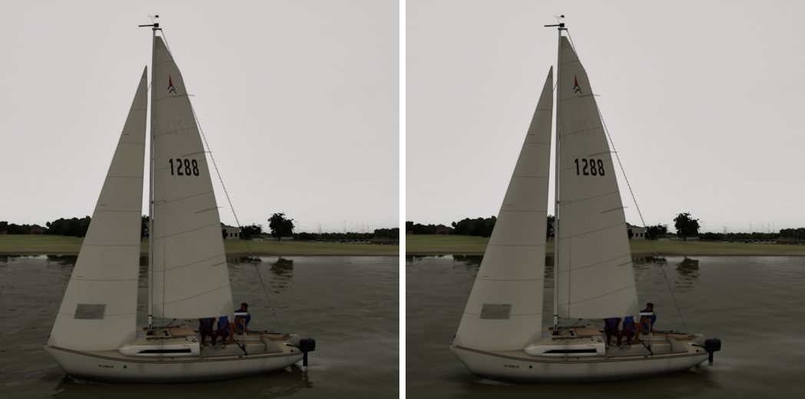
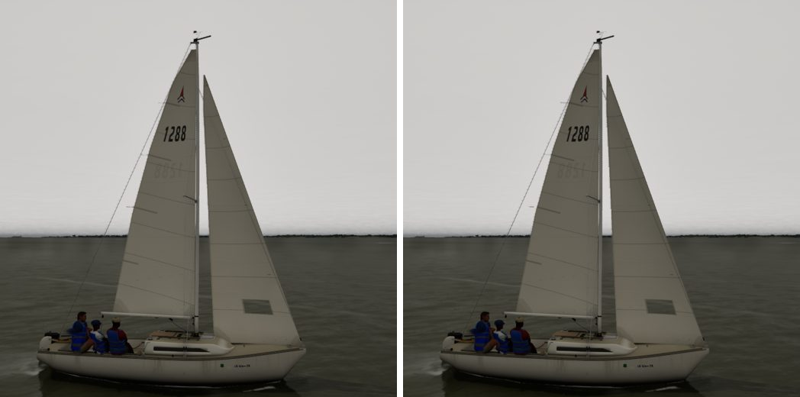
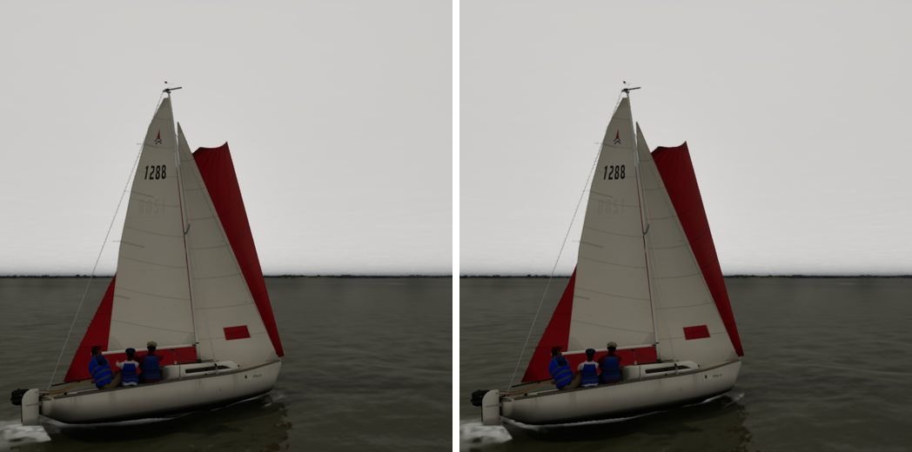
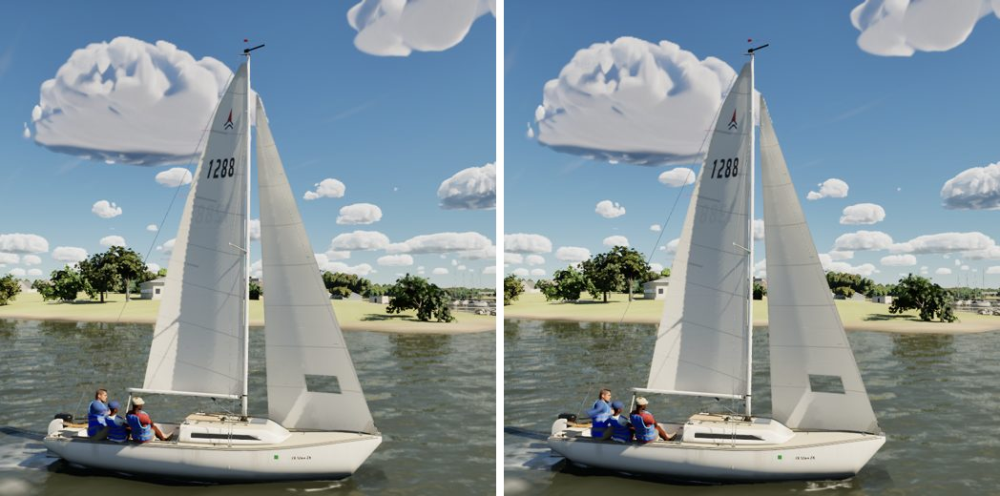

# Sail draft in flat light (realism audit 1023, item 6)

Under an overcast, the belly and twist of a white sail and the curve of a spinnaker read as nearly even tone. This
change is in `M_SailCloth`'s shading only (`SAIL_CODE` in `scripts/make_materials.py`); `FSailCloth` and the physics
are untouched.

## Reference

I compared against five Wikimedia Commons photos of sails with no people close enough to recognise: a mainsail and a
jib close up, a sail seen from under its foot, a schooner's mainsail in fog, and a spinnaker under an overcast. They are
CC BY 2.0 and BY-SA 2.0, 3.0 and 4.0, kept local and uncommitted in `Data/Reference/raw/sails` with `credits.json`.

In flat light, the shape on a white sail is a gentle gradient, not shading:

- darker through the hollow of the belly seen from windward;
- darker where the cloth turns away from the eye, at the leech and in the twist aloft;
- lighter where it tilts up toward the bright zenith.

## Change

| Term | Before | After |
| --- | --- | --- |
| Turning away from the eye | down to 0.74 at a grazing look | down to 0.64 |
| The sky's shape | none | x 0.78 (tilted down to the water) to 1.04 (tilted up to the zenith): an overcast is about three times brighter overhead than at the horizon |
| The hollow | none | up to 16% darker mid-chord on the belly's hollow side |

The hollow is how much sky the sail hides from itself: about an eighth at the deepest point of a 3 m-radius belly on a
2.5 m chord. Its curvature comes from the change of the cloth's normal on screen, so the term follows the cloth as it
moves. It is off in ray-tracing hit shaders, which have no screen derivatives.

Sampled across the J/22's mainsail in the overcast view from windward, the tone ran 92 to 100 (8-bit) before. It now
dips through the belly and falls toward the luff. The lee view's leech is about 7 levels darker than its middle.

## Cost

GPU total in a close sail view (1920x1080, the sum of the bench's GPU slices):

| Tier | Before | After |
| --- | --- | --- |
| Medium | 11.42 ms | 11.77 ms |
| High | 13.98 ms | 13.77 ms |
| Ultra | 20.10 ms | 20.18 ms |

The differences are within run-to-run noise.

## Stills (Ultra, uncooked; before | after)

