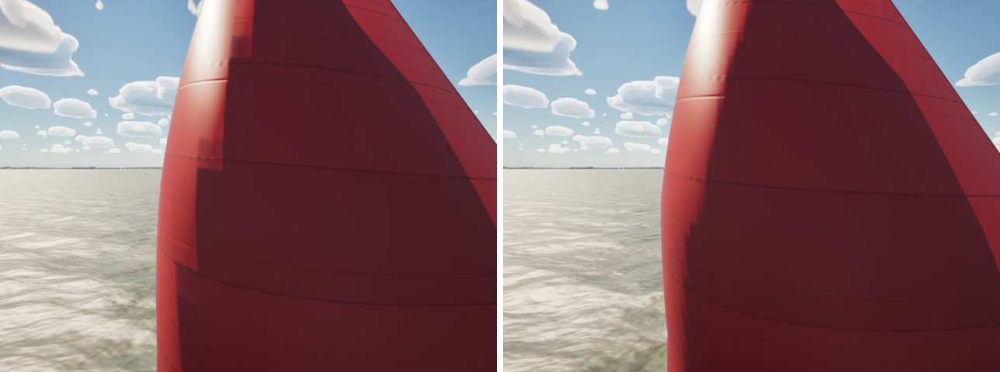

# Sail shadows without steps

The PC (`docs/spin-colour/`, #264) found the spinnaker's shadow edge stair-stepped along the cloth's grid, from the main
and from the kite's own far half. A sharper shadow LOD and less translucency both left it.

## Cause

Every sail's cloth is a 25 × 16 grid (`FSailCloth::Rows`, `Cols`), about 30 cm a cell on a J/22's spinnaker. Each cell
is drawn as a flat facet with smooth normals. `M_SailCloth` is masked two-sided foliage on the opaque path, so its
shadows are the virtual shadow map's, and a shadow grazing the curved sail fell on whole facets: an edge in steps along
the grid. No shadow resolution changes that: it is the shadow-terminator problem of a faceted surface.

## Fix

The sails are now drawn on a grid three times finer than the cloth's (`SailVisuals.cpp`: `RefineSail`, 73 × 46
vertices):
- **Positions** between the cloth's points are Catmull-Rom, so the surface curves between them. Bilinear points would
  stay on the old facets.
- **Normals, tangents and UVs** are bilinear.
- **The winding** is `FSailCloth::Triangles`' (its front face to starboard, which `M_SailCloth`'s sail-number placement
  relies on).
- **Unchanged:** the cloth's simulation, its telltales and its clew stay on the cloth's own grid.
- **`-SailingClassicSailGrid`** draws the old grid, to compare.

`SailingSim.Visual.RigClearance` and `SheetClearance` read the drawn sail's triangles, so they now check the refined
surface. They pass.

## Stills

The kite from ahead to leeward in 14 kn at TWA 150, noon. The old grid is on the left, the new one on the right. Close
up, the old shadow edge breaks into blocks the size of cloth cells; the new one follows the curve:

## Gate

`--scope boats`: pass, 229/229 tests. beam8 62.2, beat15 60.4, marina 60.1, helm-eye 60.1, slip 53.1, crew 53.6, in line
with recent gates.
