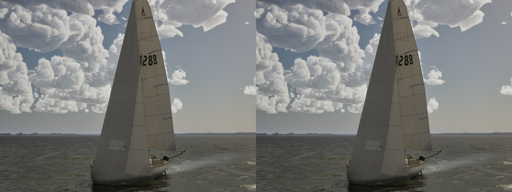
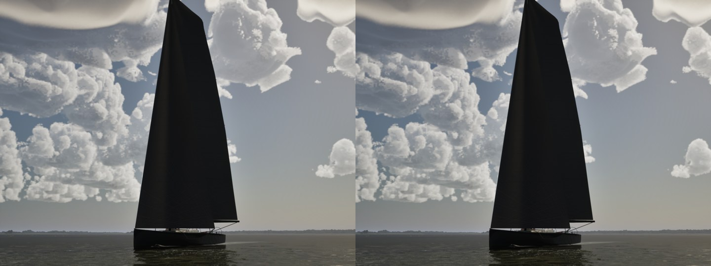

# The main over the spreaders on a run (Oct 27 2026)

`docs/mac-next/` candidate 1. Running, the spreaders stood through the main. `SailingSim.Visual.RigClearance` listed the
crossing on four boats without failing:

| Boat | Samples | Point of sail, boom angle |
|---|---|---|
| J/22 | 8 | TWA 159, boom 80 deg |
| Catalina 30 | 8 | TWA 158, boom 76 deg |
| Corsair 880 | 8 | TWA 158, boom 75 deg |
| Maxi 100 | 8 | TWA 159, boom 72 deg |

A real main eased square lies on its spreaders and takes a crease from them, which is where sailmakers sew chafe patches.

## Why

`FSailCloth::KeepClear` already keeps the main's target shape clear of the rig in two ways:
- It turns the whole sail off the wires, like a boom stopped at the shroud, by at most 11 deg.
- It dents each row round a shroud where the row passes the shroud's height.

The dents skipped the spreaders. They are level bars, and the turn was meant to keep them clear. On a run the main needs
far more than 11 deg to clear a spreader's tip, so the belly stayed on the far side of the bar.

## The change

The main's target gets a spreader dent as well, in the same form as the shroud dent:
- Each row near a spreader's height is turned back onto the clew's side of every point along the bar, by just as much
  as it needs.
- The dent is full within 0.75 rows of the bar and fades over 1.25 more rows above and below.
- Along the row it is full within 15 cm of the bar point's radius from the luff and fades over 45 cm.

So the cloth lies over the bar with a crease running up and down the sail from it. The cloth follows the target, as it
does for the shroud dents. Denting the cloth itself kinked it before.

The physics strips are untouched, so no polar can move. The boom's drawn turn (`GetFootTurn`) is unchanged.

`SailingSim.Visual.RigClearance` now fails a wire through the main's cloth away from the mast (column 2 and aft, below the
headboard rows). Before, only the jib's cloth failed. Today: **0 kinds of clip** over 106,886 line points. The maxi's
lazy-sheet sample from #350's first gate is gone too, since `HoldForTests` sails with ideal hands.

## Stills

The chase camera from 25 deg off the bow on the main's side, TWA 158 in 14 kn, High. Main is on the left, this branch
on the right. At this distance the change is a crease at the spreader's height; RigClearance's count is the measure.

## Cost

The dent's work per frame is each spreader times the rows near it, 6 points along the bar and 16 columns: a few thousand
small rotations. The gate's bench has the cloth CPU per view (`cloth_cpu_ms`), against today's sweep on main.
